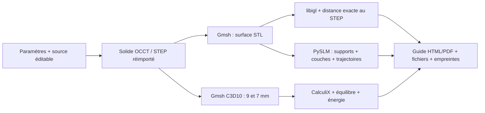
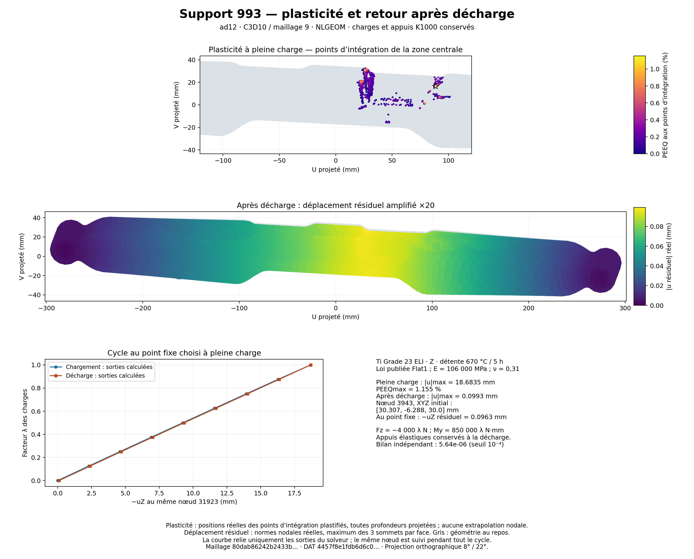
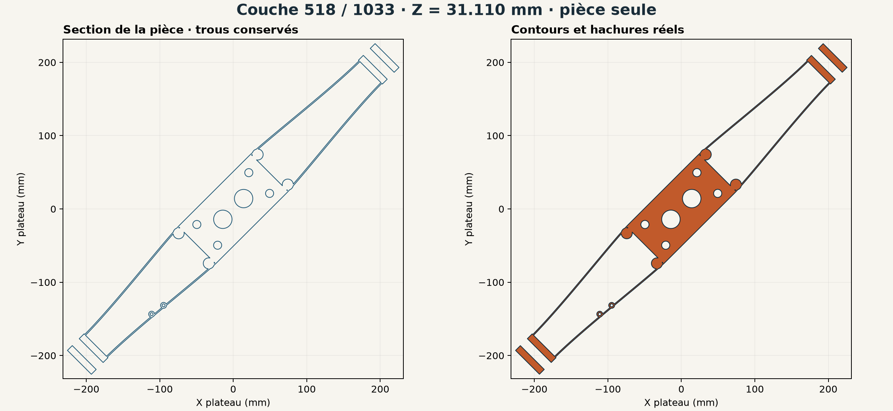
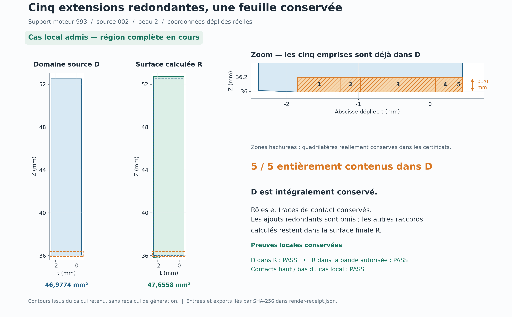
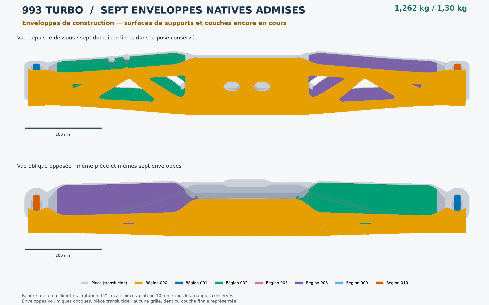

# Support moteur 993 Turbo — géométrie renforcée et chaîne reproductible, 16 octobre 2026

La reprise utilise le plafond de **1,30 kg** autorisé par Maxime. Le candidat
`bounded-webs` pèse **1,262213 kg** au volume CAO et à la densité déclarée de
4 420 kg/m³. Il conserve les fixations de V6f, corrige sa représentation
triangulée et améliore les quatre comparaisons mécaniques retenues.

La [procédure illustrée](../manufacturing/PART_WORKFLOW.md) décrit les logiciels,
leur installation, la commande de reproduction et la remise à l'atelier. La
[source éditable](../../parts/993-eng-carrier-0001/source/design-20261016/README.md)
et la [recette initiale](../../manufacturing/workflows/993-carrier.json) sont
dans le dépôt. Le passage `work/part-workflow/run-001` a exécuté ses douze
étapes de géométrie, surface, calcul et dessin. Sa préparation LPBF a été
interrompue et refusée après identification d'une région de support omise et
d'une seconde erreur de correspondance des sommets. Ses **526 couches sur
1 034** sont conservées et intègres ; il n'a aucun reçu de tranchage complet
ni guide final. La correction et le renforcement local ont des versions
séparées, sans modifier ce témoin.

## Une géométrie, plusieurs preuves liées

La recette initiale contient quinze étapes et **45 entrées épinglées**.
La [recette intégrée v6](../../manufacturing/workflows/993-carrier-lpbf-v6.json)
conserve ses douze premières étapes et ses 45 entrées, puis porte la chaîne à
**37 étapes et 293 entrées versionnées épinglées**. La
[revue des contrats et de leurs dépendances](../../parts/993-eng-carrier-0001/source/process-skins-20261016/cold-v6-recipe-evidence/assessment.json)
a passé : dix commandes modifiées sont parsées, 27 contrats identiques sont
vérifiés et réutilisés, et les 293 empreintes sont revérifiées. Elle
ne représente pas une exécution complète de la recette. Les versions
précédentes et leurs reçus restent conservés.
Le [lanceur v2](../../scripts/run_part_workflow_v2.py) autorise jusqu’à
14 400 s par étape ; les sept générations et les deux assemblages de supports
utilisent cette borne. Les producteurs v7 réemploient les aires rationnelles
déjà calculées. Le [préparateur v6](../../parts/993-eng-carrier-0001/source/process-skins-20261016/README_parallel_exact_admissions.md)
relit les unités dans quatre processus et lie leurs résultats aux six admissions.
Le guide v6 vérifie les liaisons de ces reçus, sans importer le moteur AM dans
le runtime PDF ni annoncer un nouveau calcul géométrique depuis le PDF.
Le dossier garde les commandes, journaux, identités des
sources et sorties. Le support, la figure de contrainte et les trajectoires
doivent désigner la même géométrie ; le générateur refuse de les mélanger.

| Étape | Logiciel épinglé et licence connue | Utilisation réelle et preuve |
| --- | --- | --- |
| CAO paramétrique | build123d 0.11.1 — Apache-2.0 ; OCCT/OCP 7.9.3.1 — licence du noyau non consignée | [Solide éditable et protections](../../parts/993-eng-carrier-0001/source/design-20261016/README.md), [installation figée](../../parts/993-eng-carrier-0001/source/design-20261016/cad-base-standalone-validation.json). Reçu local de volume et réimport STEP : `work/part-workflow/run-001/cad/geometry.json`. |
| Réparation et booléens | PyMesh 0.3 — MPL, version de licence inconnue ; CGAL embarqué — version et commit C++ non exposés, licences distinctes | Nettoyage natif exécuté et CSGTree des enveloppes : [essais refusés conservés](../../parts/993-eng-carrier-0001/source/remesh-20261016/results.json), [voie CSGTree et reproduction native](../../parts/993-eng-carrier-0001/source/native-pymesh-20261016/README.md). |
| Maillage | Gmsh 4.15.2 — GPL-2.0-or-later | Retriangulation de la CAO et tétraèdres quadratiques C3D10 : [surface retenue et essais antérieurs](../../parts/993-eng-carrier-0001/source/remesh-20261016/README.md), [reçus historiques](../../parts/993-eng-carrier-0001/source/remesh-20261016/results.json). Reçu local actuel : `work/part-workflow/run-001/surface/meshing.json`. |
| Contrôle des triangles | libigl 2.6.3 — MPL-2.0 ; classifieur rationnel du dépôt | Détection d'intersections et distances, puis distinction indépendante des contacts adjacents : [runtime](../../parts/993-eng-carrier-0001/source/remesh-20261016/results.json), [adjudication](../../parts/993-eng-carrier-0001/source/design-20261016/exact-contact-diagnostic.json). |
| Contrôle des parois | PicoGK 2.3.0 — Apache-2.0 ; OpenVDB embarqué, version/licence non consignées ici | Mesures natives d'épaisseur et de cavités exécutées : [reçus](../../parts/993-eng-carrier-0001/source/remesh-20261016/results.json). La reconstruction SDF du carrier retenu reste une piste étudiée. |
| Mécanique | CalculiX 2.21, paquet 2.21-1 — GPL-2.0 | Six cas élastiques, puis loi publiée, grands déplacements et décharge : [résultats constitutifs](../../parts/993-eng-carrier-0001/source/design-20261016/constitutive-results.json), [liaison au problème discret actuel](../../parts/993-eng-carrier-0001/source/design-20261016/constitutive-binding-result.json). Exécution locale : `work/part-workflow/run-001/cad/simulation-runtime.json`. |
| Préparation LPBF | PySLM 0.6.1, commit `8fa03f1` — LGPL-2.1 | Contours et hachures de pièce : [1 034 couches et audit complet de ces seuls vecteurs](../../parts/993-eng-carrier-0001/source/process-cache-20261016/results.json). Supports en correction ; [sources et correctifs épinglés](../../parts/993-eng-carrier-0001/source/process-20261016/upstream.json). |
| Topologie des supports | CGAL 6.1.3 séparé, commit `109ed62` — GPL-3.0-or-later ou commercial ; noyau LGPL-3.0-or-later ou commercial | Autoraffinement, snap, contrôles et dominance polygonale ; distinct du CGAL embarqué de CSGTree. [Reproduction native](../../parts/993-eng-carrier-0001/source/native-cgal-20261016/reproduction-results.json), [composants et licences](../../parts/993-eng-carrier-0001/source/native-toolchain-20261016/README.md). Les sept enveloppes sont admises ; les surfaces des supports restent en cours. |
| Étude du procédé | MOOSE, commit `167ee97` — LGPL-2.1 | Témoins thermoplastiques et import du maillage exécutés ; aucune prédiction thermique du carrier : [sources et reçus](../../parts/993-eng-carrier-0001/source/process-20261016/moose/upstream.json). |
| Étude du procédé | Adamantine, commit `3990489` — Apache-2.0 WITH LLVM-exception | [Témoins logiciels exécutés](LPBF_NATIVE_VERIFICATION_20261015.md), [source épinglée](../../benchmarks/lpbf-adamantine-export/upstream.json). Sur ce carrier, zéro pas thermique et zéro résolution mécanique : `work/carrier-process-20261016/adamantine-occupation-001/runtime-capabilities.json`. |
| Figures et dossier | Matplotlib 3.11.2 dans le [runtime PySLM corrigé](../../parts/993-eng-carrier-0001/source/process-coverage-20261016/requirements-macos-arm64-python311.lock.txt) ; ReportLab 4.4.9 dans la [base PDF autonome](../../manufacturing/runtimes/pdf/requirements-macos-arm64-python312.lock.txt) | [Cycle mécanique contrôlé](../../parts/993-eng-carrier-0001/source/design-20261016/constitutive-evidence/luo-flat1-cycle.json) et figure locale `work/part-workflow/run-001/fields/combined.json`. Guide témoin actuel : `work/part-workflow/review-004/guide-atelier.pdf`, produit par le [générateur versionné](../../scripts/build_carrier_workshop_guide_v2.py). Le dossier final attend l'admission des supports. |
| Essai de dessin supplémentaire | Draftwright 0.5.0.dev0, commit `f1a5db9` — AGPL-3.0 | [Deux essais bornés conservés](../../parts/993-eng-carrier-0001/source/draftwright-evaluation-20261017/README.md) : CLI automatique puis feuille déclarative, chacun interrompu après 480 s sans dessin ni lint produit. Aucun ajout à la recette ou adoption ; les valeurs lues indépendamment du STEP ne valident aucune annotation. |
| Essai d'arithmétique exacte | gmpy2 2.3.2 — LGPL-3.0-or-later | [110 égalités exactes et mesures scalaires](../../parts/993-eng-carrier-0001/source/gmp-area-evaluation-20261017/README.md). Gain local de 1,097× / 1,125× pour l'aire entière ; aucun gain de constructeur ou de région établi. Environnement séparé, sans adoption dans la recette. |
| Inventaires généraux | [Chaîne d'outils](../TOOLCHAIN.md) · [Sélection logicielle](../SOFTWARE_STACK.md) | Navigation et choix plus larges du projet ; les reçus ci-dessus établissent l'exécution propre à ce carrier. |

Les essais de treillis LEAP71 antérieurs restent disponibles dans leur
dossier historique ; ils dépassaient l'ancien plafond et ne fournissent pas
les champs mécaniques de cette nouvelle géométrie.

## Ce qui a changé dans la pièce

Le constructeur réduit les fenêtres avant découpe, porte les peaux à 1,5 mm,
conserve les nervures de 2,8 mm et ajoute deux manchons autour des petits
perçages secondaires. La paroi périphérique est obtenue par un décalage de
contour de 1,61 mm. Le solide est reconstruit avant les booléens ; les tentatives
de décalage et fusion de faces terminées qui ne survivaient pas au réimport
STEP restent refusées.

La borne de pente des courbes est `L = 2/15`. Pour deux graphes ainsi bornés,
séparés par une translation en Y de `w = 1,61 mm`, la distance est au moins
`w / sqrt(1 + L²) = 1,59588 mm`. La
[preuve enregistrée](../../parts/993-eng-carrier-0001/source/design-20261016/bounded-webs-wall-proof.json)
précise les points de contrôle et le domaine couvert. Il s'agit d'une borne
sur ces parois, pas d'une épaisseur minimale de toute face ou de tout chant.

Le contrôle BRep des régions protégées donne une différence symétrique nulle
pour la platine centrale et les six régions d'extrémité. Les quatre axes de
la platine, les deux axes des œillets, les passages d'outils et les jauges de
la paire F0 sont contrôlés séparément. Les cotes d'étude restent : entraxes
centraux **100 × 40 mm**, entraxe d'extrémités **560 mm**, platine **8 mm**,
alésages **Ø11 / Ø13,5 mm**, enveloppe **592 × 73 × 52 mm**.

## Correction des triangles et de la surface

Le nettoyage PyMesh exact a été exécuté : il ne supprimait ni les 74 triangles
effilés de V6f ni son écart de tessellation. Les essais de retessellation locale
ont été conservés avec leurs refus. La solution retenue reconstruit la surface
depuis le maître STEP avec Gmsh, puis contrôle les intersections avec libigl.

L'ancien STL de V6f s'écartait du STEP exact de **0,37097 mm** à un point
identifié, malgré une tolérance demandée de 0,06 mm. Le but n'était donc pas de
rester fidèle à cette erreur. Le STEP reste la référence des deux sens de
distance.

Pour le nouveau passage `run-001` :

| Contrôle | Résultat |
| --- | ---: |
| Triangles | 587 404 |
| Corps fermé orienté | 1 |
| Bords libres / non-manifold / dégénérescences / aiguilles | 0 / 0 / 0 / 0 |
| Paires en auto-intersection | 0 |
| STL → surfaces exactes STEP, maximum sur 3 072 points | 0,018988 mm |
| STEP → STL, maximum sur 8 313 points | 0,047388 mm |
| Seuil dans les deux sens | 0,06 mm |

Ces distances sont échantillonnées. La version précédente du remaillage était
refusée à 0,07447 mm sur un petit rayon de 0,5 mm ; la taille minimale a été
réduite de 0,5 à 0,25 mm, sans changer le seuil.

Le contrôle exploratoire uniforme « tout rayon normal ≥ 1,5 mm » reste refusé
sur le candidat antérieur de même construction : 0,393 % de surface sous ce
seuil. Les deux témoins courts examinés au STEP rencontrent deux faces
adjacentes d'un biseau d'environ 51°. Leur longueur est divisée par deux
lorsque leur distance à l'arête est divisée par deux ; elle tend donc vers zéro
au bord. Cette mesure ne décrit pas une paire de parois opposées. La borne de
paroi ci-dessus et le refus du criblage uniforme sont conservés séparément.

## Comparaison mécanique relancée

Le même cas applique `Fz = −4 000 N` et `My = 850 000 N·mm`. Élasticité de
référence : `E = 107 000 MPa`, `ν = 0,31`. Les appuis souples distribuent un
total de `1 000 N/mm` par œil et par direction entre les nœuds de l'alésage.
Les surfaces, matériaux et appuis du candidat et de V6f sont comparés sous les
mêmes conventions.

La [recherche des appuis publiés](../../parts/993-eng-carrier-0001/source/design-20261016/boundary-condition-research.md)
confirme la référence Turbo proposée par JP Group, mais ne fournit pas sa loi
de raideur. Le M154 de Rennline publie une dureté 75 Shore A et exclut les
Turbo ; aucune conversion de cette valeur en ressort `K1000` n'a été faite.
`K1000` conserve donc son statut d'hypothèse numérique déclarée.

| Maillage / appuis | Déplacement candidat / V6f (mm) | Pic IP candidat / V6f (MPa) |
| --- | ---: | ---: |
| 9 mm / rigides | 2,7623 / 2,9902 | 700,76 / 740,86 |
| 7 mm / rigides | 2,7966 / 3,0390 | 617,72 / 800,63 |
| 9 mm / ressorts | 18,0778 / 18,7329 | 1 857,91 / 1 988,76 |
| 7 mm / ressorts | 18,2486 / 18,9290 | 1 676,55 / 2 082,84 |

Les quatre comparaisons respectent les
[critères déclarés](../../parts/993-eng-carrier-0001/source/design-20261016/normal-webs-selection-criteria.json).
Sur le maillage 7 mm rigide, le pic baisse de **22,85 %** et le déplacement
de **7,98 %**. Les six calculs conservent leur bilan énergétique indépendant ;
la décomposition gravité + tangage vérifie la superposition du cas combiné.

Cette décision est une amélioration relative à V6f. Les pics changent encore
entre les deux maillages ; ils ne sont pas présentés comme une contrainte
convergée. Le cas avec ressorts dépasse le seuil du diagnostic plastique et
fait l'objet de calculs séparés avec grandes déformations, loi publiée et
décharge. Ces résultats ne sont pas remplacés par la couleur verte d'une
comparaison relative.

### Plasticité, grandes déformations et décharge sur bounded-webs

Les [résultats constitutifs et reçus compacts](../../parts/993-eng-carrier-0001/source/design-20261016/constitutive-results.json)
proviennent du STEP `ad12b8e0…`, maillage 9, avec les mêmes charges et ressorts.
Le modèle parfaitement plastique à 900 MPa sert à isoler la redistribution.
Le second modèle emploie la courbe publique Flat1 Grade 23 ELI, choisie avant
le calcul, avec sa valeur publiée `E = 106 000 MPa`. Les hypothèses de Poisson
et d'isotropie sont conservées explicitement.

| Modèle | Déplacement maximal chargé (mm) | PEEQ maximale (%) | Volume plastique par quadrature (mm³) |
| --- | ---: | ---: | ---: |
| 900 MPa, petites déformations, pas 0,125 | 18,30092 | 1,68890 | 545,784 |
| 900 MPa, grandes déformations, pas 0,25 | 18,62026 | 1,35249 | 554,271 |
| Flat1, grandes déformations, pas 0,125 | 18,68349 | 1,15495 | 338,457 |

Le cycle Flat1 effectue huit incréments de charge puis huit de décharge. À
charge extérieure nulle, avec les mêmes ressorts encore en place, le résidu
maximal est **0,09926 mm** ; le maximum de von Mises résiduel est
**845,74 MPa**. La PEEQ reste dans le domaine pré-striction mesuré de la
courbe, limité à 4,698 %. Ce résultat est la réponse du modèle de sensibilité,
avec sa loi et ses appuis déclarés.

Le bilan indépendant reconstruit `F` depuis les déplacements quadratiques,
puis `P = det(F) σ F⁻ᵀ` depuis les contraintes de Cauchy. Il compare le travail
`∫ P : dF dV₀` et la variation d'énergie des ressorts au travail nodal extérieur.
Les seize sorties passent le seuil **10⁻⁴ rapporté au travail cumulé brut** ;
le pire écart est **5,64 × 10⁻⁶** et le déterminant minimal de `F` vaut 0,98639.
Le travail net du cycle est 477,264 N·mm. L'intégrale estimée de la courbe
plastique vaut 448,042 N·mm ; elle inclut l'écrouissage et n'est pas renommée
chaleur dissipée.

Deux refus sont conservés : le premier calcul 900 MPa à pas 0,25 échoue au
bilan indépendant à 0,11295 % pour un seuil de 0,1 %, puis son raffinement à
0,125 passe à 0,02919 %. Le coupon Flat1 comparé directement aux 248 points
échouait de 0,313 MPa ; la source officielle de CalculiX 2.21 a révélé son
rééchantillonnage interne à 200 points. Sa reproduction donne une erreur de
0,000381 MPa, sous la même tolérance de 0,01 MPa, sans modifier les données
publiées. Le diagnostic `ENER` Flat1 reste refusé sur les premiers incréments ;
le bilan Piola ci-dessus a son calcul et son verdict propres.

Cette figure provient des sorties retenues du modèle Grade 23 ELI. Le résidu
maximal réel est de 0,09926 mm ; la déformée est amplifiée vingt fois. Le
[reçu de la figure](../../parts/993-eng-carrier-0001/source/design-20261016/constitutive-evidence/luo-flat1-cycle.json)
conserve les empreintes du maillage et du DAT, le nœud suivi et les seize
sorties. Le refus distinct du diagnostic `ENER` reste celui indiqué ci-dessus.

## Préparation d'impression et calcul de construction

Le moteur natif [PySLM](https://github.com/drlukeparry/pyslm), sa révision,
son correctif et ses dépendances sont conservés dans la
[source de préparation](../../parts/993-eng-carrier-0001/source/process-20261016/README.md).
La pose reste à plat, tournée de 45° dans le plateau, sur une plaque de
500 × 500 mm avec un espace de support de 10 mm. La couche est de 60 µm.

Deux familles de machines ont été revérifiées sur les pages des constructeurs :
[Eplus3D EP-M650](https://www.eplus3d.com/products/ep-m650-metal-3d-printer/),
650 × 650 × 800 mm avec plaque, et
[BLT-S600 révisée](https://www.xa-blt.com/en/product/blt-s600/?category=8),
650 × 650 × 850 mm hors substrat. Les deux annoncent les alliages de titane ;
la plage publiée de l'EP-M650 inclut 60 µm. C'est une compatibilité d'enveloppe
déduite des spécifications, avec les
[faits et paramètres encore non attribués](../../parts/993-eng-carrier-0001/source/process-20261016/machine-options.json)
enregistrés séparément.

### Défauts natifs de support localisés

Le premier tranchage du candidat omettait une région projetée entière de
**6 191,323755 mm²**. Un sommet de la triangulation n'avait pas d'intersection
avec la pièce : le polygone simplifié débordait de **0,151449 mm²** sur la
projection exacte des triangles. Le correctif recoupe le domaine par cette
projection, conserve les trous, puis utilise Earcut et un raffinement
conforme par centroïdes. Sur la région témoin, la différence symétrique est
**1,26 × 10⁻¹⁴ mm²** et les **4 486 rayons sur 4 486** retrouvent la pièce.

Une autre étape native pouvait réordonner les sommets avant de réaffecter les
hauteurs Z. La nouvelle version garde la correspondance de projection et
refuse explicitement toute région omise. Les peaux périphériques complexes
ont leur propre contrôle ; leur absence ne se confond pas avec celle des
grilles internes. Ces admissions locales ne sont pas annoncées comme une
préparation complète du support tant que l'ensemble n'a pas passé les mêmes
contrôles.

Les supports sont des surfaces de grilles et de parois avec dents, assorties
de segments de trajectoire ; leur masse volumique n'est pas inventée depuis
une coque ouverte. Les sections de pièce doivent être fermées. Le programme
vérifie les segments finis et retire uniquement les doublons exactement
identiques. Le format machine, l'ordre d'exposition et les réglages laser
seront attribués au procédé retenu.

Le moteur thermomécanique a aussi été recherché et exécuté. Le témoin
[MOOSE](../../parts/993-eng-carrier-0001/source/process-20261016/moose/README.md)
active la matière sans contrainte, chauffe, plastifie, refroidit puis relâche
le même état. Il réussit 26 contrôles et conserve une déformation résiduelle
que le contre-exemple purement élastique ne produit pas. Il s'agit d'une barre
témoin du moteur de calcul. L'import du maillage courant conserve ses
159 121 nœuds et 85 315 TET10, avec des coordonnées à 2,84 × 10⁻¹⁴ mm près.
La hauteur médiane d'un élément, 2,389 mm, couvre **39,8 couches** ; ce maillage
mécanique ne résout pas l'activation de chaque couche de 60 µm.

Les données publiques de
[Luo et al., Ti-6Al-4V ELI](../../parts/993-eng-carrier-0001/source/process-20261016/material-luo-set1/README.md)
fournissent quatre courbes de sensibilité à température ambiante. Le premier
spécimen est choisi avant le calcul ; les trois autres décrivent la dispersion
de ce jeu. La conversion pré-striction, le traitement du bruit et le domaine
plastique sont traçables. Cet état Grade 23 ELI n'est pas assimilé au Grade 5
de l'hypothèse initiale.

## Vérification du logiciel

Les tests ciblés du lanceur, du guide, des champs, de la géométrie et du
remaillage réussissent : **31 tests**, dont deux tests libigl ignorés dans le
runtime CAD puis exécutés dans leur runtime Linux (**10 tests de remaillage
réussis**, aucun ignoré). Les **6 tests natifs PySLM** réussissent aussi, notamment
conservation d'un trou, refus d'une section ouverte, identité d'entrée, dents
et élimination exacte des doublons.

Le `make check` général a été exécuté : **4 023 tests, 2 échecs, 27 erreurs,
262 ignorés**. Les deux échecs de comparaison flottante WE43/stator et les
erreurs SciPy PROPACK / Python 3.10 sont les mêmes que sur la base de reprise.
Ils sont conservés dans le journal ; la suite générale n'est pas annoncée
verte. Les sources et études sans rapport avec ce support restent inchangées.

Un second passage avec Python 3.11/PySLM a exécuté **4 067 tests** : les deux
comparaisons flottantes échouent encore ; un ancien cas 917 exige NumPy 2
alors que PySLM impose 1.26.4. Ce passage a aussi détecté un champ manquant
dans le nouveau témoin de décharge, corrigé sans relâcher la validation du
modèle. Les **10 tests constitutifs actuels** passent ensuite sous Python
3.11/NumPy 1.26 et sous la base CAD autonome/NumPy 2.2. Les journaux des deux
passages et de la correction sont conservés. Les environnements restent
séparés pour ces contraintes réelles de dépendances.

Le [passage général après gel de la recette v6](../../parts/993-eng-carrier-0001/source/process-scanpath-audit-20261016/repository-checks-005.json)
exécute **4 414 tests en 439,744 s** dans l’environnement PySLM corrigé :
quatre échecs, une erreur et 177 tests ignorés. Les cinq identités d’échec
sont exactement celles du passage classé précédent : deux comparaisons
flottantes, un ancien test 917 exigeant `np.trapezoid` et deux tests du
préparateur historique rejetés par l’empreinte du runtime corrigé. Aucun
nouvel échec n’est identifié ; `make check` reste refusé et n’exécute pas les
cibles dépendant de la réussite de ces tests. Le reçu conserve la comparaison
au [passage antérieur à 4 375 tests](../../parts/993-eng-carrier-0001/source/process-scanpath-audit-20261016/repository-checks-004.json),
avec 39 tests supplémentaires et les mêmes cinq identités d’échec. Les bilans
antérieurs restent conservés, y compris le premier lancement avec le mauvais
interpréteur et sa correction.

Les **34 tests ciblés des guides v4/v3/v2 et du générateur générique** passent.
Les dix tests propres au guide v4 passent aussi par découverte dans la base
PDF réinstallée et dans le runtime PySLM corrigé. Le rattachement réel à
`run-001` est revérifié en lecture de JSON et d’empreintes : même maillage 9,
même jeu linéaire K1000 et seize états conservés. Aucun DAT ni solveur n’est
rejoué par ces contrôles ; ils ne produisent pas le guide final.

## Renforcement local : gain de raideur, refus du pic

La version `contour-2`, à **1,292876 kg**, élargit progressivement les nervures
sans changer leur ligne centrale ni leur hauteur. STEP, régions protégées,
assemblage et surface Gmsh/libigl passent. Son STL OCCT brut était ouvert ;
il reste conservé et n'est pas admis à la place du remaillage contrôlé.

Les six calculs donnent environ **17 % de déplacement en moins** sur les
appuis souples et **74 % de volume en moins au-dessus de 900 MPa**. Cependant,
le pic augmente à **2 026 / 2 647 MPa** sur les maillages 9 / 7. Les quatre
comparaisons de pic régressent : la pièce est refusée selon les critères
fixés avant calcul, malgré ce gain porteur. Aucun cycle Flat1 n'est lancé sur
ce candidat refusé.

Le vrai point d'intégration maximal est situé à **0,23405 mm** d'une arête
rentrante entre le toit du raccord et le flanc de nervure. Les normales font
111,0905°, correspondant à un angle côté matière de 291,0905°. La continuité
C1 des courbes en XY n'a pas supprimé cette jonction 3D vive. Un essai de
congé OCCT tardif R1 mm, sur cette arête et son homologue en X, échoue avant
export STEP et reste refusé. La suite reprend la construction du raccord
avant les booléens et conserve les mêmes protections, plafond et comparaisons.

## Contrôle des supports et des trajectoires

La révision `bounded-webs`, à **1,262213 kg**, reste retenue pour terminer la
chaîne d'impression. Les essais de renfort ne la remplacent pas tant que leurs
jonctions sont refusées. Le premier pied tensoriel, à 1,292893 kg, enfouit le
pli initial mais prolonge un coin à la fenêtre : son remaillage passe, son
raccord reste refusé et aucun calcul mécanique n'est lancé dessus.

La correction des supports traite maintenant les **intervalles libres réels**
entre les surfaces, plutôt qu'une seule hauteur par position XY. L'union de
prismes des triangles de surplomb, le masque XY puis la soustraction de la
pièce produisent sept volumes. Des recouvrements ont été localisés dès l'union
Manifold ; une nouvelle construction PyMesh/IGL/CGAL est en cours. Son témoin
natif de deux prismes superposés puis évidement intermédiaire conserve
4 000 puis 3 200 mm³ et les deux intervalles libres.

Le compteur brut libigl est conservé. Ses tests des faces adjacentes utilisent
aussi des calculs approchés : certains contacts signalés ne sont que le sommet
ou l'arête déjà partagés. Une classification indépendante en rationnels des
coordonnées IEEE distingue ces contacts des croisements et recouvrements
réels, sans epsilon ajouté ni déplacement de sommets. Elle ne prétend pas
détecter des paires absentes du rapport d'entrée. Les défauts réels de l'union
ne sont pas effacés par cette distinction. Le
[diagnostic exact](../../parts/993-eng-carrier-0001/source/design-20261016/exact-contact-diagnostic.json)
conserve les huit intermédiaires, les compteurs et les témoins.

Le [trancheur à quatre processus](../../parts/993-eng-carrier-0001/source/process-slicing-20261016/README.md)
conserve exactement les contours, leur ordre, les hachures et les aires de
huit plans fixés du carrier. Le benchmark mesure **32,282 → 11,808 s**, avec
démarrage des workers, soit 2,73 fois plus rapide sur ce témoin. La
présélection Z seule n'avait pas accéléré le cas ; ce résultat reste conservé.
Le groupe de processus est fermé après calcul.

L'audit des trajectoires vérifie les segments entiers dans les sections avec
leurs trous. Un segment traversant un trou est refusé même si ses deux
extrémités restent dans la matière. Dix tests natifs de tranchage et de
trajectoires passent ensemble. Cinq couches conservées du passage partiel
passent cet audit ; cela ne remplace pas l'audit de toutes les couches du futur
passage.

Le [conditionnement renforcé](../../scripts/build_carrier_workshop_guide_v2.py)
exige six admissions liées à leurs reçus : enveloppes, régions, peaux, grilles,
contacts et collisions. Il exige aussi l'audit complet des trajectoires de la
même préparation. Neuf tests des anciens et nouveaux conditionnements passent,
dont le refus d'un support simplement généré et d'un audit partiel. La revue
illustrée de travail est disponible en HTML hors ligne et PDF de huit pages ;
ses huit pages ont été rendues et examinées, avec les étapes encore ouvertes
visibles.

Le [rattachement constitutif](../../scripts/bind_carrier_constitutive_evidence.py)
vérifie une liaison plus forte que la seule ressemblance des géométries : le
maillage discret `mesh.npz` du nouveau passage est identique bit à bit à celui
de la sensibilité Flat1, et le jeu linéaire de référence, avec ses charges et
ses ressorts, porte exactement la même empreinte. Les exports STEP restent
distincts. Le reçu relie les seize états et leur audit indépendant au même
problème discret, sans annoncer une nouvelle exécution. Il garde le diagnostic
ENER refusé sur l'ensemble du cycle. Quatre tests refusent notamment un autre
maillage, un autre jeu de charges, des sorties modifiées ou un audit partiel.

Une [revérification indépendante](../../parts/993-eng-carrier-0001/source/design-20261016/constitutive-evidence/constitutive-binding-independent-002.json)
reparse ensuite les seize états du DAT brut, compare les tableaux et types du
maillage, puis recalcule les incréments de travail externe et des ressorts.
Les écarts de comparaison restent sous 10⁻⁷ N·mm / 10⁻¹² relatif. Elle conserve
les deux identités STEP distinctes et le diagnostic ENER refusé.

Le [préparateur d'un nouveau plan constitutif](../../scripts/rebind_carrier_constitutive_plan.py)
permet aussi de repartir d'un export neuf du même problème discret : seuls
l'identité STEP, l'en-tête de chemin du maillage et la date du plan changent.
Le contenu du maillage après suppression du seul bloc `*HEADING`, le NPZ et le
jeu de charges doivent rester identiques. La préparation native du jeu
non linéaire a été exécutée et restitue le même fichier d'entrée bit à bit ;
le [reçu](../../parts/993-eng-carrier-0001/source/design-20261016/constitutive-evidence/cold-start-input-equivalence-001.json)
précise que le solveur n'a pas été relancé. Quatre tests contrôlent notamment
la modification d'un élément du maillage malgré un NPZ inchangé.

La réinstallation PySLM a été exécutée dans un environnement neuf : les
**37 versions**, les **quatre fichiers corrigés** et les **775 sources et
binaires du tranchage** correspondent au cache de pièce contrôlé.
Celui-ci termine ses **1 034 couches**, dont 866 non vides et **9 339 852
segments de hachures**, en 1 097,67 s avec fermeture du groupe de processus.
L'audit indépendant réussit sur toutes les couches : **zéro segment hors
domaine, nul ou exactement dupliqué**, pour les hachures et les **11 507 777
segments de contours**. La relecture complète restitue les mêmes tableaux,
aires et ordre sans refaire les hachures. Les deux contrôles prennent 32,15 et
34,12 s. Le [reçu compact](../../parts/993-eng-carrier-0001/source/process-cache-20261016/results.json)
les distingue de la préparation des supports, qui reste en cours.

La figure montre la pièce seule à Z = 31,110 mm ; les supports n'y sont pas
ajoutés. Sa version SVG, les données et l'empreinte du plan sont conservées
avec le [reçu](../../parts/993-eng-carrier-0001/source/process-cache-20261016/evidence/layer-00518/figure.json).

L'[assembleur](../../scripts/assemble_carrier_workflow.py) pourra réunir les
douze étapes déjà vérifiées et la nouvelle préparation admise en conservant
leurs provenances. Ses huit tests passent : le passage source reste refusé,
aucun recalcul de solveur n'est inventé et les changements de fichiers, de
surface ou d'audit sont détectés. Les résultats déjà calculés sont réutilisés
par leur identité explicite.

Le [contrôle des expositions de supports](../../parts/993-eng-carrier-0001/source/process-scanpath-audit-20261016/README.md)
est prêt : dix-neuf tests ciblés et un témoin natif complet de 170 couches
passent. Il reconstruit les coupes des vrais triangles avec une formule
rationnelle indépendante, distingue les contacts idéaux de leur encodage et
contrôle les graphes des trajectoires rationnelles et float64. Chaque couche
doit être ancrée dès sa construction ; une connexion apparue plus tard ne
répare pas un départ flottant. Le carrier complet attend encore ses supports
corrigés ; le témoin de boîte ne l'admet pas.

Le [répartiteur de coupes de supports](../../parts/993-eng-carrier-0001/source/process-support-slicing-20261016/README.md)
passe quatre tests et conserve l'ordre et les tableaux du hook exact. Sur dix
plans historiques fixés avant calcul, sept sont encodables à l'identique et
trois conservent leur refus : un segment rationnel non nul s'effondre en
float64. Le petit lot mesure 2,262 s en série et 2,556 s à quatre processus,
démarrage compris ; aucun gain de vitesse n'est annoncé pour ce lot. Ces
anciennes feuilles restent rejetées et ne constituent pas un tranchage final.

Le conditionnement exige aussi une preuve distincte que chaque groupe de
matière de support apparaît effectivement dans les trajectoires. Le reçu
complet lie par SHA les deux sous-reçus : audit des expositions et couverture
de tous les groupes. Une feuille située entièrement entre deux plans de
couche ne peut donc pas disparaître silencieusement du dossier accepté.

L'[installation Linux consolidée](../../parts/993-eng-carrier-0001/source/native-toolchain-20261016/complete-installation-results.json)
a été exécutée dans un préfixe neuf : environnement d'audit, cinq outils
natifs et copie vérifiée de l'archive PyMesh. Les 47 sources correspondent
encore au checkout et les cinq reçus sont liés au manifeste de runtime.
Cette exécution installe les logiciels ; elle ne recalcule pas le carrier.

Un [contrôle général antérieur du dépôt](../../parts/993-eng-carrier-0001/source/process-scanpath-audit-20261016/repository-checks-001.json)
exécute 4 146 tests : quatre échecs, une erreur et 177 tests ignorés. Trois
refus existaient déjà ; deux viennent de l'utilisation du nouveau runtime
pour des tests du générateur historique. Ces deux tests ont ensuite été
[rejoués seuls dans leur runtime historique](../../parts/993-eng-carrier-0001/source/process-scanpath-audit-20261016/historical-runtime-checks-001.json)
et passent. La suite globale n'est donc pas annoncée verte ; les contrôles
ciblés des nouveaux modules sont conservés séparément.

Le guide et l'assembleur exigent désormais aussi le contrôle indépendant des
trajectoires de supports sur toutes les couches, avec leur encodage géométrique
et leurs contacts exposés. Les seize tests des deux modules passent ensemble ;
une admission de géométrie seule ne remplace pas cet audit d'exposition.

La [galerie illustrée du travail en cours](../../parts/993-eng-carrier-0001/source/progress-figures-20261016/index.html)
rassemble cinq planches initiales : pièce complète à 1,262 kg, cotes, maillage avant/après,
couche réelle d'indice 518 et diagnostic des supports perforés de la région droite.
Ce dernier reste explicitement refusé : 26 composantes ne possèdent pas les deux
ancrages requis. Le détail rouge provient du graphe exact et des triangles réels,
sans ajout de matière au rendu. Les cinq images ont été relues visuellement ;
le [reçu de sources](../../parts/993-eng-carrier-0001/source/progress-figures-20261016/figures.json)
conserve leurs empreintes. Le test ciblé de liaison du graphe aux faces passe.

La [planche locale de la peau gauche](../../parts/993-eng-carrier-0001/source/progress-figures-20261016/chart002-local-20261016/README.md)
montre le domaine source, la surface calculée et les cinq extensions déjà
entièrement contenues dans le domaine. Les trois JSON réels, le script et les
exports sont conservés ensemble. Le rendu après extraction fonctionne depuis
un autre répertoire courant et reproduit exactement le PNG accepté. Son
statut local ne remplace pas l’admission de la région complète.

Les [vues des sept enveloppes natives](../../parts/993-eng-carrier-0001/source/progress-figures-20261016/sealed-envelopes-20261016/README.md)
montrent les volumes de construction dans la vraie pose de la pièce. Une
seconde planche agrandit les petites régions 003/009 sans déplacer leurs
sommets. Les barres de 100 mm et 10 mm sont vérifiées par la transformation
VisPy installée ; le rejeu depuis une copie séparée conserve les deux PNG à
l’octet. Les grilles, les dents et les couches finales de support ne sont pas
représentées par ces volumes.

Les [deux planches des surfaces déjà calculées](../../parts/993-eng-carrier-0001/source/progress-figures-20261016/calculated-surfaces-20261017/README.md)
montrent les régions 003/009/010 dans la pose de la pièce, puis leurs grilles,
peaux et dents. Le contrôle local des trois checkpoints, des graphes et de
leurs tableaux passe ; 010 contient 16 916 faces et deux composantes ancrées.
Les cinq échelles sont vérifiées par projection et les deux pages PDF ont
été relues. Un rejeu depuis `/` en 7,429 s reproduit les deux PNG à l’octet.
Le code retour du processus 010 attend sa collecte ; les admissions des sept
régions et l’audit de toutes les couches ne sont pas déduits de ces images.

La [planche mécanique complémentaire](../../parts/993-eng-carrier-0001/source/progress-figures-20261016/mechanics.html)
montre les champs réels du cas combiné à appuis rigides, maillage 7 mm :
617,716 MPa au point d'intégration maximal et 2,796598 mm de déplacement.
La déformée est amplifiée dix fois ; les couleurs indiquent le déplacement
réel. Les fichiers PNG et SVG sont des copies identiques des sorties de
`run-001`, liées par le reçu de figure aux cinq entrées du calcul et par
le reçu de workflow à l'étape de rendu exécutée. Leur provenance et leur
commande de reproduction accompagnent la planche.

La [planche du cas à appuis souples](../../parts/993-eng-carrier-0001/source/progress-figures-20261016/mechanics-springs.html)
complète cette comparaison : 1 676,546 MPa et 18,248649 mm sur le même maillage
de 7 mm, avec 1 000 N/mm au total par œillet et par axe. Elle relit les vrais
champs enregistrés, sans relancer le solveur, et conserve les dix identités
de ses entrées et sorties. La déformée est amplifiée ×10, les couleurs restent
réelles. Les deux planches décrivent leurs hypothèses d'appui ; leurs pics
élastiques ne constituent pas une contrainte admissible du matériau.

Le contrôle de remise exige aussi `rational_part_contact_intersections=true`
dans le reçu d'audit des supports et son sous-reçu de trajectoires. Un contact
exact situé dans un trou ne doit pas devenir un ancrage après arrondi sur
sa frontière. Le témoin de non-régression refusait les quatre cas attendus
seulement après cette correction ; les 17 tests du guide et les 8 tests
d'assemblage passent. Cette exigence ne remplace pas l'exécution du futur
audit complet des supports.

La [nouvelle vue de la région droite corrigée](../../parts/993-eng-carrier-0001/source/progress-figures-20261016/right-supports.html)
provient du passage `real-support-source-008-full-004` : 112 898 faces,
897 groupes, 20 composantes 3D et zéro composante sans les contacts requis.
La durée est de 444,36 s ; les entrées, sources et runtime restent inchangés.
Le rendu utilise son checkpoint vérifié et montre aussi les triangles d'une
grille dans leur plan réel. Cette réussite du graphe d'une région reste
distincte des six admissions et du contrôle de toutes les couches.

## Compléments calculés le 17 octobre 2026

Le [dossier du cycle à 32 états](../../parts/993-eng-carrier-0001/source/design-20261016/constitutive-refinement-20261017/README.md)
conserve le recalcul charge-décharge sur le même maillage, avec les mêmes
charges, ressorts et loi publiée Grade 23 ELI Flat1. Les 32 états passent les
deux bilans indépendants avec leurs seuils inchangés : maximum ENER
**0,000731617 < 0,001** et maximum Piola **0,0000877425 < 0,0001**.
Le maximum ENER diminue de 53,85 % ; le maximum Piola augmente et reste sous
son seuil. Le déplacement résiduel calculé à charge nulle est de **0,09909 mm**,
sans seuil d'acceptation défini. Ce seul raffinement temporel ne constitue pas
une convergence du maillage. Les résultats et refus à 16 états décrits plus
haut restent conservés comme historique.

La [comparaison illustrée des 16 et 32 états](../../parts/993-eng-carrier-0001/source/progress-figures-20261016/energy-increments-20261017/README.md)
contient les données, l'attribution de la loi matériau et les trois formats
PNG/SVG/PDF reproduits à l'octet depuis une copie séparée.

La [planche de retriangulation CGAL](../../parts/993-eng-carrier-0001/source/progress-figures-20261016/cgal-diagonal-repair-20261017/README.md)
explique deux exemples réels parmi les 146 quadrilatères traités nativement.
La nouvelle copie de la région **010 des supports d'impression** conserve ses
sommets et attributs ; 290 lignes de triangles changent et le compteur de
coupes non représentables passe de 1 185 à zéro. Son nouveau graphe matériel
passe, ainsi que **les 1 034 couches du découpeur strict original**. Le rejeu
des deux peaux reproduit d'abord leurs géométries et reçus historiques, puis
applique les 276 lignes SKIN certifiées, sans changer les GRID. Ces contrôles
restent locaux à 010 ; l'assemblage et l'audit de tous les supports restent
à terminer.

La [galerie](../../parts/993-eng-carrier-0001/source/progress-figures-20261016/index.html)
regroupe désormais **13 images**, leurs données et les fichiers PDF disponibles.

La [capsule de référence CAD fine](../../parts/993-eng-carrier-0001/source/cad-fine-reference-20261017/README.md)
conserve l’extraction réellement exécutée des 240 faces du STEP :
68 744 sommets, 137 572 triangles, une composante fermée et orientée, aucun
triangle d’aire exacte nulle. La déflexion OCP demandée est absolue, à 0,01 mm.
Les sept sources et reçus sont conservés à l’octet et leur vérificateur
documentaire fonctionne hors environnement CAD. Cette déflexion demandée
ne constitue pas une borne globale démontrée de l’écart au BREP ;
la mesure de distance CGAL entre maillages reste une étape séparée.

Les deux copies supplémentaires des supports **003 et 009** ont ensuite été
créées à partir de 48 résultats PMP et d’une diagonale contrainte calculée
séparément par `CGAL::Euler::split_face`. Le lot PMP original de 49 cas,
y compris son choix d’ancienne diagonale sur un cas, reste conservé.
Les sommets et attributs restent identiques ; 39 et 49 lignes de triangles
changent. Les compteurs certifiés passent de **205 et 2 879 à zéro**.
Les nouveaux graphes matériels passent pour leurs 147 et 22 groupes, et
**les 1 034 couches strictes de chaque copie passent**, avec les hooks et
critères d’origine. Ces contrôles complètent ceux de 010 ; le rejeu portable
des peaux et l’assemblage des sept régions restent en cours.

Le [dossier des trois topologies corrigées](../../parts/993-eng-carrier-0001/source/certified-support-topology-20261017/README.md)
conserve maintenant les tableaux et certificats, le helper portable et
l’adaptateur privé. Le rejeu réel de leurs **14 surfaces SKIN passe** :
triangles XYZ exactement égaux aux copies candidates, 320 lignes SKIN
appliquées et zéro ligne GRID modifiée par ce rejeu. Le contrôle des preuves
sur les vrais NPZ passe ; les 19 tests synthétiques de l’adaptateur passent
depuis cette copie documentaire. Les contacts/expositions des trois régions
sur toutes les couches et l’assemblage des sept régions restent distincts.
