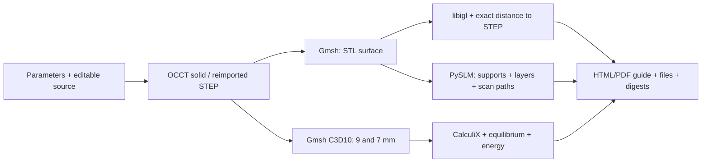
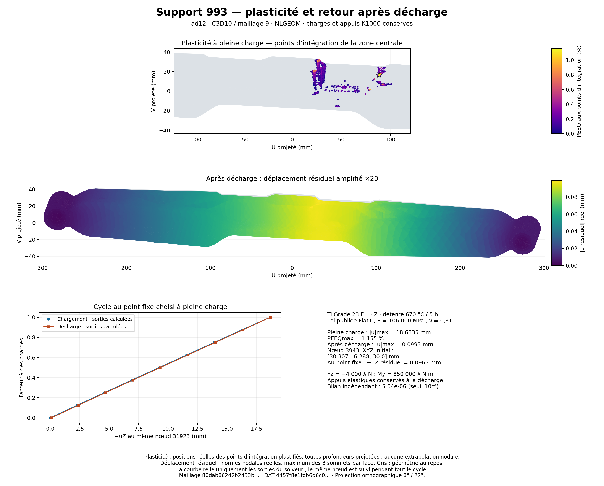
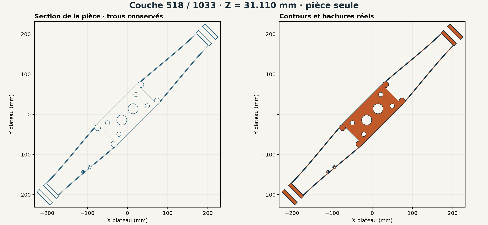
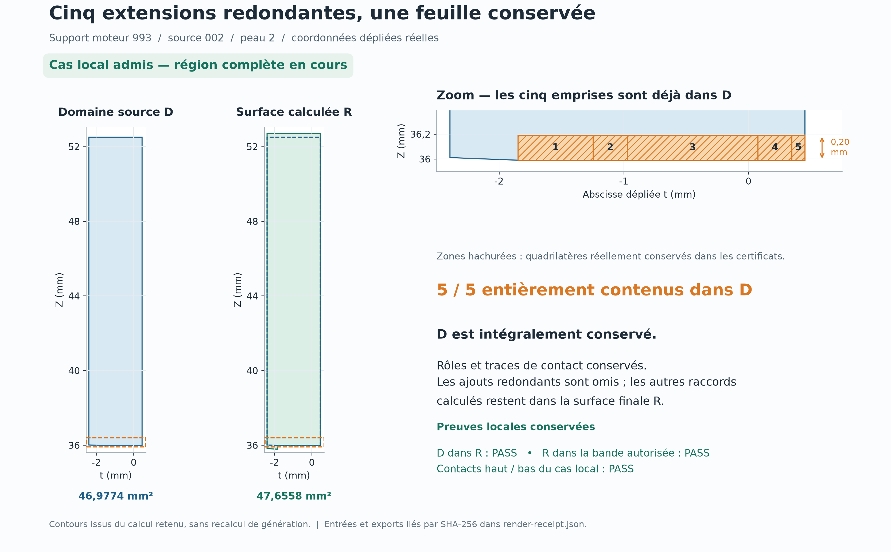
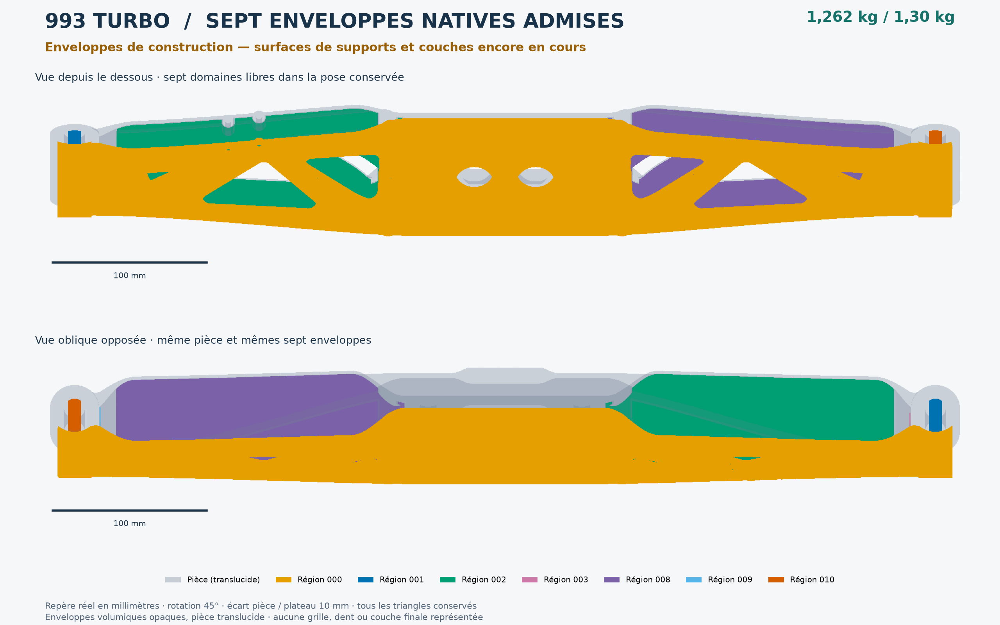

# 993 Turbo engine carrier — reinforced geometry and reproducible chain, 16 October 2026

The rerun uses the **1.30 kg** ceiling authorised by Maxime. The
`bounded-webs` candidate weighs **1.262213 kg** at the CAD volume and the declared density of
4,420 kg/m³. It keeps the V6f fixings, corrects its triangulated
representation and improves the four mechanical comparisons retained.

The [illustrated procedure](../manufacturing/PART_WORKFLOW.md) describes the software,
its installation, the reproduction command and the handover to the workshop. The
[editable source](../../parts/993-eng-carrier-0001/source/design-20261016/README.md)
and the [initial recipe](../../manufacturing/workflows/993-carrier.json) are
in the repository. The `work/part-workflow/run-001` pass ran its twelve
geometry, surface, calculation and drawing steps. Its LPBF preparation was
interrupted and refused after identification of an omitted support region and
a second vertex-correspondence error. Its **526 layers out of
1,034** are kept and intact; it has no complete slicing receipt
nor final guide. The correction and the local reinforcement have separate
versions, without modifying this witness.

## One geometry, several linked pieces of evidence

The initial recipe contains fifteen steps and **45 pinned inputs**.
The [integrated v6 recipe](../../manufacturing/workflows/993-carrier-lpbf-v6.json)
keeps its first twelve steps and its 45 inputs, then brings the chain to
**37 steps and 293 pinned versioned inputs**. The
[review of the contracts and their dependencies](../../parts/993-eng-carrier-0001/source/process-skins-20261016/cold-v6-recipe-evidence/assessment.json)
passed: ten modified commands are parsed, 27 identical contracts are
verified and reused, and the 293 digests are re-verified. It
does not represent a complete run of the recipe. The previous
versions and their receipts remain kept.
The [v2 launcher](../../scripts/run_part_workflow_v2.py) allows up to
14,400 s per step; the seven generations and the two support assemblies
use this bound. The v7 producers reuse the rational areas
already computed. The [v6 preparer](../../parts/993-eng-carrier-0001/source/process-skins-20261016/README_parallel_exact_admissions.md)
rereads the units in four processes and binds their results to the six admissions.
The v6 guide checks the bindings of these receipts, without importing the AM engine into
the PDF runtime nor announcing a new geometric calculation from the PDF.
The dossier keeps the commands, logs, identities of
sources and outputs. The support, the stress figure and the scan paths
must designate the same geometry; the generator refuses to mix them.

| Step | Pinned software and known licence | Actual use and evidence |
| --- | --- | --- |
| Parametric CAD | build123d 0.11.1 — Apache-2.0; OCCT/OCP 7.9.3.1 — kernel licence not recorded | [Editable solid and protections](../../parts/993-eng-carrier-0001/source/design-20261016/README.md), [frozen installation](../../parts/993-eng-carrier-0001/source/design-20261016/cad-base-standalone-validation.json). Local volume and STEP reimport receipt: `work/part-workflow/run-001/cad/geometry.json`. |
| Repair and Booleans | PyMesh 0.3 — MPL, licence version unknown; embedded CGAL — version and C++ commit not exposed, separate licences | Native clean-up run and CSGTree of the envelopes: [refused trials kept](../../parts/993-eng-carrier-0001/source/remesh-20261016/results.json), [CSGTree route and native reproduction](../../parts/993-eng-carrier-0001/source/native-pymesh-20261016/README.md). |
| Meshing | Gmsh 4.15.2 — GPL-2.0-or-later | Retriangulation of the CAD and C3D10 quadratic tetrahedra: [retained surface and earlier trials](../../parts/993-eng-carrier-0001/source/remesh-20261016/README.md), [historical receipts](../../parts/993-eng-carrier-0001/source/remesh-20261016/results.json). Current local receipt: `work/part-workflow/run-001/surface/meshing.json`. |
| Triangle check | libigl 2.6.3 — MPL-2.0; the repository's rational classifier | Detection of intersections and distances, then independent distinction of adjacent contacts: [runtime](../../parts/993-eng-carrier-0001/source/remesh-20261016/results.json), [adjudication](../../parts/993-eng-carrier-0001/source/design-20261016/exact-contact-diagnostic.json). |
| Wall check | PicoGK 2.3.0 — Apache-2.0; embedded OpenVDB, version/licence not recorded here | Native thickness and cavity measurements run: [receipts](../../parts/993-eng-carrier-0001/source/remesh-20261016/results.json). SDF reconstruction of the retained carrier remains a lead under study. |
| Mechanics | CalculiX 2.21, package 2.21-1 — GPL-2.0 | Six elastic cases, then published law, large displacements and unloading: [constitutive results](../../parts/993-eng-carrier-0001/source/design-20261016/constitutive-results.json), [binding to the current discrete problem](../../parts/993-eng-carrier-0001/source/design-20261016/constitutive-binding-result.json). Local run: `work/part-workflow/run-001/cad/simulation-runtime.json`. |
| LPBF preparation | PySLM 0.6.1, commit `8fa03f1` — LGPL-2.1 | Part contours and hatches: [1,034 layers and complete audit of these vectors only](../../parts/993-eng-carrier-0001/source/process-cache-20261016/results.json). Supports under correction; [pinned sources and patches](../../parts/993-eng-carrier-0001/source/process-20261016/upstream.json). |
| Support topology | Separate CGAL 6.1.3, commit `109ed62` — GPL-3.0-or-later or commercial; kernel LGPL-3.0-or-later or commercial | Autorefinement, snap, checks and polygonal dominance; distinct from CSGTree's embedded CGAL. [Native reproduction](../../parts/993-eng-carrier-0001/source/native-cgal-20261016/reproduction-results.json), [components and licences](../../parts/993-eng-carrier-0001/source/native-toolchain-20261016/README.md). The seven envelopes are admitted; the support surfaces remain in progress. |
| Process study | MOOSE, commit `167ee97` — LGPL-2.1 | Thermoplastic witnesses and mesh import run; no thermal prediction of the carrier: [sources and receipts](../../parts/993-eng-carrier-0001/source/process-20261016/moose/upstream.json). |
| Process study | Adamantine, commit `3990489` — Apache-2.0 WITH LLVM-exception | [Software witnesses run](LPBF_NATIVE_VERIFICATION_20261015.md), [pinned source](../../benchmarks/lpbf-adamantine-export/upstream.json). On this carrier, zero thermal steps and zero mechanical solves: `work/carrier-process-20261016/adamantine-occupation-001/runtime-capabilities.json`. |
| Figures and dossier | Matplotlib 3.11.2 in the [corrected PySLM runtime](../../parts/993-eng-carrier-0001/source/process-coverage-20261016/requirements-macos-arm64-python311.lock.txt); ReportLab 4.4.9 in the [standalone PDF base](../../manufacturing/runtimes/pdf/requirements-macos-arm64-python312.lock.txt) | [Checked mechanical cycle](../../parts/993-eng-carrier-0001/source/design-20261016/constitutive-evidence/luo-flat1-cycle.json) and local figure `work/part-workflow/run-001/fields/combined.json`. Current witness guide: `work/part-workflow/review-004/guide-atelier.pdf`, produced by the [versioned generator](../../scripts/build_carrier_workshop_guide_v2.py). The final dossier awaits admission of the supports. |
| Additional drawing trial | Draftwright 0.5.0.dev0, commit `f1a5db9` — AGPL-3.0 | [Two bounded trials kept](../../parts/993-eng-carrier-0001/source/draftwright-evaluation-20261017/README.md): automatic CLI then declarative sheet, each interrupted after 480 s with no drawing or lint produced. No addition to the recipe or adoption; the values read independently from the STEP validate no annotation. |
| Exact arithmetic trial | gmpy2 2.3.2 — LGPL-3.0-or-later | [110 exact equalities and scalar measurements](../../parts/993-eng-carrier-0001/source/gmp-area-evaluation-20261017/README.md). Local gain of 1.097× / 1.125× for the integer area; no constructor or region gain established. Separate environment, not adopted in the recipe. |
| General inventories | [Toolchain](../TOOLCHAIN.md) · [Software selection](../SOFTWARE_STACK.md) | Wider project navigation and choices; the receipts above establish the run specific to this carrier. |

The earlier LEAP71 lattice trials remain available in their
historical directory; they exceeded the old ceiling and do not provide
the mechanical fields of this new geometry.

## What changed in the part

The constructor reduces the windows before cutting, takes the skins to 1.5 mm,
keeps the 2.8 mm ribs and adds two sleeves around the small
secondary holes. The peripheral wall is obtained by a contour offset
of 1.61 mm. The solid is rebuilt before the Booleans; the attempts
at offsetting and merging finished faces that did not survive STEP reimport
remain refused.

The slope bound of the curves is `L = 2/15`. For two graphs bounded in this way,
separated by a Y translation of `w = 1,61 mm` (1.61 mm), the distance is at least
`w / sqrt(1 + L²) = 1,59588 mm` (1.59588 mm). The
[recorded proof](../../parts/993-eng-carrier-0001/source/design-20261016/bounded-webs-wall-proof.json)
specifies the check points and the domain covered. This is a bound
on these walls, not a minimum thickness of every face or edge.

The BRep check of the protected regions gives a zero symmetric difference
for the central plate and the six end regions. The four axes of
the plate, the two eye axes, the tool passages and the gauges of
the F0 pair are checked separately. The study dimensions remain: central
centre distances **100 × 40 mm**, end centre distance **560 mm**, plate **8 mm**,
bores **Ø11 / Ø13.5 mm**, envelope **592 × 73 × 52 mm**.

## Correction of the triangles and the surface

The exact PyMesh clean-up was run: it removed neither the 74 sliver
triangles of V6f nor its tessellation deviation. The local retessellation trials
were kept with their refusals. The retained solution rebuilds the surface
from the STEP master with Gmsh, then checks the intersections with libigl.

The old V6f STL deviated from the exact STEP by **0.37097 mm** at an
identified point, despite a requested tolerance of 0.06 mm. The aim was therefore not to
stay faithful to that error. The STEP remains the reference for both directions of
distance.

For the new `run-001` pass:

| Check | Result |
| --- | ---: |
| Triangles | 587,404 |
| Closed oriented body | 1 |
| Free edges / non-manifold / degeneracies / needles | 0 / 0 / 0 / 0 |
| Self-intersecting pairs | 0 |
| STL → exact STEP surfaces, maximum over 3,072 points | 0.018988 mm |
| STEP → STL, maximum over 8,313 points | 0.047388 mm |
| Threshold in both directions | 0.06 mm |

These distances are sampled. The previous version of the remesh was
refused at 0.07447 mm on a small 0.5 mm radius; the minimum size was
reduced from 0.5 to 0.25 mm, without changing the threshold.

The uniform exploratory check "every normal radius ≥ 1.5 mm" remains refused
on the earlier candidate of the same construction: 0.393 % of the surface below this
threshold. The two short witnesses examined against the STEP meet two adjacent
faces of a bevel of about 51°. Their length halves
when their distance to the edge halves; it therefore tends to zero
at the edge. This measurement does not describe a pair of opposing walls. The
wall bound above and the refusal of the uniform screening are kept separately.

## Mechanical comparison rerun

The same case applies `Fz = −4 000 N` (−4,000 N) and `My = 850 000 N·mm` (850,000 N·mm). Reference
elasticity: `E = 107 000 MPa` (107,000 MPa), `ν = 0,31` (0.31). The compliant supports distribute a
total of `1 000 N/mm` (1,000 N/mm) per eye and per direction among the bore nodes.
The surfaces, materials and supports of the candidate and of V6f are compared under the
same conventions.

The [search for published supports](../../parts/993-eng-carrier-0001/source/design-20261016/boundary-condition-research.md)
confirms the Turbo reference proposed by JP Group, but does not provide its
stiffness law. Rennline's M154 publishes a hardness of 75 Shore A and excludes the
Turbo; no conversion of this value into a `K1000` spring has been made.
`K1000` therefore keeps its status of declared numerical assumption.

| Mesh / supports | Displacement candidate / V6f (mm) | IP peak candidate / V6f (MPa) |
| --- | ---: | ---: |
| 9 mm / rigid | 2.7623 / 2.9902 | 700.76 / 740.86 |
| 7 mm / rigid | 2.7966 / 3.0390 | 617.72 / 800.63 |
| 9 mm / springs | 18.0778 / 18.7329 | 1,857.91 / 1,988.76 |
| 7 mm / springs | 18.2486 / 18.9290 | 1,676.55 / 2,082.84 |

The four comparisons meet the
[declared criteria](../../parts/993-eng-carrier-0001/source/design-20261016/normal-webs-selection-criteria.json).
On the rigid 7 mm mesh, the peak drops by **22.85 %** and the displacement
by **7.98 %**. The six calculations keep their independent energy balance;
the gravity + pitch decomposition verifies the superposition of the combined case.

This decision is an improvement relative to V6f. The peaks still change
between the two meshes; they are not presented as a converged
stress. The case with springs exceeds the threshold of the plastic diagnostic and
is the subject of separate calculations with large strains, a published law and
unloading. These results are not replaced by the green colour of a
relative comparison.

### Plasticity, large strains and unloading on bounded-webs

The [constitutive results and compact receipts](../../parts/993-eng-carrier-0001/source/design-20261016/constitutive-results.json)
come from STEP `ad12b8e0…`, mesh 9, with the same loads and springs.
The perfectly plastic model at 900 MPa serves to isolate the redistribution.
The second model uses the public Flat1 Grade 23 ELI curve, chosen before
the calculation, with its published value `E = 106 000 MPa` (106,000 MPa). The Poisson and
isotropy assumptions are kept explicitly.

| Model | Maximum loaded displacement (mm) | Maximum PEEQ (%) | Plastic volume by quadrature (mm³) |
| --- | ---: | ---: | ---: |
| 900 MPa, small strains, step 0.125 | 18.30092 | 1.68890 | 545.784 |
| 900 MPa, large strains, step 0.25 | 18.62026 | 1.35249 | 554.271 |
| Flat1, large strains, step 0.125 | 18.68349 | 1.15495 | 338.457 |

The Flat1 cycle performs eight load increments then eight unloading increments. At
zero external load, with the same springs still in place, the maximum
residual is **0.09926 mm**; the maximum residual von Mises stress is
**845.74 MPa**. The PEEQ stays within the measured pre-necking domain of the
curve, limited to 4.698 %. This result is the response of the sensitivity model,
with its declared law and supports.

The independent balance rebuilds `F` from the quadratic displacements,
then `P = det(F) σ F⁻ᵀ` from the Cauchy stresses. It compares the work
`∫ P : dF dV₀` and the change in spring energy with the external nodal work.
The sixteen outputs pass the threshold of **10⁻⁴ relative to the gross cumulative work**;
the worst deviation is **5.64 × 10⁻⁶** and the minimum determinant of `F` is 0.98639.
The net work of the cycle is 477.264 N·mm. The estimated integral of the plastic
curve is 448.042 N·mm; it includes hardening and is not relabelled
dissipated heat.

Two refusals are kept: the first 900 MPa calculation at step 0.25 fails the
independent balance at 0.11295 % for a threshold of 0.1 %, then its refinement to
0.125 passes at 0.02919 %. The Flat1 coupon compared directly with the 248 points
failed by 0.313 MPa; the official CalculiX 2.21 source revealed its
internal resampling to 200 points. Reproducing it gives an error of
0.000381 MPa, within the same tolerance of 0.01 MPa, without modifying the published
data. The Flat1 `ENER` diagnostic remains refused on the first increments;
the Piola balance above has its own calculation and verdict.

This figure comes from the retained outputs of the Grade 23 ELI model. The real
maximum residual is 0.09926 mm; the deformed shape is magnified twentyfold. The
[figure receipt](../../parts/993-eng-carrier-0001/source/design-20261016/constitutive-evidence/luo-flat1-cycle.json)
keeps the digests of the mesh and the DAT, the tracked node and the sixteen
outputs. The separate refusal of the `ENER` diagnostic remains as stated above.

## Print preparation and build calculation

The native [PySLM](https://github.com/drlukeparry/pyslm) engine, its revision,
its patch and its dependencies are kept in the
[preparation source](../../parts/993-eng-carrier-0001/source/process-20261016/README.md).
The pose remains flat, rotated 45° on the build plate, on a
500 × 500 mm plate with a support gap of 10 mm. The layer is 60 µm.

Two machine families were re-verified on the manufacturers' pages:
[Eplus3D EP-M650](https://www.eplus3d.com/products/ep-m650-metal-3d-printer/),
650 × 650 × 800 mm with plate, and
[revised BLT-S600](https://www.xa-blt.com/en/product/blt-s600/?category=8),
650 × 650 × 850 mm excluding substrate. Both list titanium alloys;
the published range of the EP-M650 includes 60 µm. This is an envelope compatibility
deduced from the specifications, with the
[facts and parameters not yet attributed](../../parts/993-eng-carrier-0001/source/process-20261016/machine-options.json)
recorded separately.

### Localised native support defects

The first slicing of the candidate omitted an entire projected region of
**6,191.323755 mm²**. One vertex of the triangulation had no intersection
with the part: the simplified polygon overflowed by **0.151449 mm²** beyond the
exact projection of the triangles. The patch re-cuts the domain by this
projection, keeps the holes, then uses Earcut and a conforming
refinement by centroids. On the witness region, the symmetric difference is
**1.26 × 10⁻¹⁴ mm²** and **4,486 rays out of 4,486** find the part.

Another native step could reorder the vertices before reassigning the
Z heights. The new version keeps the projection correspondence and
explicitly refuses any omitted region. The complex peripheral skins
have their own check; their absence is not confused with that of the
internal grids. These local admissions are not announced as a
complete preparation of the support until the whole has passed the same
checks.

The supports are grid and wall surfaces with teeth, together with
scan-path segments; their density is not invented from
an open shell. The part sections must be closed. The program
checks finite segments and removes only exactly identical
duplicates. The machine format, exposure order and laser settings
will be attributed to the retained process.

The thermomechanical engine was also researched and run. The
[MOOSE](../../parts/993-eng-carrier-0001/source/process-20261016/moose/README.md)
witness activates material stress-free, heats, plastifies, cools then releases
the same state. It passes 26 checks and keeps a residual strain
that the purely elastic counter-example does not produce. This is a witness
bar for the calculation engine. The import of the current mesh keeps its
159,121 nodes and 85,315 TET10, with coordinates within 2.84 × 10⁻¹⁴ mm.
The median height of an element, 2.389 mm, covers **39.8 layers**; this mechanical
mesh does not resolve the activation of each 60 µm layer.

The public data of
[Luo et al., Ti-6Al-4V ELI](../../parts/993-eng-carrier-0001/source/process-20261016/material-luo-set1/README.md)
provide four sensitivity curves at room temperature. The first
specimen is chosen before the calculation; the other three describe the scatter
of this set. The pre-necking conversion, the noise treatment and the plastic
domain are traceable. This Grade 23 ELI condition is not equated with the Grade 5
of the initial assumption.

## Software verification

The targeted tests of the launcher, the guide, the fields, the geometry and the
remesh pass: **31 tests**, including two libigl tests skipped in the
CAD runtime then run in their Linux runtime (**10 remesh tests
passed**, none skipped). The **6 native PySLM tests** also pass, notably
preservation of a hole, refusal of an open section, input identity, teeth
and exact elimination of duplicates.

The general `make check` was run: **4,023 tests, 2 failures, 27 errors,
262 skipped**. The two WE43/stator floating-point comparison failures and the
SciPy PROPACK / Python 3.10 errors are the same as on the rerun baseline.
They are kept in the log; the general suite is not announced
green. Sources and studies unrelated to this carrier remain unchanged.

A second pass with Python 3.11/PySLM ran **4,067 tests**: the two
floating-point comparisons still fail; an old 917 case requires NumPy 2
whereas PySLM imposes 1.26.4. This pass also detected a missing field
in the new unloading witness, corrected without relaxing the model
validation. The **10 current constitutive tests** then pass under Python
3.11/NumPy 1.26 and under the standalone CAD base/NumPy 2.2. The logs of both
passes and of the correction are kept. The environments remain
separate because of these real dependency constraints.

The [general pass after freezing the v6 recipe](../../parts/993-eng-carrier-0001/source/process-scanpath-audit-20261016/repository-checks-005.json)
runs **4,414 tests in 439.744 s** in the corrected PySLM environment:
four failures, one error and 177 tests skipped. The five failure identities
are exactly those of the previous classified pass: two floating-point
comparisons, an old 917 test requiring `np.trapezoid` and two tests of the
historical preparer rejected by the digest of the corrected runtime. No
new failure is identified; `make check` remains refused and does not run the
targets that depend on these tests passing. The receipt keeps the comparison
with the [earlier pass at 4,375 tests](../../parts/993-eng-carrier-0001/source/process-scanpath-audit-20261016/repository-checks-004.json),
with 39 additional tests and the same five failure identities. The earlier
results remain kept, including the first launch with the wrong
interpreter and its correction.

The **34 targeted tests of the v4/v3/v2 guides and of the generic generator** pass.
The ten tests specific to the v4 guide also pass by discovery in the reinstalled
PDF base and in the corrected PySLM runtime. The real binding to
`run-001` is re-verified by reading JSON and digests: same mesh 9,
same linear K1000 set and sixteen states kept. No DAT or solver is
replayed by these checks; they do not produce the final guide.

## Local reinforcement: stiffness gain, peak refused

The `contour-2` version, at **1.292876 kg**, progressively widens the ribs
without changing their centre line or height. STEP, protected regions,
assembly and Gmsh/libigl surface pass. Its raw OCCT STL was open;
it remains kept and is not admitted in place of the checked remesh.

The six calculations give about **17 % less displacement** on the
compliant supports and **74 % less volume above 900 MPa**. However,
the peak rises to **2,026 / 2,647 MPa** on the 9 / 7 meshes. The four
peak comparisons regress: the part is refused according to the criteria
fixed before calculation, despite this load-bearing gain. No Flat1 cycle is launched on
this refused candidate.

The true maximum integration point is located **0.23405 mm** from a re-entrant
edge between the roof of the blend and the rib flank. The normals form
111.0905°, corresponding to a material-side angle of 291.0905°. The C1
continuity of the curves in XY did not remove this sharp 3D junction. A late
OCCT R1 mm fillet trial, on this edge and its counterpart in X, fails before
STEP export and remains refused. The next step reworks the construction of the blend
before the Booleans and keeps the same protections, ceiling and comparisons.

## Check of the supports and scan paths

The `bounded-webs` revision, at **1.262213 kg**, remains retained to complete the
print chain. The reinforcement trials do not replace it while their
junctions are refused. The first tensor root, at 1.292893 kg, buries the
initial fold but extends a corner at the window: its remesh passes, its
blend remains refused and no mechanical calculation is launched on it.

The support correction now handles the **real free intervals**
between the surfaces, rather than a single height per XY position. The union of
prisms of the overhang triangles, the XY mask then the subtraction of the
part produce seven volumes. Overlaps were located from the Manifold
union onwards; a new PyMesh/IGL/CGAL construction is in progress. Its native
witness of two stacked prisms then an intermediate hollowing keeps
4,000 then 3,200 mm³ and the two free intervals.

The raw libigl counter is kept. Its tests of adjacent faces also use
approximate calculations: some reported contacts are only the vertex
or edge already shared. An independent classification in rationals of the
IEEE coordinates distinguishes these contacts from real crossings and
overlaps, with no added epsilon or displacement of vertices. It does not claim to
detect pairs absent from the input report. The real defects of the union
are not erased by this distinction. The
[exact diagnostic](../../parts/993-eng-carrier-0001/source/design-20261016/exact-contact-diagnostic.json)
keeps the eight intermediates, the counters and the witnesses.

The [four-process slicer](../../parts/993-eng-carrier-0001/source/process-slicing-20261016/README.md)
exactly preserves the contours, their order, the hatches and the areas of
eight fixed planes of the carrier. The benchmark measures **32.282 → 11.808 s**, including
worker start-up, that is 2.73 times faster on this witness. The
Z preselection alone had not sped up the case; this result remains kept.
The process group is closed after calculation.

The scan-path audit checks entire segments within the sections with
their holes. A segment crossing a hole is refused even if both its
ends remain in the material. Ten native slicing and scan-path
tests pass together. Five kept layers from the partial pass
pass this audit; this does not replace the audit of all layers of the future
pass.

The [reinforced packaging](../../scripts/build_carrier_workshop_guide_v2.py)
requires six admissions bound to their receipts: envelopes, regions, skins, grids,
contacts and collisions. It also requires the complete scan-path audit of the
same preparation. Nine tests of the old and new packagings pass,
including the refusal of a merely generated support and of a partial audit. The illustrated
working review is available as offline HTML and an eight-page PDF;
its eight pages have been rendered and reviewed, with the steps still open
visible.

The [constitutive binding](../../scripts/bind_carrier_constitutive_evidence.py)
verifies a stronger link than mere resemblance of geometries: the
discrete mesh `mesh.npz` of the new pass is bit-for-bit identical to that
of the Flat1 sensitivity, and the reference linear set, with its loads and
springs, carries exactly the same digest. The STEP exports remain
distinct. The receipt links the sixteen states and their independent audit to the same
discrete problem, without announcing a new run. It keeps the
ENER diagnostic refused over the whole cycle. Four tests notably refuse another
mesh, another load set, modified outputs or a partial audit.

An [independent re-verification](../../parts/993-eng-carrier-0001/source/design-20261016/constitutive-evidence/constitutive-binding-independent-002.json)
then reparses the sixteen states from the raw DAT, compares the arrays and types of the
mesh, then recomputes the increments of external work and of the springs.
The comparison deviations remain below 10⁻⁷ N·mm / 10⁻¹² relative. It keeps
the two distinct STEP identities and the refused ENER diagnostic.

The [preparer of a new constitutive plan](../../scripts/rebind_carrier_constitutive_plan.py)
also allows starting again from a fresh export of the same discrete problem: only
the STEP identity, the mesh path header and the plan date change.
The mesh content after removal of the `*HEADING` block alone, the NPZ and the
load set must remain identical. The native preparation of the non-linear
set was run and restores the same input file bit for bit;
the [receipt](../../parts/993-eng-carrier-0001/source/design-20261016/constitutive-evidence/cold-start-input-equivalence-001.json)
states that the solver was not rerun. Four tests notably check
the modification of one mesh element despite an unchanged NPZ.

The PySLM reinstallation was run in a fresh environment: the
**37 versions**, the **four patched files** and the **775 slicing sources and
binaries** match the checked part cache.
That cache completes its **1,034 layers**, including 866 non-empty and **9,339,852
hatch segments**, in 1,097.67 s with closure of the process group.
The independent audit passes on all layers: **zero segments out of
domain, null or exactly duplicated**, for the hatches and the **11,507,777
contour segments**. The complete reread restores the same arrays,
areas and order without redoing the hatches. The two checks take 32.15 and
34.12 s. The [compact receipt](../../parts/993-eng-carrier-0001/source/process-cache-20261016/results.json)
distinguishes them from the support preparation, which remains in progress.

The figure shows the part alone at Z = 31.110 mm; the supports are not
added. Its SVG version, the data and the plane digest are kept
with the [receipt](../../parts/993-eng-carrier-0001/source/process-cache-20261016/evidence/layer-00518/figure.json).

The [assembler](../../scripts/assemble_carrier_workflow.py) will be able to combine the
twelve steps already verified and the new admitted preparation while keeping
their provenance. Its eight tests pass: the source pass remains refused,
no solver recalculation is invented and changes of files,
surface or audit are detected. The results already computed are reused
by their explicit identity.

The [support exposure check](../../parts/993-eng-carrier-0001/source/process-scanpath-audit-20261016/README.md)
is ready: nineteen targeted tests and a complete native witness of 170 layers
pass. It rebuilds the sections of the real triangles with an independent
rational formula, distinguishes ideal contacts from their encoding and
checks the graphs of the rational and float64 scan paths. Each layer
must be anchored from its construction; a connection appearing later does not
repair a floating start. The complete carrier still awaits its corrected
supports; the box witness does not admit it.

The [support slicing dispatcher](../../parts/993-eng-carrier-0001/source/process-support-slicing-20261016/README.md)
passes four tests and preserves the order and arrays of the exact hook. Of ten
historical planes fixed before calculation, seven are encodable identically and
three keep their refusal: a non-zero rational segment collapses in
float64. The small batch measures 2.262 s serially and 2.556 s with four processes,
start-up included; no speed gain is announced for this batch. These
old sheets remain rejected and do not constitute a final slicing.

The packaging also requires separate proof that every support material
group actually appears in the scan paths. The complete
receipt binds by SHA the two sub-receipts: exposure audit and coverage
of all groups. A sheet lying entirely between two layer planes
therefore cannot silently disappear from the accepted dossier.

The [consolidated Linux installation](../../parts/993-eng-carrier-0001/source/native-toolchain-20261016/complete-installation-results.json)
was run in a fresh prefix: audit environment, five native
tools and a verified copy of the PyMesh archive. The 47 sources still match
the checkout and the five receipts are bound to the runtime manifest.
This run installs the software; it does not recompute the carrier.

An [earlier general check of the repository](../../parts/993-eng-carrier-0001/source/process-scanpath-audit-20261016/repository-checks-001.json)
runs 4,146 tests: four failures, one error and 177 tests skipped. Three
refusals already existed; two come from using the new runtime
for tests of the historical generator. These two tests were then
[replayed alone in their historical runtime](../../parts/993-eng-carrier-0001/source/process-scanpath-audit-20261016/historical-runtime-checks-001.json)
and pass. The global suite is therefore not announced green; the targeted
checks of the new modules are kept separately.

The guide and the assembler now also require the independent check of the
support scan paths on all layers, with their geometric encoding
and their exposed contacts. The sixteen tests of the two modules pass together;
a geometry admission alone does not replace this exposure audit.

The [illustrated gallery of work in progress](../../parts/993-eng-carrier-0001/source/progress-figures-20261016/index.html)
gathers five initial plates: complete part at 1.262 kg, dimensions, mesh before/after,
real layer of index 518 and diagnostic of the perforated supports of the right-hand region.
The last remains explicitly refused: 26 components lack the two
required anchorages. The red detail comes from the exact graph and the real triangles,
with no material added in the render. The five images were reviewed visually;
the [source receipt](../../parts/993-eng-carrier-0001/source/progress-figures-20261016/figures.json)
keeps their digests. The targeted test binding the graph to the faces passes.

The [local plate of the left skin](../../parts/993-eng-carrier-0001/source/progress-figures-20261016/chart002-local-20261016/README.md)
shows the source domain, the computed surface and the five extensions already
fully contained in the domain. The three real JSON files, the script and the
exports are kept together. The render after extraction works from
another working directory and exactly reproduces the accepted PNG. Its
local status does not replace admission of the complete region.

The [views of the seven native envelopes](../../parts/993-eng-carrier-0001/source/progress-figures-20261016/sealed-envelopes-20261016/README.md)
show the build volumes in the real pose of the part. A
second plate enlarges the small regions 003/009 without moving their
vertices. The 100 mm and 10 mm scale bars are verified by the installed VisPy
transform; replay from a separate copy preserves both PNGs
byte for byte. The grids, the teeth and the final support layers are not
represented by these volumes.

The [two plates of the surfaces already computed](../../parts/993-eng-carrier-0001/source/progress-figures-20261016/calculated-surfaces-20261017/README.md)
show regions 003/009/010 in the pose of the part, then their grids,
skins and teeth. The local check of the three checkpoints, the graphs and
their arrays passes; 010 contains 16,916 faces and two anchored components.
The five scales are verified by projection and the two PDF pages have
been reviewed. A replay from `/` in 7.429 s reproduces both PNGs byte for byte.
The return code of process 010 awaits collection; the admissions of the seven
regions and the audit of all layers are not deduced from these images.

The [complementary mechanical plate](../../parts/993-eng-carrier-0001/source/progress-figures-20261016/mechanics.html)
shows the real fields of the combined case with rigid supports, 7 mm mesh:
617.716 MPa at the maximum integration point and 2.796598 mm of displacement.
The deformed shape is magnified tenfold; the colours show the real
displacement. The PNG and SVG files are identical copies of the outputs of
`run-001`, bound by the figure receipt to the five inputs of the calculation and by
the workflow receipt to the rendering step run. Their provenance and their
reproduction command accompany the plate.

The [plate of the compliant-support case](../../parts/993-eng-carrier-0001/source/progress-figures-20261016/mechanics-springs.html)
completes this comparison: 1,676.546 MPa and 18.248649 mm on the same 7 mm
mesh, with 1,000 N/mm in total per eye and per axis. It rereads the real
recorded fields, without rerunning the solver, and keeps the ten identities
of its inputs and outputs. The deformed shape is magnified ×10, the colours remain
real. Both plates describe their support assumptions; their elastic
peaks do not constitute an admissible stress of the material.

The handover check also requires `rational_part_contact_intersections=true`
in the support audit receipt and its scan-path sub-receipt. An exact contact
located in a hole must not become an anchorage after rounding onto
its boundary. The non-regression witness refused the four expected cases
only after this correction; the 17 guide tests and the 8 assembly
tests pass. This requirement does not replace the run of the future
complete support audit.

The [new view of the corrected right-hand region](../../parts/993-eng-carrier-0001/source/progress-figures-20261016/right-supports.html)
comes from the `real-support-source-008-full-004` pass: 112,898 faces,
897 groups, 20 3D components and zero components without the required contacts.
The duration is 444.36 s; the inputs, sources and runtime remain unchanged.
The render uses its verified checkpoint and also shows the triangles of a
grid in their real plane. This success of one region's graph remains
distinct from the six admissions and from the check of all layers.

## Additions computed on 17 October 2026

The [32-state cycle dossier](../../parts/993-eng-carrier-0001/source/design-20261016/constitutive-refinement-20261017/README.md)
keeps the load-unload recalculation on the same mesh, with the same
loads, springs and published Grade 23 ELI Flat1 law. The 32 states pass the
two independent balances with their thresholds unchanged: ENER maximum
**0.000731617 < 0.001** and Piola maximum **0.0000877425 < 0.0001**.
The ENER maximum decreases by 53.85 %; the Piola maximum increases and stays below
its threshold. The residual displacement computed at zero load is **0.09909 mm**,
with no acceptance threshold defined. This time refinement alone does not constitute
mesh convergence. The 16-state results and refusals described
above remain kept as history.

The [illustrated comparison of the 16 and 32 states](../../parts/993-eng-carrier-0001/source/progress-figures-20261016/energy-increments-20261017/README.md)
contains the data, the attribution of the material law and the three formats
PNG/SVG/PDF reproduced byte for byte from a separate copy.

The [CGAL retriangulation plate](../../parts/993-eng-carrier-0001/source/progress-figures-20261016/cgal-diagonal-repair-20261017/README.md)
explains two real examples among the 146 quadrilaterals processed natively.
The new copy of region **010 of the print supports** keeps its
vertices and attributes; 290 triangle rows change and the counter of
non-representable sections goes from 1,185 to zero. Its new material graph
passes, as do **the 1,034 layers of the original strict slicer**. The replay
of the two skins first reproduces their historical geometries and receipts, then
applies the 276 certified SKIN rows, without changing the GRIDs. These checks
remain local to 010; the assembly and the audit of all supports remain
to be finished.

The [gallery](../../parts/993-eng-carrier-0001/source/progress-figures-20261016/index.html)
now gathers **13 images**, their data and the available PDF files.

The [fine CAD reference capsule](../../parts/993-eng-carrier-0001/source/cad-fine-reference-20261017/README.md)
keeps the extraction actually run of the 240 faces of the STEP:
68,744 vertices, 137,572 triangles, one closed and oriented component, no
triangle of exactly zero area. The requested OCP deflection is absolute, at 0.01 mm.
The seven sources and receipts are kept byte for byte and their documentary
verifier works outside the CAD environment. This requested deflection
does not constitute a demonstrated global bound on the deviation from the BREP;
the CGAL distance measurement between meshes remains a separate step.

The two additional copies of supports **003 and 009** were then
created from 48 PMP results and a constrained diagonal computed
separately by `CGAL::Euler::split_face`. The original PMP batch of 49 cases,
including its choice of the old diagonal on one case, remains kept.
The vertices and attributes remain identical; 39 and 49 triangle rows
change. The certified counters go from **205 and 2,879 to zero**.
The new material graphs pass for their 147 and 22 groups, and
**the 1,034 strict layers of each copy pass**, with the original hooks and
criteria. These checks complement those of 010; the portable replay
of the skins and the assembly of the seven regions remain in progress.

The [dossier of the three corrected topologies](../../parts/993-eng-carrier-0001/source/certified-support-topology-20261017/README.md)
now keeps the arrays and certificates, the portable helper and
the private adapter. The real replay of their **14 SKIN surfaces passes**:
XYZ triangles exactly equal to the candidate copies, 320 SKIN rows
applied and zero GRID rows modified by this replay. The check of the proofs
on the real NPZ files passes; the 19 synthetic tests of the adapter pass
from this documentary copy. The contacts/exposures of the three regions
on all layers and the assembly of the seven regions remain separate.

### Zone 000 and new plate of the original surfaces

Generation of zone 000 produced 148,340 vertices, 171,694 faces and
337 groups in one verified material component. The original strict
slicer refused a section of grid `grid-0-9-0` from Z = 0.030 mm;
the complete census of sections is in progress. An exact index of five fields
per group was extracted by traversing the 2,589,891,988 bytes of the original
report, with SHA, partition and attributes checked.

The [new plate](../../parts/993-eng-carrier-0001/source/progress-figures-20261016/region000-material-20261017/README.md)
shows all the original faces in two views, without simplification.
The eight inputs, the three exports and the render run from a separate
copy are bound. This dossier keeps the triangulation correction still
in progress; it does not change the admissions of the three regions already corrected.
