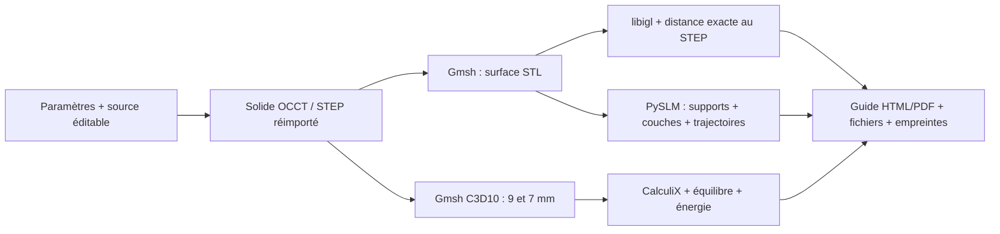

# Support moteur 993 Turbo — géométrie renforcée et chaîne reproductible, 16 octobre 2026

La reprise utilise le plafond de **1,30 kg** autorisé par Maxime. Le candidat
`bounded-webs` pèse **1,262213 kg** au volume CAO et à la densité déclarée de
4 420 kg/m³. Il conserve les fixations de V6f, corrige sa représentation
triangulée et améliore les quatre comparaisons mécaniques retenues.

La [procédure illustrée](../manufacturing/PART_WORKFLOW.md) décrit les logiciels,
leur installation, la commande de reproduction et la remise à l'atelier. La
[source éditable](../../parts/993-eng-carrier-0001/source/design-20261016/README.md)
et la [recette initiale](../../manufacturing/workflows/993-carrier.json) sont
dans le dépôt. Le passage `work/part-workflow/run-001` a exécuté ses douze
étapes de géométrie, surface, calcul et dessin. Sa préparation LPBF a été
interrompue et refusée après identification d'une région de support omise et
d'une seconde erreur de correspondance des sommets. Ses **526 couches sur
1 034** sont conservées et intègres ; il n'a aucun reçu de tranchage complet
ni guide final. La correction et le renforcement local ont des versions
séparées, sans modifier ce témoin.

## Une géométrie, plusieurs preuves liées

Les quinze étapes de la recette vérifient les **45 entrées épinglées** avant
et après exécution. Le dossier garde les commandes, journaux, identités des
sources et sorties. Le support, la figure de contrainte et les trajectoires
doivent désigner la même géométrie ; le générateur refuse de les mélanger.

| Outil repris ou trouvé sur GitHub | Utilisation réelle dans cette reprise |
| --- | --- |
| build123d / OCCT | Construction du solide, protections BRep, réimport STEP et volume |
| PyMesh | Nettoyage exact exécuté ; insuffisant pour corriger la tessellation, essais refusés conservés |
| Gmsh 4.15.2 | Retriangulation depuis la CAO et maillages C3D10 |
| libigl 2.6.3 | Intersections exactes entre triangles et distance inverse ; runtime Linux ARM64 local |
| PicoGK 2.3.0 / OpenVDB | Contrôle natif des parois et des volumes enfermés sur Kali1 |
| CalculiX 2.21 | Calculs élastiques et non linéaires ; solveur local à image et binaire épinglés |
| PySLM 0.6.1 | Supports dentés, couches, contours et hachures ; correction de projection tracée |
| MOOSE | Activation, histoire thermoplastique et relâchement vérifiés sur témoin ; import du maillage du support |
| Adamantine | Audit exécuté ; limitations STL/ArborX et équilibre plastique identifiées avant de lui confier une prédiction |

Les essais de treillis LEAP71 antérieurs restent disponibles dans leur
dossier historique ; ils dépassaient l'ancien plafond et ne fournissent pas
les champs mécaniques de cette nouvelle géométrie.

## Ce qui a changé dans la pièce

Le constructeur réduit les fenêtres avant découpe, porte les peaux à 1,5 mm,
conserve les nervures de 2,8 mm et ajoute deux manchons autour des petits
perçages secondaires. La paroi périphérique est obtenue par un décalage de
contour de 1,61 mm. Le solide est reconstruit avant les booléens ; les tentatives
de décalage et fusion de faces terminées qui ne survivaient pas au réimport
STEP restent refusées.

La borne de pente des courbes est `L = 2/15`. Pour deux graphes ainsi bornés,
séparés par une translation en Y de `w = 1,61 mm`, la distance est au moins
`w / sqrt(1 + L²) = 1,59588 mm`. La
[preuve enregistrée](../../parts/993-eng-carrier-0001/source/design-20261016/bounded-webs-wall-proof.json)
précise les points de contrôle et le domaine couvert. Il s'agit d'une borne
sur ces parois, pas d'une épaisseur minimale de toute face ou de tout chant.

Le contrôle BRep des régions protégées donne une différence symétrique nulle
pour la platine centrale et les six régions d'extrémité. Les quatre axes de
la platine, les deux axes des œillets, les passages d'outils et les jauges de
la paire F0 sont contrôlés séparément. Les cotes d'étude restent : entraxes
centraux **100 × 40 mm**, entraxe d'extrémités **560 mm**, platine **8 mm**,
alésages **Ø11 / Ø13,5 mm**, enveloppe **592 × 73 × 52 mm**.

## Correction des triangles et de la surface

Le nettoyage PyMesh exact a été exécuté : il ne supprimait ni les 74 triangles
effilés de V6f ni son écart de tessellation. Les essais de retessellation locale
ont été conservés avec leurs refus. La solution retenue reconstruit la surface
depuis le maître STEP avec Gmsh, puis contrôle les intersections avec libigl.

L'ancien STL de V6f s'écartait du STEP exact de **0,37097 mm** à un point
identifié, malgré une tolérance demandée de 0,06 mm. Le but n'était donc pas de
rester fidèle à cette erreur. Le STEP reste la référence des deux sens de
distance.

Pour le nouveau passage `run-001` :

| Contrôle | Résultat |
| --- | ---: |
| Triangles | 587 404 |
| Corps fermé orienté | 1 |
| Bords libres / non-manifold / dégénérescences / aiguilles | 0 / 0 / 0 / 0 |
| Paires en auto-intersection | 0 |
| STL → surfaces exactes STEP, maximum sur 3 072 points | 0,018988 mm |
| STEP → STL, maximum sur 8 313 points | 0,047388 mm |
| Seuil dans les deux sens | 0,06 mm |

Ces distances sont échantillonnées. La version précédente du remaillage était
refusée à 0,07447 mm sur un petit rayon de 0,5 mm ; la taille minimale a été
réduite de 0,5 à 0,25 mm, sans changer le seuil.

Le contrôle exploratoire uniforme « tout rayon normal ≥ 1,5 mm » reste refusé
sur le candidat antérieur de même construction : 0,393 % de surface sous ce
seuil. Les deux témoins courts examinés au STEP rencontrent deux faces
adjacentes d'un biseau d'environ 51°. Leur longueur est divisée par deux
lorsque leur distance à l'arête est divisée par deux ; elle tend donc vers zéro
au bord. Cette mesure ne décrit pas une paire de parois opposées. La borne de
paroi ci-dessus et le refus du criblage uniforme sont conservés séparément.

## Comparaison mécanique relancée

Le même cas applique `Fz = −4 000 N` et `My = 850 000 N·mm`. Élasticité de
référence : `E = 107 000 MPa`, `ν = 0,31`. Les appuis souples distribuent un
total de `1 000 N/mm` par œil et par direction entre les nœuds de l'alésage.
Les surfaces, matériaux et appuis du candidat et de V6f sont comparés sous les
mêmes conventions.

La [recherche des appuis publiés](../../parts/993-eng-carrier-0001/source/design-20261016/boundary-condition-research.md)
confirme la référence Turbo proposée par JP Group, mais ne fournit pas sa loi
de raideur. Le M154 de Rennline publie une dureté 75 Shore A et exclut les
Turbo ; aucune conversion de cette valeur en ressort `K1000` n'a été faite.
`K1000` conserve donc son statut d'hypothèse numérique déclarée.

| Maillage / appuis | Déplacement candidat / V6f (mm) | Pic IP candidat / V6f (MPa) |
| --- | ---: | ---: |
| 9 mm / rigides | 2,7623 / 2,9902 | 700,76 / 740,86 |
| 7 mm / rigides | 2,7966 / 3,0390 | 617,72 / 800,63 |
| 9 mm / ressorts | 18,0778 / 18,7329 | 1 857,91 / 1 988,76 |
| 7 mm / ressorts | 18,2486 / 18,9290 | 1 676,55 / 2 082,84 |

Les quatre comparaisons respectent les
[critères déclarés](../../parts/993-eng-carrier-0001/source/design-20261016/normal-webs-selection-criteria.json).
Sur le maillage 7 mm rigide, le pic baisse de **22,85 %** et le déplacement
de **7,98 %**. Les six calculs conservent leur bilan énergétique indépendant ;
la décomposition gravité + tangage vérifie la superposition du cas combiné.

Cette décision est une amélioration relative à V6f. Les pics changent encore
entre les deux maillages ; ils ne sont pas présentés comme une contrainte
convergée. Le cas avec ressorts dépasse le seuil du diagnostic plastique et
fait l'objet de calculs séparés avec grandes déformations, loi publiée et
décharge. Ces résultats ne sont pas remplacés par la couleur verte d'une
comparaison relative.

### Plasticité, grandes déformations et décharge sur bounded-webs

Les [résultats constitutifs et reçus compacts](../../parts/993-eng-carrier-0001/source/design-20261016/constitutive-results.json)
proviennent du STEP `ad12b8e0…`, maillage 9, avec les mêmes charges et ressorts.
Le modèle parfaitement plastique à 900 MPa sert à isoler la redistribution.
Le second modèle emploie la courbe publique Flat1 Grade 23 ELI, choisie avant
le calcul, avec sa valeur publiée `E = 106 000 MPa`. Les hypothèses de Poisson
et d'isotropie sont conservées explicitement.

| Modèle | Déplacement maximal chargé (mm) | PEEQ maximale (%) | Volume plastique par quadrature (mm³) |
| --- | ---: | ---: | ---: |
| 900 MPa, petites déformations, pas 0,125 | 18,30092 | 1,68890 | 545,784 |
| 900 MPa, grandes déformations, pas 0,25 | 18,62026 | 1,35249 | 554,271 |
| Flat1, grandes déformations, pas 0,125 | 18,68349 | 1,15495 | 338,457 |

Le cycle Flat1 effectue huit incréments de charge puis huit de décharge. À
charge extérieure nulle, avec les mêmes ressorts encore en place, le résidu
maximal est **0,09926 mm** ; le maximum de von Mises résiduel est
**845,74 MPa**. La PEEQ reste dans le domaine pré-striction mesuré de la
courbe, limité à 4,698 %. Ce résultat est la réponse du modèle de sensibilité,
avec sa loi et ses appuis déclarés.

Le bilan indépendant reconstruit `F` depuis les déplacements quadratiques,
puis `P = det(F) σ F⁻ᵀ` depuis les contraintes de Cauchy. Il compare le travail
`∫ P : dF dV₀` et la variation d'énergie des ressorts au travail nodal extérieur.
Les seize sorties passent le seuil **10⁻⁴ rapporté au travail cumulé brut** ;
le pire écart est **5,64 × 10⁻⁶** et le déterminant minimal de `F` vaut 0,98639.
Le travail net du cycle est 477,264 N·mm. L'intégrale estimée de la courbe
plastique vaut 448,042 N·mm ; elle inclut l'écrouissage et n'est pas renommée
chaleur dissipée.

Deux refus sont conservés : le premier calcul 900 MPa à pas 0,25 échoue au
bilan indépendant à 0,11295 % pour un seuil de 0,1 %, puis son raffinement à
0,125 passe à 0,02919 %. Le coupon Flat1 comparé directement aux 248 points
échouait de 0,313 MPa ; la source officielle de CalculiX 2.21 a révélé son
rééchantillonnage interne à 200 points. Sa reproduction donne une erreur de
0,000381 MPa, sous la même tolérance de 0,01 MPa, sans modifier les données
publiées. Le diagnostic `ENER` Flat1 reste refusé sur les premiers incréments ;
le bilan Piola ci-dessus a son calcul et son verdict propres.

## Préparation d'impression et calcul de construction

Le moteur natif [PySLM](https://github.com/drlukeparry/pyslm), sa révision,
son correctif et ses dépendances sont conservés dans la
[source de préparation](../../parts/993-eng-carrier-0001/source/process-20261016/README.md).
La pose reste à plat, tournée de 45° dans le plateau, sur une plaque de
500 × 500 mm avec un espace de support de 10 mm. La couche est de 60 µm.

Deux familles de machines ont été revérifiées sur les pages des constructeurs :
[Eplus3D EP-M650](https://www.eplus3d.com/products/ep-m650-metal-3d-printer/),
650 × 650 × 800 mm avec plaque, et
[BLT-S600 révisée](https://www.xa-blt.com/en/product/blt-s600/?category=8),
650 × 650 × 850 mm hors substrat. Les deux annoncent les alliages de titane ;
la plage publiée de l'EP-M650 inclut 60 µm. C'est une compatibilité d'enveloppe
déduite des spécifications, avec les
[faits et paramètres encore non attribués](../../parts/993-eng-carrier-0001/source/process-20261016/machine-options.json)
enregistrés séparément.

### Défauts natifs de support localisés

Le premier tranchage du candidat omettait une région projetée entière de
**6 191,323755 mm²**. Un sommet de la triangulation n'avait pas d'intersection
avec la pièce : le polygone simplifié débordait de **0,151449 mm²** sur la
projection exacte des triangles. Le correctif recoupe le domaine par cette
projection, conserve les trous, puis utilise Earcut et un raffinement
conforme par centroïdes. Sur la région témoin, la différence symétrique est
**1,26 × 10⁻¹⁴ mm²** et les **4 486 rayons sur 4 486** retrouvent la pièce.

Une autre étape native pouvait réordonner les sommets avant de réaffecter les
hauteurs Z. La nouvelle version garde la correspondance de projection et
refuse explicitement toute région omise. Les peaux périphériques complexes
ont leur propre contrôle ; leur absence ne se confond pas avec celle des
grilles internes. Ces admissions locales ne sont pas annoncées comme une
préparation complète du support tant que l'ensemble n'a pas passé les mêmes
contrôles.

Les supports sont des surfaces de grilles et de parois avec dents, assorties
de segments de trajectoire ; leur masse volumique n'est pas inventée depuis
une coque ouverte. Les sections de pièce doivent être fermées. Le programme
vérifie les segments finis et retire uniquement les doublons exactement
identiques. Le format machine, l'ordre d'exposition et les réglages laser
seront attribués au procédé retenu.

Le moteur thermomécanique a aussi été recherché et exécuté. Le témoin
[MOOSE](../../parts/993-eng-carrier-0001/source/process-20261016/moose/README.md)
active la matière sans contrainte, chauffe, plastifie, refroidit puis relâche
le même état. Il réussit 26 contrôles et conserve une déformation résiduelle
que le contre-exemple purement élastique ne produit pas. Il s'agit d'une barre
témoin du moteur de calcul. L'import du maillage courant conserve ses
159 121 nœuds et 85 315 TET10, avec des coordonnées à 2,84 × 10⁻¹⁴ mm près.
La hauteur médiane d'un élément, 2,389 mm, couvre **39,8 couches** ; ce maillage
mécanique ne résout pas l'activation de chaque couche de 60 µm.

Les données publiques de
[Luo et al., Ti-6Al-4V ELI](../../parts/993-eng-carrier-0001/source/process-20261016/material-luo-set1/README.md)
fournissent quatre courbes de sensibilité à température ambiante. Le premier
spécimen est choisi avant le calcul ; les trois autres décrivent la dispersion
de ce jeu. La conversion pré-striction, le traitement du bruit et le domaine
plastique sont traçables. Cet état Grade 23 ELI n'est pas assimilé au Grade 5
de l'hypothèse initiale.

## Vérification du logiciel

Les tests ciblés du lanceur, du guide, des champs, de la géométrie et du
remaillage réussissent : **31 tests**, dont deux tests libigl ignorés dans le
runtime CAD puis exécutés dans leur runtime Linux (**10 tests de remaillage
réussis**, aucun ignoré). Les **6 tests natifs PySLM** réussissent aussi, notamment
conservation d'un trou, refus d'une section ouverte, identité d'entrée, dents
et élimination exacte des doublons.

Le `make check` général a été exécuté : **4 023 tests, 2 échecs, 27 erreurs,
262 ignorés**. Les deux échecs de comparaison flottante WE43/stator et les
erreurs SciPy PROPACK / Python 3.10 sont les mêmes que sur la base de reprise.
Ils sont conservés dans le journal ; la suite générale n'est pas annoncée
verte. Les sources et études sans rapport avec ce support restent inchangées.

Un second passage avec Python 3.11/PySLM a exécuté **4 067 tests** : les deux
comparaisons flottantes échouent encore ; un ancien cas 917 exige NumPy 2
alors que PySLM impose 1.26.4. Ce passage a aussi détecté un champ manquant
dans le nouveau témoin de décharge, corrigé sans relâcher la validation du
modèle. Les **10 tests constitutifs actuels** passent ensuite sous Python
3.11/NumPy 1.26 et sous la base CAD autonome/NumPy 2.2. Les journaux des deux
passages et de la correction sont conservés. Les environnements restent
séparés pour ces contraintes réelles de dépendances.

## Renforcement local : gain de raideur, refus du pic

La version `contour-2`, à **1,292876 kg**, élargit progressivement les nervures
sans changer leur ligne centrale ni leur hauteur. STEP, régions protégées,
assemblage et surface Gmsh/libigl passent. Son STL OCCT brut était ouvert ;
il reste conservé et n'est pas admis à la place du remaillage contrôlé.

Les six calculs donnent environ **17 % de déplacement en moins** sur les
appuis souples et **74 % de volume en moins au-dessus de 900 MPa**. Cependant,
le pic augmente à **2 026 / 2 647 MPa** sur les maillages 9 / 7. Les quatre
comparaisons de pic régressent : la pièce est refusée selon les critères
fixés avant calcul, malgré ce gain porteur. Aucun cycle Flat1 n'est lancé sur
ce candidat refusé.

Le vrai point d'intégration maximal est situé à **0,23405 mm** d'une arête
rentrante entre le toit du raccord et le flanc de nervure. Les normales font
111,0905°, correspondant à un angle côté matière de 291,0905°. La continuité
C1 des courbes en XY n'a pas supprimé cette jonction 3D vive. Un essai de
congé OCCT tardif R1 mm, sur cette arête et son homologue en X, échoue avant
export STEP et reste refusé. La suite reprend la construction du raccord
avant les booléens et conserve les mêmes protections, plafond et comparaisons.

## Contrôle des supports et des trajectoires

La révision `bounded-webs`, à **1,262213 kg**, reste retenue pour terminer la
chaîne d'impression. Les essais de renfort ne la remplacent pas tant que leurs
jonctions sont refusées. Le premier pied tensoriel, à 1,292893 kg, enfouit le
pli initial mais prolonge un coin à la fenêtre : son remaillage passe, son
raccord reste refusé et aucun calcul mécanique n'est lancé dessus.

La correction des supports traite maintenant les **intervalles libres réels**
entre les surfaces, plutôt qu'une seule hauteur par position XY. L'union de
prismes des triangles de surplomb, le masque XY puis la soustraction de la
pièce produisent sept volumes. Des recouvrements ont été localisés dès l'union
Manifold ; une nouvelle construction PyMesh/IGL/CGAL est en cours. Son témoin
natif de deux prismes superposés puis évidement intermédiaire conserve
4 000 puis 3 200 mm³ et les deux intervalles libres.

Le compteur brut libigl est conservé. Ses tests des faces adjacentes utilisent
aussi des calculs approchés : certains contacts signalés ne sont que le sommet
ou l'arête déjà partagés. Une classification indépendante en rationnels des
coordonnées IEEE distingue ces contacts des croisements et recouvrements
réels, sans epsilon ajouté ni déplacement de sommets. Elle ne prétend pas
détecter des paires absentes du rapport d'entrée. Les défauts réels de l'union
ne sont pas effacés par cette distinction. Le
[diagnostic exact](../../parts/993-eng-carrier-0001/source/design-20261016/exact-contact-diagnostic.json)
conserve les huit intermédiaires, les compteurs et les témoins.

Le [trancheur à quatre processus](../../parts/993-eng-carrier-0001/source/process-slicing-20261016/README.md)
conserve exactement les contours, leur ordre, les hachures et les aires de
huit plans fixés du carrier. Le benchmark mesure **32,282 → 11,808 s**, avec
démarrage des workers, soit 2,73 fois plus rapide sur ce témoin. La
présélection Z seule n'avait pas accéléré le cas ; ce résultat reste conservé.
Le groupe de processus est fermé après calcul.

L'audit des trajectoires vérifie les segments entiers dans les sections avec
leurs trous. Un segment traversant un trou est refusé même si ses deux
extrémités restent dans la matière. Dix tests natifs de tranchage et de
trajectoires passent ensemble. Cinq couches conservées du passage partiel
passent cet audit ; cela ne remplace pas l'audit de toutes les couches du futur
passage.

Le [conditionnement renforcé](../../scripts/build_carrier_workshop_guide_v2.py)
exige six admissions liées à leurs reçus : enveloppes, régions, peaux, grilles,
contacts et collisions. Il exige aussi l'audit complet des trajectoires de la
même préparation. Neuf tests des anciens et nouveaux conditionnements passent,
dont le refus d'un support simplement généré et d'un audit partiel. La revue
illustrée de travail est disponible en HTML hors ligne et PDF de huit pages ;
ses huit pages ont été rendues et examinées, avec les étapes encore ouvertes
visibles.
