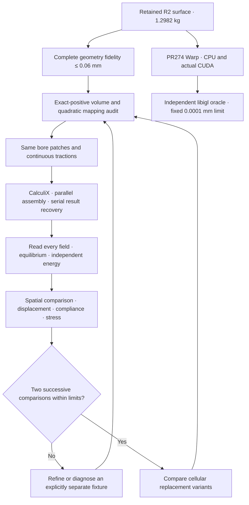
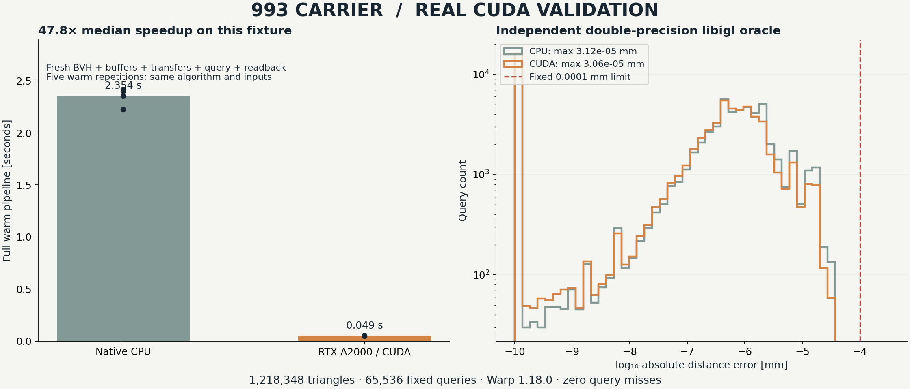
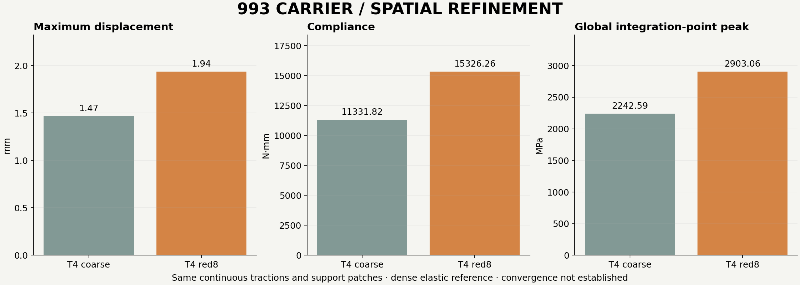
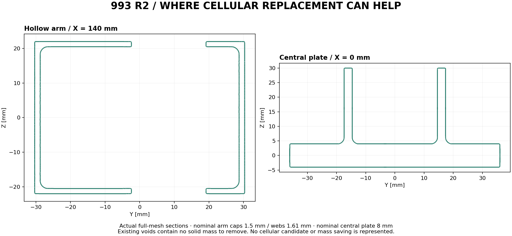

# 993 carrier — mechanical convergence and actual CUDA validation

This continuation keeps the **1.298199813 kg R2 geometry** and the same assumed
material, continuous bore tractions and support patches. It refines the analysis
spaces, checks every completed field and tests the new Warp layer from PR #274
on a rented NVIDIA GPU. The mass ceiling remains **1.30 kg**.

[Previous matched-order study](../carrier-resume-20261020/CONVERGENCE.md) ·
[Declared numerical criteria](convergence-contract.json) ·
[Full English part workflow](../../manufacturing/PART_WORKFLOW_EN.md) ·
[Exact retained material and load assumptions](evidence/material-and-load-study.json)

## Actual software validation

Warp **1.18.0**, NumPy **2.2.6** and Python **3.12.3** ran on a rented
**RTX A2000**, driver **595.91.07**, using the unchanged PR #274 query kernel.
All 15 pilot tests passed. The original three synthetic box cases passed on
both native CPU and actual `cuda:0`, with no CPU fallback for a CUDA request.

The real-carrier test includes every one of the **1,218,348 reference triangles**
and **65,536 deterministic queries**: bounding-box probes, surface centroids,
small normal offsets and nominal tool-column points. A separate **libigl 2.6.3
float64 oracle** checks the exact float32-promoted arrays delivered to Warp.
Neither its distances nor its acceptance decision call Warp.

Both devices pass the original **0.0001 mm** absolute error limit over the cold
pass and five warm repetitions. Maximum error is **0.0000306 mm on CUDA** and
**0.0000313 mm on CPU**, with zero missed queries.

The median complete warm pipeline is **2.354 s on CPU** and **0.0492 s on CUDA**,
about **47.8× for this fixture**. Each repetition creates a fresh mesh/BVH,
allocates buffers, transfers inputs, queries, synchronizes and reads results
back. Fixture generation, input loading and oracle assessment are excluded on
both devices. The kernel disk cache can reuse the earlier pilot compilation;
these are not universal speedups or finite-element solver timings.

This validates the pinned **native runtime** on CUDA. The separate Docker image
from PR #274 has its existing CPU image-build evidence; it has not itself been
executed on CUDA here. The approved provider launcher uses its existing pinned
mesh-CFD SSH image, inside which the isolated hash-pinned Python environment
was installed. No Docker-in-Docker operation or provider-secret retrieval was
used. Qwen, PorscheFanatics and ComPilot are workflow context in PR #274; these
results do not claim fresh model inference or compiler validation.

## Refinement protocol

The criteria were saved before new solves: at most **2% change in displacement
and compliance**, **5% in stress observables**, and two successive spatial
comparisons. The global integration-point peak, volume-weighted 95th percentile
and central `abs(X) ≤ 260 mm` region remain separate outputs. A central-region
result never qualifies an excluded end-restraint peak. Original equilibrium,
energy and complete **0.06 mm** geometry-fidelity limits are unchanged.

The first nested red split divides each of the original 343,283 tetrahedra into
eight, giving **2,746,264 exact-positive T4 cells**, one connected volume and
**785,624 matching boundary facets**. Child surface forces are integrated from
the original traction vectors; the old P2 nodal-force vector is not copied.

The corresponding quadratic mesh contains **4,452,247 nodes**. A rational
whole-simplex calculation certifies positive mappings in every element, with
maximum relative Jacobian perturbation **6.771 × 10⁻¹⁰ < 1**. Its composed
complete reference-surface distance bound is **0.059999994899846 mm**.

## A parallel-result regression detected and isolated

A rented native CalculiX **2.21-1** binary first passed the original quadratic
manufactured solution and both traction cube controls. A full-size T4 regression
then failed despite the solver's successful process exit: reaction imbalance
reached about **1,510 N**, and the independent stress-energy relative residual
was **182.17**, against the unchanged **0.0001** limit. That case is refused.

Changing only `CCX_NPROC_RESULTS` from **8 to 1**, while keeping parallel
assembly/factorization, restores the reference solution, reactions and stresses.
A separate entirely serial run also passes. This isolates the execution setting;
it does not claim an upstream source-code diagnosis. Future production runs use
serial result recovery. The failed fields and both diagnostic repeats are
retained rather than replaced by the successful repeat.

This mitigation is case-specific evidence, not a guarantee for every refined
mesh. The later fan T10 case still fails the independent reaction-force limit
with serial result recovery; a fully serial repeat is the next diagnostic.

The native quadratic reference independently passes equilibrium and stress
energy and recovers the previous **2.491741 mm / 1,152.404 MPa** values.
The local Docker refinement wrote a completed solver log but lost its cleanup
receipt when Docker Desktop became unavailable. It is excluded from accepted
results; the other local services were not restarted.

## Current mechanical comparisons

| Accepted field | Cells | Nodes | Max displacement, mm | Compliance, N·mm | Global peak VM, MPa | Volume-weighted p95 VM, MPa |
| --- | ---: | ---: | ---: | ---: | ---: | ---: |
| Coarse T4, serial result recovery | 343,283 | 107,537 | 1.469255 | 11,331.820 | 2,242.595 | 126.604 |
| Red8 T4, entirely serial repeat | 2,746,264 | 656,577 | 1.935419 | 15,326.258 | 2,903.057 | 147.276 |

The spatial changes, using the finer value as denominator, are **24.09% in
displacement**, **26.06% in compliance**, **22.75% in global peak stress** and
**14.04% in volume-weighted p95 stress**. None meets the declared limit. Independent
stress-energy residuals are **6.61 × 10⁻⁹** and **5.33 × 10⁻⁹**, respectively.
The linear mesh therefore remains too sensitive to spatial refinement.

The separate coarse T10 result is **2.491741 mm**, with a **1,152.404 MPa** global
integration-point peak. Element-order comparison is not a spatial convergence
comparison. The 4,452,247-node red8 T10 solve reached its **1,200 s** wall limit,
was terminated and reaped, and produced no complete displacement/stress field.
It contributes no convergence result.

The alternative intermediate mesh adds one interior centre per original cell,
giving **1,373,132 cells and 2,372,992 T10 nodes**, with the **original 196,406
boundary facets unchanged**. Complete exact orientation and whole-simplex
quadratic mapping audits pass. The original bore-patch areas, centroids and
traction vectors match exactly. This is an interior fan refinement; its boundary
mesh size is unchanged, and it is not a uniform halving of `h`. Its 319.60 s solve
completed all result rows, but is **refused**: the X reaction residual is
**−25.55 N**, beyond its unchanged **15.85 N** limit. The energy residual
**8.14 × 10⁻⁷** passes. Its apparent displacement/stress values are not admitted
to the convergence comparison. See the [complete refused assessment](evidence/fan-P2-assessment-001/assessment.json).

Successful process exit alone is never used as convergence evidence. The separate
original R2 manufacturing-study surface stays unchanged; these are analysis meshes.

### Shape quality is a separate diagnostic

The existing complete-cell quality evaluator was reused, without an invented
admission threshold. Positive Jacobians do not establish good conditioning.

| Complete corner-mesh diagnostic | Coarse | Interior fan |
| --- | ---: | ---: |
| Minimum mean-ratio quality, regular tetrahedron = 1 | 0.003477 | 0.001501 |
| Maximum local Jacobian 2-norm condition | 2,206.7 | 11,088.1 |
| Minimum altitude, mm | 0.001217 | 0.0003043 |

The fan worsens the worst shape measures. This is a possible contributor to
numerical sensitivity, **not an established cause** of its failed reaction check.
The condition measure uses the stored local corner ordering. Exact source-bound
reports are retained for the [coarse mesh](evidence/coarse-quality-001/assessment.json)
and [fan mesh](evidence/fan-quality-001/assessment.json). A full serial repeat
and the built-in iterative Cholesky solver are distinct diagnostics; changing
the linear solver alone must preserve all geometry, material, loads and supports.

## Toolchain coverage in this continuation

| Layer | Actual evidence and scope |
| --- | --- |
| PicoGK / source R2 | Retained geometry identity and nominal mass; no new cellular geometry claimed |
| libigl | Independent real-carrier distance oracle on exact arrays supplied to Warp |
| PR #274 Warp 1.18.0 | 15 pilot tests, synthetic CPU/CUDA fixtures and complete-carrier query fixture pass on actual GPU |
| PR #274 Docker image | Existing CPU image evidence; this separate image has not run on CUDA in this continuation |
| TetGen | An intermediate volume request was refused: `a0.5` still returned a 74.49 mm³ maximum cell; the cap was not relaxed |
| Deterministic refinement | Red8 and interior fan meshes pass complete exact volume/boundary checks |
| CalculiX 2.21-1 | Analytic controls, full fields, equilibrium and independent energy; serial result recovery required by the full-size regression |
| LPBF process tools | Retained earlier evidence only; these geometry/mechanics runs are not a fresh full-build process calculation |
| Qwen / ComPilot / PorscheFanatics | PR #274 workflow context, without a new inference/compiler/site execution claim |

See the [exact-copy evidence manifest](evidence-copy-manifest.json),
[accepted T4 comparison](evidence/P1-comparison.json) and
[native runtime qualification](evidence/native-runtime-qualification.json).
Large raw fields and input decks remain in the local work directory with
collection SHA-256 manifests; the report keeps the compact receipts and does not
claim that every large raw artifact is committed to Git.

## Further weight reduction with small cells

Cellular replacement remains a useful optimization candidate. It is not an
established mass saving on R2. The retained model already has hollow arms with
nominal **1.5 mm caps and 1.61 mm webs**, while the central plate is **8 mm**
thick. Putting a lattice into an existing void adds material; reducing weight
requires replacing material that is currently solid.

These are intersections of the complete retained R2 surface with two planes,
not an illustration of a generated cellular design. The arm section is already
open and thin-walled; the centre section shows the plate and standing ribs.

The first comparison should preserve the end eyes, bore interfaces, tool access
and the main loaded junctions, then examine sufficiently thick, lightly loaded
regions. A graded lattice or continuous cellular surface can be generated with
the installed [PicoGK and LatticeLibrary stack](https://github.com/leap71/LEAP71_LatticeLibrary).
Cell pitch, minimum ligament or wall thickness, skin thickness, connectivity,
local buckling and powder escape remain explicit design variables. No universal
micrometre-scale cell dimension is assumed. Primary LPBF research also identifies
[powder evacuation from small-pore lattices](https://link.springer.com/article/10.1007/s00170-026-17457-3)
as a geometry-dependent problem.

Making cells smaller is not itself a mass reduction. In the ideal geometric
scaling argument, reducing every cell dimension and its wall/strut thickness by
the same factor preserves relative density. At a fixed minimum thickness,
shrinking the pitch instead increases the amount of solid per occupied volume.
Topology and relative density must be compared together; the classical
[octet-truss study](https://doi.org/10.1016/S0022-5096(01)00010-2)
provides analytical and finite-element treatment of elasticity and strut buckling.
This scaling argument is not a carrier-specific stiffness prediction.

The earlier [BCC trial](../../../parts/993-eng-carrier-0001/source/bionic-20261011/native-leap71/README.md)
**added** 16 mm cells with 2 mm beams to the older V5 carrier. It did not replace
R2 solid material and had no solved mechanical result for the changed geometry.
Its mass rejection used the previous 1.2 kg ceiling. It therefore cannot establish
either the mass or resistance of a new cellular R2 variant.

For budgeting only, replacing a fraction `f` of the current solid material by a
lattice of relative density `r` gives `m = 1.298199813 × [1 − f × (1 − r)] kg`,
before skins, blends and machining allowances. For example, `f = 0.10` and
`r = 0.40` imply about **78 g** removed. This is an algebraic scenario, **not a
measured eligible volume, generated design or solved candidate**. The numerical
comparison must establish the actual eligible volume and stiffness cost.
