# 993 carrier — mechanical convergence and actual CUDA validation

This continuation keeps the **1.298199813 kg R2 geometry** and the same assumed
material, continuous bore tractions and support patches. It refines the analysis
spaces, checks every completed field and tests the new Warp layer from PR #274
on a rented NVIDIA GPU. The mass ceiling remains **1.30 kg**.

[Previous matched-order study](../carrier-resume-20261020/CONVERGENCE.md) ·
[Declared numerical criteria](convergence-contract.json) ·
[Full English part workflow](../../manufacturing/PART_WORKFLOW_EN.md) ·
[Exact retained material and load assumptions](evidence/material-and-load-study.json)

Current checkpoints: [complete-model rejection gate](#complete-model-regression-gate-and-displacement-view),
[accepted serial-recovery reference](#serial-recovery-reference-accepted-fine-field-pending),
the [cross-host recovery refusal](#cross-host-recovery-refusal-and-solver-only-threading),
and [new RTX 5060 Ti core screen](#rtx-5060-ti-replay-and-remeshed-core-screen).
Mechanical convergence remains open; the R2 master mass is unchanged.

Latest continuation: [dependency race reproduced and corrected](#spooles-race-reproduction-and-corrected-complete-reference),
with **500 paired low-level repeats** and **two complete corrected carrier
repeats**. The [serial fine run](#accepted-fine-t10-field-and-first-spatial-comparison)
now passes complete equilibrium and independent energy. Its first spatial
comparison keeps convergence open; execution repeats preserve the original criteria.

The [refined interior screen](#refined-interior-screen-on-the-rtx-4070) now finds a
**12.67 g conditional cellular budget**, with all **3,052,512 CPU/CUDA queries**
checked. This is not a new part mass; no cellular carrier has been generated.

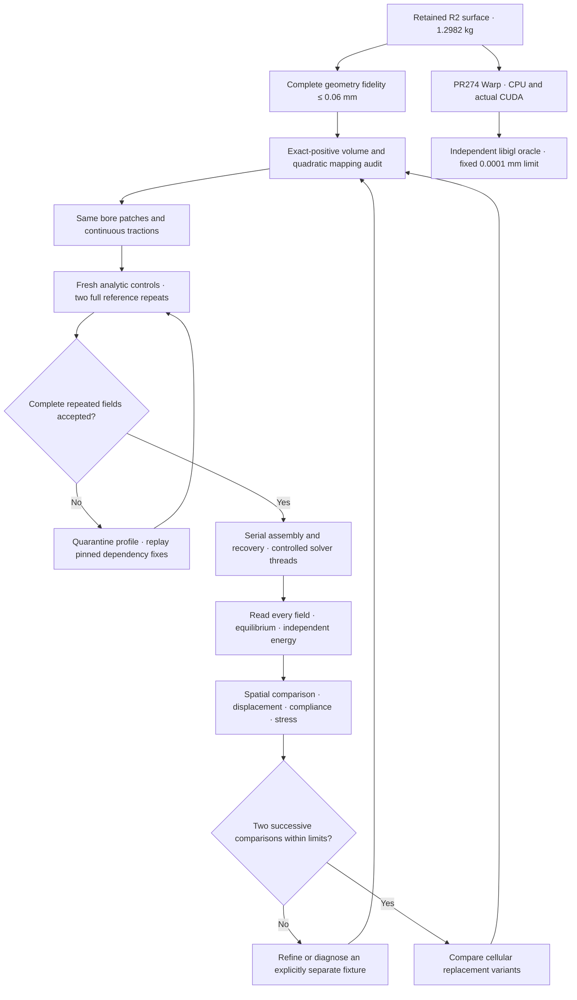

## Actual software validation

Warp **1.18.0**, NumPy **2.2.6** and Python **3.12.3** ran on a rented
**RTX A2000**, driver **595.91.07**, using the unchanged PR #274 query kernel.
All 15 pilot tests passed. The original three synthetic box cases passed on
both native CPU and actual `cuda:0`, with no CPU fallback for a CUDA request.

The real-carrier test includes every one of the **1,218,348 reference triangles**
and **65,536 deterministic queries**: bounding-box probes, surface centroids,
small normal offsets and nominal tool-column points. A separate **libigl 2.6.3
float64 oracle** checks the exact float32-promoted arrays delivered to Warp.
Neither its distances nor its acceptance decision call Warp.

Both devices pass the original **0.0001 mm** absolute error limit over the cold
pass and five warm repetitions. Maximum error is **0.0000306 mm on CUDA** and
**0.0000313 mm on CPU**, with zero missed queries.


The median complete warm pipeline is **2.354 s on CPU** and **0.0492 s on CUDA**,
about **47.8× for this fixture**. Each repetition creates a fresh mesh/BVH,
allocates buffers, transfers inputs, queries, synchronizes and reads results
back. Fixture generation, input loading and oracle assessment are excluded on
both devices. The kernel disk cache can reuse the earlier pilot compilation;
these are not universal speedups or finite-element solver timings.

This validates the pinned **native runtime** on CUDA. The separate Docker image
from PR #274 has its existing CPU image-build evidence; it has not itself been
executed on CUDA here. The approved provider launcher uses its existing pinned
mesh-CFD SSH image, inside which the isolated hash-pinned Python environment
was installed. No Docker-in-Docker operation or provider-secret retrieval was
used. Qwen, PorscheFanatics and ComPilot are workflow context in PR #274; these
results do not claim fresh model inference or validation of ComPilot. The separate
CalculiX compiler experiment is documented below.

## Refinement protocol

The criteria were saved before new solves: at most **2% change in displacement
and compliance**, **5% in stress observables**, and two successive spatial
comparisons. The global integration-point peak, volume-weighted 95th percentile
and central `abs(X) ≤ 260 mm` region remain separate outputs. A central-region
result never qualifies an excluded end-restraint peak. Original equilibrium,
energy and complete **0.06 mm** geometry-fidelity limits are unchanged.

The first nested red split divides each of the original 343,283 tetrahedra into
eight, giving **2,746,264 exact-positive T4 cells**, one connected volume and
**785,624 matching boundary facets**. Child surface forces are integrated from
the original traction vectors; the old P2 nodal-force vector is not copied.

The corresponding quadratic mesh contains **4,452,247 nodes**. A rational
whole-simplex calculation certifies positive mappings in every element, with
maximum relative Jacobian perturbation **6.771 × 10⁻¹⁰ < 1**. Its composed
complete reference-surface distance bound is **0.059999994899846 mm**.

## A parallel-result regression detected and isolated

A rented native CalculiX **2.21-1** binary first passed the original quadratic
manufactured solution and both traction cube controls. A full-size T4 regression
then failed despite the solver's successful process exit: reaction imbalance
reached about **1,510 N**, and the independent stress-energy relative residual
was **182.17**, against the unchanged **0.0001** limit. That case is refused.

Changing only `CCX_NPROC_RESULTS` from **8 to 1**, while keeping parallel
assembly/factorization, restores the reference solution, reactions and stresses.
A separate entirely serial run also passes. This isolates the execution setting;
it does not claim an upstream source-code diagnosis. Future production runs use
serial result recovery. The failed fields and both diagnostic repeats are
retained rather than replaced by the successful repeat.

This mitigation is case-specific evidence, not a guarantee for every refined
mesh. The later fan T10 case still fails the independent reaction-force limit
with serial result recovery; the fully serial repeat below passes both equilibrium and independent energy.

The native quadratic reference independently passes equilibrium and stress
energy and recovers the previous **2.491741 mm / 1,152.404 MPa** values.
The local Docker refinement wrote a completed solver log but lost its cleanup
receipt when Docker Desktop became unavailable. It is excluded from accepted
results; the other local services were not restarted.

## Current mechanical comparisons

| Accepted field | Cells | Nodes | Max displacement, mm | Compliance, N·mm | Global peak VM, MPa | Volume-weighted p95 VM, MPa |
| --- | ---: | ---: | ---: | ---: | ---: | ---: |
| Coarse T4, serial result recovery | 343,283 | 107,537 | 1.469255 | 11,331.820 | 2,242.595 | 126.604 |
| Red8 T4, entirely serial repeat | 2,746,264 | 656,577 | 1.935419 | 15,326.258 | 2,903.057 | 147.276 |

The spatial changes, using the finer value as denominator, are **24.09% in
displacement**, **26.06% in compliance**, **22.75% in global peak stress** and
**14.04% in volume-weighted p95 stress**. None meets the declared limit. Independent
stress-energy residuals are **6.61 × 10⁻⁹** and **5.33 × 10⁻⁹**, respectively.
The linear mesh therefore remains too sensitive to spatial refinement.


The separate coarse T10 result is **2.491741 mm**, with a **1,152.404 MPa** global
integration-point peak. Element-order comparison is not a spatial convergence
comparison. The 4,452,247-node red8 T10 solve reached its **1,200 s** wall limit,
was terminated and reaped, and produced no complete displacement/stress field.
It contributes no convergence result.

The alternative intermediate mesh adds one interior centre per original cell,
giving **1,373,132 cells and 2,372,992 T10 nodes**, with the **original 196,406
boundary facets unchanged**. Complete exact orientation and whole-simplex
quadratic mapping audits pass. The original bore-patch areas, centroids and
traction vectors match exactly. This is an interior fan refinement; its boundary
mesh size is unchanged, and it is not a uniform halving of `h`. Its 319.60 s solve
completed all result rows, but is **refused**: the X reaction residual is
**−25.55 N**, beyond its unchanged **15.85 N** limit. The energy residual
**8.14 × 10⁻⁷** passes. Its apparent displacement/stress values are not admitted
to the convergence comparison. See the [complete refused assessment](evidence/fan-P2-assessment-001/assessment.json).

A separate **fully serial repeat** completes in **471.93 s** and passes both
checks: force residual components are below **0.000036 N**, and the independent
energy residual is **6.48 × 10⁻⁹**. The earlier failed case remains refused.

| Accepted quadratic field | Max displacement, mm | Compliance, N·mm | Global peak VM, MPa | Volume-weighted p95, MPa | Central peak, MPa |
| --- | ---: | ---: | ---: | ---: | ---: |
| Coarse T10 | 2.491741 | 20,284.901 | 1,152.404 | 179.428 | 716.837 |
| Interior fan T10, fully serial | 2.493267 | 20,299.518 | 1,568.735 | 179.564 | 902.512 |

Displacement changes **0.0612%**, compliance **0.0720%**, and volume-weighted
p95 stress **0.0760%**. However, global and central peaks change **26.54%** and
**20.57%**. The central p95 changes **0.489%**. This is one interior-refinement
comparison; **complete spatial convergence remains false**. Removing the end
region does not stabilize the central peak.

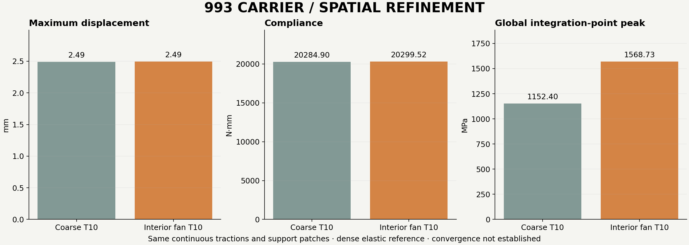

The separate fully serial red8 T10 repeat reached its **2,349 s** wall limit,
was reaped, and produced an empty DAT field. It is excluded. Its compact receipt
and collection hashes are retained; the larger mesh has not supplied a second
accepted spatial comparison.

Successful process exit alone is never used as convergence evidence. The separate
original R2 manufacturing-study surface stays unchanged; these are analysis meshes.

### Shape quality is a separate diagnostic

The existing complete-cell quality evaluator was reused, without an invented
admission threshold. Positive Jacobians do not establish good conditioning.

| Complete corner-mesh diagnostic | Coarse | Interior fan |
| --- | ---: | ---: |
| Minimum mean-ratio quality, regular tetrahedron = 1 | 0.003477 | 0.001501 |
| Maximum local Jacobian 2-norm condition | 2,206.7 | 11,088.1 |
| Minimum altitude, mm | 0.001217 | 0.0003043 |

The fan worsens the worst shape measures. This is a possible contributor to
numerical sensitivity, **not an established cause** of its failed reaction check.
The condition measure uses the stored local corner ordering. Exact source-bound
reports are retained for the [coarse mesh](evidence/coarse-quality-001/assessment.json)
and [fan mesh](evidence/fan-quality-001/assessment.json). The full serial repeat
and built-in iterative Cholesky solver are distinct diagnostics; changing
the linear solver alone must preserve all geometry, material, loads and supports.

The resumed native runtime passes all three direct analytic controls with one
thread. Built-in iterative Cholesky completes its processes but **fails both
traction controls** at unchanged limits. P1 stress error is **0.000125328 MPa**;
P2 stress error is **0.008415576 MPa**, against **0.000001 MPa**. It is not admitted
to production comparisons. Its source-preserving deck transformation does not
qualify the solver's numerical accuracy.

### Compiler storage regression

Two binaries were built from the same pinned Debian CalculiX 2.21 source and
patches, with identical C flags and Fortran flags except for **`-frecursive`**.
The [GFortran documentation](https://gcc.gnu.org/onlinedocs/gfortran/Code-Gen-Options.html)
describes its local-array storage behavior. Both binaries pass all three original
analytic controls with eight threads. The production inputs and numeric source
are unchanged. Compiler banners, archive identities, flags, binary hashes and
linked-library metadata are retained.

The full coarse T4 regression distinguishes the profiles: default storage fails
with a **−541.55 N** X reaction residual and **0.001177** energy residual.
The recursive build passes equilibrium and independent energy (**6.61 × 10⁻⁹**).
Against the accepted stock serial field, its maximum component differences are
**1.0 × 10⁻¹⁰ mm** displacement, **0.0001 MPa** stress and **0 N** reactions,
within the limits declared before the comparison. The default-storage field fails
those limits. This supports the storage-setting diagnosis for this full-size T4
case; it does not qualify every mesh or establish a specific upstream source fix.

The recursive fan T10 attempt was **refused** after allocation failure at its
separate **24 GiB address-space cap** (process code 255). It produced no complete
field and does not qualify parallel quadratic recovery. The stock fully serial
fan result above remains the accepted field. A further quadratic run would need
an independently bounded memory allowance before it can test this hypothesis.

All collected outputs were hashed before the final owned Vast instance was
destroyed. The provider independently confirmed absence, and the retained guard
recorded **three consecutive absence confirmations**. No rental remains running.

## Toolchain coverage in this continuation

| Layer | Actual evidence and scope |
| --- | --- |
| PicoGK / source R2 | Retained geometry identity and nominal mass; no new cellular geometry claimed |
| libigl | Independent real-carrier distance oracle on exact arrays supplied to Warp |
| PR #274 Warp 1.18.0 | 15 pilot tests, synthetic CPU/CUDA fixtures and complete-carrier query fixture pass on actual GPU |
| PR #274 Docker image | Existing CPU image evidence; this separate image has not run on CUDA in this continuation |
| TetGen | An intermediate volume request was refused: `a0.5` still returned a 74.49 mm³ maximum cell; the cap was not relaxed |
| Deterministic refinement | Red8 and interior fan meshes pass complete exact volume/boundary checks |
| CalculiX 2.21-1 | Analytic controls, full fields, equilibrium and independent energy; serial result recovery required by the full-size regression |
| LPBF process tools | Retained earlier evidence only; these geometry/mechanics runs are not a fresh full-build process calculation |
| Qwen / ComPilot / PorscheFanatics | PR #274 workflow context, without a new inference/compiler/site execution claim |

See the [exact-copy evidence manifest](evidence-copy-manifest.json),
[accepted T4 comparison](evidence/P1-comparison.json) and
[native runtime qualification](evidence/native-runtime-qualification.json).
Large raw fields and input decks remain in the local work directory with
collection SHA-256 manifests; the report keeps the compact receipts and does not
claim that every large raw artifact is committed to Git.

## Further weight reduction with small cells

Cellular replacement remains a useful optimization candidate. It is not an
established mass saving on R2. The retained model already has hollow arms with
nominal **1.5 mm caps and 1.61 mm webs**, while the central plate is **8 mm**
thick. Putting a lattice into an existing void adds material; reducing weight
requires replacing material that is currently solid.


These are intersections of the complete retained R2 surface with two planes,
not an illustration of a generated cellular design. The arm section is already
open and thin-walled; the centre section shows the plate and standing ribs.

The first comparison should preserve the end eyes, bore interfaces, tool access
and the main loaded junctions, then examine sufficiently thick, lightly loaded
regions. A graded lattice or continuous cellular surface can be generated with
the installed [PicoGK and LatticeLibrary stack](https://github.com/leap71/LEAP71_LatticeLibrary).
Cell pitch, minimum ligament or wall thickness, skin thickness, connectivity,
local buckling and powder escape remain explicit design variables. No universal
micrometre-scale cell dimension is assumed. Primary LPBF research also identifies
[powder evacuation from small-pore lattices](https://link.springer.com/article/10.1007/s00170-026-17457-3)
as a geometry-dependent problem.

Making cells smaller is not itself a mass reduction. In the ideal geometric
scaling argument, reducing every cell dimension and its wall/strut thickness by
the same factor preserves relative density. At a fixed minimum thickness,
shrinking the pitch instead increases the amount of solid per occupied volume.
Topology and relative density must be compared together; the classical
[octet-truss study](https://doi.org/10.1016/S0022-5096(01)00010-2)
provides analytical and finite-element treatment of elasticity and strut buckling.
This scaling argument is not a carrier-specific stiffness prediction.

The earlier [BCC trial](../../../parts/993-eng-carrier-0001/source/bionic-20261011/native-leap71/README.md)
**added** 16 mm cells with 2 mm beams to the older V5 carrier. It did not replace
R2 solid material and had no solved mechanical result for the changed geometry.
Its mass rejection used the previous 1.2 kg ceiling. It therefore cannot establish
either the mass or resistance of a new cellular R2 variant.

For budgeting only, replacing a fraction `f` of the current solid material by a
lattice of relative density `r` gives `m = 1.298199813 × [1 − f × (1 − r)] kg`,
before skins, blends and machining allowances. For example, `f = 0.10` and
`r = 0.40` imply about **78 g** removed. This is an algebraic scenario, **not a
measured eligible volume, generated design or solved candidate**. The numerical
comparison must establish the actual eligible volume and stiffness cost.

### Executed protected-core screen

The algebraic 78 g example above is **not** a found saving. A new executed screen
uses the accepted fully serial fan T10 field, all **1,373,132 analysis-cell
centroids**, and their integrated strain energies. CPU and actual CUDA distances
are checked against an independent libigl oracle on the exact float32-promoted
arrays. Both pass the unchanged **0.0001 mm** limit, with maximum errors
**0.0000471 mm on CPU** and **0.0000435 mm on CUDA**, without missed queries.
This fixture uses the **196,406-face auxiliary analysis boundary**, separately
from the earlier 1,218,348-face retained-R2 query test.

For each entire analysis cell, the screen subtracts its corner-ball radius,
the quadratic mapping deviation bound, float32 transport bounds and the fixed
distance-error allowance. It retains a nominal **1.5 mm skin**, **10 mm bore
keepouts** and the inboard region `abs(X) ≤ 260 mm`. These are provisional design
assumptions, not demonstrated printer limits. Whole-cell protection is deliberately
conservative and can reject cells with an admissible subvolume.

Only **192 whole cells**, totaling **543.712 mm³**, survive this screen. They
represent **0.1851%** of the auxiliary analysis volume and **0.0477%** of its
original strain energy. Conditional replacement at relative density **0.40**
would remove **1.442 g**, giving an **analysis-proxy** mass of **1.296793 kg**.
The retained R2 part remains unchanged at **1.298199813 kg**. The proxy uses its
own integrated volume; it is not a measured mass of a newly generated part.

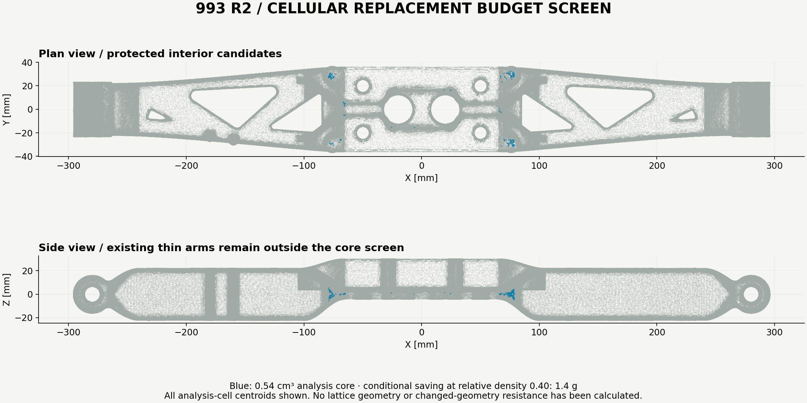

**This is a conservative subset, not an upper bound on possible weight reduction.**
The coarse cells and their enclosing balls can exclude useful material in the
8 mm central plate. A finer geometric partition, altered skins, or a redesigned
cellular section could expose more material. None is credited here without its
own geometry and comparison. Low original strain energy does not predict the
redistributed stress, local buckling or stiffness of the changed design.

Reproduce with `prepare_cellular_screen.py`, the unchanged paired
`check_carrier_warp.py` queries, and `select_cellular_budget.py` using the retained
[cellular parameters](../../../parts/993-eng-carrier-0001/source/design-20261016/convergence-20261022/cellular-screen-parameters.json).
The [assessment](evidence/cellular-budget-001/assessment.json), oracle and paired
device reports are exact copies in the evidence manifest. No lattice geometry,
changed-part solve, or microcell manufacturing qualification has been produced.

## 25 October — replacing sliver-preserving refinement with a quality remesh

PR #276 is merged with passing Linux checks. The next experiment reuses the
installed **Gmsh 4.15.2** runtime; no new paid machine is required for this stage.
The separate catalogue gyroid study on `main` uses the older F0 concept and its
receipt reports `core_region_cm3 = 0` and `cored = false`. It supplies no cellular
mass saving on R2 and is not substituted for the mechanical reference.

The existing complete-cell diagnostics locate the original worst-shaped cell at
approximately **(52.7485, −24.8066, −2.5776) mm**. All four corners are boundary
vertices, although none of its four complete faces is a stored surface facet.
Interior-node relocation cannot move those four protected corners. Its minimum
mean ratio stays **0.00347694** after three `Relocate3D` iterations. That output
passes exact orientation and indexed connectivity, but does not remove this
worst-cell limitation. This does not prove the cause of the earlier stress peaks.

### Native Netgen import defect and explicit recovery

The [Gmsh optimization API](https://gmsh.info/doc/texinfo/#gmsh_002fmodel_002fmesh_002foptimize)
allows optimization of imported discrete entities with `force=True`. In the
executed one-volume import, Netgen leaves the complete original **343,283-cell**
block intact and appends **381,564 new cells**. The combined output has the same
stored surface and positive cell determinants, but its integrated volume doubles
to **587,436.6766 mm³**. The independent indexed audit detects **97,688
nonmanifold faces**, and none of the stored surface triangles is on the combined
volume boundary. **This raw output is refused and retained.** A successful process
exit, a preserved surface list and positive cells do not qualify a volume mesh.

`extract_appended_netgen.py` is an explicit, separately recorded recovery. It
requires equality of every original vertex and cell in the complete prefixes,
plus the complete unchanged boundary array, before removing the old cell block.
It compacts only unused vertices and saves the new block as a fresh candidate.
The raw output and its rejection remain immutable. Gmsh warns that per-entity
optimization selection is not interfaced; this fixture contains only one volume,
so no claim of selective optimization is made.

The extracted block has **119,948 nodes and 381,564 cells**. A fresh independent
audit checks every cell with exact dyadic rational arithmetic and every indexed
face: **zero negative/zero-volume cells, one connected component, zero
nonmanifold faces and all 196,406 boundary facets matched**. Its exact signed
volume is the same as the original: **293,718.3382924733 mm³**. The complete surface
coordinates and triangles remain unchanged; the retained R2 geometry and nominal
**1.298199813 kg** part mass are unchanged.

| Complete-cell diagnostic | Original T4 | Extracted Netgen T4 |
| --- | ---: | ---: |
| Cells | 343,283 | 381,564 |
| Minimum mean-ratio quality | 0.00347694 | 0.0160222 |
| Maximum local Jacobian condition | 2,206.72 | 608.86 |
| Minimum element altitude, mm | 0.00121727 | 0.00648869 |

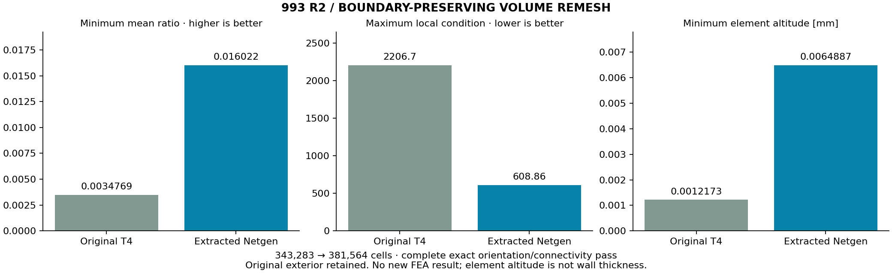

The mean-ratio minimum improves **4.61×** with about **11.2%** more cells.
Element altitude measures a numerical cell, not the part's wall thickness.
No admission threshold is invented and no new stress result is inferred from
shape quality. The small analytic tetrahedron also passes after the explicit
extraction: volume **1/6**, complete exact connectivity/orientation, and minimum
mean ratio **0.0940 → 0.4404**.

```mermaid
flowchart LR
    A[Original audited T4] --> B[Gmsh Netgen discrete optimization]
    B --> C[Combined old and new blocks]
    C --> D[Independent audit: double volume refused]
    D --> E[Verify complete unchanged original prefixes]
    E --> F[Extract appended block explicitly]
    F --> G[Fresh exact full-volume audit passes]
    G --> H[Matched T10 conversion and mapping audit pending]
    H --> I[Same traction patches and new mechanical comparisons]
```

The next mechanical step is to convert this genuinely changed cell connectivity
to T10, audit its mapping and numeric transport, transfer the identical surface
patches/tractions, and compare complete accepted fields. It is a replacement
analysis mesh, not another nested spatial-refinement level. The original
convergence contract and all earlier failed results remain unchanged.

The first exact-audit attempts using the host user-site Python failed its SciPy
native import; the same unmodified auditor then completed in the existing
isolated geometry runtime (NumPy 2.0.2 / SciPy 1.14.1). No host runtime or Docker
service was restarted. Small receipts, the refused combined mesh audit, the
explicit extraction and successful fresh audits are exact copies under
[evidence/mesh-quality-20261025](evidence/mesh-quality-20261025/carrier-Netgen-appended-exact-001/assessment.json).
Raw mesh arrays remain in `work/carrier-mesh-quality-20261025/` with SHA-256
identities. No new FEA result, cellular geometry, process job or manufacturing
release is claimed by this checkpoint.

Verification for this checkpoint: **87 focused carrier tests pass**, including
all four new extraction/boundary regressions; all published copy hashes pass;
strict links report **zero broken links across 1,829 Markdown files**; preview
fingerprints pass. Full local `make check` completed **4,860 tests** with **4
failures / 39 errors / 458 skips** in the host Python 3.10 environment. Its native
SciPy/import and existing retained-fixture failures are recorded separately;
these local failures are not represented as a passing full suite. Linux CI must
check the published PR head independently.

### Matched quadratic geometry and unchanged loads

The replacement mesh now has **381,564 T10 elements and 719,680 nodes**.
`prepare_remeshed_quadratic.py` verifies every oriented boundary triangle against
the retained, source-bound linear reference before transferring its complete
surface-distance budget. Cyclic corner permutations are allowed; reversed winding
or even a 1e-12 mm boundary displacement is refused. The reference linear and
quadratic corner rosters and all retained hashes must agree. No sampled-distance
result is upgraded to a complete certificate.

The original shared-edge midpoint construction and bounded CalculiX numeric
encoder are reused. A fresh whole-simplex integer mapping audit passes every
new T10 element, with maximum relative Jacobian perturbation **2.50026 × 10⁻¹⁰**
and composed reference-to-transported-surface bound **0.059999994899798 mm**,
below the unchanged **0.06 mm** limit. The inherited linear bound is rounded
upward when converting its exact rational sum to binary64.

The unchanged matched-traction generator then prepares P1 and P2 decks. A full
comparison of both order reports confirms **identical material, all bore-patch
areas/centroids/counts, and all per-bore constant traction vectors** for both
load cases. This is preparation and geometry evidence; native result fields,
equilibrium and independent energy remain required before a mechanical comparison.

## 25 October — qualified local solver and new complete mechanical fields

A native **macOS arm64 CalculiX 2.21** runtime is now built in a private work
prefix with the existing GCC 16.2.0 and ARPACK 3.9.1 toolchain. No global package
or service was replaced. A clean, source-only replay of the published installer
produces **the identical binary SHA-256** as the separately qualified runtime:
`188939942f7d1e4214c7f74d17dc8cacab46e37e484ea2e3d1db03f2794a0a7a`.

### A large-case SPOOLES failure missed by small analytic controls

The first port follows the public
[Homebrew CalculiX recipe](https://github.com/costerwi/homebrew-calculix/blob/main/calculix-ccx.rb)
for the macOS build mechanics, while retaining the pinned **2.21** numerical
sources instead of adopting its newer solver version. It passes the original
manufactured solution and traction controls, but the full reference crashes
with **SIGSEGV** after 111.5 s inside `I2Ohash_insert` during sparse-factor
postprocessing. That binary is refused for full-size mechanics.

A targeted C reproducer instruments the actual SPOOLES source with UBSan. It
catches **signed 32-bit overflow in `60001 * 60001`** before the resulting invalid
hash-table access. This is the historical SPOOLES issue covered by the official
Debian `I2Ohash-64bit.patch`, available in the hash-pinned
[Ubuntu/Debian source patch archive](https://archive.ubuntu.com/ubuntu/pool/universe/s/spooles/spooles_2.2-14.debian.tar.xz).
The patch widens the hash product in insertion, lookup and removal; it does not
change material, geometry, loads or acceptance limits. The patched C reproducer
passes insertion/lookup/removal without a UBSan error. The old source, failed
binary, failed full run and filtered owned-process crash diagnostic are retained.
Raw operating-system crash reports are not committed.

A separate local supervision defect surfaced when a process completed during
RSS observation and group-signal cleanup. Its finished solver log lacked a
complete terminal receipt, so that attempt is **excluded**. The worker now
records the owned PID, accepts legitimate zero-RSS exit observations and reaps
the process across Darwin's exit/group-signal race. Missing or malformed RSS
measurements remain refused. A fresh full repeat supplies the accepted receipt;
the old finished log receives no retroactive qualification credit.

### Cross-platform reference recovery

The corrected binary passes all three original analytic controls at unchanged
limits. Its complete coarse T10 reference independently passes equilibrium and
stress/strain energy. Compared with the previously accepted Linux field, maximum
component differences are **1.0e-6 mm displacement**, **0.0001 MPa stress** and
**0.00001 N reaction**, within the previously declared compiler comparison
limits of 1e-5 mm / 0.01 MPa / 0.01 N. The maximum displacement and global VM
peak reproduce **2.491741357 mm / 1,152.404155 MPa**.

The new solver worker runs one requested thread, bounds wall time and child CPU
time, samples the actual solver PID's RSS, hashes complete inputs/outputs and
requires a reaped process plus a finished marker. Its **24 GiB sampled-RSS ceiling
is not an OS memory guarantee**; each probe is bounded and the observation scope
is recorded. Accepted complete runs here remain below approximately **11.0 GiB
sampled RSS**. No fresh CUDA execution is claimed by these local CPU results.

### Accepted replacement-mesh results

All following fields have complete result rosters, preserved source hashes,
independent equilibrium and independent stress-energy checks.

| Quadratic T10 field | Cells | Max displacement, mm | Compliance, N·mm | Global peak VM, MPa | Volume-weighted p95, MPa | Central peak, MPa |
| --- | ---: | ---: | ---: | ---: | ---: | ---: |
| Original reference, corrected native replay | 343,283 | 2.491741 | 20,284.901 | 1,152.404 | 179.428 | 716.837 |
| Quality remesh, same exterior | 381,564 | 2.497451 | 20,337.443 | 799.432 | 179.078 | 774.445 |

Using the new field as denominator, changes are **0.229% displacement**, **0.258%
compliance**, **0.195% p95 stress**, but **44.15% global peak** and **7.44% central
peak**. The independent energy residual of the replacement T10 field is
**2.44e-9**. This is a **topology-replacement comparison, not a nested h-refinement
step**. The unchanged physical study shape has not acquired a demonstrated
strength gain merely because one computed peak decreased.

### New nested family from the quality mesh

The first red8 split now contains **3,052,512 T4 cells / 719,680 nodes**. Its full
exact-rational orientation and indexed boundary/connectivity audit passes.
The corresponding T10 space contains **4,884,701 nodes**; its complete mapping
proof also passes, with relative Jacobian perturbation **5.73942e-10** and composed
surface bound **0.059999994899846 mm**. The consistently integrated child loads
retain the parent traction vectors and patch rosters. This larger T10 solve is
**prepared, not executed** by this checkpoint.

| Accepted T4 field | Cells | Max displacement, mm | Compliance, N·mm | Global peak VM, MPa | Volume-weighted p95, MPa |
| --- | ---: | ---: | ---: | ---: | ---: |
| Quality remesh T4 | 381,564 | 1.550166 | 12,004.933 | 1,270.714 | 129.527 |
| Nested red8 T4 | 3,052,512 | 1.989848 | 15,795.123 | 1,555.257 | 150.228 |

The nested changes are **22.10% displacement**, **24.00% compliance**, **18.30%
peak stress** and **13.78% p95 stress**. Independent energy residuals are
**2.34e-8** and **1.20e-8**. **These calculations are accepted; their convergence
is not.** The larger T10 family and further comparisons remain necessary under
the unchanged contract, including its two-successive-comparison requirement.

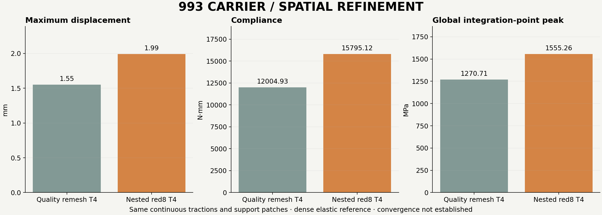

Both load cases at both orders also receive a coordinate-labelled comparison:
every encoded nonzero nodal force is identical to the original reference. P1
fixed-node coordinates are identical. Three P2 fixed midpoint coordinates differ
by at most **1/288230376151711744 mm = 3.47e-18 mm** after the fresh numeric
transport. This roundoff is recorded explicitly; it does not change the nominal
fixed patch model. It is covered by the fresh geometric mapping/transport proof.

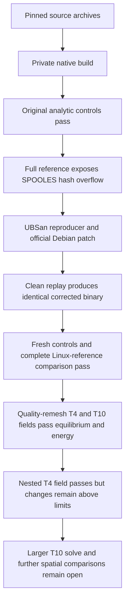

### Reproduce locally and continue

The [native installer](../../../parts/993-eng-carrier-0001/source/design-20261016/convergence-20261022/build_macos_ccx.py)
downloads four SHA-pinned source archives from Ubuntu and Netlib, applies the
retained Debian patches and bounded macOS build-compatibility edits, and builds
with two compiler jobs. It refuses an existing output directory or a different
retained compiler/ARPACK version. Use the existing toolchain; it does not upgrade
Homebrew packages.

```sh
python3 parts/993-eng-carrier-0001/source/design-20261016/convergence-20261022/build_macos_ccx.py \
  --output work/local-ccx-fresh
```

Building alone does not qualify the binary. Run `spooles_hash64_control.c` against
its actual source with UBSan, the three original analytic controls with
`run_local_ccx_serial.py`, the existing independent readers, and the full retained
reference before adopting new fields. The clean replay and all actual control
receipts are published as compact exact copies; large raw decks/fields remain in
`work/carrier-mesh-quality-20261025/` with hashes.

The bounded Vast rental **57657325** eventually reached `running`, but its input
transfer delivered only **783,360 / 40,781,439 bytes** before the 60 s transfer
bound. No remote numerical job started. With the corrected local reference
independently accepted and the remaining rental time insufficient at that
observed rate, the exact owned instance was destroyed. The provider independently
confirmed absence and its guard recorded three consecutive absence confirmations.
This rental supplies no new GPU or finite-element qualification claim.

The retained R2 master stays **1.298199813 kg**, below **1.30 kg**. No new cellular
part, changed-geometry resistance result, qualified print job or manufacturing
release is claimed. The full engineering/manufacturing objective remains open.

Current-checkpoint verification: **91 focused carrier tests pass**, including
native extraction/archive and process-exit regressions plus exact receipt-copy
checks. Strict links report **0 broken links / 1,829 Markdown files**, and all
**43 public catalogue preview records** remain current. The previous Linux head
`53d65b20` passed full CI; the new published head requires its own CI result.
The earlier local full-suite host failures remain recorded and are not presented
as a passing current-head `make check`.

## Complete-model regression gate and displacement view


This image uses the accepted **381,564-cell / 719,680-node T10** field, every
quadratic boundary face and its actual nodal displacements. Grey shows the
undeformed shape; deformation is amplified **10×**. Colours represent displacement,
with the displayed triangle's vertex magnitudes averaged only for colour. The
reported maximum remains the complete field's **2.497451 mm**. This is the same
**1.298199813 kg** R2 study geometry, not a newly lightened design.

The later Linux recursive-binary run demonstrates why small controls and a normal
solver exit cannot qualify this workflow by themselves:

| Check | Eight result-recovery threads, full T10 reference |
| --- | ---: |
| Original three analytic controls | Passed their unchanged mathematical limits |
| Actual solver exit / finished marker | 0 / present |
| Complete displacement / stress / reaction rows | 719,680 / 1,526,256 / 11,051 |
| Largest force imbalance | **3,795.43 N** versus a **13.80 N** limit |
| Independent stress-energy residual | **48.1901** versus **0.0001** |
| Field admission | **Refused** |
| Fine production case launched from this run | **No** |

The enormous resulting stress peak is a **refused numerical output**, not a
material strength result. `-frecursive` alone did not make this full T10
parallel-recovery run admissible. The exact input/output hashes, independent
assessment, collection receipt and teardown evidence are retained under
[`evidence/mesh-quality-20261025`](evidence/mesh-quality-20261025).

The next bounded profile retains parallel assembly/factorization but requests
**`CCX_NPROC_RESULTS=1`**, as the existing serial-recovery worker does. Its
[long worker](../../../parts/993-eng-carrier-0001/source/design-20261016/convergence-20261022/run_native_ccx_long_parallel.py)
records both thread counts. It allows at most 2,400 s and 240 GiB of address space;
the executed cap must remain below the measured allocation. The complete coarse
field must pass equilibrium, independent energy and the original whole-component
Mac/Linux regression limits before a fine solve is launched. These execution
changes do not relax the spatial-convergence contract.

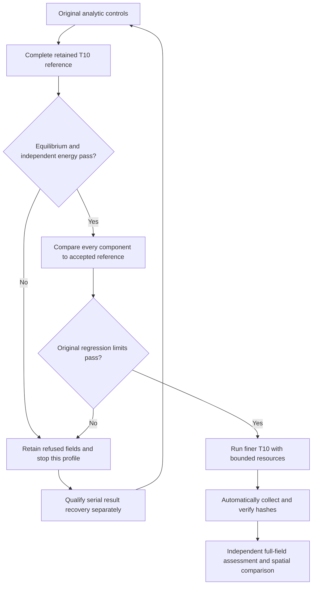

Rental **57665158** reached its fixed deadline during an interruption. Its
analytic controls were retained, but its complete-model result was not collected;
it supplies **no accepted full field**. The guard destroyed it and verified its
absence. Rental **57702970** produced the refused full field above; all files
needed for independent assessment were collected before destruction, and absence
was independently confirmed. Neither rental launched the finer production solve.

The exact previous published head **`2cb88efc`** passed full Linux CI in
[run 40193446206](https://github.com/cluster2600/porscheparts/actions/runs/40193446206).
Later changes need their own checks; that result is not transferred to a new head.

### Serial-recovery reference accepted; fine field pending

On rental **57704201**, the same recursive binary with serial result recovery
passed fresh analytic controls and the **complete 381,564-cell T10 reference**.
The actual solve took **113.97 s**. Its independent energy residual is
**2.38e-9**, and every displacement, stress and reaction component agrees with
the accepted Mac reference within the original regression contract: maximum
differences **1e-6 mm**, **0.0001 MPa** and **0.00001 N**. This admits that particular
execution; the later cross-host refusal below means the profile is not generally
qualified. The refused eight-recovery-thread field remains excluded.

The **3,052,512-cell / 4,884,701-node T10** solve was then launched with the same
loads and source-bound geometry, eight assembly threads and one result-recovery
thread. Its recorded bound is **2,215 s / 136 GiB virtual address space**, below
the measured **183,500,800,000-byte cgroup allocation**, with **900 s reserved for
collection** before the original lease deadline. At this checkpoint the fine
field is **pending**: no new convergence or strength result is claimed.

This checkpoint passes **29 focused continuation tests**, strict links over
**1,829 Markdown files** and freshness checks for **43 catalogue previews**.
The local minimal geometry runtime lacks Matplotlib; the tests and figure were
successfully run with the already installed host NumPy/Matplotlib environment.
The new Linux head still requires its own full CI outcome.

### RTX 5060 Ti replay and remeshed core screen

The unchanged PR #274 kernel also passes on an actual **RTX 5060 Ti, sm_120**,
driver **595.104.02**, with Warp **1.18.0**. All **15 pilot tests** pass. The new
fixture covers **381,564 cell-centroid queries / 196,406 complete analysis-boundary
triangles** from the accepted replacement-mesh reference. Native CPU and actual
CUDA both pass six repetitions against the independent **libigl 2.6.3 float64
oracle**, using the exact same float32-promoted arrays. Maximum errors are
**0.00004128 mm CPU** and **0.00003819 mm CUDA**, below the unchanged **0.0001 mm**
limit, with complete hit rosters. No CPU fallback is used for the CUDA request.

This secondary workload was restricted to **two CPU affinity entries** while the
primary fine solve continued with its frozen inputs. Its timings are not used
for a new hardware speedup claim. The actual native libigl import on the isolated
Mac environment refused with `std::bad_cast`; the Linux oracle runtime was used
and its outputs collected. Package installation alone is not called a working
native runtime.

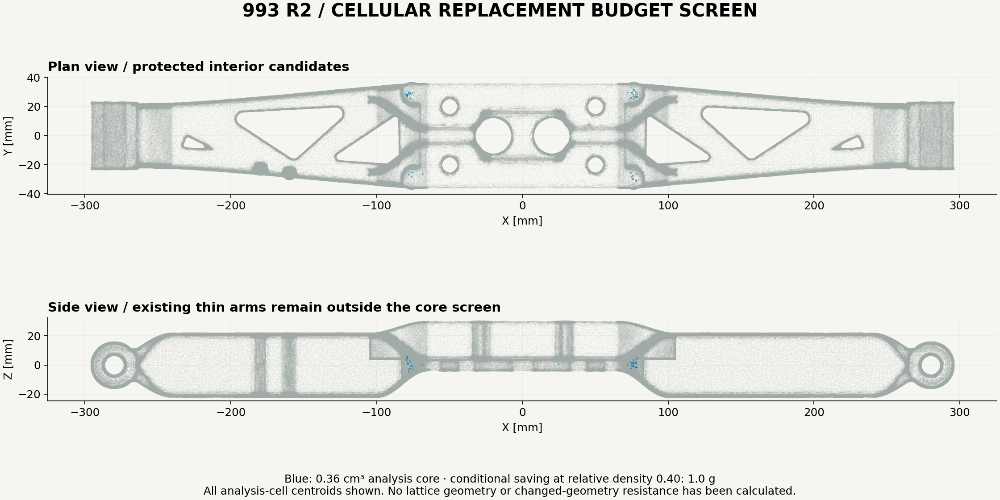

With the original **1.5 mm skin**, **10 mm bore keepout**, inboard limit and density
scenario unchanged, **44 whole analysis cells / 358.714 mm³** pass the screen.
The arithmetic saving at relative density **0.40** is **0.9513 g**, with
**0.03445% of the baseline elastic energy** in those cells. This is a geometric
and baseline-energy screen, not a calculation of the modified part's resistance.

**Neither this result nor the earlier 1.442 g screen is an upper bound on possible
lightening.** Different interior tessellations enclose different conservative
whole-cell subsets. A cell whose enclosing radius crosses the skin is excluded
even when part of it could contain smaller cavities. The next useful geometric
step is finer classification and an actual protected cellular solid, followed by
the same complete mechanical checks. No cellular geometry or new part mass is
credited here; the retained R2 master stays **1.298199813 kg**.

### First fine attempt collected and refused at its wall limit

The first replacement-mesh fine T10 attempt reached **2,215.006 s**, its declared
wall limit. The child process was terminated and reaped; the input hashes were
unchanged. Its DAT contains **zero bytes**, there is no finished marker and the
independent reader refuses the completion receipt. **No fine field and no spatial
convergence comparison result from this attempt.** This is a runtime limit, not
evidence of mechanical failure or convergence.

The complete compact execution/collection receipts were retained, and rental
**57704201** was destroyed and independently verified absent. Collection
supervision was taken over without interrupting the remote fine solve so that a
transfer timeout could not trigger premature teardown. The original lease
deadline remained unchanged; its guard records three absence confirmations.

A separate extended profile,
[`run_native_ccx_extended_parallel.py`](../../../parts/993-eng-carrier-0001/source/design-20261016/convergence-20261022/run_native_ccx_extended_parallel.py),
permits **at most 7,200 s**, preserves serial result recovery and enables line
buffering for visible progress. The separately bounded
[`lease_guard_extended_live.py`](../../../parts/993-eng-carrier-0001/source/design-20261016/convergence-20261022/lease_guard_extended_live.py)
permits a **new lease of at most three hours / USD 2**. Historical profiles and
receipts stay unchanged. A new execution must pass the fresh controls and complete
reference comparison before running the identical fine inputs. This larger time
envelope is not a numerical acceptance result.

### Cross-host recovery refusal and solver-only threading

Rental **57714117** passed fresh analytic controls, resource inspection and a
checksum-verified bidirectional transfer probe. However, the complete coarse
reference with eight assembly threads, one recovery thread and line buffering
was refused. Although the maximum displacement matched **2.497451456 mm** and
the process exited normally, the independent energy residual was **0.00538725**
against the unchanged **0.0001** limit. The force residual was
**[743.75, 226.33, −25.53] N**, and the stress peak was **1,342.79 MPa**.
The [complete assessment](evidence/mesh-quality-20261025/linux-013-coarse-P2-assessment-001/assessment.json)
records the full field counts and input hashes. No fine solve was launched;
the [lease guard](evidence/mesh-quality-20261025/vast-lease-013/guard-terminal-live.json)
confirmed destruction and three consecutive absence observations.

The accepted earlier Mac and Linux fields retain their individual equilibrium,
energy and component-comparison evidence. This later refusal prevents treating
serial recovery alone as a portable qualification. Host, buffering and assembly
conditions changed together; the evidence does not isolate a root cause.

The next bounded profile,
[`run_native_ccx_solver_parallel.py`](../../../parts/993-eng-carrier-0001/source/design-20261016/convergence-20261022/run_native_ccx_solver_parallel.py),
sets **assembly = 1**, **recovery = 1** and independently selects the SPOOLES
thread count. It removes inherited `LD_PRELOAD`/`stdbuf` settings, records actual
terminal and output hashes, and permits at most **10,800 s**. A candidate needs
the original three analytic controls and **two complete reference repetitions**
within the original component tolerances before attempting the identical fine
deck. Two repetitions test execution reproducibility; they are not two spatial
refinements and cannot establish mesh convergence.

[`inspect_linux_limits.py`](../../../parts/993-eng-carrier-0001/source/design-20261016/convergence-20261022/inspect_linux_limits.py)
reads both cgroup v1 and v2 limits, including visible nested memberships. Six
small tests cover finite limits, unlimited sentinels, malformed input and path
validation. Unknown or unlimited memory is not replaced with host RAM. The
separate four-hour lease guard retains a fixed deadline and **USD 2** ceiling;
actual memory, transfer throughput and provider pricing must pass before work.

### Serial profile repeated before the second fine attempt

Rental **57718860** tested three explicit configurations on the unchanged complete
reference. Assembly and recovery were serial in all three. The packaged binary
with eight SPOOLES threads passed its first reference execution and **failed its
second**: the energy residual reached **0.0512661** and the force residual reached
**3,571.21 N** in Z. The recursive binary with eight SPOOLES threads also failed
its first full execution. Both configurations were excluded, even though all
their small analytic controls passed.

The packaged binary with **one thread throughout** then passed the original
controls and **both complete reference repetitions**. Every displacement, stress
and reaction component agrees with the accepted Mac field inside the original
limits. The [profile trial ledger](evidence/mesh-quality-20261025/vast-lease-015/profile-trials.json)
keeps both failures and successes; the
[selected profile](evidence/mesh-quality-20261025/vast-lease-015/selected-profile.json)
does not select a lucky passing eight-thread execution.

Only then was the identical **3,052,512-cell / 4,884,701-node T10** deck launched.
Its [resource plan](evidence/mesh-quality-20261025/vast-lease-015/fine-resource-plan-001.json)
records **10,677 s / 153 GiB virtual address space**, the actual finite cgroup
allocation and **1,800 s collection reserve** inside the original four-hour lease.
At this checkpoint it is running; no fine result or spatial comparison is
credited. The R2 master stays **1.298199813 kg**.

### SPOOLES race reproduction and corrected complete reference

A targeted upstream search located Conda Forge's
[pinned SPOOLES concurrency patch series](https://github.com/conda-forge/spooles-feedstock/tree/3377d504926b51b831a817749dba8397ecca37bd/recipe/patches)
and its independent known-solution repeat test. The patches order shared work
publication, solve barriers and counters, and give each solve thread its own
timing vector. This supplies a concrete dependency-level explanation to test;
an upstream description alone does not qualify a carrier calculation.

Both native Mac builds use the same original SPOOLES 2.2 archive, compiler,
build compatibility edits and I2Ohash overflow correction. The controlled
difference is the five concurrency patches. The same **20 × 20 × 20 grid** is
solved **500 times with eight threads** and checked against its independently
known solution, with the upstream fixed **0.0001** absolute solution-error limit.

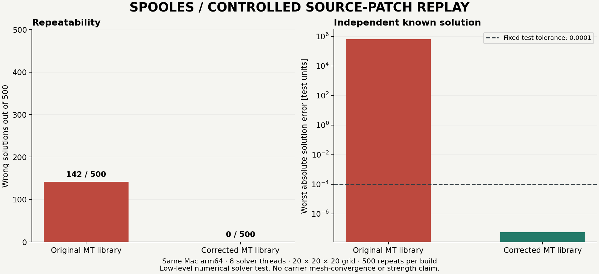

The original MT code produces **142 wrong solutions / 500**, with worst absolute
error **625,550**. The corrected build produces **0 wrong solutions / 500**, with
worst error **5.6208e-8**. These are measured outcomes of this fixture, not a
universal failure probability. The
[actual paired terminal receipt](evidence/mesh-quality-20261025/spooles-upstream-review-015/mac-race-ab-001/terminal.json)
and [pinned source manifest](evidence/mesh-quality-20261025/spooles-upstream-review-015/source-manifest.json)
retain the test, patch and binary identities. This independently reproduces the
dependency defect; it does not retroactively diagnose every earlier CCX refusal.

The corrected libraries were then linked with the **unchanged CalculiX 2.21
object files** into a fresh binary, SHA-256
`95e9b61985446b686f5f146d1a947101a5ec8ac86fef0cf9e308d25f817c918a`.
A control relink of the original library differs from the accepted binary only
in Mach-O UUID and code-signature metadata; the retained
[read-only byte comparison](evidence/mesh-quality-20261025/spooles-upstream-review-015/mac-ccx-relink-001/baseline-metadata-comparison.json)
records zero other differing bytes. Neither binary was edited to make it match.

The new binary passes fresh quadratic and traction controls, then **two complete
381,564-cell T10 carrier executions** with serial assembly/recovery and eight
SPOOLES threads. Both pass equilibrium and independent energy and agree with
every accepted reference component: maximum differences **1e-6 mm**,
**0.0001 MPa** and **0.0000001 N**. The
[complete replay receipt](evidence/mesh-quality-20261025/spooles-upstream-review-015/mac-full-reference-terminal.json)
binds both results and the unchanged regression contract.

The existing Linux fine run continues under its separately admitted serial
profile. The corrected Mac reference repeats are execution qualification for
this binary and fixture; they are not spatial mesh refinements. No geometry,
mass, loads, stress exclusions or acceptance tolerances were changed.

### Corrected Linux build and repeatable source retrieval

The same pinned corrections also pass on the actual Linux x86-64 rental. The
independent grid problem completes **500 / 500** correct repetitions with worst
absolute solution error **3.0374e-9**. A fresh CalculiX 2.21 binary then passes
the original three analytic controls and **two complete carrier repetitions**.
Every reference component is inside the original comparison limits. See the
[Linux replay receipt](evidence/mesh-quality-20261025/vast-lease-015/patched-reference-terminal.json).

The build uses the existing **GCC/GFortran 13** tools and versioned runtime
libraries. The first attempt correctly refused a missing `patch` utility. GNU
patch **2.7.6-7build3** was then checksum-verified and extracted into a private
tool directory. It was not installed over the active environment. Before/after
hashes confirm that the installed libraries used by the original fine solver
were unchanged. The corrected solver is a separate binary, SHA-256
`cd2d7d8b8209d4bc77d0b4b1d8bb457681b644a037b58914a622c5797c5cb4e2`.

The source fetcher retrieves **15 exact public inputs** from Ubuntu, Netlib and
pinned GitHub commits, verifies every SHA-256, and publishes its output directory
only after every input passes. Its successful replay uses native `curl` HTTPS
verification; the earlier Python CA-store refusal was not bypassed.

```sh
python3 parts/993-eng-carrier-0001/source/design-20261016/convergence-20261022/fetch_native_spooles_sources.py --output work/corrected-solver-sources
python3 parts/993-eng-carrier-0001/source/design-20261016/convergence-20261022/build_native_spooles_fixed.py --sources work/corrected-solver-sources --output work/corrected-solver-build --seconds 1800
```

The builder requires Linux x86-64, GCC/GFortran 13, GNU patch and the retained
runtime libraries. It makes no package installations, limits each child to
**4 GiB virtual memory**, uses two compilation jobs, and runs the complete
500-repeat library test. A newly built binary still needs its own fresh analytic
controls and complete carrier comparisons; its existence does not inherit the
qualification of the binary above.

### Refined interior screen on the RTX 4070

The next geometric classification uses the **accepted refined T4 field** and its
separate independent stress-energy proof. It checks all **3,052,512 cell
centroids** against all **785,624 boundary triangles**. This is a finer auxiliary
clearance screen; it is not a finer accepted T10 mechanical result.

The unchanged PR #274 kernel passes on native CPU and actual **RTX 4070 CUDA**,
driver **595.84**, against the independent libigl oracle. Maximum errors are
**0.00004638 mm CPU** and **0.00004887 mm CUDA**, below the original **0.0001 mm**
limit. All 15 pilot tests pass. The actual outputs and their identities were
collected before calculating the budget; no speedup claim is made.


With the same **1.5 mm analysis skin**, **10 mm bore keepout** and inboard limit,
**7,401 whole cells / 4,778.814 mm³** pass the screen. Replacing that volume at
relative density **0.40** gives a conditional saving of **12.6734 g**. The cells
contain **0.5205% of the accepted T4 baseline elastic energy**. That energy
fraction is not a prediction of stiffness loss after replacement.

The [budget assessment](evidence/mesh-quality-20261025/linear-cellular-budget-015/assessment.json)
retains the original parameters and explicitly marks geometry generation and
cellular strength as false. The much larger budget than the earlier whole-cell
screen comes from smaller enclosing radii. It remains a conservative selected
subset, not an upper bound on possible lightening. T4 and T10 baseline energy
fractions are separate quantities; their difference is not a mechanical
convergence comparison. The retained R2 part remains **1.298199813 kg**.

### Micro-cell stiffness: compute it instead of assuming it

The first periodic gyroid study uses a **unit cube, full-integration C3D8
hexahedra and six independent macroscopic strains**. Opposite faces obey exact
periodic displacement equations; three prescribed control nodes impose the
normal and engineering shear strains. An independently manufactured full-solid
cube first recovers the analytic isotropic titanium tensor with relative error
**1.6633e-7**.

For the gyroid, the solid mask is
`abs(sin(x)cos(y) + sin(y)cos(z) + sin(z)cos(x)) <= 0.6170021750539874`.
The threshold was fixed before these solves to target 40% solid at a separate
96³ geometry sampling. All cells retain their full integration points. Void is
represented by a separate elastic phase; changing its modulus from **1e-4 to
1e-6** of the solid changes the computed tensor by less than **0.084%** at the
three completed resolutions below.

| Cells per direction | Actual solid fraction | Minimum tensor stiffness ratio | Full tensor change from preceding grid |
|---|---:|---:|---:|
| 16 | 0.40625 | 0.16341 | — |
| 24 | 0.41204 | 0.16585 | 2.434% |
| 32 | 0.39648 | 0.16081 | 4.271% |

The stiffness ratios are generalized eigenvalues against the full dense
elasticity tensor, with engineering shear conventions preserved. They describe
all six macroscopic strain combinations. They are **not** yield, fatigue or
buckling allowables. At N=32, the largest ratio is about 0.20: density 0.40 does
not justify assigning stiffness 0.40.

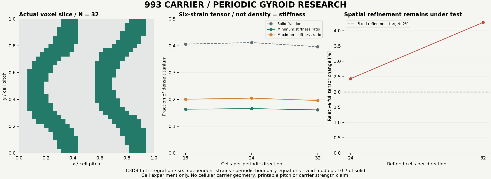

Every admitted case requires complete U/RF and all eight stress-point rosters,
periodic residual below **1e-8 mm**, independent stress-energy agreement and
physical reaction-work agreement within **1e-4**, a reciprocal tensor and
positive stiffness within the Voigt upper bound. The two successive spatial
changes must each be at most **2%**, and void-floor sensitivity at most **1%**.
The completed N=16/24/32 sequence does **not** meet spatial convergence. The
retained N=48 attempt refused its initial 4 GiB memory limit; the continuation
uses a separately recorded 24 GiB / 600 s limit on the 64 GiB Mac, without
changing the equations or numerical tolerances.

The [original contract and actual comparisons](evidence/mesh-quality-20261025/periodic-gyroid-study-001/contract.json)
remain available with the exact frozen experiment sources and compact solver
receipts. A separate reusable [periodic cell tool](../../../parts/993-eng-carrier-0001/source/design-20261016/convergence-20261022/periodic_cell_study.py)
has also completed a fresh full-solid six-strain control and a six-strain N=8
gyroid replay. It requires a qualified Mac binary and its exact SHA-256, uses the
existing bounded native runner, and refuses existing output directories.

```sh
# Run from the repository root with a separately qualified corrected Mac binary.
python3 parts/993-eng-carrier-0001/source/design-20261016/convergence-20261022/periodic_cell_study.py \
  --parameters docs/reports/carrier-convergence-20261022/evidence/mesh-quality-20261025/public-periodic-solid-parameters.json \
  --output work/fresh-periodic-solid-control \
  --binary "$CCX_BINARY" --expected-binary "$CCX_SHA256" --solid-control
# For the gyroid, use public-periodic-cell-parameters.json and omit --solid-control.
```

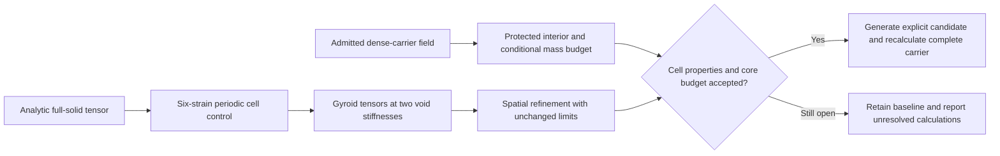

This cell experiment has no assigned printable pitch or wall thickness. It has
not changed the carrier geometry or nominal mass. The **12.6734 g** screen is
still conditional; combining it with an unconverged cell tensor would not prove
a new carrier stiffness or resistance.

### Accepted fine T10 field and first spatial comparison

The original fully serial Linux solve completed in **6,710.77 s**, with actual
return code zero, reaped process, unchanged inputs, finished marker and complete
field rosters: **4,884,701 displacement nodes, 12,210,048 stress integration
points and 42,930 reaction nodes**. Peak resident memory reported by native
`time` was **108,895,468 KiB**. Its archive was fully SHA-256 verified on collection.

The independent stress-compliance energy residual is **2.9044e-9**, below the
unchanged 1e-4 limit. The applied resultants remain −4,000 N and 850 N·m. The
integrated volume matches the coarse T10 volume; the retained R2 geometry and
**1.298199813 kg** nominal mass are unchanged.

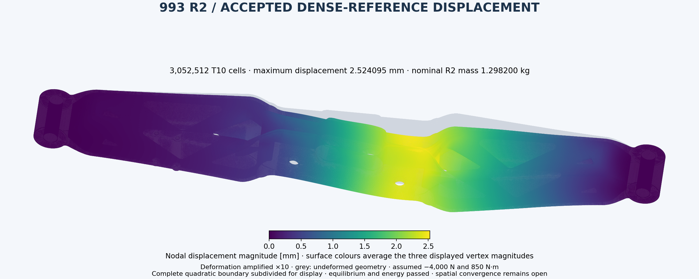

| Observable | Coarse T10 | Refined T10 | Change / finer value | Original limit |
|---|---:|---:|---:|---:|
| Maximum displacement [mm] | 2.497451 | 2.524095 | 1.0556% | 2% |
| Compliance [N·mm] | 20,337.443 | 20,584.972 | 1.2025% | 2% |
| Global integration-point peak [MPa] | 799.432 | 1,170.351 | **31.6930%** | 5% |
| Volume-weighted stress p95 [MPa] | 179.078 | 180.745 | 0.9220% | 5% |
| Central-region peak [MPa] | 774.445 | 841.209 | **7.9367%** | 5% |
| Central volume-weighted p95 [MPa] | 189.525 | 190.955 | 0.7485% | 5% |

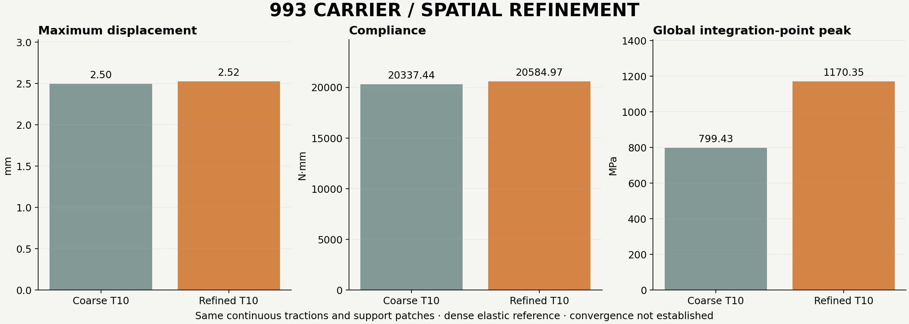

This is **one** spatial comparison. Both peak observables fail their original
limits, so neither this pair nor the earlier execution repeats establishes
mechanical convergence. The [complete comparison](evidence/mesh-quality-20261025/P2-spatial-comparison-015.json)
retains all observables and the original finer-denominator convention.

The refined global peak is at **[276.48269, 22.86464, −5.81566] mm**, only
**0.008739 mm** from the reconstructed rim of the fixed bore patch. The central
peak is at **[89.05953, 13.06837, 17.98835] mm**, away from either bore-patch rim.
The [separate boundary diagnostic](evidence/mesh-quality-20261025/fine-P2-peak-diagnostic-015/assessment.json)
reconstructs both integration-point positions and computes distances to all
piecewise-linear quadratic patch-rim segments. It keeps every stress value:
proximity to a boundary does not prove a continuum singularity and does not
justify removing the failed peak from acceptance. The two hotspot locations
also differ from their coarse counterparts.

The exact same **7,401 geometrically selected core cells** were then checked
against the accepted refined T10 stresses. Their corner rosters and selected
centroids match the T4 screen exactly. Their integrated volume remains
**4,778.814419 mm³**, and they contain **47.766686 N·mm / 0.464093%** of the T10
baseline elastic energy. See the [frozen-selection energy audit](evidence/mesh-quality-20261025/fine-P2-core-energy-015/assessment.json).
The conditional 12.6734 g mass arithmetic is unchanged; this is not a modified
carrier calculation or a predicted stiffness loss.

The rental was **destroyed after verified collection**. The independent guard
then observed three consecutive absences, and a fresh account instance listing
was empty. No rental remains active from this attempt.

### Solver-backend trial that did not qualify

An isolated **MKL 2025.2 / PARDISO-capable** CalculiX binary compiled successfully
without replacing the installed libraries. Its reference trial was refused as
PARDISO qualification: the unchanged decks explicitly request
`*STATIC,SOLVER=SPOOLES`, and the actual log confirms SPOOLES execution. One
complete carrier replay passes the component contract, but neither that result
nor the analytic controls tests the linked PARDISO backend. The [refusal receipt](evidence/mesh-quality-20261025/mkl-feasibility-015/qualification-refusal.json)
preserves this distinction. Any later PARDISO attempt needs separately bound
solver-selection decks and fresh controls; a successful link is insufficient.

### Can the cellular core save more mass?

Yes, the conditional budget grows when the assumed retained skin is reduced.
The following separate design scenarios reuse the admitted CPU/CUDA distances,
keep the **10 mm bore keepout, 260 mm inboard limit, 10% maximum selected-volume
fraction and 40% relative-density scenario**, and preserve the original 1.5 mm
screen as the reference. They change a design assumption, not the oracle error
limit or the convergence criteria.

| Retained analysis skin [mm] | Selected cells | Selected volume [mm³] | Conditional saving [g] | Baseline T10 energy in selected cells |
|---|---:|---:|---:|---:|
| 0.75 | 39,130 | 13,237.789 | 35.107 | 1.9399% |
| 1.00 | 21,549 | 9,601.908 | 25.464 | 1.1861% |
| 1.25 | 12,222 | 6,884.230 | 18.257 | 0.7451% |
| **1.50** | **7,401** | **4,778.814** | **12.673** | **0.4641%** |
| 2.00 | 2,861 | 2,133.430 | 5.658 | 0.1859% |
| 3.00 | 388 | 446.148 | 1.183 | 0.0370% |

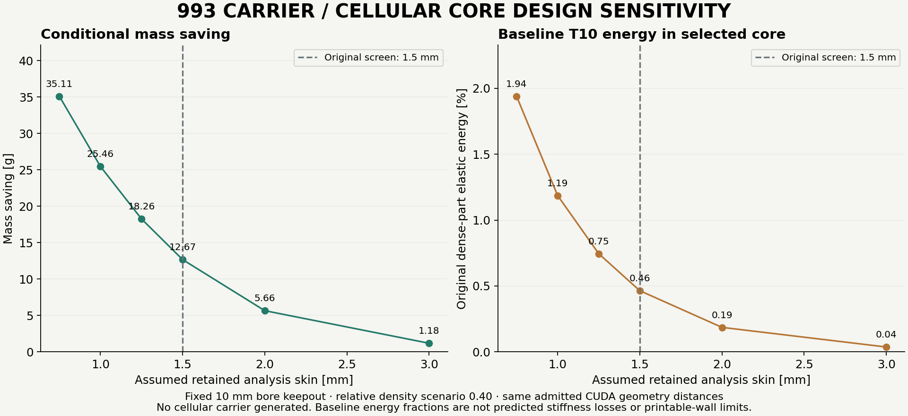

The 1.5 mm row reproduces the **exact original selected-cell index roster**.
Every scenario independently integrates the admitted T10 stresses over its own
selected cells, while the ranking remains the original T4 baseline energy
ranking. Their quadratic integrated volumes match the geometric screen volumes.
The [frozen sweep contract and results](evidence/mesh-quality-20261025/cellular-skin-sweep-001/assessment.json)
retain the actual source identities and the unchanged original parameters.

These are design comparisons, not adopted printable wall thicknesses. A lower
skin can select more material for replacement, but neither its baseline energy
fraction nor the mass arithmetic solves the modified cellular carrier. The
retained geometry and nominal mass stay unchanged. Wider architectural changes
and different cell pitches are outside this particular whole-cell screen; the
35.107 g row is not a universal lightening limit.

### Cell refinement reaches N=48; N=64 time limit retained

Both six-strain **N=48 C3D8** runs now pass the complete periodicity, energy,
reaction-work, reciprocity and positivity checks. Their actual solid fraction is
**0.3990162**, minimum tensor stiffness ratio **0.1636402**, and void-floor
sensitivity **0.07624%**. The full tensor change from N=32 is **1.60463%**, within
the unchanged 2% threshold. This is the first successive passing refinement;
the preceding N=24→32 comparison failed.

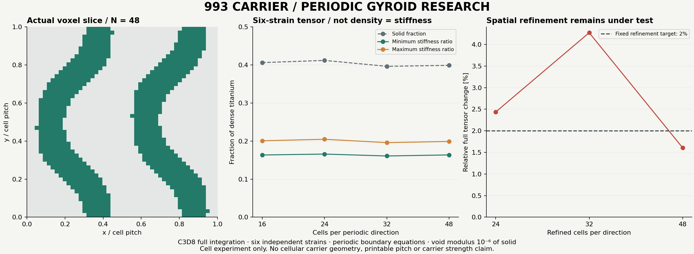

The first N=64 strain case reached its predeclared **600 s** limit. Its actual
receipt records return code **124**, a reaped process, unchanged inputs and no
finished marker. Maximum sampled solver RSS was **18,052,382,720 bytes**; this
was a time refusal, not an accepted N=64 tensor. The
[continuation refusal](evidence/mesh-quality-20261025/periodic-gyroid-study-002/refusal.json)
and [case receipt](evidence/mesh-quality-20261025/periodic-gyroid-study-002/n64-floor1e-4/case-0/actual-terminal.json)
remain alongside the completed N=48 data. Cell stiffness convergence is still
false at this checkpoint. The next backend attempt must preserve the same
C3D8 equations and qualify actual PARDISO dispatch before continuing this series.

### Separate native FFT experiment

A pinned **µSpectre 0.27.0** source build provides an additional periodic-cell
research path. It is a separate Fourier-Galerkin discretisation and is **not**
counted as another C3D8 mesh level. The actual native binding experiment passes
six full-solid and six layered-composite strain cases against independent
analytic tensors, with relative tensor errors **3.45e-16** and **1.92e-16**.
A six-strain N=17 gyroid at void stiffness 1e-4 also passes the independent
Hooke-law, projected equilibrium and energy checks.

The 1e-6 gyroid trial fails its fixed **10,000-iteration / 1e-10 CG** condition:
the last reported residual is **1.53198e-9**. No tolerance was relaxed and no
high-contrast tensor was admitted. See the [native FFT qualification summary](evidence/mesh-quality-20261025/fft-feasibility-001/qualification-summary.json).
Neither this trial nor its different discretisation establishes cell or carrier
convergence.

The isolated build needed one documented stale C++ accessor correction. On the
current Mac, duplicate private Mach-O loader paths also needed removal; before
and after hashes confirm that the executable `__text` sections were unchanged.
The actual experiment calls the same native PocketFFT cell factory used by the
official Python wrapper. That full helper package remains unavailable because
its eager SciPy ProPACK import is refused by the Mac loader. This is an
experimental native-API probe, not a qualification of the full Python package.
All modifications are confined to the private environment; system packages and
the accepted CalculiX binary are unchanged.

### Actual PARDISO dispatch now qualifies

The next isolated Linux attempt explicitly selects `SOLVER=PARDISO` in copied
decks. Three fresh analytic controls and **two complete coarse T10 carrier
repetitions pass**, with actual symmetric PARDISO dispatch and eight solver
threads observed. Maximum component differences against the independent Mac
reference are **1e-6 mm displacement, 1e-4 MPa stress and 1e-7 N reaction**,
within the original limits. The first complete coarse repetition takes
**61.184 s**. The earlier trial that actually selected SPOOLES remains refused.

The [reference terminal](evidence/mesh-quality-20261025/vast-lease-020/pardiso-reference-terminal.json)
binds both repetitions to the native binary SHA-256. The
[runtime footprint](evidence/mesh-quality-20261025/vast-lease-020/runtime-footprint.json)
and [loaded-library observation](evidence/mesh-quality-20261025/vast-lease-020/N64-runtime-observation.json)
identify the actual private MKL runtime. A separate six-strain solid control
and N=16 gyroid reproduce the previous complete C3D8 tensor; see the
[periodic reference comparison](evidence/mesh-quality-20261025/vast-lease-020/periodic-reference-comparison.json).
These are backend qualification results, not additional spatial refinements.

### What smaller micro-cells can and cannot save

For this ideal periodic gyroid sheet, fixing the threshold fixes its relative
density. Rescaling its pitch leaves both that density and its homogenized
linear-elastic tensor unchanged. **Smaller cells alone do not remove additional
mass.** More saving requires a lower solid fraction, a thinner outer skin or a
different region/architecture, followed by calculation of that modified part.

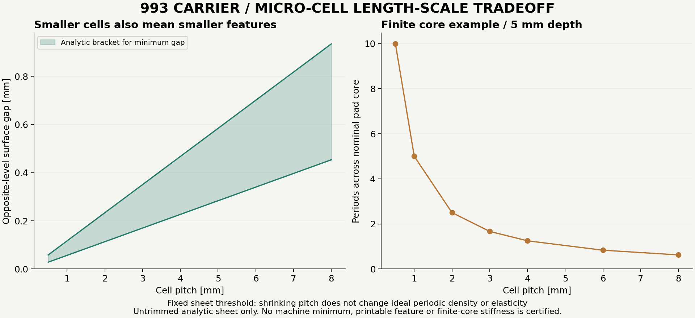

The [analytic scale assessment](evidence/mesh-quality-20261025/gyroid-scale-bounds-001/assessment.json)
brackets the minimum distance between the opposite level surfaces of the
**untrimmed periodic sheet**. For threshold `a` and pitch `p`, the lower bound
is `a*p/(2*pi*sqrt(3))`; a constructed diagonal pair gives the upper bound
`sqrt(3)*asin(2*a/3)*p/(2*pi)`. At the frozen threshold, these are approximately
**0.05670p to 0.11686p**. The plot also shows how many periods fit across the
nominal 5 mm pad-core example. These are geometric bounds, not machine feature
limits or a finite-core stiffness result. Clipping, skin connections and powder
escape still belong to the eventual explicit cellular geometry.

### Shared-factor six-strain backend cross-check

The pinned Apache-2.0 **UnitcellEngine** experiment uses one direct SPD solve
call with **six actual right-hand sides**. This avoids repeating the same cell
matrix factorization independently for every strain case. Its independent
postprocessor reconstructs all eight trilinear Gauss-point operators, stresses,
energies, physical forces and periodic equilibrium; no strain case is inferred
from cubic symmetry.

A uniform `1e-6` stiffness control exposes the difference between the upstream
assembly's ersatz regularization and raw-density tensor postprocessing: its
energy residual is **1.0101%**, exceeding the unchanged 0.01% energy condition.
A separate, versioned one-line adaptation applies the same phase scaling to
both. Both full-solid and uniform-soft analytic controls then pass. The pinned
upstream source remains unchanged and the original negative control is retained.

The adapted **N=16** gyroid passes all independent operator and energy checks.
It then reproduces **all six complete CCX fields**: 4,913 physical nodes and
32,768 stress integration points per case. Maximum differences are **4.986e-10
mm U, 4.918e-5 MPa S and 4.872e-8 N RF**; full-tensor relative difference is
**4.201e-9**. The original component limits remain unchanged. The
[complete cross-check](evidence/mesh-quality-20261025/unitcellengine-factor-reuse-001/collected-controls/n16-crosscheck.json)
records the explicit shear and Gauss-point permutations. The
[reproduction recipe and exact scripts](../../../parts/993-eng-carrier-0001/source/design-20261016/convergence-20261022/unitcellengine-study/README.md)
describe the isolated pinned environment, retained negative control and bounded
N=64 continuation. This qualifies this backend/operator comparison; it does not
yet establish carrier convergence or a cellular-part result.
