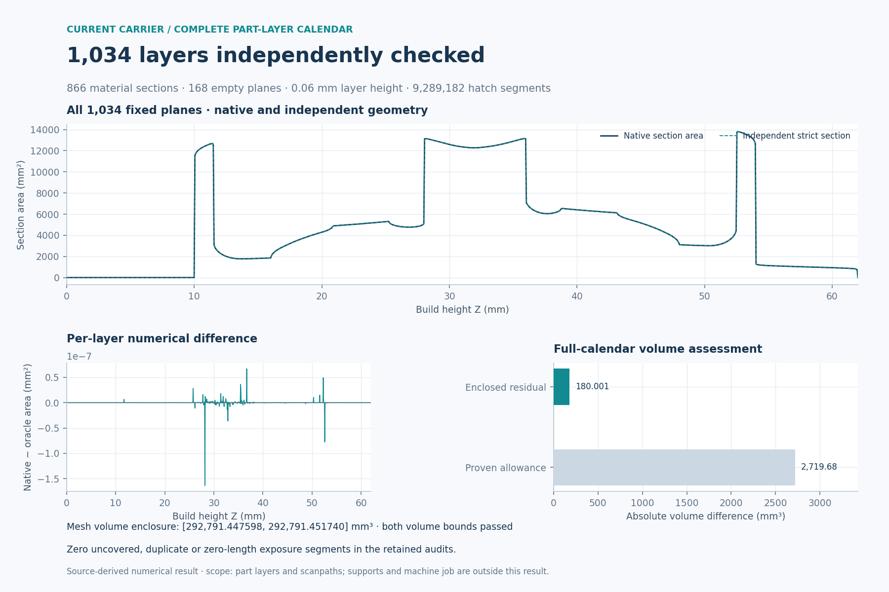
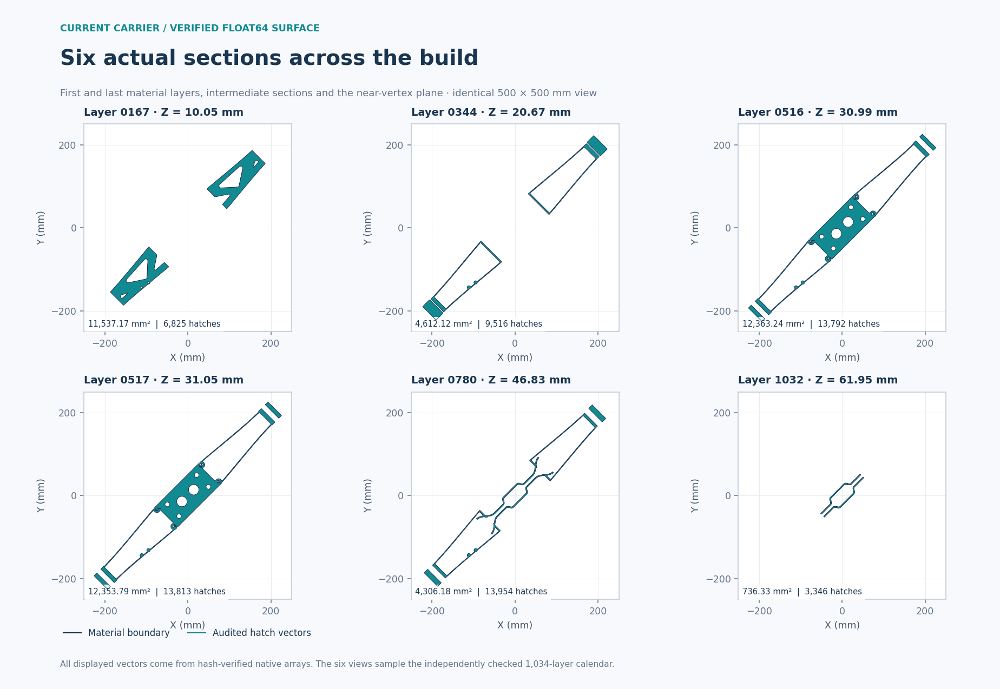
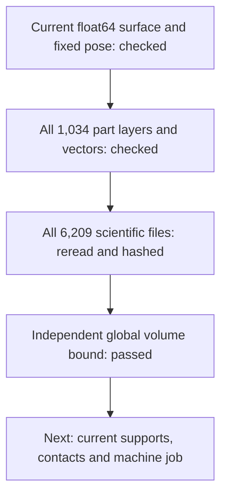

# 993 carrier: complete current-surface slicing

**All 1,034 part layers and 36,914,986 contour/hatch segments passed their
native and independent checks.** The complete file readback and global volume
assessment also passed. This closes the part-layer calculation for the current
float64 surface; support geometry and the machine-specific build job remain
separate work.

## What was actually calculated

The unchanged source contains **2,882,300 vertices and 5,764,688 triangles**.
It was imported directly from float64 arrays, with no STL conversion, vertex
merging or surface repair. Its SHA-256 is
`801e989e4e41d2c6cfc1da828e36726cded7584a9f7c1b321687d2ec538b50bd`.
The [source intake](carrier-current-am-intake-20261106.md) records the complete
coordinate readback, 45° Z rotation, 10 mm plate gap and 500 × 500 mm study plate.

The calendar uses a **0.06 mm layer height**, from Z = 0.03 to 62.01 mm.
The admitted PySLM profile, offsets, hatching parameters and numerical limits
were unchanged from the [nine-layer trial](carrier-current-am-batch-20261107.md).
One leading layer-517 reference call preceded the 1,034 indexed outputs;
its arrays and NPZ reproduced the retained reference byte for byte.

| Completed quantity | Result |
|---|---:|
| Indexed layers | **1,034** |
| Material sections / empty planes | **866 / 168** |
| Hatch segments | **9,289,182** |
| Contour segments | **27,625,804** |
| Segments outside the checked domains, duplicated or zero-length | **0** |
| Scientific files independently read back | **6,209** |
| Retained scientific bytes | **1,085,287,501** |
| Largest absolute native/independent section-area difference | **1.634708 × 10⁻⁷ mm²** |

Every layer retains native and independent domain checks, including holes,
source-edge correspondence and outward-rounded section-area bounds. The
near-vertex plane at layer 516 passed without changing its height or tolerance.
The final collector rehashed every scientific file and checked the complete
file set; the separately identified Finder metadata is not scientific output.

These six views show actual retained arrays at a common scale. They illustrate
the complete calculation; they are not the denominator of its checks.

## Independent volume assessment

Integrating the native section areas gives **292,611.450288 mm³**. The independent
closed-surface volume enclosure, rounded outward here, is
**[292,791.447597, 292,791.451741] mm³**.
The enclosed residual is at most **180.001453 mm³**, approximately **0.0615%**
of the mesh volume, below the derived allowance of about **2,719.681691 mm³**.
Both the native and independent section-volume checks passed.

The allowance comes from the actual closed surface and layer spacing:
`(h/2 + delta) × S_z`, where `S_z` bounds variation of the section area and
`delta` bounds the published planes' displacement inside their calendar cells.
Here `S_z` is enclosed by **[90,656.0560964637, 90,656.05609646458] mm²**,
and `delta = 127 / 36028797018963968 mm`.
Outward arithmetic retains the surface, section, accumulation and native-to-true
section uncertainties. This is a direct tagged-partition bound; it does not
assume continuity at section jumps or fit a tolerance to the observed result.
The [full-precision summary](carrier-current-am-full-20261107/summary.json)
preserves every interval and verdict. Figure labels are rounded for display.

## Execution and reproducibility

The actual run returned **0** after **4,522.33 seconds**, with a sampled peak
aggregate RSS of **4,410,294,272 bytes**. It used one worker, at most two pending
layers and one numerical thread. The 7,200-second, 8-GiB RAM, 4-GiB scientific
output and 8-GiB free-storage limits were unchanged. All workers were reaped,
the exact owned process group was absent, and every prepared source pin still
matched at completion.

The runtime was the recorded Mac Python 3.11.18 profile with PySLM 0.6.1 and
its four pinned support patches, NumPy 1.26.4, Trimesh 5.1.1, Shapely 2.2.0,
pyclipr 0.1.8 and SciPy 1.17.1. Plotting used the separate runtime recorded in
the figure provenance; it did not change the calculation runtime.

Public receipts are the [scalar summary](carrier-current-am-full-20261107/summary.json),
[all-layer scalar table](carrier-current-am-full-20261107/layer-scalars.csv),
[complete independent readback](carrier-current-am-full-20261107/readback-proof.json),
[actual terminal](carrier-current-am-full-20261107/terminal.json),
[figure provenance](carrier-current-am-full-20261107/figure-provenance.json)
and [visual inspection](carrier-current-am-full-20261107/visual-inspection.json).
Raw meshes, scan vectors and source-edge arrays remain in private evidence.

The [public one-layer recipe](../../parts/993-eng-carrier-0001/source/process-float64-20261107/README.md)
already reproduces layer 517 through the repository workflow runner. This full
calendar was executed through the retained local bounded driver identified in
the summary. Packaging that complete driver as a public replay recipe and
qualifying installation on another machine remain open.

The [software coverage ledger](carrier-toolchain-coverage-20261106.md) keeps
this completed part-layer stage distinct from support/contact admission,
thermal process modelling and machine export. No support surface, exposure
power/speed profile or production-machine file was generated by this run.
