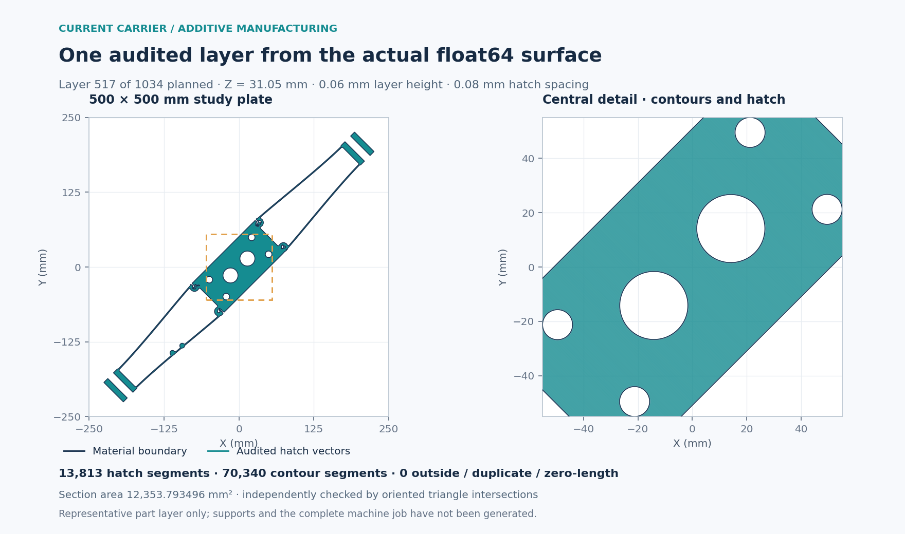
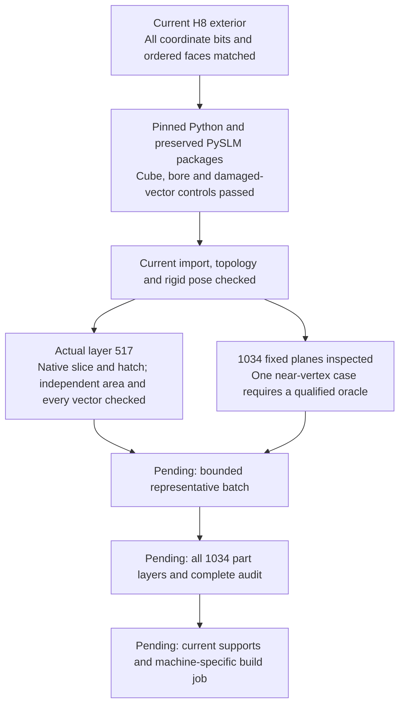

# 993 carrier: current-surface additive intake and one audited layer

This is a new current-source execution, completed on 2026-11-06. It does not
resume the interrupted historical current24af cache. H9 is required to preserve
the current H8 exterior. This additive intake does not depend on completing that
interior volume refinement.



The [public numerical receipt](carrier-current-am-intake-20261106/results.json)
records this execution. The [software ledger](carrier-toolchain-coverage-20261106.md)
keeps it separate from complete build preparation and mechanical convergence.



## Current source and runtime

The surface contains 2,882,300 float64 vertices and 5,764,688 ordered triangles.
`source-surface-identity.json` compares every coordinate bit and ordered face
between the admitted binary exterior and H8 `source.mesh64`. Their SHA-256 values
are `801e989e4e41d2c6cfc1da828e36726cded7584a9f7c1b321687d2ec538b50bd`
and `c424988e6d946aeb985874929bd163439c04b72d21e2a97f3891f6de7a28611a`.
The existing exact-coordinate 3MF is also verified against its actual package
hash `3ab75122fc89bf5b8774e53e304e8eeceac22af234ff2204869344aff49d5fb1`.
The executed adapter uses the binary float64 arrays directly; it does not pass
through binary STL or a rounded coordinate merge.

The historical Python 3.11.15 launcher is broken; its package tree was preserved.
The new profile uses `/opt/homebrew/Cellar/python@3.11/3.11.18/bin/python3.11`
with `-I -B -S` and an explicit AM011 site-packages path. The executable hash is
`6c3cb7fae319bee761aeba0ebb1eeae07b4a4c28fa5b74e73f02b6a7e1ff10d8`.
`runtime-profile.json` hashes 2,454 source/native files (120,953,067 bytes) and
records exact package versions. The four installed PySLM support patches match
tracked `upstream.json`. These are new runtime receipts; historical execution evidence remains unchanged. Writes to the preserved packages are forbidden by the audit hook.

Actual loaded native images are recorded in the admission and layer receipts.
All admission image identities remain present unchanged after the layer; current
filesystem-backed image hashes were independently reread. macOS shared-cache
images without individual files are explicitly recorded with OS/kernel identity
and no invented filesystem hash.

## Executed controls and results

- Six interior plane controls on a cube and a circular-bore polygonal prism:
  original filtered/full-mesh sections agree, analytic areas/holes agree, and the
  unchanged native hatching passes its independent scanpath audit.
- Four deliberately damaged vector sets (outside, duplicate, zero length and
  crossing the bore) are rejected.
- The complete current import preserves all unposed coordinate bits and face
  indices. It is watertight, consistently wound, positive-volume and has no
  zero-area face. PySLM repair and vertex merging are disabled.
- The prescribed study pose is 45 degrees about Z, unit scale and a 10 mm plate
  gap. Every posed coordinate matches an independent rigid-transform oracle to
  at most 2.842170943040401e-14 mm; original source arrays remain unchanged.
- The current bounds independently yield 1,034 required 0.06 mm plate midplanes.
  The deterministic representative is index 517, Z=31.05 mm. The calendar was
  measured from this source, not copied from the historical cache.
- The executed layer contains 23 boundary rings, 13,813 hatch vectors and 70,340
  contour segments. All vectors are covered by the reconstructed material
  domain, with zero duplicates and zero-length segments.
- Native section area: 12,353.793496440594 mm². Independent oriented intersections
  of 22,731 triangles give 12,353.793496440707 mm², retaining holes by signed
  integration. The unchanged ring-area audit differs by 4.55e-11 mm². The original
  1e-10 relative area tolerance is unchanged; vector coverage has no buffer.

Admission completed in 12.185 s at 4,104,273,920 bytes peak RSS. The layer phase
completed in 20.337 s at 4,154,998,784 bytes. Both children were reaped RC0 with
empty stderr and no telemetry failures. Each phase was guarded by 300 seconds,
8 GiB aggregate RSS, 8 GiB disk reserve and one numerical thread. Sources and
runtime pins were unchanged at completion.

The raw layer arrays stay private at
`private-evidence/carrier-am-current-20261106-001/layers/layer-00517.npz`
(SHA-256 `640bc40462471f42c4dc83ce1f6eb3e95fd20ab62f8751bed4d453c1b9933e4e`).
The English image is rendered only from those arrays. Its
[figure provenance](carrier-current-am-intake-20261106/figure-provenance.json)
binds the source, result, arrays, renderer and image. The original scripts and
full runtime receipts remain in `work/carrier-current-am-intake-20261106-001/`;
the public receipt carries their hashes, not the raw arrays.

## Commands and continuation boundary

Executed from the original calculation checkout:

```sh
.venv-check/bin/python work/carrier-current-am-intake-20261106-001/supervise.py --phase admission
.venv-check/bin/python work/carrier-current-am-intake-20261106-001/supervise.py --phase slice
.venv-check/bin/python -B work/carrier-current-am-intake-20261106-001/render_current_layer.py
```

These phase directories are complete and exclusive; rerunning them is refused.
A new continuation requires a new output directory and pinned binding.

The subsequent preflight examined all 1,034 fixed midplanes: 866 intersect the
part's Z extent and 168 lie outside it. No plane has an exactly coplanar vertex,
edge or face. Layer 516 at Z=30.99 mm passes 9.536744727256519e-9 mm from one
vertex, within the native 1e-8 mm merge tolerance. The generic independent oracle
therefore refuses this case pending a separately qualified strict-sign,
source-edge-identity check. No planes or tolerances were changed. The preflight
receipt is bound by SHA-256
`f8dffe3e82ba6aed6961335e541400caea7245412ceb812d03f80a8862489867`.
It performs no slicing or hatching.

The paused 24af cache contains 440 historical layers, no completion report and no
complete layer CSV. None is counted as current. The current result is one audited
part layer, not a complete 1,034-layer job. Next, qualify the near-vertex case,
then execute a bounded representative batch before the full part-only cache.
Reuse worker initialization and retain exact source/pose/parameter/runtime hashes,
ordered per-layer manifests and independent checks on every layer. Current
supports and machine-specific export remain separate later stages. The inherited
500×500 mm plate and process parameters are study settings, not a selected
machine/process qualification. The former 1.30 kg mass ceiling is withdrawn;
this surface-preserving AM trial does not redesign or lighten the part.
