# 993 Turbo carrier: complete-mesh mechanical continuation

Five complete nested gravity refinements have passed native and independent
Mac equilibrium/energy checks. The latest energy-norm increment is **2.83%**,
down from 4.73%; the separately verified combined-force/torque increment is
**4.60%**, down from 6.15%. Both remain above the unchanged 1% stabilization
screen. Nominal mass is 1.294 kg and the common h5 mesh contains 13,883,493
tetrahedra. Pointwise peaks remain unresolved and visible; no strength or
spatial-convergence claim is made.

The [next-refinement admissibility review](carrier-refinement-admissibility-20261105.md)
records a rejected interior-only refinement, its exact mechanical limitation,
and the retained shared-edge route with positive child-order screening.

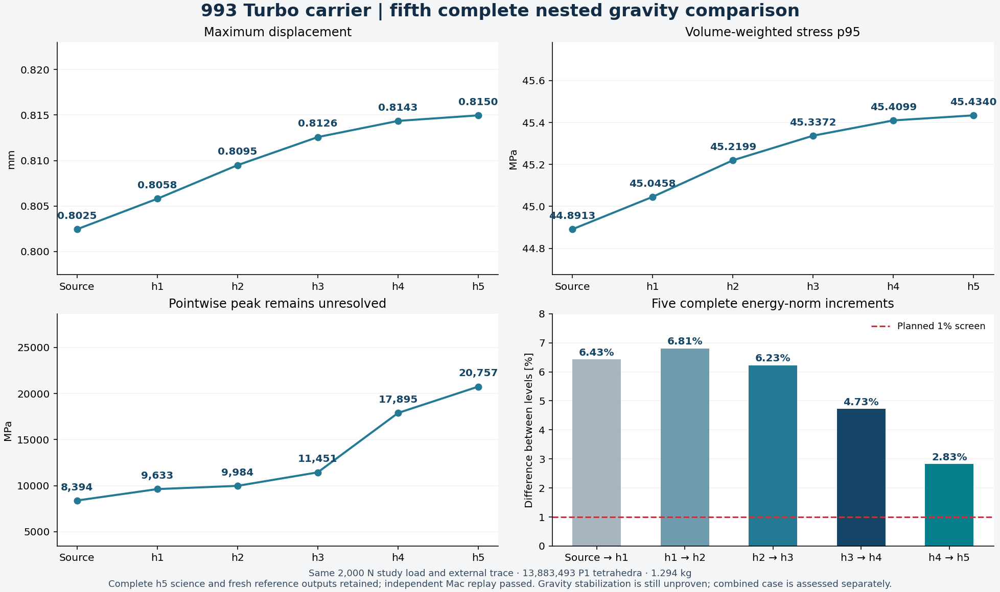

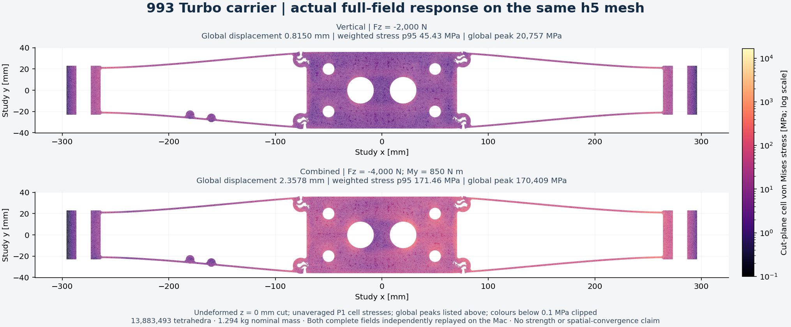

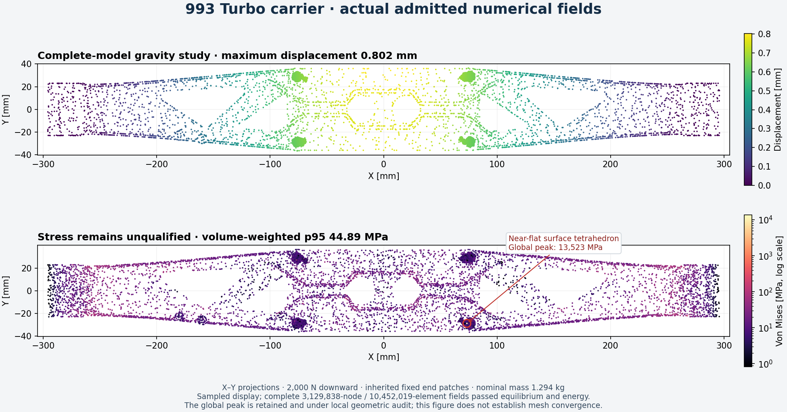

## Original geometry and solver intake

| Item | Original checked value |
|---|---:|
| Vertices | 3,129,838 |
| Linear tetrahedra | 10,452,019 |
| Nominal mass interval | 1.294138207488142–1.294138207584442 kg |
| Fixed nodes, three translations each | 14,064 |
| Active displacement degrees of freedom | 9,347,322 |
| Resolved tetrahedra with condition metric at least 1e6 | 134 |
| Unresolved condition evaluations | 0 |

The geometry certificate checks positive tetrahedral volumes, cancelling
internal faces, one connected component and no unused vertices. The maximum
certified cell-volume upper bound is 0.49137604217910308 mm³. The remaining
conditioning tail is not hidden by these geometric checks.

The retained study uses dense Ti-6Al-4V elastic reference properties, E =
107,000 MPa and Poisson ratio 0.31, fixed nominal end patches and the existing
central-patch load distribution. The gravity-labelled study case applies
2,000 N downward; the combined case applies 4,000 N downward and 850,000 Nmm
about the retained y axis. These are inherited study inputs, not new measured
operating loads.

The full CalculiX mesh text is 610,711,825 bytes. Ordered connectivity was
read back for every element. Text transport changed 15,734 coordinate records,
with maximum coordinate error 6.938893903907228e-18 mm. All 142,671 incident
tetrahedra were checked exactly for positive volume and the 0.5 mm³ cap.
Complete exported-surface intersection checking passed separately. The
cumulative certified surface change remains below 10 nm relative to the
retained study surface, not relative to a scan or a Porsche CAD master.

## Actual complete-model attempts

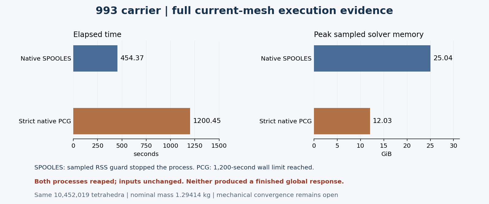

| Backend | Elapsed seconds | Peak sampled solver RSS | Terminal reason | Complete response |
|---|---:|---:|---|---|
| Native SPOOLES | 454.366 | 26,890,108,928 bytes | Sampled RSS guard | No |
| Strict native iterative solver | 1,200.445 | 12,917,882,880 bytes | Wall timeout | No |

Both processes were reaped and their inputs remained unchanged. The first
attempt reached matrix ordering. The second reached actual PCG iterations;
its residual did not reach the strict stopping requirement. Partial files are
not displacement or stress results.

The separate iterative-runtime correction changes the internal hard-coded
PCG/CG stopping constant from 0.005 to 1e-12. Eight coupled analytic cases
passed the retained checks with that runtime, but this did not establish
convergence of the complete carrier. The original runtime and rejected
attempts remain retained.

## Exact current-surface interchange export

A new 3MF now represents the current conditioned surface rather than the
earlier assembly. The independent streaming verifier checked every one of
2,882,300 vertices and 5,764,688 triangles: all coordinate bits and ordered
indices match the retained surface, units are millimetres and the single
build item has identity placement. All package-member CRCs passed. One
positive and six altered-package controls passed before the complete export.
The source remained unchanged and the nominal mass interval above still
applies.

Package SHA-256:
`da3743c998cb4ede1708532c4a10335f5fb7cb96efc9ca8774cbcab8d447f76f`.
The package and its complete readback evidence remain private in
`work/carrier-current-3mf-001/`. This is a geometry interchange artifact;
current placement, supports and machine build parameters remain separate.
The earlier surface's orientation certificate is not reused for this revision.

## Portable direct-solver route

The retained Linux CalculiX/PARDISO ELF is unchanged. A private Ubuntu loader
and shared-library closure allows it to run inside the pinned Debian-based
PicoGK image without replacing that image's system libc. All eleven shared
libraries recorded by the earlier accepted PARDISO execution match the new
closure byte for byte. Three analytic cases executed under local amd64
emulation and reproduced the retained output components exactly.

This is runtime portability evidence. Before the full current-model case, the
leased native host must pass three analytic controls and two complete retained
coarse-reference repetitions, including the independent 1e-4 energy check.
The reference component limits remain 1e-5 mm displacement, 0.01 MPa stress
and 0.01 N force. They are unchanged by the backend move.

The frozen input packet contains the complete model. Resource profiles only
set memory caps after finite Linux cgroup limits are measured: 48, 96 or
192 GiB of solver virtual memory. They do not coarsen the model or relax its
numerical criteria. Every phase has bounded execution, immutable archive
collection with SHA-256 checking and exact-instance cleanup.

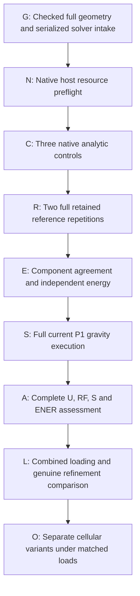

The independent assessor retains the original numerical formulas and
limits. It checks terminal status, every consumed deck and mesh, native binary,
private ABI closure and thread allocation. It recomputes all five reference
component comparisons from restored result bytes. Ten binding/rejection
controls and eight actual analytic response fields passed. Its separately
bound data-local execution subsequently admitted the complete native response
reported below.

### Native hosted continuation

A larger host passed actual resource preflight: 519,045,120,000 finite cgroup
memory bytes, 122.87999 CPU quota cores and affinity to 128 processors. The
complete frozen packet was transferred and verified. After a refused command
construction was corrected and absent worker state was independently checked,
the worker started once. All three native analytic component comparisons
passed with zero differences from the retained outputs.

The exact-instance guard subsequently destroyed this lease during the first
full coarse-reference repetition. Its combined contract/cost predicate fired;
another account workload was observed after cleanup. The log does not isolate
the individual predicate, so this is not a demonstrated memory or solver
failure. Three analytic archives were retained, while no full reference or
current-carrier result was collected. The instance's absence was verified and
its collector was stopped only afterward.

The owner subsequently authorized simultaneous rentals. The new
[parallel-lease delta](../../deploy/vast/picogk-parallel/README.md) checks only
the exact owned label, instance ID, image, deadline and budget. Unrelated
account jobs no longer cause this lease's destruction. The historical wrapper
and guard remain unchanged; versioned patches update the installed ownership
gate while preserving unrelated functions. Seven no-network controls passed.
The earlier account-exclusivity mutex companion is superseded for this task.
The new controller makes at most one paid attempt and does not alter the
geometry, loads or numerical acceptance limits.

A subsequent independently guarded lease passed native preflight with
129,718,288,384 finite cgroup memory bytes and 48 available processors. Its
complete 592,116,080-byte packet was recovered through verified prefix resumes,
then checked against the original SHA-256 before safe extraction. The worker
started once with the 96 GiB solver virtual-memory cap. All three analytic
controls and both complete reference repetitions passed. Their independent
relative energy residuals were 2.43544e-9 and 2.41528e-9, below the unchanged
1e-4 limit; their native solver times were 94.203 and 94.569 seconds. The full
current model subsequently started with a 2,892-second wall cap and finished
normally after 504.815 seconds. A separate operator adapts only the full-case
wall timeout to the existing lease deadline, retaining the full geometry,
loads, material, numerical limits and 600-second collection reserve. This does
not extend the paid lease or restart interrupted work automatically.

Bulk result download timed out on this host. Forty-one bounded reports were
retained separately, including both reference comparisons and energy reports;
the incomplete archive is preserved and is not counted as a collected field.
A separately sealed native assessor was deployed to avoid making numerical
checking depend on the slow download. It retains the independently checked
field reader, compliance formulas and acceptance limits, checks the same
native qualification, and re-decodes every serialized mesh coordinate and
connectivity entry against independent local byte hashes. Six decoder controls
passed. Its complete current-field result passed; raw-data collection remains
a separate operation. No missing result bytes are reconstructed from a golden
reference.

### Accepted complete native response

| Observable, retained 2,000 N case | Actual result |
|---|---:|
| Complete displacement rows | 3,129,838 |
| Complete reaction rows | 14,064 |
| Complete stress and energy rows, each | 10,452,019 |
| Maximum displacement | 0.802453705563 mm |
| External work | 1,445.625900475 Nmm |
| Independent stress-compliance energy | 722.812868862 Nmm |
| Relative independent energy residual | 1.125818872e-7 |
| Relative native energy residual | 1.126246720e-7 |
| Unchanged energy admission limit | 1e-4 |
| Volume-weighted stress p95 | 44.891267433 MPa |
| Global integration-point peak, not converged | 13,523.315658306 MPa |

All four complete field rosters passed missing/duplicate/nonfinite checks,
fixed-node displacements are zero, and force/moment balance passed. All eleven
consumed assessor payload members matched their independently retained hashes.
Native DAT SHA-256:
`87afeaa6a730509799bd05e149cb07ad8eae30f5a380c1b4acdf297df965f90c`.
Complete report SHA-256:
`00d8e9bdcf391c3d0ec777b7630b1e646fa9fa526a8da0ff1b5fcabdb72a4115`.

The native 1,504,485,636-byte DAT was independently compressed into
355,851,376 bytes of concatenated standard XZ streams. A complete native
decompression reproduced the original DAT hash and byte count. Bounded range
collection was interrupted, with 117,440,512 bytes of complete compressed
ranges retained. This is not a retained complete field.
The figure uses explicitly labelled actual field samples and preserves the
complete-model peak and weighted p95 annotations.

### Peak audit and separate local geometry trial

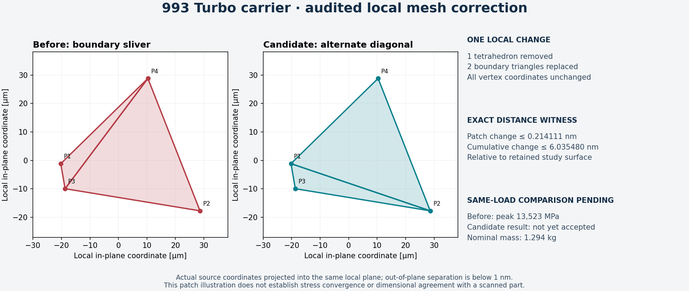

The peak occurs in source element 9,558,751, a tetrahedron with four surface
vertices, two boundary faces, volume 8.48265e-11 mm³ and edge-matrix condition
about 231,008. It touches no retained severe edge and lies outside the three
protected x regions. These observations identify an explicit local trial;
they do not prove that removing the cell repairs the stress response.

An alternate-diagonal witness bounds the proposed two-facet surface change
by 0.214111 nm. Together with the retained earlier corrections, the cumulative
bound is 6.035481 nm, below the existing 10 nm study-surface budget. Coordinates,
supports and scalar applied loads stay identical. The separate candidate
removes exactly that positive boundary sliver; it does not inherit the
original response or count as spatial refinement.

Complete independent checks passed for the candidate: all 10,452,018 positive
cells, exact indexed boundary, one component, no unused vertices, no full
libigl intersections, closed vertex-manifold topology, nominal mass cap and
identical protected rosters/all 2,292 severe-edge records. A separate check also
confirmed all six exact attachment/load surface rosters. On the earlier lease,
the same-load native comparison started, but no final result was collected
before the guard destroyed the instance after an inventory-read failure.
That interrupted attempt remains unaccepted; the successful fresh comparison
is recorded below. The candidate surface hash is
`801e989e4e41d2c6cfc1da828e36726cded7584a9f7c1b321687d2ec538b50bd`;
its independently bound serialized mesh hash is
`f8dd93eadc583dbe91d239c0850add66a144c8647f17abdaff4f85c8d1245fc6`.

The candidate also has a separate exact-coordinate 3MF export. Independent
streaming readback checked every one of its 2,882,300 vertices and 5,764,688
triangles, including bit-identical coordinates, ordered indices, millimetre
units, identity placement and member CRCs. Package SHA-256:
`3ab75122fc89bf5b8774e53e304e8eeceac22af234ff2204869344aff49d5fb1`.
The source stayed unchanged. This retains the candidate for interchange;
it does not accept its pending mechanical response. The private package and
readback receipts are in `work/carrier-peel-3mf-001/`.

A further incidence audit inspected the sixteen largest stresses among the
19,986 retained baseline display samples. This is a sampled investigation,
not a replacement for the full-field ranking. The next-largest sampled value,
1,493.272 MPa, also lies in a two-boundary-face cell. Its alternate-diagonal
distance witness is 36.822411 nm, so that witness does not admit the same
correction under the 10 nm budget. Thirty-six adjacent two-to-three volume-flip
cavities were also inspected with exact orientation, volume and cavity-boundary
checks. One local proposal passed those geometric checks and its proposed edge
was absent from the complete source inventory, but its worst floating
edge-matrix condition increased. No proposal was assembled or accepted.
High stress alone is not a reason to delete a cell or relax the geometry limit.

### Complete recovered same-host comparison

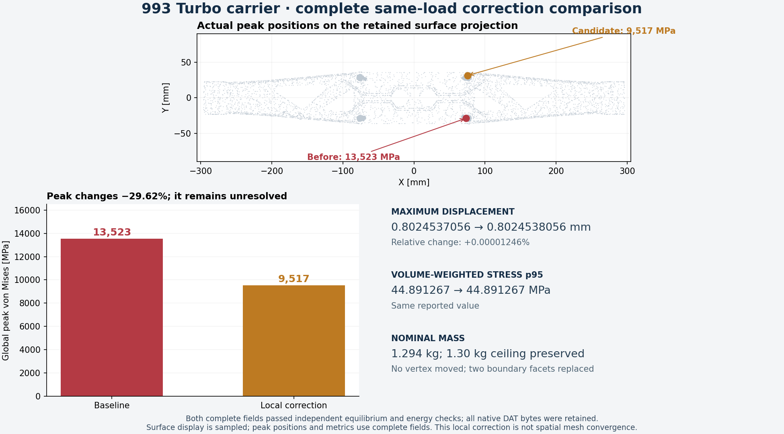

The fresh Spain-hosted execution completed the original full model in
365.435 seconds and the local correction in 373.627 seconds. Both native
processes returned zero, were reaped and preserved their input identities.
Three analytic controls and two full reference repetitions completed first.
Independent complete-field equilibrium and energy checks passed for both
10.45-million-element models, with the original limits unchanged.

| Observable | Baseline | Local correction |
|---|---:|---:|
| Maximum displacement [mm] | 0.8024537056 | 0.8024538056 |
| Global peak von Mises [MPa] | 13,523.310 | 9,517.264 |
| Volume-weighted stress p95 [MPa] | 44.891267 | 44.891267 |
| External work [N mm] | 1,445.625973 | 1,445.626004 |
| Relative independent energy residual | 6.126e-8 | 4.199e-8 |

The peak falls 29.623%, while maximum displacement changes only 1.246e-7
relatively. The new peak lies at [75.419226, 31.445736, 3.795109] mm. It remains
unresolved; neither this correction nor unchanged bulk observables establish
spatial convergence or strength. Nominal mass remains 1.294 kg.

The new peak-cell audit finds four surface vertices but **zero exterior
faces**, 74 incident cells and no retained severe-edge endpoint. Its
edge-matrix condition is about 38,264. The previous two-boundary-face removal
does not apply: its explicit precondition refuses this case. The next local
conditioning trial must inspect interior connectivity while preserving the
surface, before attempting a mechanical refinement comparison.

A finite search of 22 local cavity connectivities found one admissible
four-cell interior-edge replacement. Its worst normalized condition decreases
from 25,897.893 to 8,610.946; minimum mean ratio improves from 0.001736 to
0.003446. Exact positive volumes and identical cavity boundaries/volumes pass
in both the printed and serialized solver coordinate frames. No new edge is
already used outside the cavity. The complete assembled 10,452,018-cell mesh
then passed the independent exact orientation/indexed-boundary check, with one
component and no unused vertex. Every surface byte, vertex position, interface
roster and nominal mass stays unchanged. This variant has no mechanical result
yet and is not a spatial-refinement level.

Its separate frozen input packet changes only `current/mesh.inp` among the
declared inputs; runtime, controls, loads and numerical limits remain unchanged.
The complete packet passed unpacking and every member hash check inside the
exact pinned image under local amd64 emulation. The solver-mesh hash is
`3c940610308741ea2b3d48b022e5d5286aa195b95d0262bf6512d6a7353c666d`.

All seven original phase archives, 1,169,015,230 compressed bytes, were
collected and SHA-256 verified. Restoration reverified all 39 files named by
the closed native terminal records, 3,738,628,143 bytes. The complete original DAT is now
retained: 1,504,485,636 bytes, SHA-256
`684624e69c4e33f1d6c3f344ab1608b703940e6b85a830a964ffef36ff9012a6`.
The complete candidate DAT was separately collected, losslessly decompressed
and verified: 1,504,485,508 bytes, SHA-256
`7450a879dd68e26e08f9c1b55ba79af6e226fd7aa3d735fd2098417abc278012`.
The earlier interrupted range collection remains a separate partial dataset.

### Preparation for genuine spatial refinement

The separate interior-edge refinement preparation now also checks that each
rounded midpoint is exactly on its original edge. A reproduced synthetic case
passed the earlier cavity-boundary and total-volume checks while rounding its
midpoint off the parent edge; that does not preserve a nested P1 partition.
The new version rejects that case and passes nine local controls. This is
preparation for genuine displacement-space enrichment; no complete carrier
refinement or mechanical convergence is inferred from those controls.

A read-only refinement-ranking tool is also prepared. It reparses an admitted
complete DAT with the bit-qualified reader, pairs every indexed interior face,
and distributes half the face quantity
`h_f A_f ||(sigma_left - sigma_right) n_f||² / E` to each adjacent cell.
Here `h_f` is the largest face edge; the quantity has N mm units. This ranks
interior traction discontinuities, not just stress magnitude. It excludes
boundary residuals and is not a certified global error bound. Twelve primitive
controls and three complete two-cell pairing/rejection controls passed locally
and in the pinned image under Mac amd64 emulation. The complete native ranking
then ran after the candidate checks and critical raw-output recovery. It paired
all 18,021,692 interior faces and counted all 5,764,688 boundary faces in
100.760 seconds. Its complete 83,616,272-byte cell-indicator array was collected
with matching SHA-256. The summed interior indicator is 2,132.195580 N mm;
this is the defined ranking quantity, not a strain energy or certified error.
No refined mesh has yet been solved, and no rental deadline was extended.

Provider absence was independently confirmed. The retained baseline response,
candidate inputs and all upstream geometry checks remain available. The
[versioned guard correction](../../deploy/vast/picogk-parallel/README.md)
adds exact-owned lookup recovery and bounded monitoring retries. A subsequent
attempt must also pass a bidirectional transfer preflight before the complete
packet is uploaded; repeating the slow transfer is not the planned recovery.

A subsequent Germany-hosted attempt passed native connection/runtime readiness
but failed the declared 32 MiB-per-direction, 20-second transfer gate. Its
exact instance was destroyed and independently observed absent before the full
model was sent. This refusal remains recorded rather than being relabelled a
successful preflight.

Recovery preparation now includes [rsync](https://github.com/RsyncProject/rsync)
3.5.2, built locally for Mac and Linux from the signed upstream release. Five
actual local tests passed, including interrupted transfer recovery, corrupt
prefix repair and independent SHA-256 rejection of a wrong full-sized file
despite a zero transfer-tool exit code. Two additional Mac/Linux protocol
tests passed in the exact pinned container. The Linux executable is qualified
for that image; no broader libc/NSS portability is inferred. Persistent connection
sharing uses the documented
[OpenSSH controls](https://man.openbsd.org/ssh_config#ControlMaster);
each host must pass its own bulk-transfer test.

The next Spain-hosted attempt exposed a local transfer-process supervision
failure; it was destroyed before model upload. Local controls then reproduced
the inherited-pipe waiting mechanism and verified file-backed process waiting,
actual timeout reaping and interrupted-transfer recovery. A subsequent
Vietnam-hosted attempt failed SSH authentication and was also confirmed absent
before model upload. These failures are retained separately from solver results.

Attempt 013 passed the live Spain-hosted gate: 32 MiB uploaded in 17.284 seconds
and downloaded in 29.862 seconds, with complete SHA-256 agreement in both
directions. SSH setup took a separate 4.835 seconds. The native cgroup reported
64,720,207,872 bytes of RAM and a 30.720-core CPU quota; this admits the prepared
finite `ram64` profile. These observations qualify this host's transport and
resource intake, not the subsequent full-model solve. The two-hour lease uses
the unchanged version-2 ownership guard and independently bounded operators.

### Reusable complete-field reader

The new [C3D4 reader](../../scripts/calculix_c3d4_field_reader.py) batches native
decimal rows while preserving strict sections, ordered IDs, complete counts,
one integration point, finite values and exact row widths. Eleven public
admission/rejection tests passed. Eight actual native analytic datasets also
matched the earlier reader bit for bit, with six damaged-output controls.

The complete current-carrier comparison checked every displacement, reaction,
stress and energy scalar against the original admitted reader: all bits
matched. Parsing took 41.684 seconds; parsing plus the whole-array comparison
took 43.869 seconds. The published parser function has an identical AST to
that native-qualified function; its CLI adds input/output hashes and a fresh
directory requirement. It performs field intake; equilibrium and energy
checks remain separate.

The published CLI also completed intake of the newly restored complete native
DAT on the Mac: 24.295 seconds and 725,925,888 bytes observed peak RSS. Every
one of its 82,595,839 float64 scalars has the same raw-array SHA-256 as the
independently replayed original native reader on that exact DAT. This extends
the earlier small CLI smoke check to the full real field and a different
platform; it does not add a mesh-refinement result.

```sh
python3 scripts/calculix_c3d4_field_reader.py \
  --dat /private/native-case/job.dat \
  --nodes 3129838 --elements 10452019 \
  --groups work/carrier-current-p1-intake-001/groups.npz \
  --output /private/fresh-current-fields
```

## Four-cell interior conditioning: native response passed

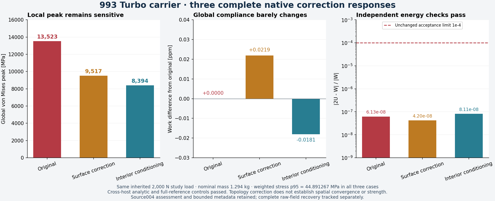

The complete source004 response finished on the North Carolina host in
420.87 seconds with return code zero, unchanged input hashes and the native
process reaped. This revision preserves all vertices, the complete external
surface, interfaces, applied nodal forces and nominal mass. It changes four
interior cells through exact cavity-boundary/volume preserving connectivity.
It is a conditioning experiment, not an h-refinement result.

| Same 2,000 N study load | Original admitted mesh | First surface correction | Four-cell interior conditioning |
|---|---:|---:|---:|
| Elements | 10,452,019 | 10,452,018 | 10,452,018 |
| Maximum displacement [mm] | 0.802453705552 | 0.802453805556 | 0.802453705548 |
| External work [N mm] | 1,445.625972798 | 1,445.626004426 | 1,445.625946634 |
| Volume-weighted stress p95 [MPa] | 44.891267433 | 44.891267433 | 44.891267433 |
| Global stress peak [MPa] | 13,523.310352 | 9,517.263838 | 8,394.264568 |
| Independent energy relative residual | 6.126e-8 | 4.199e-8 | 8.108e-8 |

All three analytic controls and both complete quadratic reference cases
passed on this host. Each complete reference matched its frozen native gold
with **zero difference in the printed displacement, reaction and stress
components**, under unchanged acceptance limits. Independent source004 intake
counted 3,129,838 nodal displacements, 14,064 support force vectors and
10,452,018 stress/energy records. Equilibrium and both energy evaluations
passed the predeclared limits; the energy relative limit remains 1e-4.

The additional peak drop is approximately 11.8% relative to the first
correction. Global work and displacement remain almost unchanged, while the
peak still depends strongly on local connectivity. These results do not
establish peak convergence or an allowable strength.

Complete source004 scientific DATs and bounded run metadata are now locally
retained and SHA-256 verified. Both complete reference DATs are byte-identical;
content reuse preserves their separate native execution receipts. The native
90 MB reference assessment arrays were also recovered against their exact
output hash. A fresh Mac replay passed all original mathematical controls,
equilibrium and energy limits. Displacement, peak, weighted p95 and both
integrated energies match the native metrics exactly. The work reduction differs
by one binary64 ULP (2.274e-13 N mm); its derived relative energy residuals differ
by 1.573e-16. An extra assertion requiring every metric to be bit-identical
correctly recorded that difference; the engineering limit remains unchanged.

The original large gzip archive collector failed on bandwidth timeouts. The
separate lossless XZ/range recovery retained the full scientific fields instead;
large auxiliary FRDs and original archives are still not credited as retained.
No native calculation replay or lease extension was needed to recover bytes.

## Bulk nested interior refinement: complete geometry checks passed

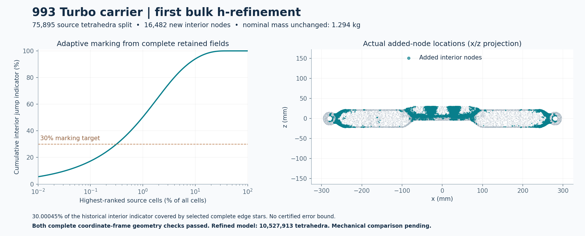

The first true h-refinement has now been assembled and checked over the complete
model. It bisects 16,482 closed interior edge stars, replacing 75,895 parent
tetrahedra with 151,790 children. Each new midpoint is exactly the dyadic average
of its parent edge in both the original and serialized solver coordinate frames.
Every local cavity retains its exact oriented boundary and total volume. Source
stars are disjoint, and no new midpoint duplicates another midpoint or an
existing mesh vertex.

| Quantity | Four-cell conditioned source | First bulk refinement |
|---|---:|---:|
| Vertices | 3,129,838 | 3,146,320 |
| Tetrahedra | 10,452,018 | 10,527,913 |
| Free displacement degrees of freedom | 9,347,322 | 9,396,768 |
| Conservative scalar sparsity upper bound | 322,871,256 | 333,800,136 |
| Surface SHA-256 | `801e989e…` | Identical |
| Nominal mass | 1.2941382 kg | Unchanged |
| Full mechanical comparison | Native equilibrium/energy passed; full-field recovery in progress | Response pending |

Selected complete stars cover 30.000454% of the **historical first-correction
interior jump indicator**. The ranking contains all 10,452,018 source-cell
entries. Approximately 32,868 highest-ranked individual cells account for 30%
of that indicator; complete-star closure and non-overlap determine the larger
75,895-cell refinement set. The four subsequently conditioned cells and all 134
retained extreme-condition cells are protected from subdivision. This is
adaptive marking from retained fields, not a current error estimate or a
certified error bound.

All 151,790 new children were also classified with the original normalized
condition metric in both coordinate frames. One child crosses 1e6, reaching
1,277,787.53. The refined exact-energy evaluation list therefore contains
**135 cells**, including new cell index 9,599,878; it must use the separately
verified population rather than inheriting only the original 134 entries.

The qualified complete-mesh checker passes on all 10,527,913 tetrahedra in both
coordinate frames: exact positive orientation, the unchanged complete oriented
surface, cancelling interior faces, one cell component and zero unused nodes.
Independent complete solver-text readback matches every coordinate and cell.
A fresh assembly replay reproduces the volume, solver mesh and both checker
report hashes. The initial boundary-frame writer correctly stopped on an
incorrect assumption that the surface includes every volume vertex; its refusal
is retained, and the corrected writer was replayed from a fresh directory.

All original fixed and loaded nodes remain unchanged. Added nodes are internal,
with zero applied nodal force and no added support constraint. Exact parent-edge
bisection therefore permits a nested P1 comparison with the same load functional
and boundary trace. For linear elasticity, the next numerical checks can track
`W = L(u)`, `2U = W` and the expected nondecreasing compliance under nested
refinement, alongside displacement, weighted stress and the audited peak. No
refined mechanical solution or convergence result is claimed by geometry alone.

```mermaid
flowchart LR
    N_SRC["N-SRC: Four-cell conditioned source<br/>Geometry, native response and full raw fields checked"] -->|"historical full-field ranking guides"| N_MARK["N-MARK: Disjoint closed edge stars<br/>30.000454% of retained indicator"]
    N_MARK -->|"exact midpoint bisection"| N_SPLIT["N-SPLIT: Nested P1 geometry<br/>16,482 new interior nodes"]
    N_SPLIT -->|"verified in both coordinate frames"| N_CHECK["N-CHECK: Complete mesh and intake<br/>10,527,913 positive tetrahedra"]
    N_CHECK -->|"native reader refuses overlong coordinates"| N_REFUSE["N-REFUSE: Initial h1 retained<br/>No complete response"]
    N_REFUSE -->|"exact decimal admissibility before selection"| N_FORMAT["N-FORMAT: Alternative exact edge stars<br/>All native fields at most 20 characters"]
    N_FORMAT -->|"repeat complete dual-frame checks"| N_RECHECK["N-RECHECK: Revised complete geometry<br/>10,527,916 positive tetrahedra"]
    N_RECHECK -->|"exact packet006 reconstruction"| N_SOLVE["N-SOLVE: Same-load native solve<br/>Complete; full fields recovered"]
    N_SOLVE -->|"complete fields and unchanged limits"| N_COMPARE["N-COMPARE: Equilibrium/energy passed<br/>Measured energy-norm difference 6.43%"]
```

Private volume SHA-256:
`eeb2333cc16ea51a7173ea8a404d3e7d87ed84852ecc83d4289adcef85ddf13d`.
Solver-text SHA-256:
`9e2a3252106235f151c513f7932391b12522ce03a1b95831eaf5c3b29c1db686`.

The owner explicitly authorizes simultaneous Vast rentals. Every lease still
has an exact owned identity, finite deadline and independent cleanup monitor.
The renewed 128 GiB host failed the sustained public-only download gate and was
destroyed with provider absence verified, before private-model upload. A later
provider API outage during another image startup also caused exact cleanup;
both refusals remain recorded. These are infrastructure outcomes, not failed
mechanical calculations. A fresh host must pass native readiness and the same
128 MiB bidirectional SHA-256 gate before receiving the frozen model packet.

### Native-format follow-up to the first proposal

The initial h1 native trial passed its three analytic and two full-reference
controls, then stopped during current-mesh intake after 93.33 seconds, return
code201. No displacement or stress field was produced. A new midpoint included
`-4.0459999581798999E-05`, exceeding the native numeric-field width. The
[upstream node reader](https://github.com/Dhondtguido/CalculiX/blob/master/src/nodes.f)
uses `F20.0` and rejects coefficients longer than 20 characters. Python float
readback had admitted the geometry but had not tested this native constraint.
All bounded refusal logs and actual terminals are retained.

A first format-only attempt also refused: some midpoint values cannot be
written within 20 characters using a standard decimal token while preserving
their binary64 value. No digit was truncated. The revised edge-star selection
therefore requires an exact, native-width-compatible token before admitting
each proposed midpoint. Alternative complete edge stars replace the rejected
choices. All original vertices, supports, loads, external boundary and mass
remain unchanged; the internal refinement proposal is a distinct revision.

| Revised exact proposal | Checked value |
|---|---:|
| Added interior nodes | 16,482 |
| Split source cells | 75,898 |
| Children | 151,796 |
| Total elements | 10,527,916 |
| Historical interior indicator covered | 30.000821% |
| Exact-energy population | 135 |
| Full original-frame and solver-frame geometry checks | Passed |
| Independent complete coordinate/connectivity readback | Passed |

The new source volume SHA-256 is
`86a29c1e33a69b9e30beb237deed00f6649080055a97425fc4093d312b5db8fd`;
its solver mesh SHA-256 is
`986ad356ba9359a45d827fc1695630fea9325bc8aed2412df0daf09ff39dae8c`.
The reusable [lossless coordinate formatter](../../scripts/calculix_coordinate_format.py)
now refuses unsupported values before mesh acceptance. Its six regression tests
cover the observed native-reader failure, exact negative fixed decimals,
unrepresentable values, signed zero, adjacent binary64 values and nonfinite
inputs. All **49,446 actual new-coordinate tokens** pass binary64 readback and
the 20-character limit. A separate complete packet audit checks every actual
native node field before execution. The original failed proposal remains retained;
no convergence is credited from its small control successes.

## First complete nested response: retained and independently replayed

The revised h1 solve finished in **429.57 seconds**, actual return code zero,
process reaped and every input unchanged. Its complete 1,515,073,998-byte DAT
has SHA-256
`1c16dd56c6145666263cacbd6a421906f93f82947c47d639ffdebbdf25a8af4d`.
All three analytic and both complete quadratic reference controls passed under
the unchanged component limits.

| Same-load quantity | Conditioned source | Admitted h1 | Relative change |
|---|---:|---:|---:|
| Maximum displacement [mm] | 0.802453705548 | 0.805801283565 | +0.417168% |
| External work [N mm] | 1,445.625946634 | 1,451.625543727 | +0.415017% |
| Volume-weighted stress p95 [MPa] | 44.891267433 | 45.045800071 | +0.344238% |
| Global stress peak [MPa] | 8,394.264568 | 9,632.876305 | +14.755453% |
| Independent energy relative residual | 8.108e-8 | 1.212e-7 | Both below 1e-4 |

The actual nested comparison checks every original vertex and each added
midpoint, uses the complete parent/child map, and integrates the stress-field
difference over every refined tetrahedron. Its compliance increment is
5.999597093 N mm; twice the stress-difference compliance energy is
5.999654043 N mm. The Galerkin identity defect is 3.923e-8 relative to the
refined work. The normalized between-level energy difference is **6.4289%**;
this is a measured increment, not a certified error relative to the exact
continuum solution.

The complete source and h1 scientific DATs, bounded metadata and exact input
packets are now local and SHA-256 verified. A fresh Mac h1 replay finished in
86.37 seconds with actual return code zero and reproduced all eight selected
native metrics exactly, including both energy integrals and residuals.
Original large gzip phase archives and large auxiliary FRDs are not claimed
as retained by this scientific recovery. The exact original instance was
then destroyed, with provider absence verified; its lease was never extended.

### Upstream peak-cell and boundary audit

Before a further native refinement, the actual source and h1 peak cells were
checked against the complete retained boundary with the already qualified
libigl 2.6.3 double AABB. Rational determinant signs classify their cell
orientation and neighboring boundary-plane sides. The diagnostic finished in
5.07 seconds, return code zero, actual process reaped, about 1.69 GiB peak RSS.

| Peak-cell diagnostic | Conditioned source | h1 |
|---|---:|---:|
| Exact positive cell volume [mm³] | 1.22235e-11 | 3.95366e-10 |
| Normalized condition metric | 45,939 | 212,331 |
| Cell-centroid distance to retained boundary [mm] | 1.27717e-7 | 4.20868e-7 |

The nearest source-boundary triangle has adjacent reentrant creases with
interior dihedral angles around 187.0° and 187.4°. The immediate neighbors of
the selected h1 nearest triangle are convex or nearly coplanar. These are
local geometric observations, not a demonstrated singularity exponent. The
extremely thin peak cells and the moving peak remain explicit. **Upstream
verdict:** continue finite-energy global-response refinement; exclude the
pointwise peak from a strength or convergence certificate until its geometric
and conditioning interpretation is resolved.

### Second nested proposal and complete software checks

The next proposal uses the freshly computed complete h1 traction-jump field,
not the older marking field. Its 18,173,488 interior faces produce a total
indicator of 2,748.897252 N mm. The complete 84,223,456-byte cell indicator was
recovered against SHA-256
`f7a726b0493de558a932d564f9f4d1ab97d929ca8283deae22d0fd65e4fc0869`.
This is an interior ranking, not a certified global error bound.

A 60% marking request attained only 52.108% with the finite 80% seed search,
closed disjoint stars, exact native-width-compatible midpoints and the new
normalized child-condition cap. That request remains unaccepted. A separate
fresh **50% marking proposal** completed; no force, energy, reference-component
or solver stopping limit was changed.

| Admitted second geometry | Checked value |
|---|---:|
| Nodes / tetrahedra | 3,198,879 / 10,778,441 |
| Added free interior nodes | 52,559 |
| Split parents / children | 250,525 / 501,050 |
| Actual current indicator coverage | 50.000058% |
| Maximum new-child normalized condition metric | 917,492 |
| Newly introduced cells at or above 1e6 | 0 |
| Complete exact-energy population | 135 |
| Both-frame orientation, indexed boundary, connectivity and readback | Passed |
| Nominal mass / external surface / original loads | Unchanged |

The new complete solver mesh SHA-256 is
`856e9e95b3ab53c2f011476d6b31cddfc72bce24df11b639c0bb785acae67a52`.
Packet007 retains the same solver, ABI, material, controls and load functional.
All 90 regular members passed the original safe-unpack and full member-hash
witness in the unchanged pinned Linux image, with networking disabled; the
witness took 72.81 seconds and container absence was verified. Its complete native response and independent Mac replay are now retained,
as detailed below.

### Second complete native response and independent replay

The UK RTX 5090 host completed the full h2 case using the same native
CalculiX/PARDISO binary, private ABI closure and eight solver threads. All three
analytic controls and both full quadratic-reference repeats passed. All seven
native phase archives were recovered: **1,193,495,446 bytes**, with their SHA-256
identities and every terminal-named output verified. This includes the large
current FRD; no full-output recovery claim is inferred from report files alone.

| Measured quantity | h1 | h2 | Change |
|---|---:|---:|---:|
| Maximum displacement, mm | 0.805801284 | 0.809489862 | +0.457753% |
| External work, N mm | 1,451.625544 | 1,458.386404 | +0.465744% |
| Volume-weighted stress p95, MPa | 45.045800 | 45.219891 | +0.386475% |
| Global stress peak, MPa | 9,632.876 | 9,984.251 | +3.647659% |
| Independent relative energy residual | 1.212338e-7 | 1.979841e-7 | Both below 1e-4 |

A fresh Mac assessment independently decoded all complete h2 fields and reran
all original controls. Displacement, both stress statistics and both integrated
energies match the native report exactly. External work differs by one binary64
ULP (−2.2737367544323206e-13 N mm); no acceptance limit was changed.

The complete nested comparison checked every unchanged cell, all 250,525 split
parents, every new midpoint and the actual child connectivity. It also requires
identical material properties and load/support payload hashes. Seven comparison
controls passed, including deliberate invalid parent/midpoint mappings. The
measured stress-difference compliance energy is 3.380485119 N mm; its normalized
energy-norm increment is **6.808763%**. The relative Galerkin-identity defect is
7.547936e-8 of work. Together with the previous 6.43% increment, this fails the
planned stabilization screen of two consecutive energy-norm increments below
1%, with scalar increments below 0.5%. Small scalar changes alone are insufficient.

### Third admitted nested geometry

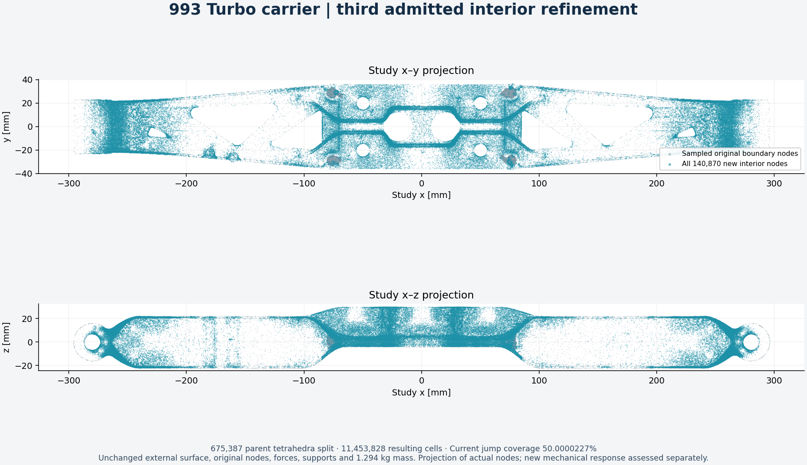

A fresh h2 jump ranking examined all 18,674,538 interior faces. Its total
indicator is 2,925.989176 N mm. The complete 86,227,656-byte vector was recovered
against SHA-256
`61a09bb1099940be1fc2b8de0f713f5d9ff206b30f6dab3c3785046e3d3adae5`.
An 80% seed search failed to attain the 50% marking target and remains rejected.
A separate search over all seeds attained 50.0000227%; target, quality and
numerical limits remained unchanged.

| Third geometry check | Result |
|---|---:|
| Nodes / tetrahedra | 3,339,749 / 11,453,828 |
| New interior nodes / split parents | 140,870 / 675,387 |
| Maximum new-child normalized condition | 942,568.821 |
| Newly introduced cells at or above 1e6 | 0 |
| Complete exact-energy population | 135, inherited |
| Geometry, both coordinate frames and independent native-text readback | Passed |
| Mass, original node bits, indexed external surface, forces and supports | Unchanged |

Complete mesh SHA-256:
`0088036dca69f3bc7659af8f08b79882ccf7c84ad6f168690b48c92f1ee33175`.
The 196,423,700-byte lossless mesh transport has passed a complete decode/hash
witness; every native coordinate token fits the unchanged 20-character reader.
The complete h3 native solve has now finished in **183.253 seconds**, actual
return code zero, process reaped and all input hashes unchanged. The native
full-field assessment passes, with 0.812572357 mm maximum displacement and
relative independent energy residual 6.300138e-8. Complete scientific-field retention, independent Mac replay and the nested
h2-to-h3 comparison have also completed, as detailed below.

The retained `/usr/bin/time -v` output measures **37.3364 GiB maximum RSS** and
zero swaps. The actual matrix has 9,977,055 equations and 168,247,860 lower
triangular nonzeros. This level completed within the existing 96 GiB virtual
cap; no larger-memory rental was needed for h3. The native structural solve
uses eight requested CPU solver threads. Its execution does not claim GPU
acceleration.

### Third complete retained response and independent nested comparison

The complete new scientific DAT contains **1,643,842,471 bytes**, SHA-256
`4f61d91b108b3ca11f321c440a8253b75d761b28dd7a422b5cf57930647c4f00`. Its lossless XZ envelope is
389,676,536 bytes, SHA-256
`109c4f22a31fcb91a0f0118c3ab7595ba5f2a78aca5f8ccd84c3c354456bb1c8`. Every transport range, the complete
envelope and every decoded raw byte were verified. Bounded metadata was retained
separately. The five inherited h2 control DATs and reference arrays are reused
locally only after their exact native execution and output hashes match; they
are not five newly executed native control solves. Large h3 auxiliary FRD and
phase archives are **not** claimed as locally retained.

A fresh Mac assessment independently reparsed every h3 U, RF, S and ENER record
and recomputed all original control comparisons and energy/equilibrium checks.
It passed with all original numerical limits unchanged.

| Measured quantity | h2 | h3 | Change |
|---|---:|---:|---:|
| Maximum displacement, mm | 0.809489862 | 0.812572357 | +0.380795% |
| External work, N mm | 1,458.386404 | 1,464.062488 | +0.389203% |
| Volume-weighted stress p95, MPa | 45.219891 | 45.337166 | +0.259344% |
| Global stress peak, MPa | 9,984.251 | 11,451.151 | +14.692137% |

All 675,387 actual split parents, every unchanged cell and all 140,870 exact
midpoints passed the independent complete nesting/binding checks. Material,
load and support hashes agree. The stress-difference compliance energy is
2.837944849 N mm, the energy-norm increment is
**6.226402%**, and the relative Galerkin-identity defect is
1.330697e-07 of work. The new increment is smaller than
6.81% but remains above the unchanged 1% stabilization screen. The three scalar
increments remain below 0.5%; that alone does not establish stabilization.

The fresh h3 indicator was then computed locally from every retained field.
All 12 primitive and three face-pairing controls passed. The complete run took
68.715 seconds, returned zero and was reaped. It checked 20,025,312 interior
faces and the unchanged 5,764,688 boundary faces; total indicator is
2,992.119644 N mm. The new vector is bound by SHA-256
`9e3864cc3c8ba29b8bec4937156fea658eb0d9846da561649660c4d42fdbf778`.
This remains an adaptive ranking, not a certified error bound. Its locally
verified full field is the input to the fourth nested proposal.

The exact UK lease was destroyed after complete h2/h3 scientific retention and
both independent Mac replays, with provider absence verified. Its deadline was
never extended. The full h3 DAT is retained; the large auxiliary FRD is not.

### Fourth complete geometry admission and next load cases

The fourth proposal uses the freshly retained h3 indicator. A first preparation
stopped before geometry generation because the local indicator lived under
`result/` rather than at the recovered-vector root. That path refusal is
preserved; the corrected fresh trial uses the actual h3 vector hash above.
Its complete seed search attained the unchanged 50% marking target. Complete
assembly, both coordinate-frame checks, independent native-text decoding and
all new-child quality classifications passed.

| Fourth geometry check | Result |
|---|---:|
| Nodes / tetrahedra | 3,553,918 / 12,501,252 |
| New interior nodes / split parents | 214,169 / 1,047,424 |
| Actual current indicator coverage | 50.0000172% |
| Maximum new-child normalized condition | 960,316.632 |
| Minimum new-child mean ratio, both frames | 1.59249049e-5 |
| New cells at or above 1e6 / inherited exact-energy cells | 0 / 135 |
| Mass, original node bits, external trace, loads and supports | Unchanged |

Complete mesh SHA-256:
`f76c0288050309b678c4bf0fabcd5babdf90f56cec7bb4303cca5713fabc4793`.
All native node tokens fit the unchanged 20-character reader. The complete
lossless mesh roundtrip passed. Packet009 is 560,972,944 compressed bytes,
SHA-256 `59be36c82aa50f6ed6b590c1fbb3d54fd5ec3cae8353f524debd85744635a82c`.
All 90 regular files were safely unpacked and every member hash checked in the
unchanged pinned Linux image, networking disabled. The witness took 83.896
seconds and its container absence was verified. This admits the complete input;
at this input checkpoint the fourth mechanical response had not yet executed; its subsequently completed results are recorded below.

The second prepared load case retains the original study functional of
4,000 N downward plus 850,000 N mm about y (850 N m). Its independent input
checks bind every serialized force component, every support node, the elastic
material and all six rigid-work bases on the admitted h3 and h4 coordinates.
Five altered input cases are refused, including substituting the gravity deck,
changing a force, duplicating a load, moving a support and changing the elastic
modulus. The separate native wrapper checks actual case/deck/mesh identity,
reserve-aware dispatch, unchanged reference controls and metadata recovery
before a current case is reached. These are prepared input/operator checks,
**not a solved combined response**.

The next numerical executions must preserve both load cases separately. Each
native host needs its actual analytic/reference controls, full-field assessment,
complete scientific DAT retention and independent replay. Combined-case results
must not be inferred by scaling the gravity peak: the applied torque changes
the load functional. Both cases remain under the same original study material
and numerical limits.

### Fourth-level native results under two load cases

Both fresh hosts executed their own three analytic controls and two complete
quadratic-reference repetitions. Both complete h4 load cases then finished and
passed the unchanged native full-field equilibrium and energy checks. The mesh,
material and support functional are identical; the force/moment functional
differs. Complete current-field retention and both independent Mac replays have now
also passed, as detailed below.

| Native quantity | Vertical | Combined |
|---|---:|---:|
| Maximum displacement, mm | 0.814348056 | 2.353343418 |
| Volume-weighted stress p95, MPa | 45.409949 | 171.171669 |
| Global stress peak, MPa | 17,894.815 | 172,807.522 |
| External work, N mm | 1,467.342232 | 19,058.480137 |
| Independent relative energy residual | 2.758951e-07 | 8.692134e-08 |
| Native solve elapsed seconds | 369.992 | 208.086 |

Vertical: Fz = -2,000 N complete native DAT SHA-256:
`b88ed7fb48bf9d7e43149a6d843c488c820b63d46e1ac6d9901dc721a8f83f6d`.

Combined: Fz = -4,000 N, My = 850 N m complete native DAT SHA-256:
`1af3a2c2b96751edd3199a2222877cfe064095d8d34ffcb3ee3d71c7d8ccc0de`.

The fresh reference outputs differ bytewise from older host caches, while
remaining within every original component and energy criterion. Their actual
DATs and result arrays are therefore recovered separately and bound to the new
execution terminals. No older array is substituted on approximate agreement,
and no solver execution is replayed to repair a transfer or cache mismatch.
The unresolved pointwise peaks remain visible; no strength acceptance follows
from these native checks.

### Fourth complete independent comparisons and real-field images

The entire 1,789,263,700-byte DAT for each h4 case was recovered, losslessly
decoded and bound to its actual native terminal SHA-256. Fresh reference DATs
and result arrays were also retained by exact new-host hashes; identical repeat
outputs were deduplicated only after their complete SHA-256 identities matched.
Both Mac assessments reran the original control comparisons and every current
field check. All original equilibrium and energy limits remain unchanged.

| h3-to-h4 quantity | Vertical | Combined |
|---|---:|---:|
| Energy-norm increment | 4.727968% | 6.153902% |
| External-work change | +0.224017% | +0.380140% |
| Maximum-displacement change | +0.218528% | +0.352728% |
| Volume-weighted stress-p95 change | +0.160539% | +0.335087% |
| Relative Galerkin identity defect | 2.083674e-7 | 4.578755e-8 |

Both comparisons verify all 1,047,424 actual parent/child pairs and 214,169
midpoints, unchanged cells and original coordinate bits, identical material,
and the actual load/support payload hashes. The combined checker explicitly
requires two combined-case reports and the combined force-vector hash; an old
gravity-vector match cannot qualify a combined comparison. Its additional
altered-case/load/support controls pass.

The h3 combined baseline was executed separately on the already qualified
combined host: 192.641 seconds, actual return code zero, full native and Mac
energy/equilibrium checks passed. Its five native controls were inherited by
exact same-host execution receipts, copied without modifying the originals,
then independently recompared and reassessed. They were not five new native
solves. An additive receipt preserves and corrects the generic standalone
dispatch metadata flag; the explicit reuse ledger records the actual behavior.
No new machine or deadline extension was needed for this baseline.

After all three complete current DATs were rehashed locally and the independent
replays and fresh reference recoveries were verified, both h4 leases were
destroyed. Provider absence is recorded in
`work/carrier-h4-lease-close-001/close-026.json` and `close-027.json`. No deadline
was extended. The next refinement is prepared locally before further rental.

The real-field image intersects all 325,706 nondegenerate tetrahedral cuts on
z = 0 mm and assigns each polygon its actual, unaveraged P1 cell stress. Both
cases share a logarithmic colour scale. Global peaks are reported separately;
the cut plane does not represent every global peak. Original images remain
archival; the published second layout was visually inspected for readability.

### Reusable case-aware comparison command

The public [nested P1 comparator](../../scripts/calculix_compare_nested_p1.py)
now reproduces both actual complete h3-to-h4 comparisons exactly for all checked
numerical and connectivity values. Nine focused tests cover the energy identity,
parent/child topology and altered case/load/support refusals. Qualification is
recorded in `work/carrier-public-comparison-qualification-001/qualification.json`.

Run from the repository root using the environment installed by `make check-setup`.

```sh
.venv-check/bin/python3 scripts/calculix_compare_nested_p1.py \
  --load-case combined \
  --source work/carrier-h3-combined-local-replay-001/result \
  --refined work/carrier-h4-combined-local-replay-002/result \
  --map work/carrier-nested-comparison-h4-001/h3-to-h4-map.npz \
  --output /tmp/carrier-combined-comparison.json
```

The command consumes independently admitted assessment folders, their bound
material/load records, decoded coordinates/connectivity and complete fields.
Private inputs are intentionally excluded from Git. Set `--load-case gravity`
and supply the corresponding gravity assessment folders to compare that case.

An exact positive-volume audit of the two global-peak cells found normalized
condition metrics of 293,245 and 362,850. Their minimum tetrahedral altitudes
are approximately 3.26e-6 and 5.65e-7 mm. These are cell-shape measurements,
**not part wall thicknesses**. Neither peak cell directly contains a loaded
or fixed vertex. This inspection does not establish a singularity exponent;
the very large pointwise stresses remain unresolved and excluded from strength
acceptance. Full private details are in
`work/carrier-h4-peak-conditioning-001/audit.json`.

A separately qualified streaming decoder verified a 2,200,000,137-byte public
fixture and the complete actual h4 gravity DAT, with at most 1 MiB decoded per
chunk. Truncation, trailing bytes and wrong size/hash are refused. This prepares
lossless recovery of larger refinement outputs; it changes no mathematical
values or precision and does not increase the leases' compressed network budgets.
The qualification is in `work/carrier-large-scientific-codec-001/qualification.json`.

The new native encoder function was additionally exercised on a complete
2,200,000,137-byte fixture. Full encoding and bounded decoding reproduced every
source byte and SHA-256; an altered actual-terminal hash was refused. Its
qualification is in `work/carrier-large-native-codec-001/qualification.json`.
The raw fixture was temporary and removed after the completed check.

### Next common refinement under both cases

The actual h4 traction-jump indicators are 3,459.818053 N mm in gravity and
69,041.702113 N mm in the combined case. The new dimensionless ranking uses
J_joint = J_gravity / W_gravity + J_combined / W_combined, with external work
from each independently admitted complete response. This removes dependence
on a uniform scaling of either load. Analytical sum, squared-load-scale
invariance and negative/nonfinite/mismatched-size/zero-work refusals pass.

The next proposal must cover at least 50% of **each** actual case indicator,
in addition to the joint 50% target, using the unchanged complete seed search,
exact midpoint, closed disjoint cavity and child-quality conditions. The same
boundary, original loads, supports and mass are preserved. This ranking is not
a certified error bound; the next geometry and both new numerical responses
remain separate required checks.

The first joint-order proposal reached its 1,800-second preparation limit before
finishing both individual targets. Its last retained joint coverage was 50.1043%;
that joint value does not demonstrate 50% coverage in each case. No geometry or
mechanical result was admitted from that attempt. A fresh bounded preparation
visits the least-covered case first, with descending indicator inside that case.
Its synthetic controls verify both disjoint-case coverage and refusal to count
protected cells. The original targets and geometric quality limits are unchanged;
its preparation remains separate from full geometry admission and new solves.

That second preparation was stopped before admission after a bounded comparison
identified a better edge choice. On the same 808 high-indicator source cells,
selecting the admissible edge with the largest remaining-gap-weighted indicator
gain covered 16.9526% of the combined indicator, versus 16.0593% with the first
admissible longest edge. It split 991 source cells versus 1,008. This is a local
algorithm witness, not a full-model refinement or convergence result. Exact
closed-star, dual-frame midpoint and child-quality checks were unchanged.

The new full preparation uses that gain-aware choice and retains the same 50%
target in each case. Five controls exercise its actual production gain
expressions, including invariance under uniform load scaling and zero pressure
from a case already at target. Its complete geometry checks and both mechanical responses subsequently
passed the native and independent Mac assessments described below. Source-kernel inspection of the 808 cells also measured
11.04% and 11.87% of the total gravity/combined indicators in individually
unmarkable inspected cells; untested cells are conservatively considered
markable, so this does not prove that the 50% targets are unattainable. Private
receipts are in `work/carrier-h5-gain-pilot-001/`,
`work/carrier-h5-edge-feasibility-001/` and
`work/carrier-adaptive-h5-joint-003/gain-controls.json`.

### Fifth common geometry: complete admission under both indicators

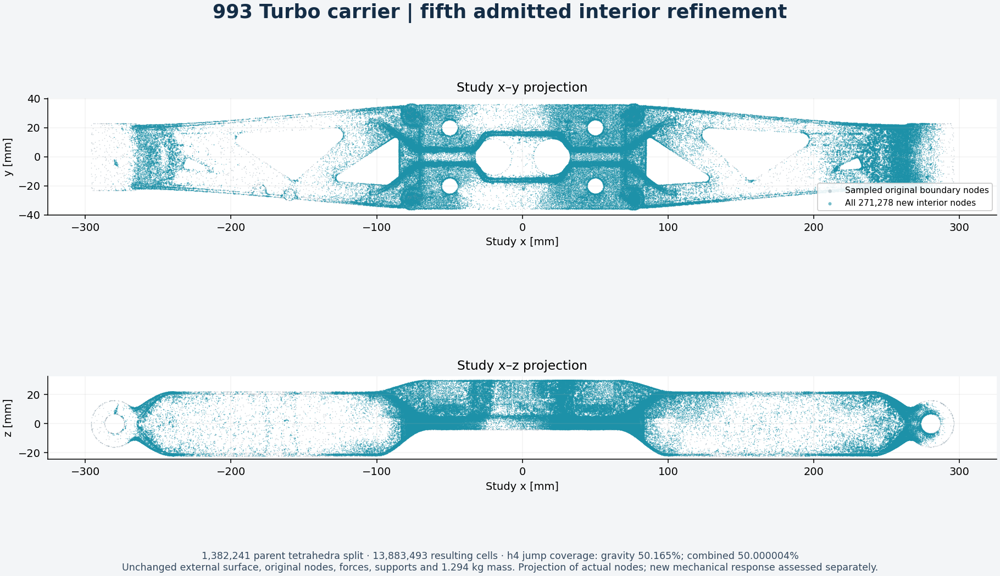

The gain-aware proposal attained both unchanged marking targets. The complete
assembly then passed exact positive-volume, boundary/orientation, connectedness,
unused-node and independent native-text readback checks in both coordinate
frames. No original node, boundary trace, applied load or support was changed.

| Fifth geometry check | Result |
|---|---:|
| Nodes / tetrahedra | 3,825,196 / 13,883,493 |
| Added interior nodes / split source parents | 271,278 / 1,382,241 |
| Actual gravity-indicator coverage | 50.1649757% |
| Actual combined-indicator coverage | 50.0000043% |
| New children classified in each coordinate frame | 2,764,482 |
| Maximum new-child normalized condition | 999,228.821 |
| Minimum new-child mean ratio | 8.558800e-6 |
| New cells at or above 1e6 / inherited exact-energy cells | 0 / 135 |
| Nominal mass | Unchanged: 1.2941382 kg |

Complete volume SHA-256:
`0ee0f96e662c361c29000988740f3d3733731d8edde57695ca549e1100b32b1f`.
Native mesh SHA-256:
`ba34637fc3083adf14b492d381a47229b5bf10cf88495dd1e50fffe45b0d4e19`.
All actual native node fields fit the unchanged 20-character reader and the
complete lossless text roundtrip passed. Packet012 contains 90 regular files,
585,204,699 compressed bytes, SHA-256
`bfb726e6dc227d8b54bda727450115858de16b62449c41230a6032a219bc747a`.
Every member was safely unpacked and hash-verified in the unchanged pinned
Linux image; the witness returned zero in 83.118 seconds and container absence
was verified.

Before a new paid solve, the public nesting checker independently bound all
1,382,241 actual parent/child pairs and all 271,278 midpoint edges to both
independently admitted h4 case geometries. Every unchanged cell and original
coordinate bit matched. The same map will be checked again with each new full
response; no h5 energy increment follows from geometry admission alone.

The two new receiver paths also passed actual decode, terminal-hash binding and
receipt checks, with wrong size/hash and trailing-stream refusals. Their shared
large-file encoder function is structurally identical between cases. A private
local APFS evidence directory passed write/fsync/atomic-rename/full-SHA256
readback and altered-volume/ownership/path refusals. New raw scientific outputs
use that directory, with mount identity and a 32 GiB free-space reserve checked
before rental and reception. Existing artifacts were not moved.

Private geometry receipts: `work/carrier-adaptive-h5-joint-003/`,
`work/carrier-high-memory-input-012/` and
`work/carrier-nested-comparison-h5-001/map-provenance.json`.

### Fifth complete native responses and independent comparisons

The h5 gravity case completed in 231.729 seconds, actual return code zero,
process reaped, with every input unchanged. The qualified host first executed
three analytical controls and two complete retained quadratic-reference solves.
The combined case then completed in 234.191 seconds on that same host, using
all 89 declared packet members plus the manifest without another model upload.
Its five source control executions were inherited by exact terminal/deck/mesh/
DAT/ABI hashes, then recomputed comparisons and reference-energy assessments.
They were not five new native solves. The combined dispatch receipt correctly
records this inheritance.

A separate-host attempt failed SSH authentication before any private model
transfer. The launch wrapper destroyed that exact host and its guard verified
provider absence. The admitted original host was used for the combined case;
its original deadline was not extended. The failed-host receipts remain
retained alongside the successful work.

Each complete current DAT contains **1,980,568,282 bytes**. Both were recovered
and fully SHA-256 verified. Fresh reference DATs and arrays were also recovered;
identical output bytes were reused only after matching each actual current
terminal/assessment hash. Both complete Mac assessments then passed every
original equilibrium/energy limit. All eight reported gravity quantities match
the native values exactly; the combined external-work difference is one ULP
(3.638e-12 N mm), with the original criteria unchanged.

| h4-to-h5 quantity | Vertical | Combined |
|---|---:|---:|
| Energy-norm increment | 2.826103% | 4.596462% |
| External-work change | +0.079949% | +0.211728% |
| Maximum-displacement change | +0.074955% | +0.189933% |
| Volume-weighted stress-p95 change | +0.053024% | +0.171308% |
| Relative Galerkin identity defect | 1.609800e-7 | 6.245277e-8 |
| Monotonic external work | Yes | Yes |

Both comparisons again checked all parent/child mappings, unchanged cells,
original vertex bits, actual load/support hashes and identical material. The
pointwise gravity peak still rose to 20,756.602 MPa; the combined peak is
170,408.885 MPa. These unresolved values remain visible and excluded from
strength acceptance. Smaller changes in displacement or stress p95 do not
replace the energy-norm stabilization screen.

All new scientific files and both Mac replay workspaces live on the qualified
private evidence volume. A fresh complete packet restoration verified every
member SHA-256. Cross-volume bindings use verified atomic copies; same-volume
bindings use exact-byte hard links. No older artifact was moved. The complete
compressed output estimate, including both cases, fresh reference files,
public probe and protocol reserve, was **1,622,041,980 bytes**, below the
original 2,000,000,000-byte lease envelope.

After both Mac replays passed, every scientific and reference file was rehashed
again and the successful host was destroyed, with provider absence verified.
The refused auxiliary host's absence was independently reverified too. No paid
host for this continuation remains active. Current numerical receipts are in
`work/carrier-h5-local-replay-001/`,
`work/carrier-h5-combined-local-replay-001/`,
`work/carrier-h5-combined-followup-001/`,
`work/carrier-nested-comparison-h5-001/` and
`work/carrier-h5-lease-close-001/`.

The new field image shows the actual unaveraged stresses on the undeformed
z = 0 mm cut, with a shared logarithmic colour scale and separately reported
global peaks. The complete current fields now supply fresh per-case interior
traction-jump rankings for the next common refinement. That ranking remains
an adaptive indicator, not a certified error bound.

For this same-host continuation, a separate operator can copy the five actual
h2 control executions after binding their terminal, deck, mesh, DAT, binary,
private ABI and thread identities. The original worker recomputes comparisons
and reference-energy checks, then runs the new current case. These are inherited
control solves, **not five new native solves**. Four operator contract checks
passed, including altered deck/receipt refusals, source immutability and actual
forwarding of the new current case to the native solver. The first native wrapper stopped before the current solve because copied
`comparison.json` already existed and the unchanged comparator requires a fresh
output. That refusal remains retained. A separate corrected operator preserves
the copied file as `inherited-comparison.json`, requires the new comparison path
to be absent and passes the expanded actual-copy contract checks. The corrected
native attempt has recomputed all control comparisons and both reference-energy
checks and completed the new full h3 solve and independent assessment. The original three-hour
lease deadline and independent deletion guard remain unchanged.

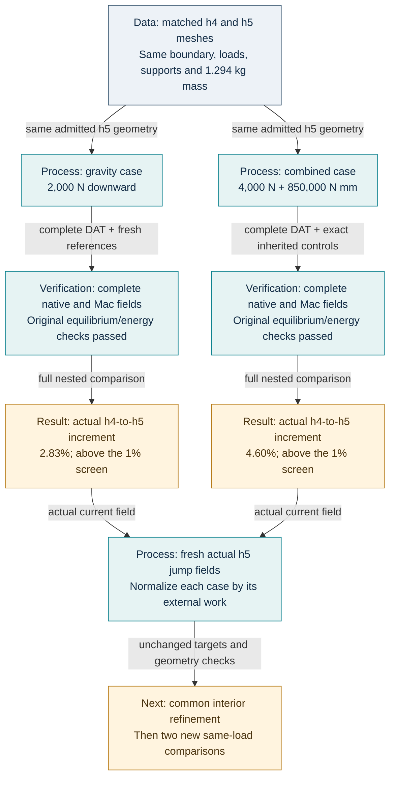

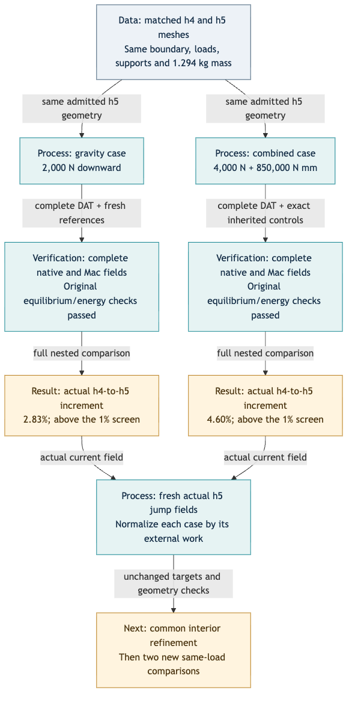

A carried-over descriptive summary in packet006 still named the earlier h1
proposal's element count and geometry hashes. Its separate derived geometry
contract, actual mesh, complete decoded counts and both numerical replays were
correct. The frozen original is preserved with a separate correction receipt.
Packet007 updates every summary field and adds a pre-assessment requirement
that summary counts and volume identity agree with the independent contract.

The complete repository check now passes using its supported isolated runtime:
**5,160 tests, 405 explicit skips**, plus all remaining `make check` targets.
The initial bare invocation used an old global Python 3.10 / incompatible SciPy
and is retained as an environment failure. The successful invocation uses
Python 3.12.11, NumPy 2.2.6 and SciPy 1.17.1 from the unchanged project
requirements:

```sh
make check-setup
PATH="$PWD/.venv-check/bin:$PATH" make check
```


## Optional local AMG route: independent controls passed

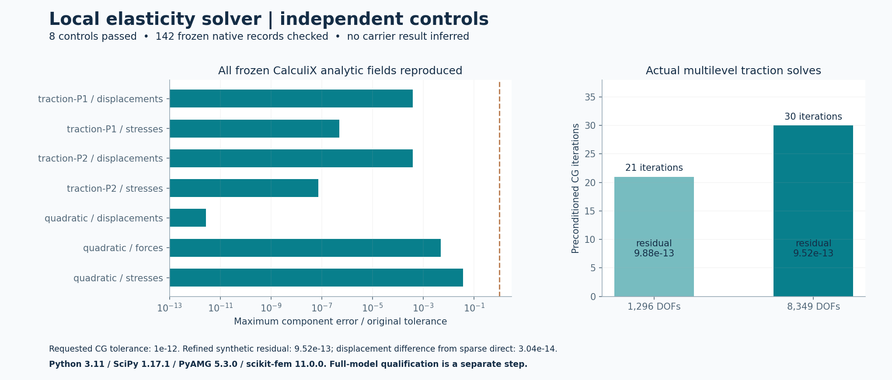

A separate local solver prototype now combines scikit-fem 11.0.0 assembly with
PyAMG 5.3.0 and SciPy 1.17.1. It is isolated in a fresh CPython 3.11 environment;
all four official wheel hashes, including NumPy 2.3.4, were checked against PyPI
metadata before installation. Existing solver environments remain unchanged.
The first Python 3.10/SciPy 1.15.3 import failed on this Mac; a fresh official
wheel reproduced the failure. The working version follows the maintainers'
[PROPACK migration guidance](https://github.com/scipy/scipy/issues/25635).

Five independent elasticity checks pass: rigid-body modes and symmetry, an
affine displacement patch with analytic strain energy, coarse and refined
traction solves checked against sparse direct solutions, and nested compliance
monotonicity under the same continuous traction. The six rigid-body candidate
vectors follow the standard [elasticity multigrid construction](https://docs.fenicsproject.org/dolfinx/main/python/demos/demo_elasticity.html).

The prototype also reproduces every displacement, stress and printed force
record in the three frozen CalculiX analytic fixtures: P1 traction, P2 traction
and the quadratic manufactured case. These are 142 records / 588 scalar
components. The original component limits remain unchanged:

| Frozen analytic field | Largest absolute component difference | Original limit |
|---|---:|---:|
| Displacement, mm | 3.925e-13 | 1e-9 |
| Stress, MPa | 3.711e-8 | 1e-6 |
| Printed force, N | 4.934e-9 | 1e-6 |

The quadratic control also caught an adapter error: CalculiX `RF` includes
applied nodal loads and support reactions. Its linear-static equivalent is
`Ku`; the support-only reaction is `Ku - f`. Correcting this convention matches
the frozen fields without changing a tolerance. This agrees with the
[CalculiX force-output explanation](https://feacluster.com/CalculiX/ccx_2.18/doc/ccx/node201.html).

Both scalar sparse storage and three-component block storage pass the same
eight checks. On the 8,349-DOF synthetic traction case, scalar storage needs 30
CG iterations with true relative residual 9.52e-13; block storage with
energy-smoothed interpolation needs 22, with residual 8.01e-13. The block
configuration follows the [upstream PyAMG elasticity example](https://github.com/pyamg/pyamg-examples/blob/main/linear_elasticity/demo.py).
These fixture results do not establish full-model performance or convergence.

The complete retained quadratic reference has 719,680 nodes, 381,564 C3D10
elements and 2,159,040 displacement DOFs. Every vertex and quadratic edge-node
identity was audited. Native edge coordinates differ from arithmetic midpoints
by up to 2.776e-17 mm, so the adapter retains every source coordinate through
`MeshTet2` instead of replacing the quadratic geometry with corner tetrahedra.
All Jacobians at the native four integration points are positive. Complete
assembly yields 152,490,803 scalar stiffness entries. Both complete local
reference trials were **refused** under their declared solver criteria:

| Configuration | Actual outcome | True relative residual | Elapsed seconds |
|---|---|---:|---:|
| Scalar storage / initial interpolation | 600-iteration limit | 2.256956e-4 | 840.70 |
| Three-component blocks / energy interpolation | CG recurrence reported convergence; true-residual gate failed | 2.832898e-9 | 877.09 |

The declared true-residual limit is 1e-9. It was not relaxed. Neither trial
reached the subsequent full native-field and response comparison, so the
optional route is not qualified for the complete reference or current carrier.
Both processes were reaped. Their sampled peak RSS values were 18.98 and
19.60 GiB, within their 24 GiB limits. The native CalculiX/PARDISO route remains
the established complete-model backend.

A separate streaming audit exercised the optional library's actual affine
mapping on all 10,452,018 current source cells in the serialized solver frame.
Every determinant is positive and every inverse is finite. The minimum floating
determinant is 4.852366e-14; the largest scaled inverse residual is 8.290e-14.
This admits the mapping's signs and finiteness, not its stiffness accuracy or a
new carrier response. The existing exact geometry checks remain authoritative.

Three streamed-assembly checks also pass: native P1 displacement parity with
one-cell and six-cell chunks, and a nontrivial global-node permutation. The
subsequent full P1 assembly attempt was stopped by its 24 GiB sampled RSS
guard after 63.83 seconds. Its last observed progress was 3,932,160 of
10,452,018 elements; no complete operator or mechanical response was credited.

## Lossless refined-mesh transport

The complete refined `mesh.inp` can now be transported as a 129,854,532-byte XZ
stream instead of its 614,882,557 raw bytes: 21.12% of the original size. The
codec uses XZ/CRC64, preset 6. Complete local decoding reproduces the raw
SHA-256 exactly; no node, element, coordinate digit or result is removed.
One roundtrip control and one damaged-stream rejection passed first.

The unchanged pinned Linux image then decoded the complete asset under local
x86-64 emulation, with networking disabled and a 1 GiB container limit. All
614,882,557 decoded bytes match the expected SHA-256, with a 256 MiB dictionary
memory limit. The witness took 49.21 seconds and container absence was verified.
The complete retained first-correction native DAT also passed an actual
lossless roundtrip: 1,504,485,508 raw bytes became 355,751,020 compressed bytes.
Local complete decompression reproduced raw SHA-256
`7450a879dd68e26e08f9c1b55ba79af6e226fd7aa3d735fd2098417abc278012`.
The combined codec witness finished in 1,196.26 seconds, return code zero,
process reaped, and approximately 326 MiB peak RSS. This first-correction DAT
is distinct from the newer source004 DAT; the latter's recovery has its own
native-terminal hash binding.

Compressed-mesh SHA-256:
`9418246dc277799c877decff919c497079a906af7d88404885bd07aff901954b`.
Decoded-mesh SHA-256 remains
`9e2a3252106235f151c513f7932391b12522ce03a1b95831eaf5c3b29c1db686`.

## Concurrent compute and transport recovery

The owner explicitly authorized simultaneous Vast rentals. Each lease keeps
its own exact instance, label, immutable deadline, finite cost allowance and
independent ownership guard. Attempt022 was cleaned up and verified absent
after a failed sustained public transfer gate, before model upload. Attempt023
on Portugal offer57690849 failed native SSH authentication; provider absence
was independently verified, also before private model upload. Neither failure
is a mechanical result.

Four independently checked 2 MiB reads then passed on the already qualified
source004 host. The recovery now uses at most eight standalone, strictly
host-key-checked SSH connections. Each immutable range has its own byte count
and SHA-256, at most two byte-transfer attempts, and a fixed lease reserve.
Short and corrupt identities are rejected. Reassembly requires the complete
compressed SHA-256; decompression separately requires exact raw count, XZ EOF,
no extra stream and the native terminal's complete DAT SHA-256. No scientific
precision is changed, and byte recovery never restarts a solver.

The first true nested refinement was subsequently started **once on that same
qualified host**, inside its original deadline. Only the verified 129.85 MB
lossless mesh envelope was uploaded. Native reconstruction checked every
source004 input member, copied 88 unchanged members, replaced only
`current/mesh.inp`, and matched the exact packet005 manifest SHA-256
`1aca429fbf61b058b4c42b8696947f88ea65616abe7e6d64e4270e7ceb25b1ac`.
The unchanged eight-thread `ram128` profile and frozen analytic/reference
controls are reused. The initial current-mesh reader refusal is documented above; the revised
packet006 response has passed and been fully recovered; packet007 is the next trial. The source calculation, guard and fixed
lease were not modified.

## Complete PR #274 CUDA accuracy witness: refused

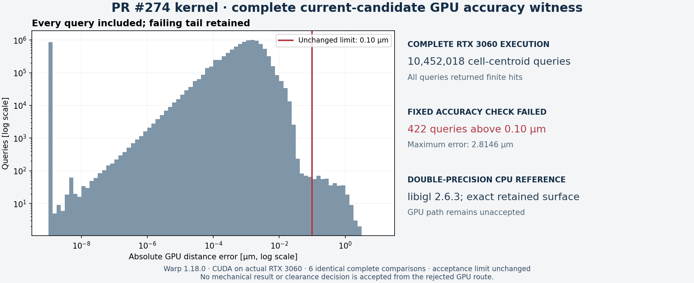

The current candidate was exercised with the unchanged PR #274 kernel on the
actual RTX 3060, driver 595.71.05, using an isolated CPython 3.11 / NumPy 2.2.6 /
Warp 1.18.0 overlay. Its exact wheels matched public PyPI release hashes; the
Warp wheel also matches the existing pinned wheel. The original solver image
and Python environment were preserved. The runtime follows the
[vendor installation requirements](https://nvidia.github.io/warp/v1.18/user_guide/installation.html).

Before CUDA execution, the complete float32 proxy audit found no zero cross
products in promoted-double triangle diagnostics and bounded corresponding
surface displacement by 5.841256 nm. An independent libigl 2.6.3 double AABB
computed reference distances for **all 10,452,018 actual cell-centroid probes**
against the retained double-precision surface. The unchanged 15 pilot tests and
the analytic CUDA cases passed on the native host.

The complete candidate comparison then **failed all six repetitions** at the
unchanged 0.0001 mm limit. There were no missing hits or nonfinite distances,
but **422 / 10,452,018 queries** exceeded the limit. Maximum absolute error was
0.002814613 mm; all 422 violations overestimated the reference distance.
The complete rejected distances/hits array, 38,026,421 compressed bytes, was
collected and SHA-256 verified. Small-case success is not promoted to full-case
acceptance, and the tolerance remains unchanged.

A separate CPU comparison on the 32 worst queries found at most 0.000001653 mm
change from source-to-proxy geometry, while GPU-versus-proxy error still reached
0.002813968 mm. Proxy displacement therefore does not explain the observed
largest errors. The complete double CPU distances remain the clearance
reference; this CUDA query route remains unaccepted for the current candidate.

## Private recovery with DVC

The existing DVC storage adapter archived 24 explicitly selected files,
1,316,449,785 bytes in total, into a private local store. A fresh workspace
and cache restored all files and independently verified every SHA-256. The
restored surface and 3MF then passed the complete streaming geometry verifier
again: all 2,882,300 coordinate records and 5,764,688 triangle records match.

The payload includes the current 3MF and proofs, source surface and volume,
exact-volume/conditioning reports and the frozen complete numerical request.
This is verified local recovery on the same Mac, not off-device backup or a
completed mechanical calculation. Runtime dependencies used the repository's
frozen constraints; DVC 3.67.1 was installed in an isolated environment.
Private receipts are in `work/carrier-dvc-current-001/`; raw geometry and the
DVC cache/store remain outside Git.

The separately identified local-repair candidate now has its own recoverable
checkpoint: **69 files / 1,928,502,242 bytes**. It includes the exact surface,
volume mesh, serialized solver mesh, 3MF, interface/distance proofs, frozen
native input packet and source snapshots. Fresh-cache restoration verified
every recorded SHA-256. A second independent complete readback of the restored
3MF confirmed all 2,882,300 vertices and 5,764,688 ordered triangles, exact
coordinate bits, millimetre units, identity placement and member CRCs.
This candidate checkpoint preserves its pending mechanical status; it does
not inherit the earlier baseline response. The documents inside it are dated
snapshots. The private restoration receipts are in
`work/carrier-dvc-peel-001/` and the recovered objects remain on the same Mac.
This is the geometry/input checkpoint. Replaying every upstream inspection also
uses the pinned repository checkout and qualified local checker dependencies;
it is not a standalone installer for the entire software suite.

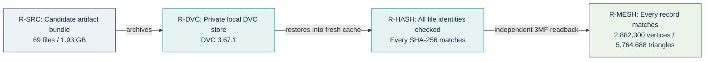

[Rendered recovery diagram](../media/carrier-recovery-20261105.png).

## Reproduction and evidence locations

Geometry and raw solver outputs remain private. Local reproducibility pointers:

- `work/carrier-surface-kernel-assembly-003/README.md`: retained geometry.
- `work/carrier-native-exact-checker-023/assessment.json`: exact volume/topology check.
- `work/carrier-current-p1-intake-001/`: full mesh text, load/support binding and readback.
- `work/carrier-current-p1-solve-001/actual-terminal.json`: direct local attempt.
- `work/carrier-current-p1-solve-002/actual-terminal.json`: iterative local attempt.
- `work/carrier-high-memory-direct-001/portable-controls.json`: private ABI controls.
- `work/carrier-high-memory-direct-001/input-identity-003.json`: frozen adaptive packet.
- `work/carrier-current-response-002/README.md`: independent assessment and commands.
- `work/carrier-current-3mf-001/terminal.json`: exact current-surface 3MF export.
- `work/carrier-peel-3mf-001/terminal.json`: exact local-repair candidate 3MF export.
- `work/carrier-local-repair-figure-001/figure.json`: actual patch projection and input hashes.
- `work/carrier-sampled-stress-audit-001/`: sampled incidence, diagonal witnesses and exact local-flip trials.
- `work/carrier-interior-edge-refinement-002/controls.json`: exact-edge refinement controls and rounding regression.
- `work/carrier-traction-jump-001/`: interior residual ranking sources, controls and pinned-image fixture receipts.
- `work/carrier-high-memory-direct-013/network-preflight.json`: live bidirectional transfer witness.
- `work/carrier-high-memory-direct-013/repair-comparison.json`: admitted complete same-host comparison.
- `work/carrier-native-restored-013/full-output-verification.json`: complete retained native output identities.
- `work/carrier-public-reader-full-001/cross-platform-parity.json`: published CLI and independent original-reader full-array byte parity.
- `work/carrier-high-memory-direct-013/retained-jump-reports/`: complete native interior ranking and its full cell-indicator array.
- `work/carrier-repair-comparison-figure-001/figure.json`: actual comparison figure and source identities.
- `work/carrier-current-warp-001/`: complete proxy/oracle preparation, isolated runtime controls and rejected CUDA error inventory.
- `work/carrier-high-memory-direct-013/retained-GPU-reports/`: actual native GPU reports and complete rejected output.
- `work/carrier-candidate-hotspot-audit-001/incidence.json`: new interior peak-cell audit and refused surface-swap precondition.
- `work/carrier-interior-conditioning-001/`: exact surface-preserving four-cell volume correction and complete mesh checks; source004 native mechanical checks passed, raw recovery separately tracked.
- `work/carrier-adaptive-refinement-001/`: bulk exact interior-star proposal, complete dual-frame geometry/intake checks and corrected assembly source.
- `work/carrier-adaptive-replay-002/admission.json`: fresh replay with identical complete volume, solver-text and checker-report identities.
- `work/carrier-adaptive-refinement-figure-001/figure.json`: actual marking and new-node figure with source hashes.
- `work/carrier-amg-local-002/`: isolated runtime hashes, five synthetic elasticity checks and three complete frozen analytic-field comparisons.
- `work/carrier-amg-local-003/`: same checks for block storage and energy-smoothed interpolation.
- `work/carrier-amg-reference-audit-001/audit.json`: complete quadratic source-node and edge-topology audit.
- `work/carrier-amg-reference-solve-002/` and `work/carrier-amg-reference-solve-003/`: bounded complete scalar/block reference trials and actual terminal records when available.
- `work/carrier-amg-P1-map-audit-001/audit.json`: complete current-source optional affine-map audit.
- `work/carrier-amg-controls-figure-001/figure.json`: actual optional local-control figure and source hashes.
- `work/carrier-P1-stream-assembly-001/`: passed native/scatter controls and the retained RSS-refused complete-assembly attempt.
- `work/carrier-lossless-xz-001/progress.json`: complete refined-mesh XZ identity and codec controls.
- `work/carrier-lossless-xz-001/image-decode-terminal.json`: complete pinned-image decode witness and verified container cleanup.
- `work/carrier-high-memory-input-004/image-unpack-terminal.json`: complete next-request unpacking/member witness in the pinned image.
- `work/carrier-dvc-peel-001/terminal.json`: fresh candidate archive recovery and restored 3MF verification.
- `work/carrier-high-memory-direct-004/actual-terminal.json`: hosted interruption and retained controls.
- `work/carrier-high-memory-direct-007/`: independent lease, native execution and incomplete bulk transfer.
- `work/carrier-hosted-response-001/`: sealed data-local assessor and retained bounded reports.
- `work/carrier-lease-coordination-001/controls-003.json`: bounded launch-mutex controls.

This continuation adds a separately identified local mesh correction, with no
catalogue selection change. The h5 responses and both h4-to-h5 comparisons are complete. Further mechanical
stabilization and subsequent cellular lightening remain open. See the [new-software allocation review](carrier-software-review-20261104.md)
for how CADAM, surface inspection and optimization fit the next stages.
