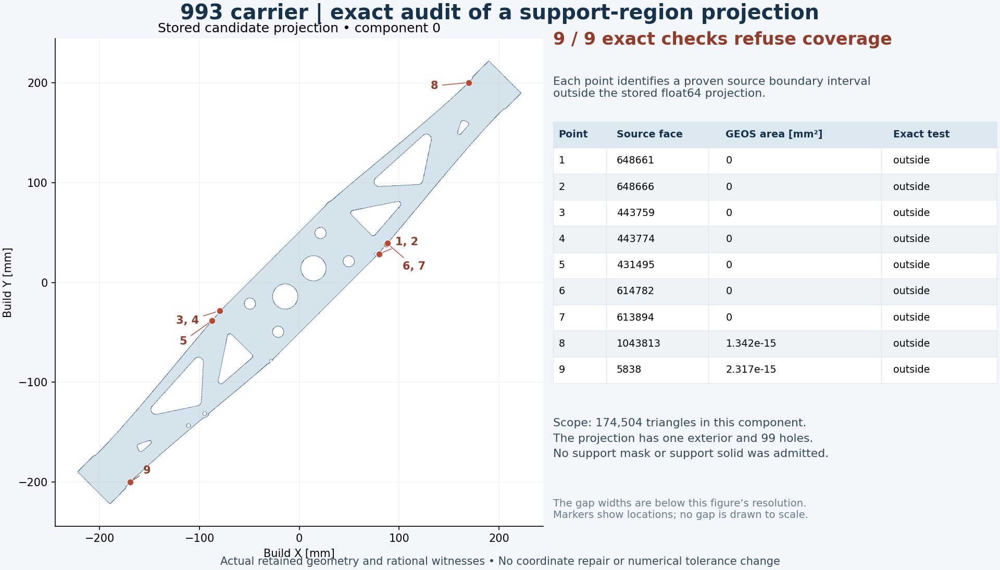
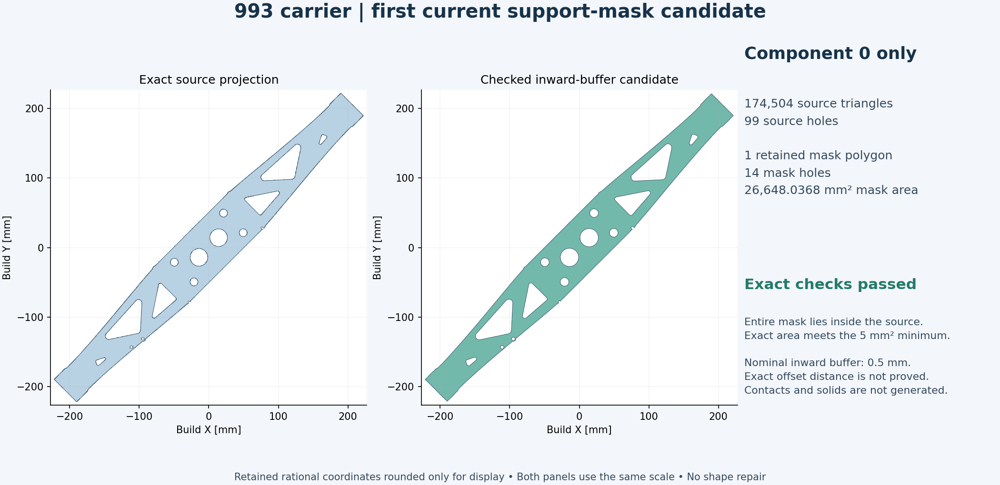
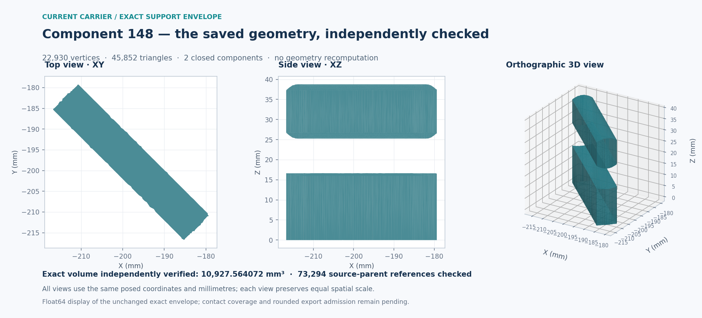
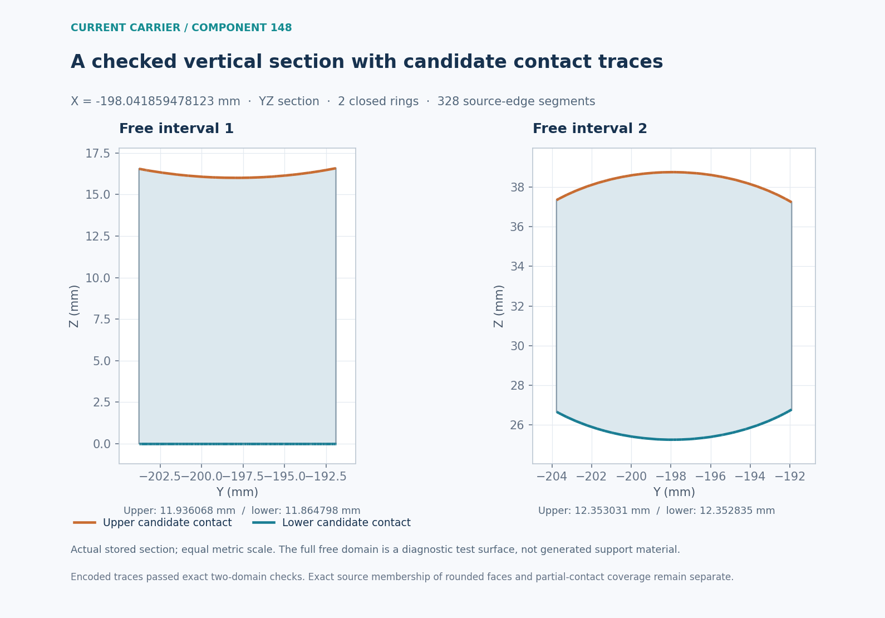
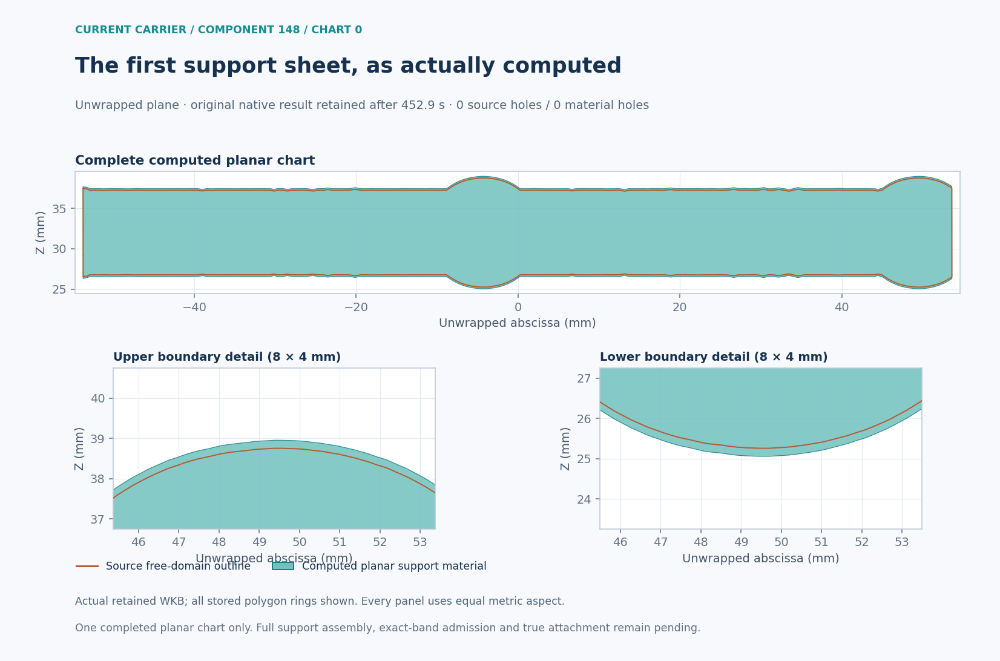
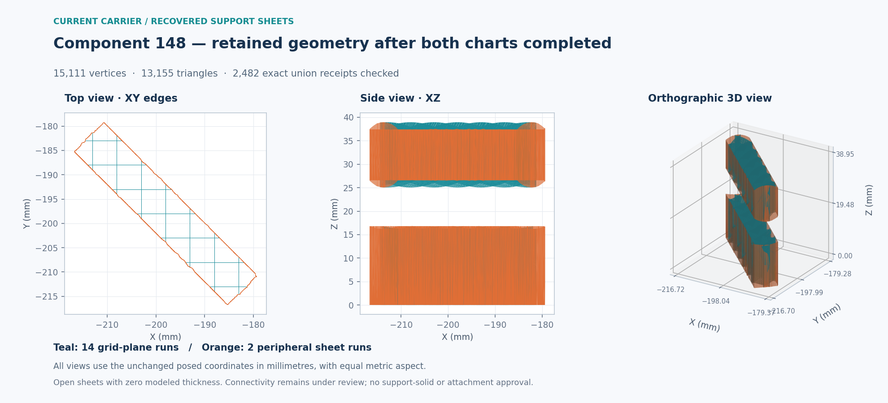
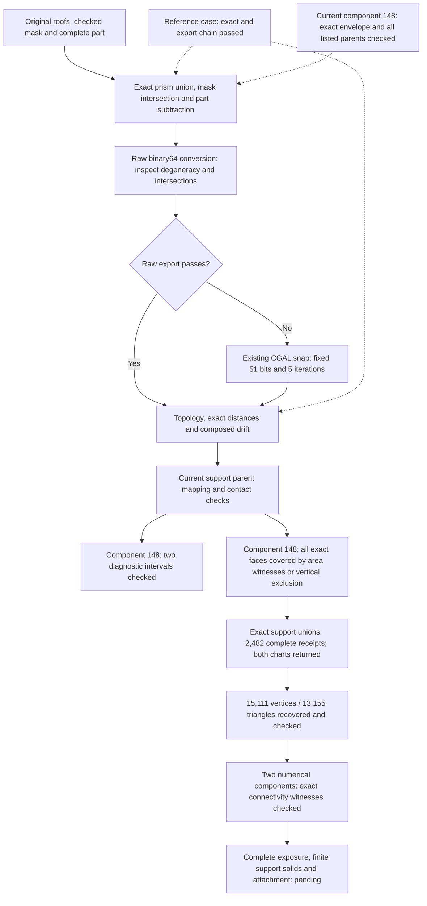

# 993 carrier: current support-region projection audit

Date: 2026-11-07. This checkpoint follows the [complete current part-layer
calculation](carrier-current-am-full-20261107.md). It checks the current carrier
surface used for support preparation; it does not reuse the historical STL
support masks.

Native overhang extraction preserved every selected triangle coordinate. Native
splitting then accounted for all **905,248 selected triangles in 4,676 connected
components**. The first attempted projected union failed its source-coverage
check. An independent rational-coordinate calculation confirmed all nine reported
defects, including seven for which the floating-point difference area was zero.
A separate CGAL calculation recovered the first component, then a complete pass
accounted for **all 4,676 components and 905,248 selected triangle occurrences**
with exact rational projections and independent readback. The complete native
mask-policy pass then accounted for every component: **seven polygons retained,
32 filtered below 5 mm² and 4,642 empty masks**. Exact containment and area checks
pass for every produced polygon. Contacts and support solids remain unfinished.

The markers locate actual rational witnesses, rounded only for display. The gap
widths are below the image resolution; the drawing does not exaggerate them.

## What ran

| Stage | Actual scope | Outcome |
|---|---|---|
| PySLM overhang selection at 45 degrees | 5,764,688 source faces; 905,248 selected faces; 504,752 referenced vertices | Ordered float64 triangle coordinates unchanged; all selected areas positive. No constructor adapter applied. |
| Native `split(repair=False)` | All 905,248 selected triangle occurrences | Every occurrence assigned exactly once to 4,676 components, with each triangle's ordered vertex coordinates preserved. |
| GEOS projected union | Component 0 only: 174,504 triangles | Nine source triangles failed coverage. The retained candidate is one Polygon with 99 holes. Processing stopped before inward buffering or mask filtering. |
| Independent exact inclusion test | All nine retained failing triangles against that stored Polygon | Nine exact boundary intervals lie outside it. No floating-point overlay is used by this proof. |
| CGAL exact union and readback | All 174,504 source triangle occurrences in component 0 | The serialized rational union covers every occurrence; its exact symmetric difference with the computed union is empty. Independent native rebuilding and Python rational ring/area readback pass. |
| Complete exact projection pass | All 4,676 components / 905,248 selected triangle occurrences | 4,675 projections computed; component 0 reused only after source rebinding. Every component retains exact source-coverage and readback checks. |

The initial floating-point trial and nine targeted proofs covered only component
0. The subsequent complete exact pass covers the whole selected component roster.
The historical seven processed masks came from a different STL and a later
filtering stage; they are not comparable to the current raw component count.

All six listed executions were reaped and their owned process groups were
absent. The floating-point projection returned 1 with its refusal retained;
the other five returned 0. Their respective wall times were 14.24, 16.25,
16.27, 4.08, 59.22 and 313.29 seconds; sampled peak group RSS was 4.52, 4.58,
4.16, 0.17, 4.01 and 4.48 decimal GB. Sources remained unchanged.

## Why zero area was insufficient

Seven GEOS difference-area diagnostics were zero; the other two were approximately
1.342e-15 and 2.317e-15 mm². Those values were diagnostics, not a coverage proof.
The independent test treats the stored float64 coordinates as exact fractions
and checks the complete source boundary against the target boundary and holes.
Each of the nine refusals contains a rational point in an uncovered interval.

GEOS documents that constructed floating-point intersections need not lie exactly
on their theoretical source lines. That explains why this kind of boundary
discrepancy is possible; the retained exact witnesses establish this particular
failure. See the [GEOS robustness explanation](https://libgeos.org/usage/faq/#robustness).

## Exact projection recovered for the first component

The fresh helper reuses the project's CGAL exact-polygon primitives and keeps
the original binary64 input coordinates and every source occurrence ID. CGAL documents these operations
with `Polygon_set_2` and an exact-construction kernel in its
[Boolean set-operations manual](https://doc.cgal.org/latest/Boolean_set_operations_2/index.html).
The actual Mac build uses CGAL 6.2.1, GMP 6.3.0 and MPFR 4.2.2. Eight positive
control groups and four refusal cases passed before the current component ran.
They include overlapping triangles, holes, concavity, non-binary intersections,
duplicate geometric occurrences with distinct IDs, one-ULP changes and the nine
retained failures. Two earlier build/control refusals remain recorded privately.

The accepted union has one exterior, 99 holes and 10,594 ring vertices. Its
projected area is approximately **27,893.6076 mm²**. Sixteen coordinate values
are non-binary rationals: they remain exact in the retained rings, with no float
export substituted for the authoritative geometry. All 174,504 occurrences pass
coverage against the reloaded union in 43 bounded chunks. Input and native
readback bytes match exactly; all 2,780 source/dependency/control pins were
independently checked. See the [exact-union receipt](carrier-current-support-projection-20261107/exact-union.json).

## Complete component roster

The bounded full pass retains **4,676 separate projected parts, 1,576 holes and
108,068 ring vertices**. Seventy-four coordinate values require non-binary
rationals. Every source occurrence is accounted for; no component is dropped or
merged with another. These separate projections may overlap and are not presented
as one global planar union.

Independent readback checked all **32,728 current files**, all component receipts,
input/native echo pairs and exact-ring hashes, plus all **2,799 bound inputs**.
The retained exact rings occupy 7,198,074 bytes including the reused first
component. See the [complete-pass receipt](carrier-current-support-projection-20261107/all-exact-unions.json).
An unused scope annotation inherited from the first-component contract was
incorrectly false; the original is retained with an explicit append-only
correction. The executed roster and verified counts cover all 4,676 components.

## Reproducibility and remaining work

The first **component-0 mask candidate** now passes exact containment and area
checks. The unchanged nominal `buffer(-0.5)` policy produces one retained polygon
with 14 holes and an exact area displayed as **26,648.03678915664 mm²**. Its
set difference outside the rational source is empty, and its exact area meets
the 5 mm² minimum. Seven policy controls and nine refusal cases passed first.
The actual trial took 8.46 seconds and 294 MB sampled peak RSS; independent
readback checked the files, source identities and WKB-to-rational coordinates.

The source still has 99 holes. Its float conversion, used only as input to the
native buffer, rounds 16 coordinate values and has nonzero exact additions and
losses; it never replaces the rational authority. The buffered candidate itself
is checked against that unchanged authority. This establishes a native-policy
candidate, not an exact 0.5 mm Euclidean offset. The
[mask receipt](carrier-current-support-projection-20261107/component0-mask.json)
records this distinction, complete checks and the byte-reproduced figure.

The subsequent **complete mask pass** covers all 4,676 components. Thirty-four
components produce 39 polygons, including four split components. Seven polygons
meet the unchanged 5 mm² threshold; 32 are explicitly excluded. The other 4,642
components erode to empty under the same native policy. No component disappears
from the ledger, and even the filtered polygons pass exact source-containment
and area-decision checks.

| Current source component | Retained mask area, mm² | Holes | Checked mask triangles |
|---|---:|---:|---:|
| 0 | 26,648.036789 | 14 | 27,991 |
| 79 | 5,994.405999 | 3 | 10,330 |
| 148 | 380.365137 | 0 | 590 |
| 409 | 6,089.910711 | 3 | 9,840 |
| 534 | 380.225316 | 0 | 571 |
| 2818 | 6.375239 | 0 | 503 |
| 3856 | 8.675774 | 0 | 673 |

The single bounded pass finished in **105.71 seconds**, with **502 MB** sampled
peak RSS and complete process cleanup. Independent readback verified all
**32,880 new files**, all **2,839 pinned inputs** and every one of the 216,136
source-coordinate values. Seventy-four conversions rounded; the exact source
authorities remain unchanged. The sum of retained per-component areas is
39,507.994965 mm²; this is not a cross-component union or a contact-area result.
The [full-mask receipt](carrier-current-support-projection-20261107/all-masks.json)
retains all counts, exact areas, checks and source identities. The historical
seven masks remain a different result despite the coincident count.

### All seven masks triangulated and checked

The next stage preserves the **369,273 original roof-triangle occurrences**
belonging to these seven current components, including their global source-face
identities and posed coordinate bits. Their constrained mask triangulations
contain **50,472 vertices, 50,498 positive triangles and 20 holes**. Complete
exact-union and rational-area checks show that the triangles cover each mask
without positive-area multiplicity; all vertices retain the original mask bits.

Component 148 first passed independently in 4.63 seconds. The remaining six
completed in **14.73 seconds**, with **421 MB** peak RSS, zero return and full
owned-process cleanup. The complete pass reuses component 148 only after
rebinding its exact sources, result, arrays and independent receipt. Readback
checked all 33 new scientific files, all 2,923 source pins, every array field
and the native triangle occurrence/coordinate correspondence.

The [complete triangulation receipt](carrier-current-support-projection-20261107/all-mask-triangulations.json)
records per-component counts, exact areas, identities and checks. These are
checked inputs for three-dimensional construction: no extrusion, contact
calculation or current support Boolean was executed by this stage.

### Portable exact 3D and export chain: reference case passed

The existing native CGAL binaries now run in the recorded local Linux container
with their pinned loader and library closures. No new geometric algorithm or
numerical threshold was introduced. The original prism/cutter reference case
reproduces its historical exact and rounded geometry hashes: **42 vertices,
76 faces and exactly 3,200 mm³**, with independently checked closed orientation,
analytic boundary and complete 52-source-parent mapping.

Its raw binary64 export also reproduces the known refusal: **four collinear
triangles**. The existing CGAL autorefinement route, fixed at **51 grid bits and
five iterations**, then produces **40 vertices and 72 faces**, with no collinear
triangles or post-export self-intersections. Its reconstructed complete NPZ
matches the historical accepted output hash. The exact final volume differs
from 3,200 mm³ by approximately **2.65269e-14 mm³**; it is not claimed unchanged.

The existing bidirectional exact-distance checks cover 118 and 112 declared
samples. Their composed displacement bound is **1.77636e-15 mm**, below the
unchanged **1.230696e-13 mm** limit. This is a finite-sample result, not a
continuous Hausdorff certificate. The exact-stage full parent map is retained;
the 72 snapped faces have primary ancestry only. Neither ancestry alone nor
this reference case establishes geometric contact coverage for current supports.

The [portable qualification receipt](carrier-current-support-projection-20261107/portable-3d-qualification.json)
records the controls, preserved refusal, exact volume difference, runtime hashes,
independent checks and cleanup of all seven snap/distance containers. Native
snap and distance calls took 0.037 s and 0.048 s. Independent readback checked
968 source pins. The current piece requires its own Boolean, export and contact
results through these stages.

### First current exact envelope: component 148

One of the seven current mask candidates now has an independently checked
three-dimensional envelope: **22,930 vertices, 45,852 triangles and two closed,
consistently oriented components**. The verified exact rational volume is
approximately **10,927.564072 mm³**. Native exact and rounded-surface intersection
checks pass, with zero degenerate triangles in either representation.

The construction retains all **3,510 roof occurrences** and the complete
5,764,688-face part input. Every one of the **73,294 parent references** across
45,852 output faces was independently reconstructed and checked for exact
whole-triangle containment. The role counts are 27,442 roof-prism, 31,043 mask,
14,809 part and zero bounding-box references. Multiple geometric parents are
retained rather than discarded. These correspondences do not yet establish
complete contact coverage, including partial-face contacts.

The original Boolean run reached its 1,200-second deadline after saving its
geometry. A separate annotation and final-check pass reused those exact bytes,
without repeating the Boolean operation, and completed in **663.87 seconds**.
Its runtime is **CGAL 6.3-dev, commit `b4e8c188…`**, distinct from the 6.2.1
projection runtime. Independent readback completed in **31.25 seconds**, with
631 MB sampled peak RSS and all **3,017 source pins** unchanged. The container
and owned reader processes were removed or reaped.

The initial Python assessment hit its 4,300-digit integer parsing limit on the
exact volume's 39,278-digit numerator. A bounded 65,536-digit reader passed
boundary and refusal controls on both recorded Python runtimes; it then read
the retained result successfully. The original refusal remains recorded, and
no geometry or numerical tolerance changed.

The [compact envelope receipt](carrier-current-support-projection-20261107/component148-envelope.json)
records the completed scope and source hashes. The
[figure receipt](carrier-current-support-projection-20261107/component148-image.json)
binds the actual coordinate arrays, renderer and image; a second rendering is
byte-identical. The figure records the exact-checkpoint stage; the subsequent
rounded-export check is recorded below. Raw geometry remains private. Contact
coverage, the other six current envelopes and the final support structures
remain open.

### Unchanged float64 representation: checked

The existing float64 coordinates and identical face indices now pass a separate
representation check. No snap, triangle repair or Boolean recomputation was
needed. All **45,852 triangle normals** preserve their direction; the rounded
surface remains closed, oriented and composed of the same two components.
Three exact coordinate-axis volume integrals agree with the independent
determinant sum. The volume change is approximately **7.81583e-13 mm³**,
or **7.1524e-17** relative to the exact source.

The unchanged indexed-conversion checker verifies every coordinate and face
index. Since corresponding triangle points are convex combinations of their
vertices, their displacement is bounded by the largest paired-vertex
displacement. This establishes a **continuous bidirectional surface-distance
bound of approximately 4.01628e-14 mm**, with an exact rational upper bound in
the [representation receipt](carrier-current-support-projection-20261107/component148-rounded.json).
This bound covers the whole matched surface, unlike the finite-sample reference
case above. It measures conversion error; it is not a manufacturing tolerance.

The bounded check finished in **10.90 seconds**, with 243 MB sampled peak RSS,
all 3,027 source pins unchanged and its owned process group absent. The private
NPZ was reread field by field and preserves the figure's coordinate and face
array hashes. Exact-source parent memberships remain attached to the exact
geometry: they are not silently transferred to rounded points, and contact
coverage remains a separate task.

### Current diagnostic section and contact encoding

The unchanged interface adapter now accounts for all **45,852 current faces**:
9,308 have upper whole-parent witnesses, 28,616 have lower witnesses and 7,928
have neither. There are no contradictory parent roles. These classifications
inherit the exact-source correspondences; they do not establish membership of
the rounded faces in those source surfaces.

At the envelope's X midpoint, **two closed rings and 328 source-edge segments**
are reproduced by independent section calculations. Both free intervals pass
the existing exact contact-encoding predicate for their upper and lower traces.
The test uses the whole free section as a diagnostic domain; it generates no
support material. The separate horizontal layer 517 checks the part pose and
calendar identity only.

The bounded execution completed in **8.87 seconds**, with 1.81 GB peak RSS,
all 3,060 input pins unchanged and its owned process group absent. Eight existing
boundary tests and three source-refusal controls precede this execution. A
calendar-binding correction keeps the canonical context key separate from the
serialized context file's SHA-256; changed-height and changed-pose controls
refuse the altered inputs. The original preparation refusal is retained.

The [section receipt](carrier-current-support-projection-20261107/component148-section.json)
binds the actual inputs, result, cleanup and byte-identical figure replay.
The figure records this diagnostic stage; the following check covers every
face of the exact envelope.

### Every exact face accounted for in upper/lower area coverage

All **45,852 exact faces** now pass a complete witness-coverage check. Each of
the 9,308 upper faces lies wholly in a retained upper source triangle. Each of
the 28,616 lower faces lies wholly in a lower source triangle or exactly on the
plate; 23,115 are plate faces. The remaining 7,928 faces have exactly zero
Z-normal and are vertical. There are **no unclassified nonvertical faces**.

The proof checks all three exact vertices against each retained nonzero source
witness. Convexity then covers the whole child triangle. For the vertical
faces, a positive-area intersection with any nonvertical upper/lower source
triangle would require coincident planes, which their exact normals exclude.
This avoids a redundant all-pairs intersection calculation. A near-vertical
control with a nonzero rational Z-normal is correctly kept out of this shortcut.

The bounded current calculation completed in **19.02 seconds**, with 620 MB
peak RSS. Seven intended refusal controls passed. Independent readback checked
all 45,852 face records and their original parent-list membership; all 3,071
input pins remained unchanged and the owned process group was absent. The
[complete face-coverage receipt](carrier-current-support-projection-20261107/component148-area-coverage.json)
records the proof, counts, source identities and execution.

This establishes that every exact upper/lower face has at least one complete
contact witness. It does not enumerate every partially overlapping parent.
Membership of rounded coordinates, line/point/lateral contacts and attachment
of generated support material remain separate checks. No geometry, support
policy or numerical threshold changed.

### First support-sheet chart retained; full assembly pending

The first planar chart for component 148 completed in **452.95 seconds**. This
figure renders its actual retained polygon in unwrapped abscissa/Z coordinates,
with equal metric scales and all stored rings. The source and computed material
each have one ring and no holes; their coordinate counts are 4,257 and 4,261.
A second rendering is byte-identical. This is one completed chart, not the
complete three-dimensional support assembly.

Both bounded attempts to finish the assembly reached their unchanged
**1,200-second limit**. The continuation reused the first chart's complete
polygon bytes and native receipt without recomputing it, but did not finish
the remaining work. Neither attempt produced the final support arrays or a
complete material result.

| Attempt | Observed wall time | Sampled peak RSS | Cleanup outcome |
|---|---:|---:|---|
| Original | 1,201.65 s | 2.475 GB | Group absence recorded; a cleanup race left the child exit code and reaping unconfirmed. |
| Cached continuation | 1,201.89 s | 2.464 GB | Corrected helper reaped the child with return code −15 and confirmed the exact group absent. |

The [original terminal](carrier-current-support-projection-20261107/component148-material-first-terminal.json)
and [continuation terminal](carrier-current-support-projection-20261107/component148-material-resume-terminal.json)
are preserved unchanged. A separate reconciliation confirmed the original
supervisor, worker and group absent; it did not recover the original exit code
or turn that attempt into a success. The
[compact sheet receipt](carrier-current-support-projection-20261107/component148-first-sheet.json)
records both terminal hashes, reconciliation and cleanup-control hashes, chart
identities, image provenance and byte-identical replay.

Complete component band admission, support assembly, finite thickness and
attachment to the part and plate remain pending. Raw chart coordinates stay
private; no generative geometry or new support policy was used for this image.

### Exact GMP acceleration checked; remaining unions measured

An exact-rational GMP route (`gmpy2` 2.3.2, GMP 6.3.0) now reproduces the first
chart's complete polygon bytes, derived coordinate arrays and native receipt;
only elapsed time is excluded from equality. The actual chart runs in
**123.172 s**, versus **452.946 s** for the retained Fraction run. It exercises
**309 nested union calls**. An earlier zero-fallback observation referred only
to the final-band stage and did not count these nested calls.

The following full-material attempt reused chart 0 and applied the qualified
GMP route to the remaining work. It still reached the unchanged 1,200-second
limit: **1,202.759 s** including cleanup, **2.470 GB** peak RSS, child return
code −15, child reaped and exact group absent. No complete chart 1 or full
support material was produced. The single-chart improvement is not a measured
whole-job speedup.

A shorter instrumented run then retained **94 completed exact union receipts**
and the 95th call's input before its graceful diagnostic stop. Independent
readback recomputed exact area conservation for all 94 receipts and checked
all **191 retained files**. Completed call intervals total **97.403 s**; the
largest is **12.840 s**, or 13.18%. This sampled prefix contains many costly
calls rather than one stalled union. The full call count and completion time
are still unknown.

These intervals include the pending-input write and start-event flush plus
GMP execution. They exclude earlier input serialization and later receipt
writes, so they are not isolated backend timings. The diagnostic returned
zero after **155.275 s**, with its child reaped and group absent. Preserving
completed receipts enabled the subsequent continuations below; no geometry,
support policy or arithmetic tolerance changed. The
[GMP progress receipt](carrier-current-support-projection-20261107/component148-gmp-progress.json)
binds the parity result, third timeout and bounded trace to their sources.

### Full-material continuation: 2,235 exact receipts retained

A separate chart-1 continuation reused the original 94 receipts and retained
138 more, giving **232 completed calls**. The first full-driver integration
then refused its first input: the driver constructs grid sheets before the
chart, so the chart-only prefix was not its global call prefix. The corrected
binding recognizes the exact chart context and records separate native,
chart-scoped and new-trace call numbers; it changes no union arithmetic.

The corrected full-material attempt reused those **232 receipts** and completed
**2,003 new exact unions** before its original 1,770-second worker limit.
The **2,235 completed call occurrences** comprise **869 grid calls and 1,366
chart-1 calls**. It stopped after **1,779.524 seconds** including supervision
and cleanup, with **2,486,632,448 bytes** peak RSS, return code 1, its child reaped
and its owned group absent. The original full chart-0 return was reused exactly.
Chart 1 and the full sheet assembly remain incomplete.

Independent readback checked exact area conservation and all call mappings,
**3,805 source pins** and **4,045 scientific output files**. The latest completed
chart-1 union concerns triangle index 2,793; index 2,795 is pending within the
3,676-triangle phase (zero-based indices). This is a retained prefix, not a
percentage forecast of whole-job completion.

The first readback refused changes in exactly two mutable Finder metadata paths,
`.DS_Store` and `union-progress/.DS_Store`. A fresh reader records their original
and observed hashes and sizes separately, while preserving the original manifest,
exact full file set and byte/hash checks for every scientific file. Other hidden
files remain checked. No scientific result or earlier refusal was rewritten.

The [continuation receipt](carrier-current-support-projection-20261107/component148-gmp-continuation.json)
binds these observations and the pending exact input. The next continuation can
reuse the complete native-call prefix, including the grid calls. Finite support
thickness, numerical connectivity and attachment remain unfinished.

### Both charts and the complete sheet arrays recovered

The next continuation reused all **2,235 complete calls** and completed **247
additional exact unions**. Both peripheral charts returned, and the native
assembly saved **15,111 vertices and 13,155 triangles**. The image uses all of
these unchanged triangles. Teal identifies the 14 grid-plane runs; orange
identifies the two peripheral sheet runs. The top view draws projected edges
because vertical, zero-thickness sheets have no filled top-view area.

The run then refused a duplicated JSON export: the complete chart-1 receipt
already occupied **429,435,976 bytes**, and embedding it again in
`geometry-assessment.json` exceeded that file's unchanged **256 MiB** limit.
The original chart receipt and compressed sheet arrays were already saved.
This was an export refusal after geometry generation, not an interrupted union.
The terminal remains a failure: **618.768 seconds**, **3,340,746,752 bytes** peak
RSS, return code 1, child reaped and exact owned group absent.

A separate readback verified **7,881 source pins**, all **533 scientific output
files**, the **2,482 native-call occurrences**, both complete chart captures and
every value of all four sheet arrays. No union remains pending. It also verified
that chart 0's full native return equals its retained reference. The
[sheet-recovery receipt](carrier-current-support-projection-20261107/component148-sheets-recovery.json)
binds the refusal, recovered data, complete readback and inspected image.

Numerical connectivity was after the failed export and did not run. The full
grid/contact report existed only in memory and was not retained; its absence is
explicit. The next step reuses the saved arrays and hash-referenced chart
records, rather than duplicating the large receipt or recalculating the unions.
These are open sheets with zero modeled thickness. Complete band admission,
support solids and attachment remain unfinished.

### Saved sheets: numerical connectivity independently checked

The saved arrays now pass the existing numerical connectivity calculation,
without another geometry or union calculation. Their two separated height
intervals define **30 measured face runs**: 28 grid runs and the two peripheral
skins. Every original triangle belongs to exactly one run, with unchanged
coordinates, face IDs and ordering. These runs are an observed partition;
they do not reconstruct the missing native group report.

All **30 runs are internally connected by exact shared edges**. The calculation
then records **28 positive exact triangle-intersection witnesses**, forming an
acyclic forest with **two connected components**. Each component reaches its
own retained skin's positive upper and lower contact witnesses. Grid contact
evidence remains unknown; the calculation credits only the selected skin
witnesses, without treating missing grid evidence as measured absence.

The guarded calculation returned zero in **11.541 seconds**, with
**1,488,896,000 bytes** peak RSS and verified cleanup. Independent readback in
**6.833 seconds** rechecked all **7,911 source pins**, original arrays, full face
partition, internal adjacency, every returned exact intersection, the forest
and both chosen contact rows. The
[connectivity receipt](carrier-current-support-projection-20261107/component148-sheet-connectivity.json)
records that narrower result. The image above shows the earlier recovery
checkpoint; this subsequent check closes its pending numerical connectivity.

This result uses the recorded skin contact representation. Complete interface
enumeration, band and layer-exposure admission, finite support solids and
part/plate attachment remain separate work. No contact coordinate, missing
metadata or solid thickness was invented.

The [compact receipt](carrier-current-support-projection-20261107/summary.json)
binds the actual results, terminals, source geometry, exact proof and figure.
The figure was reproduced byte for byte and visually inspected. Raw surface
coordinates, component correspondence arrays and projected polygons remain in
private evidence.

Current contact checks, the remaining finite envelopes, support structures,
their complete slicing and the machine job remain open. The carrier's completed
1,034 part layers remain a separate result. The mass ceiling is withdrawn; this
audit changes neither the part geometry nor any acceptance threshold.
