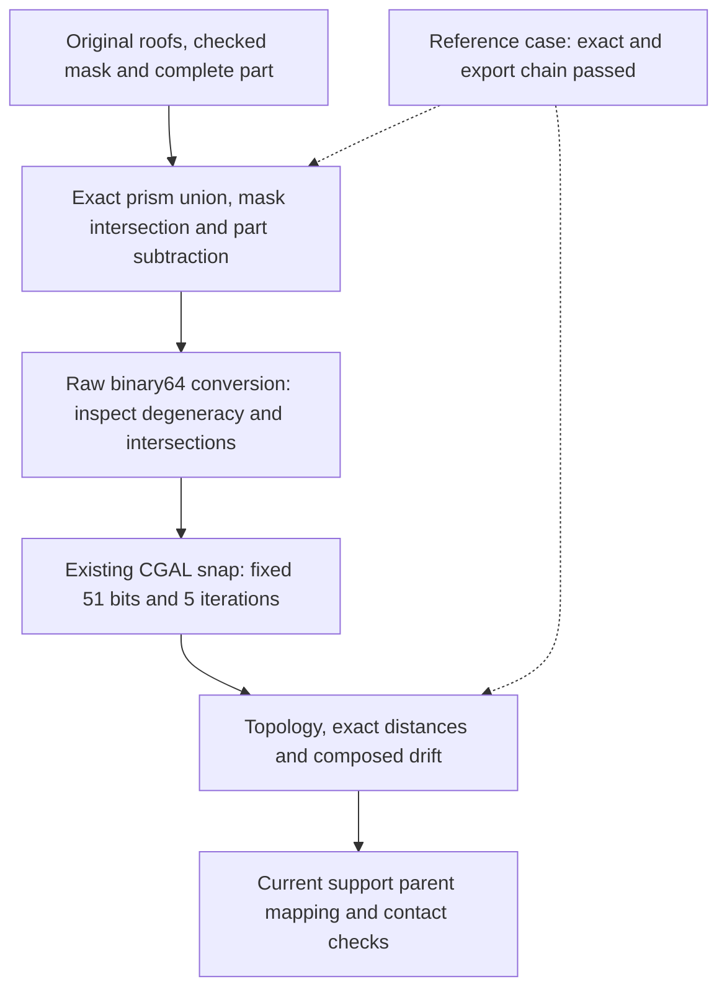

# 993 carrier: current support-region projection audit

Date: 2026-11-07. This checkpoint follows the [complete current part-layer
calculation](carrier-current-am-full-20261107.md). It checks the current carrier
surface used for support preparation; it does not reuse the historical STL
support masks.

Native overhang extraction preserved every selected triangle coordinate. Native
splitting then accounted for all **905,248 selected triangles in 4,676 connected
components**. The first attempted projected union failed its source-coverage
check. An independent rational-coordinate calculation confirmed all nine reported
defects, including seven for which the floating-point difference area was zero.
A separate CGAL calculation recovered the first component, then a complete pass
accounted for **all 4,676 components and 905,248 selected triangle occurrences**
with exact rational projections and independent readback. The complete native
mask-policy pass then accounted for every component: **seven polygons retained,
32 filtered below 5 mm² and 4,642 empty masks**. Exact containment and area checks
pass for every produced polygon. Contacts and support solids remain unfinished.

The markers locate actual rational witnesses, rounded only for display. The gap
widths are below the image resolution; the drawing does not exaggerate them.

## What ran

| Stage | Actual scope | Outcome |
|---|---|---|
| PySLM overhang selection at 45 degrees | 5,764,688 source faces; 905,248 selected faces; 504,752 referenced vertices | Ordered float64 triangle coordinates unchanged; all selected areas positive. No constructor adapter applied. |
| Native `split(repair=False)` | All 905,248 selected triangle occurrences | Every occurrence assigned exactly once to 4,676 components, with each triangle's ordered vertex coordinates preserved. |
| GEOS projected union | Component 0 only: 174,504 triangles | Nine source triangles failed coverage. The retained candidate is one Polygon with 99 holes. Processing stopped before inward buffering or mask filtering. |
| Independent exact inclusion test | All nine retained failing triangles against that stored Polygon | Nine exact boundary intervals lie outside it. No floating-point overlay is used by this proof. |
| CGAL exact union and readback | All 174,504 source triangle occurrences in component 0 | The serialized rational union covers every occurrence; its exact symmetric difference with the computed union is empty. Independent native rebuilding and Python rational ring/area readback pass. |
| Complete exact projection pass | All 4,676 components / 905,248 selected triangle occurrences | 4,675 projections computed; component 0 reused only after source rebinding. Every component retains exact source-coverage and readback checks. |

The initial floating-point trial and nine targeted proofs covered only component
0. The subsequent complete exact pass covers the whole selected component roster.
The historical seven processed masks came from a different STL and a later
filtering stage; they are not comparable to the current raw component count.

All six listed executions were reaped and their owned process groups were
absent. The floating-point projection returned 1 with its refusal retained;
the other five returned 0. Their respective wall times were 14.24, 16.25,
16.27, 4.08, 59.22 and 313.29 seconds; sampled peak group RSS was 4.52, 4.58,
4.16, 0.17, 4.01 and 4.48 decimal GB. Sources remained unchanged.

## Why zero area was insufficient

Seven GEOS difference-area diagnostics were zero; the other two were approximately
1.342e-15 and 2.317e-15 mm². Those values were diagnostics, not a coverage proof.
The independent test treats the stored float64 coordinates as exact fractions
and checks the complete source boundary against the target boundary and holes.
Each of the nine refusals contains a rational point in an uncovered interval.

GEOS documents that constructed floating-point intersections need not lie exactly
on their theoretical source lines. That explains why this kind of boundary
discrepancy is possible; the retained exact witnesses establish this particular
failure. See the [GEOS robustness explanation](https://libgeos.org/usage/faq/#robustness).

## Exact projection recovered for the first component

The fresh helper reuses the project's CGAL exact-polygon primitives and keeps
the original binary64 input coordinates and every source occurrence ID. CGAL documents these operations
with `Polygon_set_2` and an exact-construction kernel in its
[Boolean set-operations manual](https://doc.cgal.org/latest/Boolean_set_operations_2/index.html).
The actual Mac build uses CGAL 6.2.1, GMP 6.3.0 and MPFR 4.2.2. Eight positive
control groups and four refusal cases passed before the current component ran.
They include overlapping triangles, holes, concavity, non-binary intersections,
duplicate geometric occurrences with distinct IDs, one-ULP changes and the nine
retained failures. Two earlier build/control refusals remain recorded privately.

The accepted union has one exterior, 99 holes and 10,594 ring vertices. Its
projected area is approximately **27,893.6076 mm²**. Sixteen coordinate values
are non-binary rationals: they remain exact in the retained rings, with no float
export substituted for the authoritative geometry. All 174,504 occurrences pass
coverage against the reloaded union in 43 bounded chunks. Input and native
readback bytes match exactly; all 2,780 source/dependency/control pins were
independently checked. See the [exact-union receipt](carrier-current-support-projection-20261107/exact-union.json).

## Complete component roster

The bounded full pass retains **4,676 separate projected parts, 1,576 holes and
108,068 ring vertices**. Seventy-four coordinate values require non-binary
rationals. Every source occurrence is accounted for; no component is dropped or
merged with another. These separate projections may overlap and are not presented
as one global planar union.

Independent readback checked all **32,728 current files**, all component receipts,
input/native echo pairs and exact-ring hashes, plus all **2,799 bound inputs**.
The retained exact rings occupy 7,198,074 bytes including the reused first
component. See the [complete-pass receipt](carrier-current-support-projection-20261107/all-exact-unions.json).
An unused scope annotation inherited from the first-component contract was
incorrectly false; the original is retained with an explicit append-only
correction. The executed roster and verified counts cover all 4,676 components.

## Reproducibility and remaining work

The first **component-0 mask candidate** now passes exact containment and area
checks. The unchanged nominal `buffer(-0.5)` policy produces one retained polygon
with 14 holes and an exact area displayed as **26,648.03678915664 mm²**. Its
set difference outside the rational source is empty, and its exact area meets
the 5 mm² minimum. Seven policy controls and nine refusal cases passed first.
The actual trial took 8.46 seconds and 294 MB sampled peak RSS; independent
readback checked the files, source identities and WKB-to-rational coordinates.

The source still has 99 holes. Its float conversion, used only as input to the
native buffer, rounds 16 coordinate values and has nonzero exact additions and
losses; it never replaces the rational authority. The buffered candidate itself
is checked against that unchanged authority. This establishes a native-policy
candidate, not an exact 0.5 mm Euclidean offset. The
[mask receipt](carrier-current-support-projection-20261107/component0-mask.json)
records this distinction, complete checks and the byte-reproduced figure.

The subsequent **complete mask pass** covers all 4,676 components. Thirty-four
components produce 39 polygons, including four split components. Seven polygons
meet the unchanged 5 mm² threshold; 32 are explicitly excluded. The other 4,642
components erode to empty under the same native policy. No component disappears
from the ledger, and even the filtered polygons pass exact source-containment
and area-decision checks.

| Current source component | Retained mask area, mm² | Holes | Checked mask triangles |
|---|---:|---:|---:|
| 0 | 26,648.036789 | 14 | 27,991 |
| 79 | 5,994.405999 | 3 | 10,330 |
| 148 | 380.365137 | 0 | 590 |
| 409 | 6,089.910711 | 3 | 9,840 |
| 534 | 380.225316 | 0 | 571 |
| 2818 | 6.375239 | 0 | 503 |
| 3856 | 8.675774 | 0 | 673 |

The single bounded pass finished in **105.71 seconds**, with **502 MB** sampled
peak RSS and complete process cleanup. Independent readback verified all
**32,880 new files**, all **2,839 pinned inputs** and every one of the 216,136
source-coordinate values. Seventy-four conversions rounded; the exact source
authorities remain unchanged. The sum of retained per-component areas is
39,507.994965 mm²; this is not a cross-component union or a contact-area result.
The [full-mask receipt](carrier-current-support-projection-20261107/all-masks.json)
retains all counts, exact areas, checks and source identities. The historical
seven masks remain a different result despite the coincident count.

### All seven masks triangulated and checked

The next stage preserves the **369,273 original roof-triangle occurrences**
belonging to these seven current components, including their global source-face
identities and posed coordinate bits. Their constrained mask triangulations
contain **50,472 vertices, 50,498 positive triangles and 20 holes**. Complete
exact-union and rational-area checks show that the triangles cover each mask
without positive-area multiplicity; all vertices retain the original mask bits.

Component 148 first passed independently in 4.63 seconds. The remaining six
completed in **14.73 seconds**, with **421 MB** peak RSS, zero return and full
owned-process cleanup. The complete pass reuses component 148 only after
rebinding its exact sources, result, arrays and independent receipt. Readback
checked all 33 new scientific files, all 2,923 source pins, every array field
and the native triangle occurrence/coordinate correspondence.

The [complete triangulation receipt](carrier-current-support-projection-20261107/all-mask-triangulations.json)
records per-component counts, exact areas, identities and checks. These are
checked inputs for three-dimensional construction: no extrusion, contact
calculation or current support Boolean was executed by this stage.

### Portable exact 3D and export chain: reference case passed

The existing native CGAL binaries now run in the recorded local Linux container
with their pinned loader and library closures. No new geometric algorithm or
numerical threshold was introduced. The original prism/cutter reference case
reproduces its historical exact and rounded geometry hashes: **42 vertices,
76 faces and exactly 3,200 mm³**, with independently checked closed orientation,
analytic boundary and complete 52-source-parent mapping.

Its raw binary64 export also reproduces the known refusal: **four collinear
triangles**. The existing CGAL autorefinement route, fixed at **51 grid bits and
five iterations**, then produces **40 vertices and 72 faces**, with no collinear
triangles or post-export self-intersections. Its reconstructed complete NPZ
matches the historical accepted output hash. The exact final volume differs
from 3,200 mm³ by approximately **2.65269e-14 mm³**; it is not claimed unchanged.

The existing bidirectional exact-distance checks cover 118 and 112 declared
samples. Their composed displacement bound is **1.77636e-15 mm**, below the
unchanged **1.230696e-13 mm** limit. This is a finite-sample result, not a
continuous Hausdorff certificate. The exact-stage full parent map is retained;
the 72 snapped faces have primary ancestry only. Neither ancestry alone nor
this reference case establishes geometric contact coverage for current supports.

The [portable qualification receipt](carrier-current-support-projection-20261107/portable-3d-qualification.json)
records the controls, preserved refusal, exact volume difference, runtime hashes,
independent checks and cleanup of all seven snap/distance containers. Native
snap and distance calls took 0.037 s and 0.048 s. Independent readback checked
968 source pins. The current piece requires its own Boolean, export and contact
results through these same stages.

The [compact receipt](carrier-current-support-projection-20261107/summary.json)
binds the actual results, terminals, source geometry, exact proof and figure.
The figure was reproduced byte for byte and visually inspected. Raw surface
coordinates, component correspondence arrays and projected polygons remain in
private evidence.

Current contact checks, finite envelopes, support solids,
their complete slicing and the machine job remain open. The carrier's completed
1,034 part layers remain a separate result. The mass ceiling is withdrawn; this
audit changes neither the part geometry nor any acceptance threshold.
