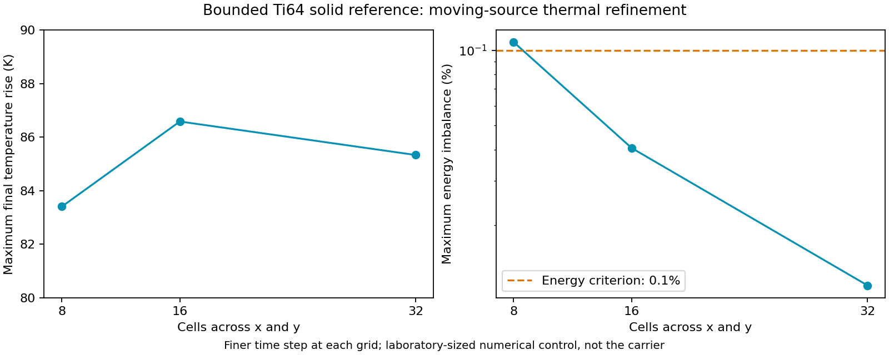

# GO-MELT: energy audit at every thermal time step

The retained moving-source solid control sampled its energy defect every 32
steps. That was a maximum over sampled steps, not over the complete discrete
history. A fresh execution now checks **all 4,224 steps across six cases**.
The equations, material adapter, mesh sizes, time steps and acceptance limits
are unchanged; the earlier files and results are preserved.

This is an actual GO-MELT CPU calculation on a small numerical coupon. It
extends the [boundary and property unit controls](carrier-go-melt-units-20261106.md)
and the [software coverage ledger](carrier-toolchain-coverage-20261106.md).
It does not yet simulate the carrier build or qualify a complete LPBF material
and process model.

## What changed and how it was checked

The only source change removes the `i % 32 == 0 or i == steps - 1` condition
around the existing energy-defect calculation. An AST comparison verifies that
removing this conditional produces the new program without changing any
numerical expression. The unchanged material adapter and upstream kernel retain
their recorded hashes.

Both executions produce exactly the same final temperature extrema, injected
energy and stored energy for all six cases. The complete audit finds slightly
larger intermediate defects: the largest increase relative to the earlier
sampled maximum is **2.572662%**, on the 16×16×8 grid with 256 steps. The finest
case increases by **0.004406% of its previous maximum**. These are corrections
to the reported maximum, not changes to the calculated temperature response.

The original acceptance outcome is unchanged. At the finer time step for each
grid:

| Grid | Steps | Final peak temperature rise (K) | Maximum energy defect / total input |
|---|---:|---:|---:|
| 8×8×4 | 256 | 83.40208483 | 0.10772228% |
| 16×16×8 | 512 | 86.57988675 | 0.04065781% |
| 32×32×16 | 2,048 | 85.32749320 | 0.01147701% |

The coarse grid still fails the declared **0.1%** energy criterion; the finer
two pass. The finest time-step comparison changes the peak rise by **0.02052351%**,
and the last spatial comparison changes it by **1.46774914%**, below the
unchanged 5% comparison limit. Spatial convergence is non-monotone; these
observed differences are not a rigorous continuum error bound.

For the finest case, total input energy is 0.0011246417588537123 J, final stored
energy is 0.0011247264643684514 J, and the maximum defect over all discrete time
steps is 1.2907527320300642e-7 J. Stored energy uses the analytical integral of
the variable heat-capacity law and independently assembled nodal volume
weights. The finite-step nonlinear method is not exactly enthalpy-conserving.

## Bounded material and numerical scope

The insulated 0.66×0.66×0.15 mm block starts at 300 K. A moving 3 W source with
0.25 absorptivity acts for 2 ms. These are numerical-control settings. Actual
calls exercise `computeSourcesL3`, `computeStateProperties` and
`solveMatrixFreeFE`. A separate assembled tensor-product Q1 operator checks a
nonuniform step; the explicit time step stays below the conservative stability
bound for the admitted property range.

The existing solid reference linearly interpolates the first conductivity and
heat-capacity segments from [TIMETAL 6-4, Table 2](https://www.timet.com/documents/datasheets/alpha-and-beta-alloys/timetal-6-4.pdf).
The conductivity points are 6.6 and 10.6 W/(m K) at 20 and 315 °C; heat capacity
is 580 and 670 J/(kg K) at 20 and 425 °C. Constant density is the sheet's
4,420 kg/m³ room-temperature reference. The adapter admits only **293.15–588.15 K**
and rejects temperatures outside this common interpolation range.

These conventional solid-property references do not supply powder packing,
melting, liquid flow, latent heat or process-equivalent LPBF properties. There
is no activation, heat loss, multilevel transfer, support model or carrier
geometry in this control. Those remain separate additions to the process chain.

## Execution and reproducibility

The child completed with RC0 and was reaped after **23.964 s**; peak RSS was
**392,232,960 bytes** under a 180-second timeout. No paid compute was used.
The stderr contains JAX CPU initialization messages, not an empty-log claim.
The executed profile is Python 3.10.11, JAX/jaxlib 0.4.16, NumPy 1.24.1 and
SciPy 1.9.0. GO-MELT's unchanged kernel SHA-256 is
`cf1889dfb41e11591e4245a9199262e66ae972e3a75e2c00baddd30f32851176`.

The [numerical report](carrier-go-melt-allsteps-20261107/report.json),
[comparison audit](carrier-go-melt-allsteps-20261107/audit.json),
[execution receipt](carrier-go-melt-allsteps-20261107/terminal.json) and
[figure provenance](carrier-go-melt-allsteps-20261107/figure-provenance.json)
retain the complete scalar results and source identities. The source bundle
is retained in the calculation checkout at
`work/go-melt-ti64-transient-allsteps-20261107-001/`, with the existing
`work/go-melt-ti64-solid-reference-001/material.json` input.
This checkpoint is not yet a self-contained command available from a fresh
public clone; packaging the retained runner is still required.
