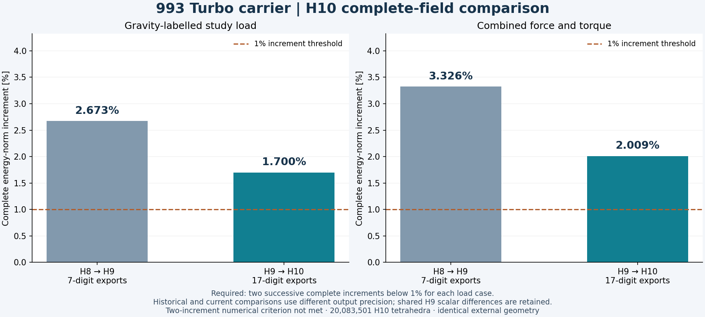
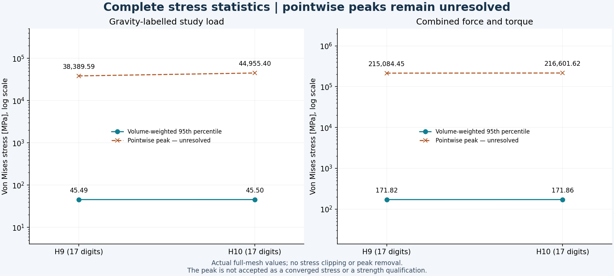
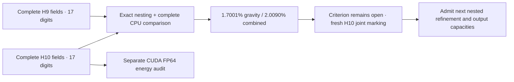

# 993 carrier: complete H10 native results

Both H10 study loads completed native CalculiX, complete lossless field recovery, CUDA FP64 energy checks and independent full-field comparison. The two paid instances were destroyed and their absence verified. The H9-to-H10 energy-norm increments are **1.7000526367% for gravity** and **2.0089858809% for combined loading**. Both exceed 1%; numerical stabilization remains open.

The criterion is unchanged: two successive complete same-load increments strictly below 1% for each case. The new comparisons use seventeen-digit output for both H9 and H10. The historical H8-to-H9 figures use seven-digit output and are labelled separately; exact equality of shared H9 scalar summaries is not assumed.

| Quantity | Gravity: H9 → H10 | Combined: H9 → H10 |
|---|---:|---:|
| External work [N mm] | 1470.91823996 → 1471.34359269 | 19156.75603536 → 19164.49027013 |
| Maximum displacement [mm] | 0.816303758 → 0.816535033 | 2.364348839 → 2.365252086 |
| Volume-weighted stress p95 [MPa] | 45.49482989 → 45.50445226 | 171.82159356 → 171.86158713 |
| Unresolved pointwise peak [MPa] | 38389.587681 → 44955.399420 | 215084.450476 → 216601.624249 |

Relative Galerkin identity defects are **7.3470393e-8** and **3.1309019e-8**, respectively. Small displacement or percentile changes do not replace the complete energy-norm criterion. Every stress peak is retained; the pointwise maxima are not admitted as converged strength values.

The admitted mesh contains **5,039,930 vertices and 20,083,501 tetrahedra**. Its exact nested map splits 883,520 H9 parents and adds 157,950 free interior vertices: 136,517 exact midpoints and 21,433 other admitted rational edge points. The exterior, load/support definitions and 135 protected extreme-condition cells remain unchanged. There is no current design mass ceiling.

Each retained native DAT stream contains **4,707,508,076 bytes** before lossless compression. The gravity and combined XZ files contain **1,419,099,512** and **1,421,414,032 bytes**, respectively, below the existing 1.6 GB allowance. Complete row identities, strict EOF and full raw SHA-256 checks passed; no scientific field was dropped. The separate CUDA check compared every H10 cell under each load. It is an energy evaluation, not a GPU mechanical solve.

The scalar readback preserved one diagnostic distinction. Combined coarse and fine work recomputations are each one binary64 ULP below the corresponding native summary (−3.637978807091713e−12 N mm). An additional bitwise-equality assertion initially refused those receipts. The fresh readback checks the exact native identity and recorded local-minus-native delta, retaining the differences without introducing a new tolerance. The original numerical comparator and all field data remain unchanged.

Next, use the complete H10 stress fields to derive fresh two-case traction-jump indicators, independently retain/check the joint vector, then admit the next nested refinement. H10 face pairing requires **1,285,344,064 bytes**; three complete indicator vectors require **482,004,024 payload bytes** (**482,004,408 bytes** in three NPY files, including headers). Those capacities and the next complete DAT/XZ/receiver sizes need explicit admission. No H11 response or convergence result is claimed.

The compact [results and provenance](carrier-h10-native-results-20261107/results.json) bind native execution, retained fields, cleanup and both comparisons. [Portable figure inputs](carrier-h10-native-results-20261107/figure-inputs.json) contain only the actual plotted scalars; they do not reproduce the underlying scientific solve.

The [figure replay instructions](carrier-h10-native-results-20261107/README.md) and [recorded replay receipt](carrier-h10-native-results-20261107/portable-replay.json) describe the checked public renderer. Earlier selection and geometry records remain in the [H9/H10 history](carrier-h9-native-results-20261107.md).
