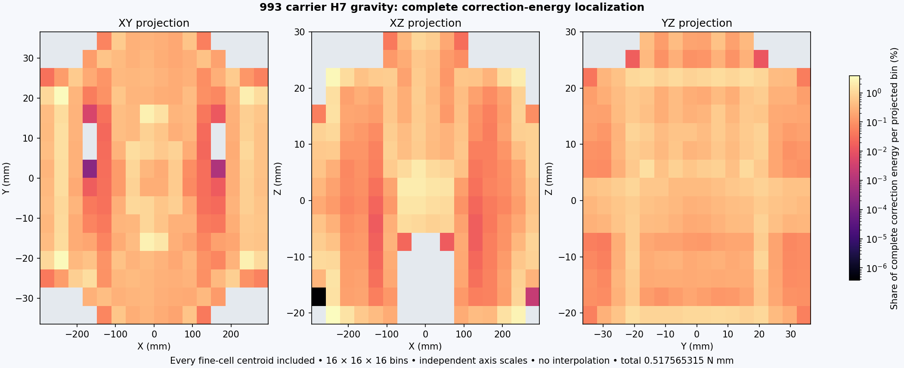
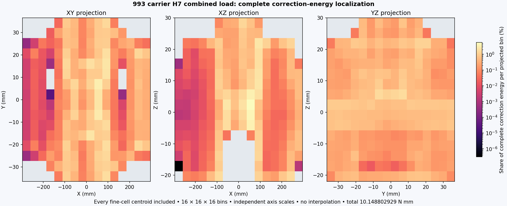

# 993 carrier H7: localize the complete mechanical correction

Both complete H6-to-H7 corrections have now been localized over all
**18,670,283 fine cells per case**. Under gravity, the 135 protected source cells contribute only
**2.32145e-10 of the correction energy**. They do not explain the measured
gravity energy increment. **87.4088%** lies in children of refined parents and
**12.5912%** in unchanged, unprotected cells.

This result directs the next mesh audit toward ordinary refined regions.
It does not justify discarding protected cells or changing the original
stabilization criterion. The [H7 mechanical report](carrier-h7-native-results-20261105.md)
remains authoritative for the two complete increments: 2.654% and 3.257%,
both above the unchanged 1% screen. Nominal mass remains **1.2941382 kg**.

The image projects a complete 16 × 16 × 16 centroid histogram onto XY, XZ
and YZ. Every fine cell contributes its positive compliance correction energy.
Each projection sums to the same full energy, not to a selected slice.
Coordinate axes are scaled independently for legibility; cells are not smoothed
or interpreted as a reconstructed surface. Gray bins have no contribution.
The [published numerical aggregate](carrier-h7-correction-localization-20261105.json)
contains the exact bin bounds, totals, source identities and largest 100 cells.

## Complete gravity partition and concentration

| Disjoint group | Fine cells | Correction energy, N mm | Share |
|---|---:|---:|---:|
| Children of refined parents | 8,460,854 | 0.4523975626069143 | 87.40878674% |
| Unchanged and unprotected | 10,209,294 | 0.06516775247135573 | 12.59121324% |
| Protected source cells | 135 | 1.201502886574257e-10 | 2.32145e-8% |

The complete sum is **0.5175653151984208 N mm**, identical to the previously
admitted stress-difference compliance energy. At least **293,975 fine cells**
are needed to accumulate half the correction, **2,298,079** for 90%, and
**6,074,838** for 99%, when sorted by decreasing cell contribution. The largest
100 contribute only **0.385145%**. The gravity correction is therefore spread
across many cells; attributing it to a few pointwise peaks is unsupported.

## Executed method and checks

For every fine cell, the checked H6-to-H7 nesting map identifies its coarse
parent. The unchanged comparator's isotropic compliance expression integrates
`volume × density(sigma_h7 − sigma_h6)` using the same study material and exact
integration volumes. No scalar stress statistic substitutes for this complete
field calculation. Both full lossless DAT streams are replayed into RAM; all
original force, moment and energy checks pass again before localization.

The classification is disjoint and exhaustive. The independently retained
protected-cell roster contains 135 cells; none is a split parent. Known-energy
partition controls pass, while negative weights, foreign labels and noninteger
labels are rejected. Group and spatial-bin sums agree with the complete energy
to relative 1e-12. There is no certified error-bound or new spatial-stabilization
claim. No new native solve or paid instance was used.

The private entry point is
`work/carrier-h7-correction-localization-001/analyze.py`, which reuses the
qualified full replay and comparison with only a fresh output root. Its complete
receipt SHA-256 is
`0a57ff31379748eb2b2b6926a9fd9dfb7fb9115d560b16302ef4576dfb61866a`.
Raw meshes and field arrays remain outside Git.

## Complete combined-load localization

| Disjoint group | Fine cells | Correction energy, N mm | Share |
|---|---:|---:|---:|
| Children of refined parents | 8,460,854 | 8.930776218548411 | 87.99832139% |
| Unchanged and unprotected | 10,209,294 | 1.2180266837534721 | 12.00167835% |
| Protected source cells | 135 | 2.6354097820620184e-8 | 2.59677e-7% |

The complete sum is **10.148802928655982 N mm**, identical to the previously
admitted combined correction energy. At least **241,930 fine cells** accumulate
half the correction, **2,054,863** accumulate 90%, and **5,772,557** accumulate
99%. The protected cells do not explain the combined increment either.
The [combined numerical aggregate](carrier-h7-combined-correction-localization-20261105.json)
retains all bin totals and source identities. Private receipt SHA-256:
`300a1f160131122da58b37bb4147c5d6a14a88e06a944cc9c1bbec99291bdbe8`.

## Execution recovery and next refinement

The gravity localization completed before the first local supervisor stopped
on a five-second process-list observation timeout. Its receipt remains intact.
The old worker and supervisor are terminal and absent. A fresh **combined-only**
replay then completed under a new supervisor that records telemetry failures,
tolerates a single transient failure, and always records child cleanup. It
exited zero and was reaped after 377.21 seconds, with sampled peak group RSS
5,372,264,448 bytes and no telemetry failures. Both actual localizations are
complete; neither is inferred from the other.

RAM-backed face storage additionally matches the unchanged disk-based complete
face-pairing algorithm byte for byte on four synthetic populations through
4,096 tetrahedra. Three-owner faces, repeated vertices and allocation above the
cap are rejected. This qualifies the storage substitution on those controls;
the actual complete two-case H7 traction-jump job has now started with full
lossless field replay and RAM face storage. Its numerical result remains
pending. It must retain both full case vectors and their normalized joint
vector so that subsequent selection can check both coverage targets
independently. An H8 geometry has not been produced.

The immediate sequence is: finish and bind both complete H7
traction-jump fields; admit a targeted H8 geometry; run both independent cases
in parallel on authorized workers; recover and compare the complete fields.
All geometry and mechanical acceptance thresholds remain unchanged.

## Storage and repository verification

The internal disk was below the mesh producer's 8 GiB reserve. Complete
localization therefore wrote only bounded metadata and figures. A subsequent
controlled maintenance pilot transparently compressed five closed artifacts:
three sorted-face tables and two historical FRD files. Every original path,
logical byte count, SHA-256, mode and mtime was preserved. Each pilot had a
positive observed free-space gain before the next was allowed. Free capacity
rose from **6,364,110,848** to **9,579,560,960 bytes**, recovering **3,215,450,112
observed bytes**. This is a storage result, not a change to geometry or physics.

Maintenance used its own finite copy bound and 4 GiB free-space floor. The
**8 GiB geometry/receiver reserve was never reduced**. The new marking job must
independently recheck that original reserve plus the full joint-vector size
before retaining its output. The current three-vector profile requires the
original 8 GiB reserve, **448,087,176 bytes** for all three complete NPY files,
and 20 MB of metadata margin before the first case is processed. Full face
arrays and solution fields remain in RAM.

Four additional closed NPY artifacts were subsequently compressed under the
same maintenance bounds. In total, **nine** artifacts retain every original
byte hash and path. The [storage receipts](carrier-h7-storage-recovery-20261105.json)
record **3,962,363,904 physical bytes saved**, with free capacity last observed
at **9,653,063,680 bytes**. Later allocations can change free capacity; each
scientific write must still pass its fresh preflight. The
external evidence mount reports available capacity, but a fresh exclusive
receiver-creation witness timed out. It is not admitted as a new scientific
receiver. Both bounded probes were killed and reaped; the first attempted root
was independently observed absent before the second, instrumented attempt.
No existing scientific files were modified.

The full hosted repository check for commit `3434804d5` passed:
[GitHub Actions run](https://github.com/cluster2600/porscheparts/actions/runs/42112884652).
Locally, 5,191 principal tests passed with 405 skips. The full local make stopped
when Docker was off; after starting it, the affected container target passed
all 15 tests. This is not a claim that the entire local make completed. Docker
was subsequently stopped after confirming there were no running containers.
