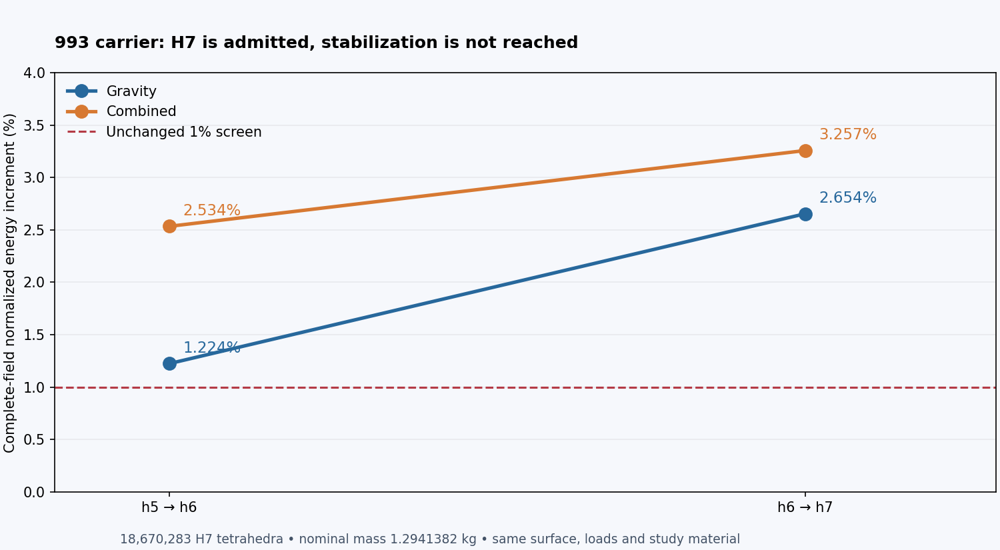
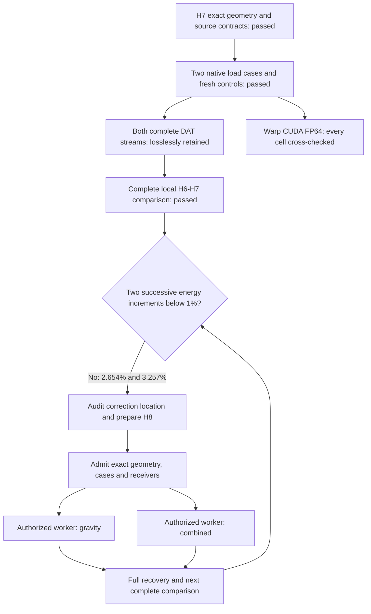
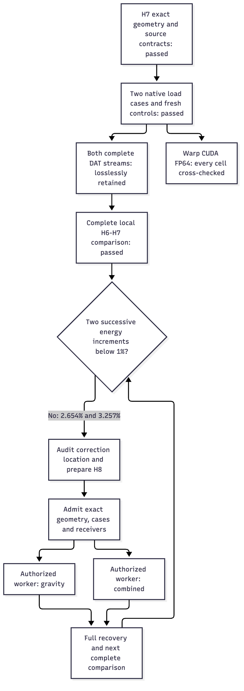

# 993 carrier H7: native results and complete-field CUDA cross-check

Both complete H7 native responses passed the original equilibrium and energy
checks. **Stabilization is not reached:** full h6-to-h7 energy increments are
**2.65382807% for gravity** and **3.25723437% for combined loading**. These
increments increased from h5-to-h6. The requirement remains two successive
complete-field increments below 1%; small scalar changes cannot replace it.
Nominal mass remains **1.2941382 kg**, below the **1.30 kg** limit.



## Measured results

| Complete-field metric | Gravity | Combined force and torque |
|---|---:|---:|
| h6-to-h7 normalized energy increment | 2.65382807% | 3.25723437% |
| Relative Galerkin identity defect | 1.277e-07 | 2.806e-08 |
| External work, N mm | 1469.77072621 | 19131.40205750 |
| Maximum displacement, mm | 0.81568056 | 2.36146403 |
| Volume-weighted stress p95, MPa | 45.46217471 | 171.67011992 |
| Unresolved pointwise stress peak, MPa | 28909.85770683 | 173961.77057018 |

Both comparisons use all 18,670,283 H7 cells and the checked exact rational
parent/child map from 14,439,856 H6 cells. Geometry, study material, support and
load bindings remain checked; pointwise peaks remain unresolved. This is a
numerical study, with no strength or manufacturing release claim.

Each native case reran three analytic and two full quadratic reference controls.
PARDISO used eight threads; full solves took 410.22 and 410.82 seconds. Independent
relative energy residuals were 4.822e-8 and 4.917e-9, below the original 1e-4 limit.
The fraction-aware comparator additionally passed three independent dense
elasticity fixtures at fractions 1/3, 5/8 and 9/16; incorrect midpoint maps were
rejected. These fixtures qualify the comparison path, not the carrier geometry.

## Executed software and retention

The [exact rational refinement](carrier-h7-rational-refinement-20261105.md)
produced 4,788,172 nodes without changing the outer surface. Both actual native
runs used the same pinned ELF SHA-256
`93181a8340dac42f2e76fb9159edcdcebc536c5f29cc25dfa4689413e83582ac`.
Both processes exited zero and were reaped.

Each full scientific DAT contains 2,644,315,130 bytes. Both are retained locally
as lossless XZ archives, with encoded and complete decompressed SHA-256 checked.
[Strict bounded XZ replay](../architecture/calculix-lossless-replay.md) consumed
all rows using RAM field arrays and executed the unchanged qualified comparator.
No raw DAT duplicate, mesh or field byte dump is added to Git. The original
32 GiB bulk storage profile is not claimed to have passed.

Actual **Warp 1.18.0 CUDA FP64** execution on an RTX 3090 independently checked
every cell's stress-compliance energy in both complete fields, after six basis,
hydrostatic and zero controls. A distinct CPU algebraic formulation checked
every GPU value at absolute 1e-14 N mm plus relative 1e-12 tolerance. Integrated
GPU, CPU and native-assessor energies agreed: **734.8853276688457 N mm** and
**9565.70107578749 N mm**. Maximum per-cell absolute differences were 3.47e-18
and 5.55e-17 N mm. This is a GPU field cross-check, not a GPU mechanical solve
or qualification of the entire software inventory. Pinned wheels were staged
in an isolated target without modifying the native CPU solver environment.

The one owned Vast instance (128 GB advertised RAM, RTX 3090) ran both cases
sequentially, then both GPU audits. Its $3.20 lease cap and original deadline
were unchanged. After complete scientific recovery, the exact instance was
destroyed and provider absence verified. Parallel rentals are authorized for
future independent case runs; no second paid instance was created for H7.

## Reproduce the recorded path

The private execution workspace contains these exact entry points:

```sh
# Controls for the fraction-aware full-field comparator
.venv-check/bin/python work/carrier-rational-comparator-controls-001/check.py
# Complete lossless local replays and comparisons (private source files required)
OPENBLAS_NUM_THREADS=1 .venv-check/bin/python work/carrier-h7-comparison-001/compare_case_v2.py --case gravity
OPENBLAS_NUM_THREADS=1 .venv-check/bin/python work/carrier-h7-comparison-001/compare_case_v2.py --case combined
```

These are recorded commands, not instructions to overwrite completed output
directories or relaunch paid workers. Original native metadata remains intact;
explicit local binding views preserve numeric values while relocating the same
material and DAT bytes. Both coarse replays match all six previously admitted
field arrays byte for byte. The source-bound JSON below publishes numerical
results and identities; private inputs remain necessary for a full rerun.

## Next mechanical step

Audit where the H7 correction energy is concentrated, bind both complete H7
traction-jump fields, and build a new source-admitted refinement. Recheck exact
nesting, protected cells and conditioning before renting case workers. Run the
two independent load cases in parallel when both have admitted inputs and
receivers; recover both complete fields and compare using the unchanged
criterion. Cellular lightening remains a subsequent geometry variant with its
own mass and mechanical comparisons.





## Source identities

| Identity | Gravity | Combined |
|---|---|---|
| Full comparison JSON | `d9327da6a3640629bbcafaf2810aaf87083cf4d4add67ebdeab52128e253469e` | `66a01d7e8df6f161a69544a5bdad513a63bd49253ede9b970c1eb26b3c329ef9` |
| Complete replay receipt | `c18d188c7ba19ded4b0c6dd613f6a1fbf55e2e28ee3b7a8a5c270a767aab2b46` | `54d43575b143da7effe13e9ef60385d331a4a17fb3481d970859e6e0648d9f07` |

CUDA audit source SHA-256: `c2c4dce5811540b39086191de3683023b0ae557c46ef6c95f82e93b2edd38e11`.
