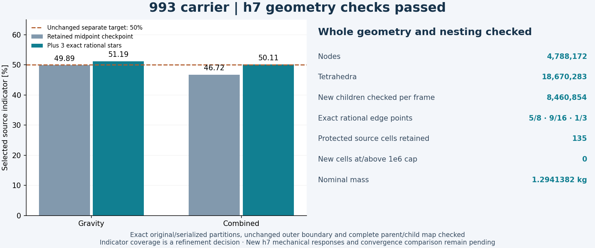
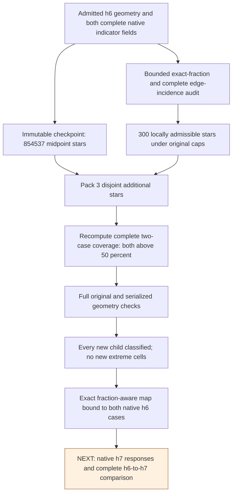

# 993 carrier h7: exact rational edge refinement

The complete h7 candidate now passes two-frame geometry, new-child quality
and complete parent/child nesting checks. It has **4,788,172 nodes and
18,670,283 tetrahedra**, with the original outer surface and nominal
**1.2941382 kg** mass retained. Both source-indicator marking targets exceed
50%. **New mechanical responses remain pending**; h6 is still the latest
admitted mechanical reference.



## What unblocked the refinement

Midpoint-only selection was rejecting some important edge stars because the
midpoint was not exactly representable or its children exceeded the unchanged
conditioning caps. A source-bound checkpoint retained 854,537 accepted midpoint
stars. A bounded probe of the 1,024 highest-indicator unblocked, unprotected
cells per load case produced 1,464 distinct cells and 5,470 edges. Complete
source incidence and exact coordinate checks left 618 available candidate
stars; 300 passed local partition, formatting and both-frame raw/normalized
conditioning checks at one of 96 exact rational fractions.

A disjoint packing needed **three** of these stars, splitting 14 additional
source cells, to pass both original marking targets. The complete proposal
then recomputed coverage from all 4,230,427 selected source cells, rather than
accepting the packing's accumulated estimates.

| Source marking coverage | Retained checkpoint | Complete rational proposal |
|---|---:|---:|
| Gravity | 49.89044115% | 51.18850764% |
| Combined force and torque | 46.72385774% | 50.11265453% |

Coverage is a refinement decision based on retained h6 traction jumps. It is
not an energy-error bound or a mechanical convergence result.

| Additional edge, zero-based source IDs | Fraction from first endpoint | Source cells |
|---|---:|---:|
| 2111909–3339759 | 5/8 | 4 |
| 2171381–3339859 | 9/16 | 4 |
| 1572036–1680476 | 1/3 | 6 |

Each exact point satisfies `p = a + t(b-a)` in both coordinate frames. No
coordinate tolerance is used. Every parent is partitioned into positive
children of exactly `t` and `1-t` times its original volume, with the same
oriented cavity boundary. Source cells are split once at most. The prior
midpoint-only producer was gracefully stopped and reaped with exit 75 and a
committed checkpoint; it did not claim proposal or geometry admission.

## Executed chain



[Rendered workflow](../media/carrier-h7-rational-workflow-20261105.png).

The retained [software allocation](carrier-software-review-20261104.md),
[storage/checkpoint process](../architecture/carrier-refinement-recovery.md)
and [current mechanical results](carrier-current-mechanics-20261104.md)
cover the surrounding chain. The new public
[exact edge subdivision module](../../scripts/calculix_exact_edge_subdivision.py)
is byte-identical to the executed operator. Six public regression tests and
seven private fixture controls passed, including default midpoint byte parity.

## Complete geometry and map checks

| Executed check | Result |
|---|---|
| Exact orientation, indexed boundary and connectedness | Passed on all 18,670,283 cells in each coordinate frame; one component, no unused vertices |
| Solver mesh independent decode | Coordinates and ordered connectivity match the serialized volume |
| Original outer boundary and old nodal bytes | Preserved |
| New children classified in each frame | All 8,460,854 |
| Largest new-child normalized condition | 999,548.2064, below the unchanged 1,000,000 cap |
| Protected source cells | All 135 unchanged |
| Newly extreme cells | Zero |
| Complete nesting map | All 4,230,427 parent/child pairs and unchanged cells checked |
| Exact new edge points | 854,537 midpoints and three rational points checked in both frames |
| Scalar graph index capacity | Original conservative int32 bound passed |
| New mechanical responses | Not executed |

Midpoint exactness uses error-free TwoSum and checks exact division by two,
including underflow rejection. Non-midpoint coordinates are independently
checked with `Fraction` arithmetic. Controls compare midpoint acceptance
against exact rational arithmetic on 1,036 binary64 endpoint pairs and reject
changed coordinates, noncanonical fractions and rounded/underflow midpoints.
The map also binds to the independently admitted geometry contract for each
actual native h6 load case.

A separate dense P1 elasticity fixture checks the projection identity
`Pᵀ K_f P = K_c` for exact thirds. Maximum relative matrix defects were
7.51e-17 and 5.07e-16. With prescribed non-affine boundary data, the three
additional interior degrees of freedom reduced energy by 74.0209531 and
38.3065050 N mm; correction-energy identities agreed within 1.86e-15 relative.
This independent numerical fixture is not a native h7 solve. The earlier
[interior-only split rejection](carrier-refinement-admissibility-20261105.md#why-an-interior-only-split-was-rejected)
remains in force.

## Reproduction and evidence

Raw meshes, fields and snapshots stay in private storage. The following
receipts bind this candidate; no raw numerical bytes are committed to Git.

| Artifact | SHA-256 |
|---|---|
| Complete proposal receipt | `45575450d0ab415c5680d9045b146068a77a36138709a451a3b79b25e4a57a9b` |
| Complete geometry admission | `79f6fef1a791896dce47bf1c07a821f6ebbe701b66fc46057a2bf3359eb0ed64` |
| Complete quality admission | `d82c6884d5ce411c3972146201cf309b557e3c9012a96d4e15f916f2d73ea151` |
| Exact edge fraction arrays | `611c6b98bc1e93b0f6ce608b12d2bcabc7ba082145992be088f92e2311948938` |
| Complete h6-to-h7 map | `eaf9701271dbf69ffe1fcc9bbe86782c602fe211d8731f41b0584a7ff99af421` |

The executed private entry points are:

- `work/carrier-rational-edge-feasibility-003/{probe,incidence,check_cavities,pack}.py`;
- `work/carrier-adaptive-h7-rational-003/{prepare,run_geometry}.py`;
- `work/carrier-nested-comparison-h7-rational-003/build_and_check_map.py`;
- `work/carrier-rational-edge-kernel-001/galerkin.py`.

Full geometry assembly took 181.0 seconds with sampled peak group RSS
8.47 GB; complete new-child classification took 56.3 seconds with peak
5.42 GB. Each phase exited zero and its child was reaped. The unchanged
8 GiB storage reserve was retained. These stages used local compute, with no
new paid instance. The fraction-aware response comparator is prepared but
still requires an actual complete native h7 execution before acceptance.

For public regression checks:

```sh
.venv-check/bin/python -m unittest discover -s tests \
  -p test_calculix_exact_edge_subdivision.py -v
```

H6-to-h7 mechanical comparison must preserve loads, supports, material,
original numerical limits and both complete source fields. No spatial
stabilization or strength conclusion follows from the geometry checks above.
