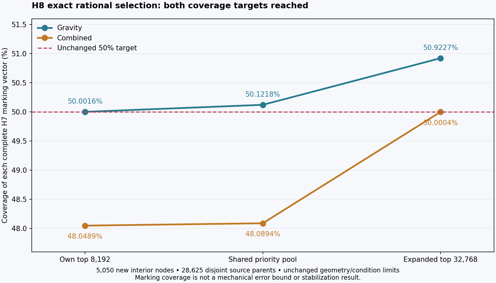
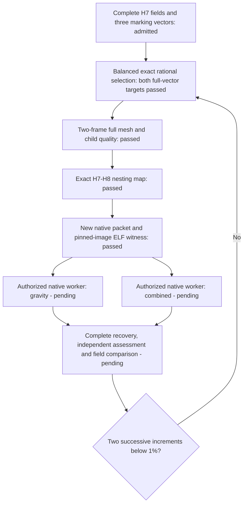

# 993 carrier H8: global rational refinement admitted

H8 now passes **complete two-frame geometry and new-child quality checks** and
the **exact H7-to-H8 nesting map**. It contains **4,793,222 nodes and 18,698,908
tetrahedra**. The original exterior and **1.2941382 kg** nominal mass remain
unchanged. **New H8 mechanical responses are pending**; the last measured H7
increments remain 2.654% and 3.257%, above the unchanged stabilization screen.

## Complete selected coverage

| Measured property | H8 value |
|---|---:|
| New interior nodes / disjoint edge stars | 5,050 |
| Source parents subdivided | 28,625 |
| New children checked in each coordinate frame | 57,250 |
| Gravity source-indicator coverage | 50.92273628% |
| Combined source-indicator coverage | 50.00041735% |
| Exact midpoint points | 3,983 |
| Other exact rational points | 1,067 |
| Maximum new-child normalized condition, either frame | 999,995.0119581318 |
| New cells at or above the unchanged 1e6 cap | 0 |
| Inherited protected exact-energy cells, unchanged | 135 |

Coverage is recomputed from the complete retained H7 vectors over every selected
parent, separately for both loads and the normalized joint vector. It is an
adaptive marking decision, not a certified error bound or a mechanical result.

## Selection and lossless continuation

The producer consumes the independently checked
[H8 source intake](carrier-h8-source-intake-20261105.json). The first 8,192-cell
orders reached 50.002% gravity and 48.049% combined, so no proposal was admitted.
Extending traversal over their shared seed pool retained every verified star
but reached only 48.089% combined. A new stage expanded to the top **32,768
cells per load**, retained all previously certified stars, and restarted only
traversal over the larger domain. Both original targets were then reached.

Each stage scanned the complete source connectivity for all six edge positions.
Fractions come from a fixed family with denominators through 17; every accepted
point is exactly representable in both frames and exactly serializable. The
public [ordered candidate helper](../../scripts/calculix_candidate_order.py)
keeps the same best-valid choice while avoiding unnecessary eager checks.
No condition, volume, boundary or coverage limit was loosened.

Source-bound snapshots retain fractions, original and serialized point bits,
children, disjoint parents, counters and traversal state. Known controls verify
exact float/fraction roundtrip and interrupted traversal equivalence. Each
production evaluator also reproduced all 157 independently recorded local
source outcomes, including the same 77 accepted fractions and condition values.
Migration receipts verify the inherited selected subtree is unchanged. The
expanded-domain stage is explicitly a new traversal, not a claim to reproduce
a larger search run from scratch.

## Independent global checks

The qualified assembly, checker orchestration and child classifier were reused
byte for byte with a new source/output binding. Complete original and serialized
checks established positive exact cell orientations, the same indexed oriented
source boundary, one cell component and no unused vertices. Solver readback
matches the intended coordinate bits and full connectivity. The 135 protected
source cells keep their coordinates and connectivity; every new child is
classified in both frames. The conservative scalar-pattern bound is
**1,510,423,416**, below the unchanged signed-32-bit capacity limit.

Assembly completed in **98.463 seconds**, with sampled peak group RSS
**5,826,871,296 bytes**. New-child classification completed in **2.013 seconds**.
Both actual processes exited zero and were reaped. The 8 GiB storage reserve
was preserved. The classifier's sparse RSS sample is not a continuous peak bound.

The separate map builder binds all 28,625 replaced/appended parent pairs and
all 5,050 edges to both admitted native H7 cases. It checks every unchanged cell,
every new point and each child-pair connectivity relation. Both-frame exact
fraction checks, original vertex-bit identity and wrong-edge/fraction rejection
controls pass. These geometric/nesting checks do not substitute for new fields.

## Native execution package

A new closed packet contains the H8 solver mesh, both unchanged load decks,
updated independently admitted geometry/population payloads and the original
native runtime. All executable modes are preserved. It contains **90 files**,
**761,661,352 compressed bytes** and **1,812,729,713 expanded bytes**. Its ELF
and numerical limits are unchanged. The local witness in the exact pinned Linux
image passed safe unpacking, all member hashes/modes and the native analytic
reference component control in **116.498 seconds**. It exited zero and its
owned container was verified absent. This is local x86-64 emulation; new H8
cloud solves have not run.

The next steps are the two independently bounded native cases, full scientific
retention, independent assessment and the complete same-load H7-to-H8 field
comparisons. Parallel rentals are authorized. Two successive complete increments
below 1% remain required before claiming numerical stabilization.

## Reproduction and identities

Private execution entry points are:

- `work/carrier-adaptive-h8-rational-003/prepare.py` for the source-bound final selection;
- `work/carrier-adaptive-h8-geometry-001/run_geometry.py` for full assembly/quality;
- `work/carrier-nested-comparison-h8-rational-001/build_and_check_map.py` for nesting;
- `work/carrier-high-memory-input-015/build.py` for the native input packet.

These retain immutable prior stages. Reproduction needs the private inputs and
a fresh output binding, not overwriting completed evidence. Raw meshes and
fields are not committed to Git. The [public numerical receipt](carrier-h8-global-geometry-20261106.json)
records counts, settings, checks and identities.

| Artifact | SHA-256 |
|---|---|
| Complete proposal | `ac118c0e0d3890d8f42678d8b773d6647b8533af1f205776416cdbc30114ef34` |
| Complete geometry admission | `56a6589ead7d652a72703f897621343a6381142129ccc7c0525a83f6a83e470a` |
| Complete quality admission | `0c6757d70aae399abfe0699b46a0e7ed42a66c20a5a35baf644689a2d10d4d64` |
| Exact fraction arrays | `16a4b0ca961006e1ba58501aa98d39a38f52067455224cf17ce828163fa54da7` |
| Complete H7-to-H8 map | `0340640278157513f92728b2ed8c0a2d119cae7568a2560d2ccc74f0c30c4f25` |
| Native input packet | `882e201379e3f592824c9a4244fd71a0c60fef95dae43c9c5b8e1b45aa25ac05` |

