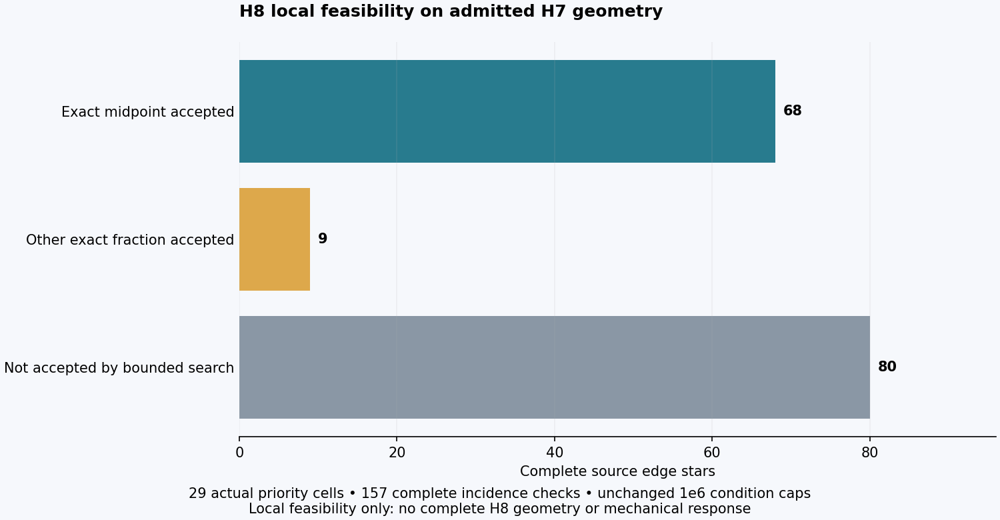
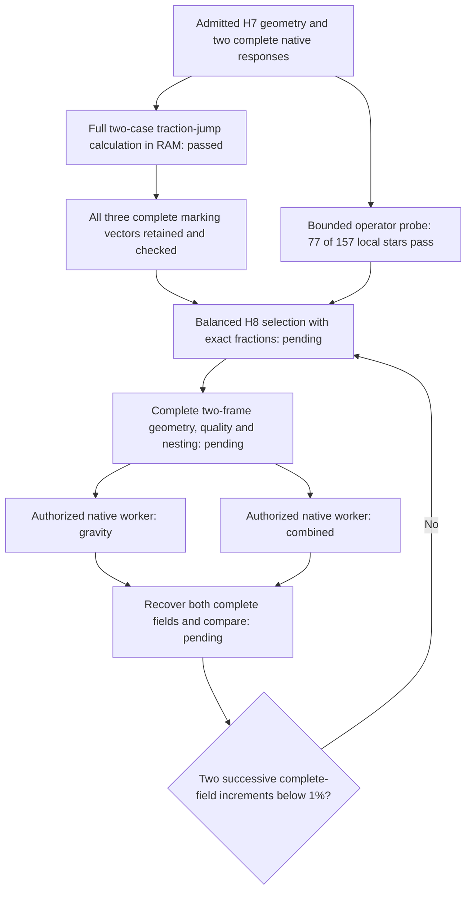

# 993 carrier H8: exact local operator feasibility and ordered qualification

A bounded test on admitted H7 geometry found **77 locally admissible edge stars
out of 157 examined**, including **9 requiring a non-midpoint exact fraction**.
This tests the refinement operator on real study coordinates, not an assembled
H8 mesh or a new mechanical response. The remaining 80 were not accepted by
this bounded search; that is not a proof that no refinement is possible.



## Source and unchanged requirements

The test starts from all **4,788,172 H7 nodes and 18,670,283 cells**, the admitted
original and serialized coordinate frames, the complete population roster and
both [correction-energy localizations](carrier-h7-correction-localization-20261105.md).
The seed set is the union of the largest 16 cell corrections per load case:
**29 distinct cells**. It is a bounded feasibility sample, not traction-jump
marking or a claim to meet either 50% source-indicator coverage requirement.

For all 157 candidate edges, six complete connectivity passes collect every
source incident cell. Stars involving protected cells or an open edge link are
refused. The unchanged exact rational kernel checks positive per-parent volume
partition and the identical oriented cavity boundary in both coordinate frames.
All accepted points are exactly representable and serialized without rounding.
Original vertices are unchanged. Raw and normalized condition numbers remain
at or below **1e6**, with no relaxation to admit a candidate.

There are **68 midpoint** and **9 other-fraction** local acceptances. Fractions
are tested from the same finite rational family with denominators through 17.
Each accepted star is checked independently; they have **not** been packed into
a disjoint global proposal. Full duplicate-point, assembled boundary,
connectedness, solver readback, quality and nesting checks remain mandatory.
Nominal source mass is **1.2941382 kg**. No new part geometry was exported.

The actual probe finished in **6.404 seconds**; its supervised process exited
zero and was reaped after 8.130 seconds with sampled peak group RSS
1,558,937,600 bytes. Source admission SHA-256 remains
`79f6fef1a791896dce47bf1c07a821f6ebbe701b66fc46057a2bf3359eb0ed64`.
The [numerical aggregate](carrier-h8-local-operator-feasibility-20261105.json)
contains the complete candidate census and source identities. Private probe
receipt SHA-256:
`12971e37dbfcad469fea33a8066507e73fc43b69926883fd20e6ffccc4317af2`.

## Avoid unnecessary expensive qualifications

The prior selector qualified every incident edge before choosing the highest
scoring admissible edge. The new
[`calculix_candidate_order.py`](../../scripts/calculix_candidate_order.py)
orders candidates by the identical score, length and deterministic edge-key tie
break, then runs the unchanged expensive qualification until the first accepted
candidate. For a fixed candidate set and qualification predicate, this returns
the same best admissible edge. It changes which discarded candidates need an
eager check, not the qualification rules. The evaluator returns `None` for a
refusal and a non-`None` qualification proof for acceptance; unexpected errors
propagate rather than being treated as ordinary refusals.

An independent exhaustive oracle matched **1,000 randomized candidate tables**;
controls also cover refused leading candidates, ties, zero scores, empty lists,
all-invalid sets and malformed rankings. A second comparison used the actual
157-edge feasibility labels with **2,900 synthetic score tables** over the 29
source seeds. Both strategies chose the same edge and fraction every time.
Qualification calls fell from **17,400 to 6,947** in those controls. Scores were
explicitly synthetic: this is a selection-equivalence and call-count result,
not a measured speedup of a complete H8 producer.

```sh
.venv-check/bin/python -m unittest discover -s tests \
  -p test_calculix_candidate_order.py -v
```

The private actual-geometry entry point is
`work/carrier-h8-local-operator-probe-001/probe.py`; its controller refuses reused
output and keeps source artifacts immutable. A fresh binding and private H7
inputs are needed for a rerun. The production H8 selector still needs to consume
the complete retained H7 marking vectors and carry fraction-aware checkpoints.

## Current marking recovery

The complete H7 gravity replay passed its original force, moment, energy and
source-identity checks. The marking run was subsequently refused by its storage
preflight before retaining a vector when available capacity drifted below the
original 8 GiB reserve plus all three planned vectors. No marking-vector input
was admitted from that failed export. The worker exited one and was reaped.

Two additional closed historical DAT files were then transparently compressed,
with original byte hashes and paths preserved. One intermediate compression
attempt exceeded its finite RAM bound; its worker was reaped, the untouched
source SHA-256 and inode were verified, and only the failed temporary copy was
removed. A separately bounded retry succeeded. No scientific source was deleted.

The replacement marking job has a further **1 GiB initial headroom**, releases
large face buffers before output, and can hold a complete vector in RAM for up
to 120 seconds while waiting for the **unchanged** storage budget. Small real
file controls verify both transient recovery and permanent refusal without an
output. The replacement job then completed successfully: both full case vectors and
the normalized joint vector are retained and SHA-256 checked. Its worker exited
zero and was reaped after **568.018 seconds**, with sampled peak group RSS
**5,678,170,112 bytes**. All three vectors contain **18,670,283 values** and
occupy **448,087,176 logical bytes** in private storage.

## Complete H7 intake for H8

| Retained marking result | Gravity | Combined |
|---|---:|---:|
| Interior faces checked | 34,458,222 | 34,458,222 |
| Unchanged source boundary faces | 5,764,688 | 5,764,688 |
| Interior-jump marking sum, N mm | 5,877.21714076261 | 118,995.45712887794 |
| Share on the 135 protected cells | 0.01652477% | 0.08183573% |
| Minimum cells accumulating half the sum | 2,708 | 1,700 |

These sums are adaptive ranking aids, not certified error bounds or physical
strain energies. The protected roster does not alone prevent the two separate
50% coverage targets; actual disjoint selection must still demonstrate them.

A separate intake check recomputed **every joint-vector value bit for bit**
from the two case vectors and their replayed external work. The full file
hashes, shape, finite/nonnegative values, face census and original boundary
count all passed. A complete source-face audit also confirmed all **4,486
loaded nodes** and **14,064 fixed nodes**, in both cases, lie on the unchanged
source boundary; none is an unintended interior point-load/support node.

The [H8 source-intake receipt](carrier-h8-source-intake-20261105.json) binds these
results to the admitted source geometry and population, so a new producer can
consume the measured inputs. Full H8 selection and geometry remain pending.

## Remaining chain



The last measured increments remain **2.654% gravity and 3.257% combined**.
Neither local feasibility nor selector controls establish stabilization.

## Repository verification

`make check` completed successfully locally after adding the ordering helper,
including **5,195 principal tests** and the subsequent repository/container
targets. The focused helper suite has four tests; the actual source-feasibility
comparison additionally covers 2,900 synthetic score tables with unchanged
qualification labels. Documentation links and file-size gates are checked
separately after rendering. This verifies the implemented changes and recorded
software paths; it does not turn the pending H8 geometry into a completed solve.
