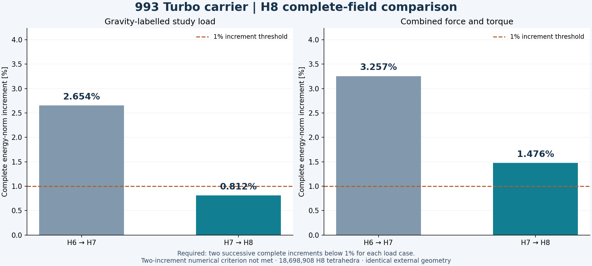
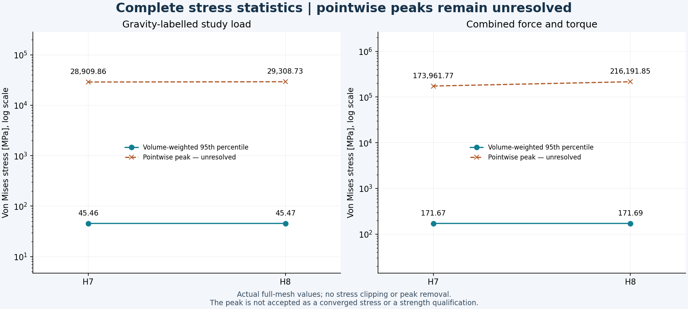
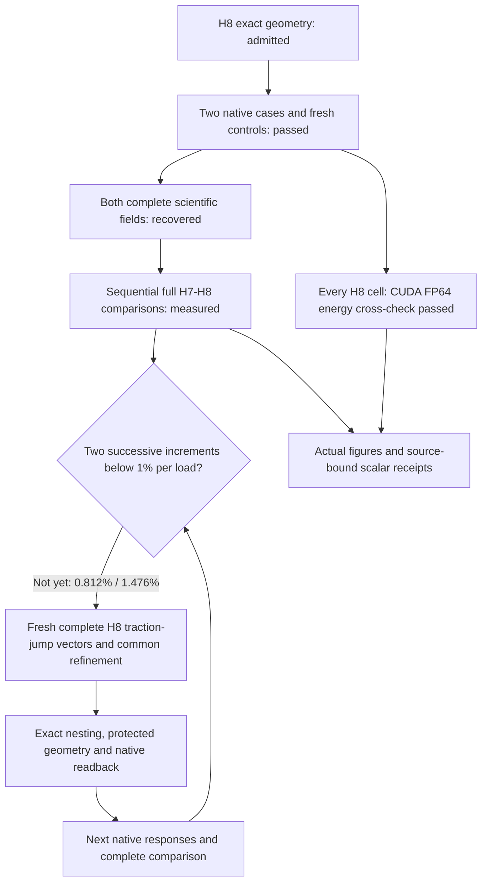

# 993 carrier H8: complete native results and CUDA energy checks

**Both H8 load cases completed, their full fields were recovered, and the
independent H7→H8 comparisons passed their original numerical checks.** The
complete energy-norm increments fell to **0.81168514% for gravity** and
**1.47583589% for combined loading**, from 2.65382807% and 3.25723437% at H6→H7.

Stabilization is **not yet reached**. The requirement remains two successive
complete-field increments below 1% for each load case. Gravity has its first
sub-1% increment; combined loading remains above 1%. Small scalar changes do
not replace this criterion. Both pointwise stress peaks remain unresolved.



The owner removed the weight ceiling. Nominal study mass remains **1.2941382 kg**
as a property of the unchanged geometry, not an active design constraint.
These calculations establish numerical results for the declared study inputs;
they make no strength or manufacturing-release claim.

## Complete measured results

| H8 quantity | Gravity-labelled study load | Combined force and torque |
|---|---:|---:|
| H7→H8 normalized energy increment | 0.81168514% | 1.47583589% |
| Relative Galerkin identity defect | 4.23404672e-8 | 3.78194659e-8 |
| External work, N mm | 1469.86750366 | 19135.56923603 |
| Maximum displacement, mm | 0.81573385 | 2.36193445 |
| Volume-weighted stress p95, MPa | 45.46617366 | 171.69454703 |
| Unresolved pointwise stress peak, MPa | 29308.72741269 | 216191.84771280 |
| Independent local energy residual | 9.14948931e-8 | 3.17472694e-8 |

| Change from H7 | Gravity | Combined |
|---|---:|---:|
| External work | +0.00658453% | +0.02178188% |
| Maximum displacement | +0.00653410% | +0.01992100% |
| Volume-weighted stress p95 | +0.00879620% | +0.01422910% |
| Unresolved pointwise peak | +1.37970138% | +24.27549283% |

The complete comparison uses all **18,670,283 H7 cells** and **18,698,908 H8
cells**. The admitted refinement adds 5,050 interior nodes and splits 28,625
parents. All original vertex bytes and unchanged cells remain identical;
3,983 new points are exact midpoints and 1,067 use other exact rational
fractions. Both assessors bind the same loads and supports. The measured
stress-difference compliance energies are 0.04841984354 N mm and
2.08395111068 N mm; external work increases in both cases.



The p95 values describe the complete volume-weighted distribution; they are
not a replacement allowable for the unresolved peak. The plots retain the
full peak magnitudes on logarithmic axes. The
[source-bound scalar results](carrier-h8-native-results-20261106/results.json)
preserve full precision, individual checks, native/replay differences and hashes.

## Native execution and independent replay

The [admitted H8 geometry](carrier-h8-global-geometry-20261106.md) contains
**4,793,222 nodes**. Both native cases used the same CalculiX/PARDISO ELF:

`93181a8340dac42f2e76fb9159edcdcebc536c5f29cc25dfa4689413e83582ac`

Each lane executed three analytical controls and two complete quadratic
reference controls before its actual case. The full gravity solve took
**594.18 seconds**; combined loading took **414.04 seconds**. Both exited zero,
were reaped and retained unchanged inputs. The subsequent independent
assessment passed the original force, moment and energy limits. The energy
relative limit remains **1e-4**.

Each complete scientific DAT has **2,648,246,780 bytes**. Both are retained as
lossless XZ streams, with encoded and full decompressed SHA-256 verification.
The [strict lossless reader](../architecture/calculix-lossless-replay.md)
replayed every displacement, reaction, stress and energy record locally.
The two local comparisons ran sequentially, each taking about **271.4 seconds**;
no raw DAT duplicate or field-array dump was created by this replay.

All independently recomputed displacement, stress and integrated-energy scalars match their
native values exactly. Summation of external work differs by at most one
binary64 unit in the last place: 2.274e-13 N mm for H8 gravity and 3.638e-12
N mm for H8 combined loading. These differences are retained, not rounded away
in the receipts. The unchanged comparator verifies exact parent-child binding,
fraction points, monotonic work and the complete energy increment.

## Actual CUDA cross-checks

Warp **1.18.0**, in an isolated NumPy 2.2.6 environment, checked the compliance
energy of **every H8 cell** in both cases. Gravity ran on an RTX 4000 Ada;
combined loading ran on an RTX 3090. Independent basis, hydrostatic and zero
controls preceded the full arrays. A distinct CPU algebraic expression checked
every GPU value at **absolute 1e-14 N mm plus relative 1e-12** tolerance.

| Complete energy check | Gravity | Combined |
|---|---:|---:|
| GPU / independent CPU / native energy, N mm | 734.9336845881295 | 9567.784314262764 |
| Maximum per-cell absolute difference, N mm | 5.20417043e-18 | 8.32667268e-17 |
| GPU/native integrated relative difference | 0 | 0 |
| Actual CUDA audit time, seconds | 14.36 | 5.84 |

This verifies the GPU field-energy calculation. It is not a GPU mechanical
solve and does not accept the separate
[refused complete-carrier CUDA distance query](carrier-current-mechanics-20261104.md#complete-pr-274-cuda-accuracy-witness-refused).
The [software coverage ledger](carrier-toolchain-coverage-20261106.md) keeps
those contracts, synthetic controls and unfinished additive integrations separate.

The two authorized case workers ran independently. Both completed scientific
recovery before their owned instances were destroyed; their cleanup receipts
verify provider absence. The public result packet contains the cleanup hashes
and outcomes, with no host addresses or account details. No new paid resource
was created for the local replay or plotting.

## Reproduce the recorded comparison

The original computational checkout retains these entry points and their
hash-bound private inputs:

```sh
OPENBLAS_NUM_THREADS=1 OMP_NUM_THREADS=1 .venv-check/bin/python \
  work/carrier-h8-comparison-002/compare_case.py --case combined
OPENBLAS_NUM_THREADS=1 OMP_NUM_THREADS=1 .venv-check/bin/python \
  work/carrier-h8-comparison-002/compare_case.py --case gravity
.venv-check/bin/python work/carrier-h8-comparison-002/render.py
```

These are the commands actually executed, not instructions to overwrite their
completed directories or relaunch workers. Another execution needs a fresh
output binding with the same source checks. The renderer requires both actual
comparison receipts, validates their hashes and refuses missing results or
existing images. The [figure provenance](carrier-h8-native-results-20261106/figure-provenance.json)
records the exact source results, renderer and byte-identical public images.
Both figures were visually inspected after rendering.

| Source identity | Gravity | Combined |
|---|---|---|
| Complete comparison JSON SHA-256 | `7e65709254ae4a1394fb354f87efb5ff9635839d279e014608ad1fda60962410` | `2277b9c7fbc24fa7d3b0b4751b63b1d3712407d10c366d71ddab323b1545a755` |
| Complete replay receipt SHA-256 | `a93ab4e34e25314c8d6e0bd3d757d74f7f0edc8b2cbccb17a4fe466bb8151586` | `3781dec3106cc06c466a8de509409a32ec74b3bc33736e4af4863a454e033b00` |
| Full decompressed DAT SHA-256 | `7fe64e121b2c8f5075f5a070a393f593234c9ae1f2498ebe112fd0024f7a0af9` | `51f85e947fe897450197bdafe9c439a5a7e61454e0cfaedb502ff3509c50b143` |

The common exact map SHA-256 is
`0340640278157513f92728b2ed8c0a2d119cae7568a2560d2ccc74f0c30c4f25`.
Original private receipts and scripts remain unchanged. The public packet
uses repository-relative or private-evidence-relative identifiers and contains
only scalars, settings and hashes; the complete mesh and field bytes stay private.

## Next numerical step

Compute fresh traction-jump vectors from both complete H8 stress fields to
drive the next common refinement. Correction-energy localization is a separate
diagnostic; it does not replace these marking vectors. Retain the same geometry,
protected-cell and conditioning contracts. Admit the exact map and native
readback before solving. Gravity needs another sub-1% increment; combined
loading needs two successive sub-1% increments from its current above-threshold
state. No pointwise strength conclusion follows from this global criterion.


