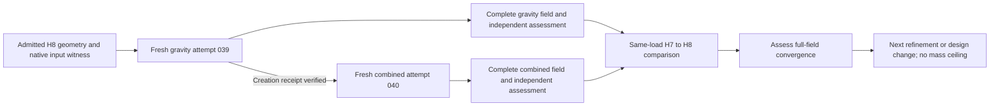

# Carrier H8 resumption after access recovery

The owner withdrew the 1.30 kg mass ceiling on 6 November 2026. Subsequent
design changes may add material when justified by mechanical or manufacturing
results. The present H8 mesh retains the existing exterior and nominal mass
of 1.2941382 kg so that its response can be compared with H7 on the same part.
This mass is a property of this study, no longer an acceptance limit.

The [software coverage ledger](carrier-toolchain-coverage-20261106.md) accounts
for 54 capabilities from the current GitHub documentation, including executed
carrier work, synthetic controls, refused trials and optional routes.

The [current free-tools manifest](../../benchmarks/free-tools/baseline-20261106.json)
now binds this catalogue amendment. Its four other input hashes and all
admission conditions are unchanged; the original manifest and recorded runs
remain intact. The current admission replay still returns `blocked_engineering`
with optimization disabled. This is a provenance update, not a new optimization.

The [admitted H8 geometry](carrier-h8-global-geometry-20261106.md) contains
4,793,222 nodes and 18,698,908 tetrahedra. Its native mechanical fields remain
pending at this preparation checkpoint. Geometry admission does not establish
mechanical convergence.

## Recovery and new attempts

The owner reported deleting the interrupted Vast instance 59336345. The
restored approved wrapper subsequently passed its configuration and
authentication checks and returned an empty provider inventory. Both old
leases were reconciled absent. The remaining old combined-case guard was
terminated only after its process identity and the empty inventory were checked.

Fresh local attempts use lane 039 for gravity and lane 040 for combined loading.
Each has an exclusive receiver, a new lease and an independent deadline guard.
The parent starts the second controller only after the first creation operation
has completed successfully. The subsequent transfer and computation may overlap.

Both new instances reached authenticated SSH and began the public bidirectional
transfer test. Gravity instance 59470533 required one explicit start of the
same owned instance after the provider had loaded its image but left it stopped;
the original deadline and lease were retained. Combined instance 59471489
started without that intervention. This is infrastructure progress, not a
completed H8 calculation.

| Case | Instance | Advertised RAM | Advertised compute/storage rate |
|---|---:|---:|---:|
| Gravity | 59470533 | 192,114 MB | USD 0.33963/h |
| Combined | 59471489 | 128,457 MB | USD 0.50204/h |

Both hosts then passed the actual cgroup, CPU, disk and public transfer checks.
Their memory limits are 193,387,823,104 and 129,307,246,592 bytes respectively;
each exposes 32 affinity CPUs with a 30.71999-core quota. The 128 MiB probes
passed complete SHA-256 verification in both directions. Gravity upload/download
took 270.90/55.96 seconds; combined upload/download took 141.51/130.98 seconds.
Network charges are separate and included in each planned cost reserve.

The unchanged Warp 1.18.0/NumPy 2.2.6 overlay was installed separately on each
host using pinned wheel hashes. Setup passed in 12.28 and 17.33 seconds. The
complete CUDA energy audit must wait for the original independent assessor to
finish and close its fields; successful installation is not that audit.

All 27 prepared file identities per lane were checked. Numerical worker sources
are byte-identical to the corresponding prior H8 attempts. The actual deployment
generators passed four local controls: correct load-case/payload dispatch and
rejection below the memory floor for each case. These are preparation controls,
not new solver results.

The planned limits remain 108 GiB of actual RAM, at least eight CPU cores,
30 GiB of remote free disk, a two-hour lease and USD 3.20 per attempt. Complete
DAT data must be recovered losslessly with raw SHA-256 verification; the local
storage reserve remains 8 GiB. Each actual host must pass admission before
private input transfer or solver dispatch.

## Comparison criterion

The new comparison adapter binds the qualified fraction-aware map and complete
H7 fields to the new H8 receivers. Both missing-input checks refuse execution
before creating private outputs. Full replay awaits the actual H8 fields.

The existing criterion remains two successive complete energy-norm increments
below one percent. Report each load case and its Galerkin defect; scalar
quantiles alone do not establish stabilization. Unresolved stress peaks remain
explicit. This checkpoint claims neither an H8 response nor convergence.

## Software sequence after H8

The removed mass ceiling permits thicker ligaments, larger cavity radii and
more retained solid material when the results justify them. Future variants
must report their mass and mechanical response, without applying the former
1.30 kg limit. Historical contracts and evidence retain their original limits;
the unchanged H8 reference remains the basis for the refinement comparison.

1. **Use geometry3Sharp and PicoGK for explicit geometry changes, with independent
   CGAL/libigl inspection.** Once the mechanical fields identify useful changes,
   reuse the [source-distance rounding route](carrier-interface-20261028/SOURCE-DISTANCE-ROUNDING.md)
   for controlled cavity and transition edits. Its prior carrier-void trial
   passed complete embedding and containment checks. The subsequent
   [two-triangle repair](carrier-interface-20261028/BOUNDED-EDGE-REPAIR.md)
   checked all 7,781,064 facets and bounded the surface change by 0.002714 mm.
   These are reusable geometry methods, not mechanical evidence for a new
   variant; inspect its interfaces, complete surface and volume mesh again.

2. **Connect OpenMDAO to the accepted native mechanical replay.** After the
   deterministic response stabilizes, compare named variants using actual mass,
   compliance, displacement and resolved stress measures under matched loads.
   The [existing integration](../architecture/free-tools/README.md) has executed
   analytical beam optimization and carrier admission replay; carrier
   optimization remains unexecuted. The [November software review](carrier-software-review-20261104.md)
   explicitly requires real solver outputs before design search.

3. **Develop a bounded GO-MELT process case and checked temperature transfer to
   CalculiX.** The intended sequence is heat accumulation followed by
   thermomechanical response. The [new boundary and material unit controls](carrier-go-melt-units-20261106.md)
   verify the actual convection/radiation conversions and explicit density,
   capacity and conductivity handoff on synthetic domains. The carrier still
   needs explicit thermal material/process inputs, material activation, a moving
   laser and mesh/time refinement remain necessary. Neither a complete carrier
   thermal simulation nor its thermomechanical transfer has been executed;
   the [isolated runtime runbook](../architecture/usd-brep-lpbf.md) records the
   current control scope.
