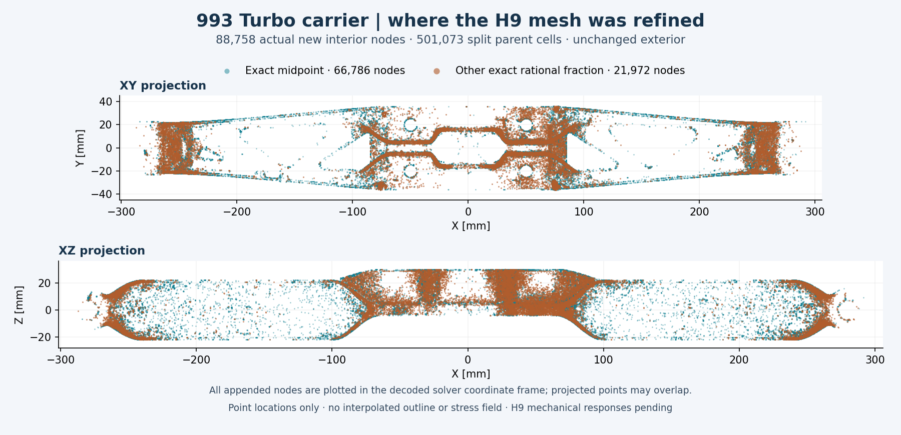
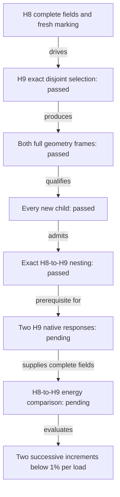

# 993 carrier H9: exact refinement and complete geometry checks

**Follow-up:** the [H9 native results and complete H8→H9 comparisons](carrier-h9-native-results-20261107.md)
are now available. The pending states below describe the earlier geometry checkpoint.

**H9 now has an admitted mesh of 19,199,981 tetrahedra and an exact H8-to-H9
nesting map.** The refinement adds **88,758 interior nodes** while preserving
the existing exterior, original coordinates, load and support nodes. Both
coordinate frames passed the complete geometry checks. **H9 mechanical
responses and the H8→H9 energy increment remain pending.**

The figure shows every appended node in two orthographic projections of the
decoded solver coordinates. Teal marks exact midpoints; orange marks other exact
rational subdivisions. Point order and fractions were checked against the
complete nesting map. There is no sampled subset, interpolated outline or stress
field; projected points can overlap. The exterior has not been redesigned.

## What changed

| Quantity | H8 | H9 |
|---|---:|---:|
| Nodes | 4,793,222 | 4,881,980 |
| Tetrahedra | 18,698,908 | 19,199,981 |
| Newly added interior nodes | — | 88,758 |
| Split source cells | — | 501,073 |
| New child cells | — | 1,002,146 |
| Retained protected cells | 135 | 135, unchanged |
| New cells at or above the condition threshold | — | **0** |

Of the new nodes, **66,786 are exact midpoints** and **21,972 use other exact
rational fractions**, with denominators no greater than 17. No mass ceiling is
applied; the interior refinement preserves the nominal study mass.

Selection used fresh traction-jump indicators from both complete H8 stress
fields. The accepted disjoint parent cells cover **50.43029672%** of the gravity
indicator, **50.00001904%** of the combined indicator and **50.17472078%** of the
joint indicator. Each retained the unchanged target of at least 50%. These
percentages describe refinement selection, not mechanical convergence or an
estimated probability of manufacturing success.

## Complete checks that passed

Every H9 cell passed exact positive-orientation and indexed-boundary checks in
both the original and serialized coordinate frames. Each full mesh has one
connected cell component and no unused vertices. Independent decoding of the
complete solver input reproduced its coordinates and ordered connectivity.

All **1,002,146 new children** were classified in both frames. The maximum new
normalized condition is **999,988.7593**, below the unchanged strict threshold
of 1e6. The **135 pre-existing protected extreme cells remain present and
unsplit**; zero new extreme cells does not mean zero extreme cells overall.
The conservative scalar-pattern bound is **1,582,577,928**, below 2³¹.

The fraction map checks every new point against its exact parent-edge fraction,
every split parent against its actual child connectivity, and every unchanged
cell for bitwise identity. Original vertex bytes remain unchanged. It also binds
both independently admitted H8 native load cases. A separate readback verified
every packed map array against the accepted proposal and fraction archive.

Assembly completed in **114.73 seconds**, followed by **10.08 seconds** for
new-child classification. Map construction and checks completed in **8.06
seconds**. The bounded controllers reaped their children and verified complete
absence of their owned process groups. These are completed local geometry
operations; no H9 solver result is inferred from them.

## Evidence and next calculation

The [scalar and source-hash record](carrier-h9-global-geometry-20261107/results.json)
preserves full precision and identifies the unchanged private evidence. The
[figure provenance](carrier-h9-global-geometry-20261107/figure-provenance.json)
binds the full decoded coordinate arrays, exact fraction ordering and rendered
image. The [bounded plotting run](carrier-h9-global-geometry-20261107/bounded-run.json)
and [visual inspection](carrier-h9-global-geometry-20261107/visual-inspection.json)
are recorded separately.
Only the image, scalar results and hashes are public; raw meshes and field
arrays remain in private evidence.

Next, execute the gravity and combined native cases with the existing analytical
and reference controls, retain their complete scientific fields losslessly,
then compare H8 and H9 using this exact map. The numerical stabilization
criterion remains **two successive complete energy-norm increments below 1%
for each load case**. The [last measured H8 results](carrier-h8-native-results-20261106.md)
remain the latest mechanical evidence until those H9 fields are available.
