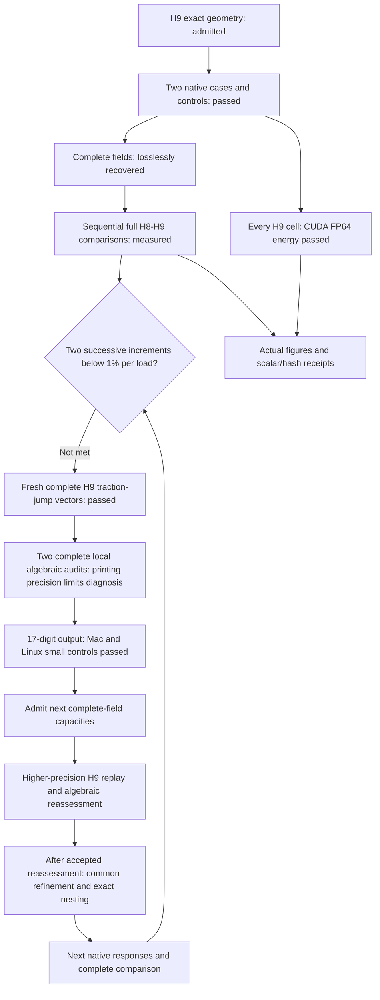

# 993 carrier H9: complete comparisons and CUDA energy checks

**Both H9 load cases completed, their complete fields were recovered, and the
independent H8→H9 comparisons passed their original numerical checks.** The
complete energy-norm increments are **2.67262758% for gravity** and
**3.32555327% for combined loading**. The requirement of two successive
complete increments below 1% for each load is **not met**.

The newest comparison covers all 18,698,908 H8 cells and 19,199,981 H9 cells.
The admitted H9 refinement adds 88,758 interior vertices and splits 501,073
parents, while retaining the exterior, original vertex coordinates and load/support
bindings. All 135 protected extreme cells remain unsplit; no new extreme cell
was admitted. No weight ceiling applies.

## Complete measured results

| Quantity | Gravity-labelled study load | Combined force and torque |
|---|---:|---:|
| Previous H7→H8 energy-norm increment | 0.81168514% | 1.47583589% |
| Actual H8→H9 energy-norm increment | 2.67262758% | 3.32555327% |
| Relative Galerkin identity defect | 4.653261221e-08 | 3.163981261e-08 |
| External work, N mm | 1470.91823991 | 19156.75588187 |
| Maximum displacement, mm | 0.81630375 | 2.36434856 |
| Volume-weighted stress p95, MPa | 45.49482574 | 171.82159907 |
| Unresolved pointwise stress peak, MPa | 38389.58283354 | 215084.41879507 |
| Independent fine-field energy residual | 4.440911533e-08 | 7.414890454e-11 |

| Change from H8 | Gravity | Combined |
|---|---:|---:|
| External work | +0.07148510% | +0.11071866% |
| Maximum displacement | +0.06986281% | +0.10220863% |
| Volume-weighted stress p95 | +0.06301847% | +0.07399888% |
| Unresolved pointwise peak | +30.98345177% | -0.51224361% |

The larger refinement reveals a larger complete-field correction than H7→H8.
Small changes in work or displacement do not replace the energy-norm criterion.
All four shared H8 scalars agree exactly between the old and new comparison
receipts. Full-precision results, native/replay differences, source hashes and
Galerkin defects remain in the [scalar receipt](carrier-h9-native-results-20261107/results.json).

The logarithmic plots retain the complete peak magnitudes. Neither the p95 nor
a small peak change establishes a converged peak or a strength qualification.

## Native execution, lossless recovery and CUDA

Each native lane ran three analytic controls and two complete reference
executions before its H9 case. Gravity finished in 612.620 s and combined loading
in 709.864 s; both exited zero, were reaped and retained unchanged inputs.
Peak solver RSS was 51.837 GiB and 51.762 GiB respectively.
The original force, moment and 1e-4 relative-energy limits passed.

Each complete DAT contains 2,717,088,298 bytes. Lossless XZ recovery retained
836,017,504 bytes for gravity and 838,583,440 for combined loading, with strict
end-of-stream and full raw SHA-256 verification. Each local replay independently
read all 4,881,980 displacement records, 14,064 reactions and 19,199,981 stress and
energy records. The two comparisons ran serially; no raw DAT duplicate or raw
field dump was added to the public repository.

Warp 1.18.0 and NumPy 2.2.6 independently cross-checked every H9 cell in CUDA
FP64. The unchanged kernel, independent CPU expression and basis/hydrostatic/zero
controls retain absolute 1e-14 N mm plus relative 1e-12 per-cell tolerance.

| CUDA energy witness | Gravity | Combined |
|---|---:|---:|
| Device | NVIDIA RTX 4000 Ada Generation | NVIDIA GeForce RTX 5070 |
| Actual audit time, seconds | 14.742 | 8.476 |
| GPU integrated energy, N mm | 735.4590872961512 | 9578.3779402240489 |
| Maximum cell absolute discrepancy, N mm | 3.469446952e-18 | 1.110223025e-16 |
| GPU/native integrated relative discrepancy | 1.545794181e-16 | 0.000000000e+00 |

This CUDA witness checks field energy. Mechanical solution, geometry-distance
queries and additive-process studies remain separate entries in the
[software coverage ledger](carrier-toolchain-coverage-20261106.md).
Both exact owned instances were destroyed after their field and GPU receipts
were recovered; a fresh provider inventory was empty. The pre-creation 041 mutex
refusal remains preserved. Fresh 043 creation waited for 042 startup to finish.
Planned pair cost including cleanup reserves was USD 3.6717 within the USD 6.40
ceiling; actual provider billing was not observed.

## Peak geometry and refinement decision

**Follow-up peak audit:** both complete H9 traction-jump vectors and their joint
vector have now passed every-value readback. Targeted geometry checks find that
the gravity peak occupies a new exact 3/16 child, while the combined peak is in
an unchanged H8 cell. Both have exact positive volume and remain below the
existing condition threshold, but their very thin shapes leave pointwise
accuracy unresolved.

| Peak-cell diagnostic | Gravity | Combined |
|---|---:|---:|
| Exact positive volume, mm³, displayed | 1.017008031572e-9 | 1.976828597044e-10 |
| Normalized condition | 732,729.197 | 201,065.146 |
| Direct exterior faces | 0 | 1 |
| Centroid distance to retained boundary, mm | 4.194380101122e-7 | 2.104338205932e-7 |

The original acceptances check net force/moment and integrated energies.
The additional complete free-node force assembly and displacement-to-stress
audit below has now finished for both loads. **H10 selection remains held for
a higher-precision H9 output check**: seven-digit displacement output limits
the new algebraic diagnosis. No peak cause or singularity exponent is inferred.
The [targeted audit receipt](carrier-h9-native-results-20261107/peak-audit.json)
records the existing acceptance scope, lineage and source hashes. The boundary
extension identity was recorded after that diagnostic, not pinned before launch.

## Complete local algebraic audit and output precision

Two independent assemblies now cover every H9 tetrahedron: internal forces from
stress reconstructed from printed displacement, and internal forces from native
printed stress. Each case checked **149,087,999 numeric tokens** and matched all
complete field hashes to the previously admitted H9 result.

| Case / force assembly | Residual / load L2 | Input-print budget / load L2 | Components above their local print budget |
|---|---:|---:|---:|
| Gravity / reconstructed stress | 2285.046 | 103629.163 | 0 |
| Gravity / native printed stress | 4.18996164e-5 | 0.00221767493 | 2,023 |
| Combined / reconstructed stress | 1014.11497 | 20475.8557 | 0 |
| Combined / native printed stress | 1.92426494e-5 | 0.000917518073 | 519 |

Seven-significant-digit displacements are too coarse to reconstruct an accurate
residual on the thin cells. The printed-stress assembly is much better balanced
globally, but its local budget exceedances remain unresolved observations.
These budgets include input printing only; geometry inversion, floating
arithmetic and accumulation do not have certified error enclosures here.
Consequently neither assembly certifies the true unprinted native residual.
No new solver acceptance threshold was introduced.

All 135 protected cells and both native peak cells were retained, with exact
geometry kernels for those 137 cells. Their reconstructed stress discrepancies
all lie within their input-print budgets. Both loads' largest residual nodes
are zero-based nodes 646,668 and 646,669, belonging to protected cell 8,696,088.
A bounded lookup of 144 known cells places them outside the two native
stress-peak cells and their known face neighbors; it is not a complete incidence
search or a cause determination.

The **2.67262758% / 3.32555327% H8→H9 increments remain unchanged**: that
comparison uses native printed stresses directly. A discrepancy reconstructed
from rounded displacement is neither a refinement increment nor a native peak.
The two audits ran serially in 243.606 s and 245.613 s, with approximately 3 GB
peak RSS, under the unchanged 2,700-second, 16-GiB RAM, 2-GiB aggregate output
and 8-GiB free-space limits. Both returned zero and all owned processes were reaped.

### Seventeen-digit output: Mac and Linux controls passed

A separate Mac CalculiX candidate changes exactly **four output WRITE sites**.
Its **1,145 other archive objects remain byte-identical**; only the two printing
objects and generated archive index change. The formatter passed **16,378
binary64 roundtrips**, including signed zero, subnormal boundaries and finite
extremes. The existing quadratic, traction-P1 and traction-P2 controls passed.

An additional native witness exercises **U, RF, S and ENER** at 17 significant
digits. Its independent integrated-energy relative error is **3.9789e-15**,
within the unchanged original control limit. The separate Linux/PARDISO
small-control qualification below now passes; complete higher-precision H9
execution remains pending. Wider output requires
fresh capacity admission: the expected complete raw DAT is **4,506,144,286 bytes
per case**, above the old 2.75 GB gate.

The [portable four-site source patch](../../parts/993-eng-carrier-0001/source/calculix-print17-20261107/README.md)
includes fail-fast input/output checksums and an actual standard-`patch`
application receipt. Applying it to pristine CalculiX 2.21 sources reproduces
both qualified Mac source files byte for byte, without offsets or fuzz. The
[Ubuntu source package record](https://archive.ubuntu.com/ubuntu/pool/universe/c/calculix-ccx/calculix-ccx_2.21-1.dsc)
lists the matching 1,794,485-byte
[upstream archive](https://archive.ubuntu.com/ubuntu/pool/universe/c/calculix-ccx/calculix-ccx_2.21.orig.tar.bz2)
and SHA-256 recorded in the patch manifest. The patch is not a complete compiler,
solver or runtime qualification.
Its displacement/reaction edits cover the first global branches
(`ntrans == 0` or explicitly requested global output); the stress edit covers
`iorien == 0`. Other branches retain their original format.

The first Linux continuation passed the actual 16,378-value formatter test and
compiled the corrected SPOOLES libraries, then reached its 900-second build
deadline during the unchanged 500-repeat threaded control. That attempt supplies
no completed Linux candidate or partial control count. The compiled libraries and
refusal are retained in the [independent refusal readback](carrier-h9-native-results-20261107/linux-build-refusal.json)
and were reused by the following bounded continuation.

The Linux continuation now passes all **500 unchanged eight-thread repetitions**,
with zero failures and a worst absolute error of **9.5166e-9**, below the original
1e-4 limit. Its fresh PARDISO baseline compiled successfully. A post-build command
extraction error was then corrected without rebuilding the baseline or repeating
the 500 tests: the parser accepts the exact linker argument list and rejects
14 altered-command/operator cases. The earlier refusals remain retained.

Only the two print objects differ between this baseline and its 17-digit
candidate. **1,145 other archive objects and the separate main object are
byte-identical**; all 1,385 symbol/member/type mappings match. Both modified
Fortran sources exactly match the qualified Mac sources and public patch.
This comparison does not claim identity with the historical Linux executable.

| Independent Linux check | Actual result |
|---|---|
| Existing quadratic, P1 traction and P2 traction assessors | All six baseline/candidate assessments passed |
| Binary64 formatter fixture | All 16,378 tested bit patterns round-tripped |
| U / RF / S / ENER native witness | 8 / 8 / 6 / 6 rows in the required format |
| Independently integrated ENER | Relative error 3.9254e-15; unchanged limit 1e-4 |
| Build and qualification provenance | All 5,448 and 7,474 input pins unchanged |
| Cleanup | Exact owned container and host process group absent |

The [Linux qualification receipt](carrier-h9-native-results-20261107/linux-qualification.json)
binds these results to the **6,669,520-byte** candidate,
SHA-256 `4c9db4806c2034d2b2f52b4baac3188c3f57cc66381566f9077d686f4f03db18`.
Finalization took 45.962 s and independent qualification 2.666 s. The existing APFS
receiver validator has also passed [actual identity, ownership and write/readback
checks](carrier-h9-native-results-20261107/external-storage-probe.json) on a fresh private directory on the mounted external SSD; packet and
audit allocations have separate admissions.

The new ordinary **packet 018** is now built and independently read back:
**92 archive members, 1,838,906,442 expanded bytes and 121 copied source/payload
paths**. Its 771,666,814-byte archive preserves the H9 geometry, loads, supports,
material and reference controls while binding the qualified 17-digit binary.
The pinned Linux/amd64 image unpacked that actual archive and executed the
quadratic control successfully. Independent host readback checked all 303
numeric components, the original analytic tolerances, all runtime/input hashes
and exact container cleanup. The image pass took **115.87 seconds**, including
unpacking and verification; the native control itself took **0.369 seconds**.

The first image attempt was refused before solving because Docker Desktop
could not bind the external volume. A verified ordinary copy of the same
archive to local storage resolved that environment issue; the external
scientific receiver and all resource limits remain unchanged. The
[packet and image receipt](carrier-h9-native-results-20261107/packet018-image.json)
records both attempts and their cleanup. Complete native 17-digit H9 fields
and the independent algebraic reassessment remain pending. The initial cloud
plan was held because its 10 GB ingress and 6 GB egress budgets exceeded the
existing profile's 2 GB input and 2 GB output declarations.

That mismatch is now resolved by a separately checked, smaller transfer plan.
It retains the existing **1.2 GB image, 2 GB input and 2 GB output declarations**,
priced consistently by the selector, approved wrapper and deadline guard.
The actual compressed image and metadata total 1,099,308,844 bytes. Two pinned
GPU wheels total 165,632,756 bytes and install offline. Scientific recovery gets
one XZ preset-6 encoding attempt and a **1.6 GB download ceiling**, with explicit
space for the probe, metadata and bounded diagnostics. A larger encoded result
is retained remotely and refused before download; full-case compression fit
has not yet been demonstrated.

Each file gets one whole-file transfer to a fresh target. Rsync's internal
checksum retry is disabled, while the independent complete SHA-256 check stays
mandatory; scientific decoding additionally verifies every raw byte and strict
EOF. The [upstream rsync manual](https://download.samba.org/pub/rsync/rsync.1#opt--checksum-choice)
describes the selected option. Actual transfer and corrupted-file controls pass.
These are application-byte allowances with a protocol margin, not measured
provider wire usage. The original **$3.20 / 7,200-second per-case bounds** remain.

At the **06:02 UTC checkpoint**, the gravity instance is active: the 128 MiB
probe passed in both directions and the isolated offline GPU installation
succeeded. The full native field is still pending. Combined loading remains
held until complete gravity recovery and verified predecessor deletion. The
[transfer-admission receipt](carrier-h9-native-results-20261107/transfer-admission.json)
records actual prerequisite results, all source/control hashes and the limits.

The [compact algebraic receipt](carrier-h9-native-results-20261107/algebraic-audit.json)
binds both full audits, independent readbacks, neighborhood lookup, local
formatting controls and actual figure to their source hashes.

## Reproduction and next numerical step

The recorded local entry points are `work/carrier-h9-comparison-001/run_compare.py`
and `work/carrier-h9-render-002/render.py`. Completed outputs are exclusive: reproduce in fresh output
bindings rather than overwrite these receipts. The renderer requires both
complete comparisons and checks exact shared H8 scalars; its
[figure provenance](carrier-h9-native-results-20261107/figure-provenance.json)
binds both images to the actual results and script.

The completed marking pass qualified the **1,228,798,784-byte face buffer**
required by H9, exceeding the historical 1.2 GB bound, and used both complete
traction-jump fields. It does not close the higher-precision algebraic check
required before H10. Correction-energy localization remains a separate diagnostic.
Before any next rental, freshly admit
complete DAT/XZ and receiver capacity: seven-digit H9 left only 32,911,702 raw
bytes below its 2.75 GB gate. These are capacity admissions; numerical thresholds,
protected cells and exact-nesting checks remain unchanged.

