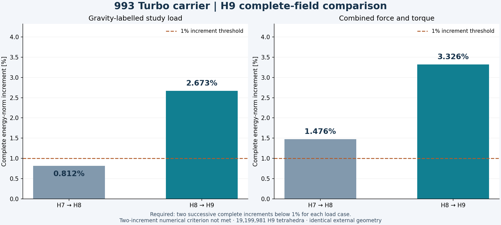
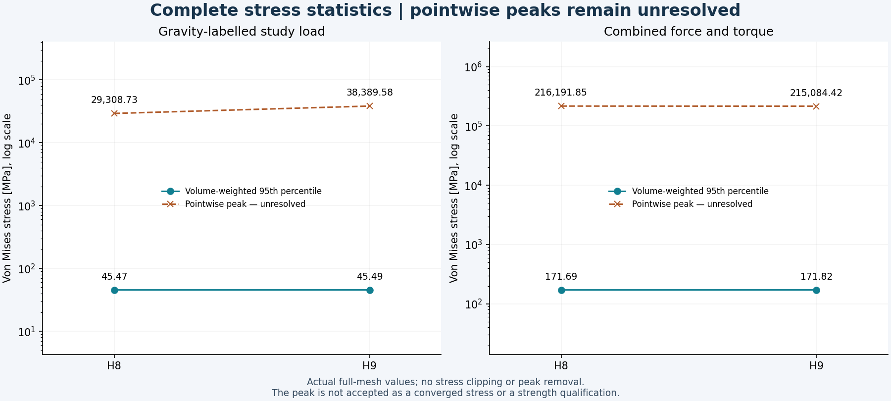
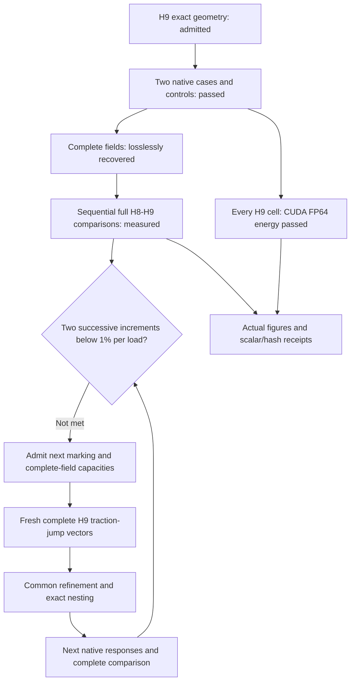

# 993 carrier H9: complete comparisons and CUDA energy checks

**Both H9 load cases completed, their complete fields were recovered, and the
independent H8→H9 comparisons passed their original numerical checks.** The
complete energy-norm increments are **2.67262758% for gravity** and
**3.32555327% for combined loading**. The requirement of two successive
complete increments below 1% for each load is **not met**.

The newest comparison covers all 18,698,908 H8 cells and 19,199,981 H9 cells.
The admitted H9 refinement adds 88,758 interior vertices and splits 501,073
parents, while retaining the exterior, original vertex coordinates and load/support
bindings. All 135 protected extreme cells remain unsplit; no new extreme cell
was admitted. No weight ceiling applies.

## Complete measured results

| Quantity | Gravity-labelled study load | Combined force and torque |
|---|---:|---:|
| Previous H7→H8 energy-norm increment | 0.81168514% | 1.47583589% |
| Actual H8→H9 energy-norm increment | 2.67262758% | 3.32555327% |
| Relative Galerkin identity defect | 4.653261221e-08 | 3.163981261e-08 |
| External work, N mm | 1470.91823991 | 19156.75588187 |
| Maximum displacement, mm | 0.81630375 | 2.36434856 |
| Volume-weighted stress p95, MPa | 45.49482574 | 171.82159907 |
| Unresolved pointwise stress peak, MPa | 38389.58283354 | 215084.41879507 |
| Independent fine-field energy residual | 4.440911533e-08 | 7.414890454e-11 |

| Change from H8 | Gravity | Combined |
|---|---:|---:|
| External work | +0.07148510% | +0.11071866% |
| Maximum displacement | +0.06986281% | +0.10220863% |
| Volume-weighted stress p95 | +0.06301847% | +0.07399888% |
| Unresolved pointwise peak | +30.98345177% | -0.51224361% |

The larger refinement reveals a larger complete-field correction than H7→H8.
Small changes in work or displacement do not replace the energy-norm criterion.
All four shared H8 scalars agree exactly between the old and new comparison
receipts. Full-precision results, native/replay differences, source hashes and
Galerkin defects remain in the [scalar receipt](carrier-h9-native-results-20261107/results.json).

The logarithmic plots retain the complete peak magnitudes. Neither the p95 nor
a small peak change establishes a converged peak or a strength qualification.

## Native execution, lossless recovery and CUDA

Each native lane ran three analytic controls and two complete reference
executions before its H9 case. Gravity finished in 612.620 s and combined loading
in 709.864 s; both exited zero, were reaped and retained unchanged inputs.
Peak solver RSS was 51.837 GiB and 51.762 GiB respectively.
The original force, moment and 1e-4 relative-energy limits passed.

Each complete DAT contains 2,717,088,298 bytes. Lossless XZ recovery retained
836,017,504 bytes for gravity and 838,583,440 for combined loading, with strict
end-of-stream and full raw SHA-256 verification. Each local replay independently
read all 4,881,980 displacement records, 14,064 reactions and 19,199,981 stress and
energy records. The two comparisons ran serially; no raw DAT duplicate or raw
field dump was added to the public repository.

Warp 1.18.0 and NumPy 2.2.6 independently cross-checked every H9 cell in CUDA
FP64. The unchanged kernel, independent CPU expression and basis/hydrostatic/zero
controls retain absolute 1e-14 N mm plus relative 1e-12 per-cell tolerance.

| CUDA energy witness | Gravity | Combined |
|---|---:|---:|
| Device | NVIDIA RTX 4000 Ada Generation | NVIDIA GeForce RTX 5070 |
| Actual audit time, seconds | 14.742 | 8.476 |
| GPU integrated energy, N mm | 735.4590872961512 | 9578.3779402240489 |
| Maximum cell absolute discrepancy, N mm | 3.469446952e-18 | 1.110223025e-16 |
| GPU/native integrated relative discrepancy | 1.545794181e-16 | 0.000000000e+00 |

This CUDA witness checks field energy. Mechanical solution, geometry-distance
queries and additive-process studies remain separate entries in the
[software coverage ledger](carrier-toolchain-coverage-20261106.md).
Both exact owned instances were destroyed after their field and GPU receipts
were recovered; a fresh provider inventory was empty. The pre-creation 041 mutex
refusal remains preserved. Fresh 043 creation waited for 042 startup to finish.
Planned pair cost including cleanup reserves was USD 3.6717 within the USD 6.40
ceiling; actual provider billing was not observed.

## Reproduction and next numerical step

The recorded local entry points are `work/carrier-h9-comparison-001/run_compare.py`
and `work/carrier-h9-render-002/render.py`. Completed outputs are exclusive: reproduce in fresh output
bindings rather than overwrite these receipts. The renderer requires both
complete comparisons and checks exact shared H8 scalars; its
[figure provenance](carrier-h9-native-results-20261107/figure-provenance.json)
binds both images to the actual results and script.

Use fresh complete H9 traction-jump vectors from both loads for the next common
refinement. Correction-energy localization remains a separate diagnostic.
Before H10 marking, qualify the 1,228,798,784-byte face buffer required by H9,
which exceeds the historical 1.2 GB bound. Before any next rental, freshly admit
complete DAT/XZ and receiver capacity: H9 leaves only 32,911,702 raw bytes below
the unchanged 2.75 GB gate. These are capacity admissions; numerical thresholds,
protected cells and exact-nesting checks remain unchanged.

