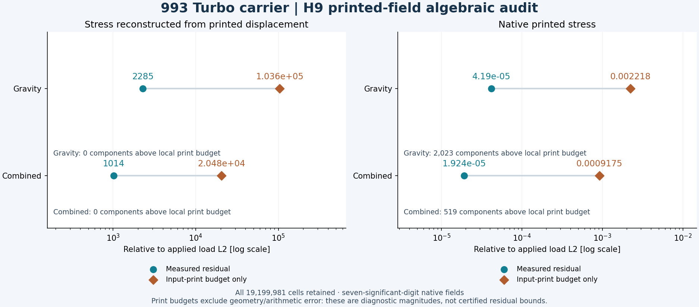
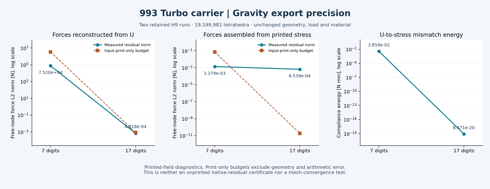
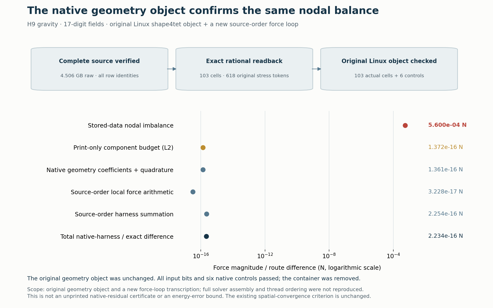
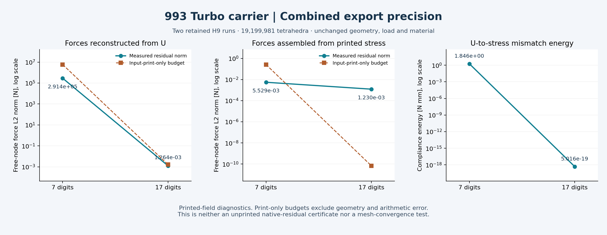
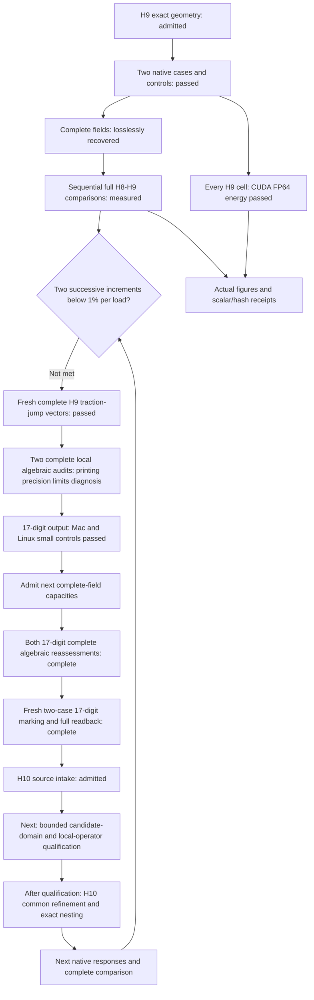

# 993 carrier H9: complete comparisons and CUDA energy checks

**Both H9 load cases completed, their complete fields were recovered, and the
independent H8→H9 comparisons passed their original numerical checks.** The
complete energy-norm increments are **2.67262758% for gravity** and
**3.32555327% for combined loading**. The requirement of two successive
complete increments below 1% for each load is **not met**.

Those spatial comparisons use the retained **seven-digit native exports**.
Both subsequent **17-digit H9 calculations, complete field recoveries, CUDA
checks and local algebraic reassessments are now complete**. Their precision
comparisons below do not replace the recorded H8→H9 increments.

The recorded spatial comparison covers all 18,698,908 H8 cells and 19,199,981 H9 cells.
The admitted H9 refinement adds 88,758 interior vertices and splits 501,073
parents, while retaining the exterior, original vertex coordinates and load/support
bindings. All 135 protected extreme cells remain unsplit; no new extreme cell
was admitted. No weight ceiling applies.

## Complete seven-digit spatial-comparison results

| Quantity | Gravity-labelled study load | Combined force and torque |
|---|---:|---:|
| Previous H7→H8 energy-norm increment | 0.81168514% | 1.47583589% |
| Actual H8→H9 energy-norm increment | 2.67262758% | 3.32555327% |
| Relative Galerkin identity defect | 4.653261221e-08 | 3.163981261e-08 |
| External work, N mm | 1470.91823991 | 19156.75588187 |
| Maximum displacement, mm | 0.81630375 | 2.36434856 |
| Volume-weighted stress p95, MPa | 45.49482574 | 171.82159907 |
| Unresolved pointwise stress peak, MPa | 38389.58283354 | 215084.41879507 |
| Independent fine-field energy residual | 4.440911533e-08 | 7.414890454e-11 |

| Change from H8 | Gravity | Combined |
|---|---:|---:|
| External work | +0.07148510% | +0.11071866% |
| Maximum displacement | +0.06986281% | +0.10220863% |
| Volume-weighted stress p95 | +0.06301847% | +0.07399888% |
| Unresolved pointwise peak | +30.98345177% | -0.51224361% |

The larger refinement reveals a larger complete-field correction than H7→H8.
Small changes in work or displacement do not replace the energy-norm criterion.
All four shared H8 scalars agree exactly between the old and new comparison
receipts. Complete comparison scalars, native/replay differences, source hashes and
Galerkin defects remain in the [scalar receipt](carrier-h9-native-results-20261107/results.json).

The logarithmic plots retain the complete peak magnitudes. Neither the p95 nor
a small peak change establishes a converged peak or a strength qualification.

## Native execution, lossless recovery and CUDA

Each native lane ran three analytic controls and two complete reference
executions before its H9 case. Gravity finished in 612.620 s and combined loading
in 709.864 s; both exited zero, were reaped and retained unchanged inputs.
Peak solver RSS was 51.837 GiB and 51.762 GiB respectively.
The original force, moment and 1e-4 relative-energy limits passed.

Each complete DAT contains 2,717,088,298 bytes. Lossless XZ recovery retained
836,017,504 bytes for gravity and 838,583,440 for combined loading, with strict
end-of-stream and full raw SHA-256 verification. Each local replay independently
read all 4,881,980 displacement records, 14,064 reactions and 19,199,981 stress and
energy records. The two comparisons ran serially; no raw DAT duplicate or raw
field dump was added to the public repository.

Warp 1.18.0 and NumPy 2.2.6 independently cross-checked every H9 cell in CUDA
FP64. The unchanged kernel, independent CPU expression and basis/hydrostatic/zero
controls retain absolute 1e-14 N mm plus relative 1e-12 per-cell tolerance.

| CUDA energy witness | Gravity | Combined |
|---|---:|---:|
| Device | NVIDIA RTX 4000 Ada Generation | NVIDIA GeForce RTX 5070 |
| Actual audit time, seconds | 14.742 | 8.476 |
| GPU integrated energy, N mm | 735.4590872961512 | 9578.3779402240489 |
| Maximum cell absolute discrepancy, N mm | 3.469446952e-18 | 1.110223025e-16 |
| GPU/native integrated relative discrepancy | 1.545794181e-16 | 0.000000000e+00 |

This CUDA witness checks field energy. Mechanical solution, geometry-distance
queries and additive-process studies remain separate entries in the
[software coverage ledger](carrier-toolchain-coverage-20261106.md).
Both exact owned instances were destroyed after their field and GPU receipts
were recovered; a fresh provider inventory was empty. The pre-creation 041 mutex
refusal remains preserved. Fresh 043 creation waited for 042 startup to finish.
Planned pair cost including cleanup reserves was USD 3.6717 within the USD 6.40
ceiling; actual provider billing was not observed.

## Peak geometry and refinement decision

**Follow-up peak audit:** both complete H9 traction-jump vectors and their joint
vector have now passed every-value readback. Targeted geometry checks find that
the gravity peak occupies a new exact 3/16 child, while the combined peak is in
an unchanged H8 cell. Both have exact positive volume and remain below the
existing condition threshold, but their very thin shapes leave pointwise
accuracy unresolved.

| Peak-cell diagnostic | Gravity | Combined |
|---|---:|---:|
| Exact positive volume, mm³, displayed | 1.017008031572e-9 | 1.976828597044e-10 |
| Normalized condition | 732,729.197 | 201,065.146 |
| Direct exterior faces | 0 | 1 |
| Centroid distance to retained boundary, mm | 4.194380101122e-7 | 2.104338205932e-7 |

The original acceptances check net force/moment and integrated energies.
The additional complete free-node force assembly and displacement-to-stress
audit below finished for both loads. At that seven-digit checkpoint, **H10
selection was held for a higher-precision H9 output check**. Both subsequent
17-digit reassessments are now complete; fresh marking precedes H10 selection.
No peak cause or singularity exponent is inferred.
The [targeted audit receipt](carrier-h9-native-results-20261107/peak-audit.json)
records the existing acceptance scope, lineage and source hashes. The boundary
extension identity was recorded after that diagnostic, not pinned before launch.

## Complete local algebraic audit and output precision

Two independent assemblies now cover every H9 tetrahedron: internal forces from
stress reconstructed from printed displacement, and internal forces from native
printed stress. Each case checked **149,087,999 numeric tokens** and matched all
complete field hashes to the previously admitted H9 result.

| Case / force assembly | Residual / load L2 | Input-print budget / load L2 | Components above their local print budget |
|---|---:|---:|---:|
| Gravity / reconstructed stress | 2285.046 | 103629.163 | 0 |
| Gravity / native printed stress | 4.18996164e-5 | 0.00221767493 | 2,023 |
| Combined / reconstructed stress | 1014.11497 | 20475.8557 | 0 |
| Combined / native printed stress | 1.92426494e-5 | 0.000917518073 | 519 |

Seven-significant-digit displacements are too coarse to reconstruct an accurate
residual on the thin cells. The printed-stress assembly is much better balanced
globally, but its local budget exceedances remain unresolved observations.
These budgets include input printing only; geometry inversion, floating
arithmetic and accumulation do not have certified error enclosures here.
Consequently neither assembly certifies the true unprinted native residual.
No new solver acceptance threshold was introduced.

All 135 protected cells and both native peak cells were retained, with exact
geometry kernels for those 137 cells. Their reconstructed stress discrepancies
all lie within their input-print budgets. Both loads' largest residual nodes
are zero-based nodes 646,668 and 646,669, belonging to protected cell 8,696,088.
A bounded lookup of 144 known cells places them outside the two native
stress-peak cells and their known face neighbors; it is not a complete incidence
search or a cause determination.

The **2.67262758% / 3.32555327% H8→H9 increments remain unchanged**: that
comparison uses native printed stresses directly. A discrepancy reconstructed
from rounded displacement is neither a refinement increment nor a native peak.
The two audits ran serially in 243.606 s and 245.613 s, with approximately 3 GB
peak RSS, under the unchanged 2,700-second, 16-GiB RAM, 2-GiB aggregate output
and 8-GiB free-space limits. Both returned zero and all owned processes were reaped.

### Seventeen-digit output: Mac and Linux controls passed

A separate Mac CalculiX candidate changes exactly **four output WRITE sites**.
Its **1,145 other archive objects remain byte-identical**; only the two printing
objects and generated archive index change. The formatter passed **16,378
binary64 roundtrips**, including signed zero, subnormal boundaries and finite
extremes. The existing quadratic, traction-P1 and traction-P2 controls passed.

An additional native witness exercises **U, RF, S and ENER** at 17 significant
digits. Its independent integrated-energy relative error is **3.9789e-15**,
within the unchanged original control limit. The separate Linux/PARDISO
small-control qualification below now passes. At that qualification checkpoint,
complete higher-precision H9 execution was still pending. Wider output requires
fresh capacity admission: the expected complete raw DAT is **4,506,144,286 bytes
per case**, above the old 2.75 GB gate.

The [portable four-site source patch](../../parts/993-eng-carrier-0001/source/calculix-print17-20261107/README.md)
includes fail-fast input/output checksums and an actual standard-`patch`
application receipt. Applying it to pristine CalculiX 2.21 sources reproduces
both qualified Mac source files byte for byte, without offsets or fuzz. The
[Ubuntu source package record](https://archive.ubuntu.com/ubuntu/pool/universe/c/calculix-ccx/calculix-ccx_2.21-1.dsc)
lists the matching 1,794,485-byte
[upstream archive](https://archive.ubuntu.com/ubuntu/pool/universe/c/calculix-ccx/calculix-ccx_2.21.orig.tar.bz2)
and SHA-256 recorded in the patch manifest. The patch is not a complete compiler,
solver or runtime qualification.
Its displacement/reaction edits cover the first global branches
(`ntrans == 0` or explicitly requested global output); the stress edit covers
`iorien == 0`. Other branches retain their original format.

The first Linux continuation passed the actual 16,378-value formatter test and
compiled the corrected SPOOLES libraries, then reached its 900-second build
deadline during the unchanged 500-repeat threaded control. That attempt supplies
no completed Linux candidate or partial control count. The compiled libraries and
refusal are retained in the [independent refusal readback](carrier-h9-native-results-20261107/linux-build-refusal.json)
and were reused by the following bounded continuation.

The Linux continuation now passes all **500 unchanged eight-thread repetitions**,
with zero failures and a worst absolute error of **9.5166e-9**, below the original
1e-4 limit. Its fresh PARDISO baseline compiled successfully. A post-build command
extraction error was then corrected without rebuilding the baseline or repeating
the 500 tests: the parser accepts the exact linker argument list and rejects
14 altered-command/operator cases. The earlier refusals remain retained.

Only the two print objects differ between this baseline and its 17-digit
candidate. **1,145 other archive objects and the separate main object are
byte-identical**; all 1,385 symbol/member/type mappings match. Both modified
Fortran sources exactly match the qualified Mac sources and public patch.
This comparison does not claim identity with the historical Linux executable.

| Independent Linux check | Actual result |
|---|---|
| Existing quadratic, P1 traction and P2 traction assessors | All six baseline/candidate assessments passed |
| Binary64 formatter fixture | All 16,378 tested bit patterns round-tripped |
| U / RF / S / ENER native witness | 8 / 8 / 6 / 6 rows in the required format |
| Independently integrated ENER | Relative error 3.9254e-15; unchanged limit 1e-4 |
| Build and qualification provenance | All 5,448 and 7,474 input pins unchanged |
| Cleanup | Exact owned container and host process group absent |

The [Linux qualification receipt](carrier-h9-native-results-20261107/linux-qualification.json)
binds these results to the **6,669,520-byte** candidate,
SHA-256 `4c9db4806c2034d2b2f52b4baac3188c3f57cc66381566f9077d686f4f03db18`.
Finalization took 45.962 s and independent qualification 2.666 s. The existing APFS
receiver validator has also passed [actual identity, ownership and write/readback
checks](carrier-h9-native-results-20261107/external-storage-probe.json) on a fresh private directory on the mounted external SSD; packet and
audit allocations have separate admissions.

The new ordinary **packet 018** is now built and independently read back:
**92 archive members, 1,838,906,442 expanded bytes and 121 copied source/payload
paths**. Its 771,666,814-byte archive preserves the H9 geometry, loads, supports,
material and reference controls while binding the qualified 17-digit binary.
The pinned Linux/amd64 image unpacked that actual archive and executed the
quadratic control successfully. Independent host readback checked all 303
numeric components, the original analytic tolerances, all runtime/input hashes
and exact container cleanup. The image pass took **115.87 seconds**, including
unpacking and verification; the native control itself took **0.369 seconds**.

The first image attempt was refused before solving because Docker Desktop
could not bind the external volume. A verified ordinary copy of the same
archive to local storage resolved that environment issue; the external
scientific receiver and all resource limits remain unchanged. The
[packet and image receipt](carrier-h9-native-results-20261107/packet018-image.json)
records both attempts and their cleanup. At the packet/image checkpoint,
complete native 17-digit H9 fields and the independent algebraic reassessment
were still pending. The initial cloud
plan was held because its 10 GB ingress and 6 GB egress budgets exceeded the
existing profile's 2 GB input and 2 GB output declarations.

That mismatch is now resolved by a separately checked, smaller transfer plan.
It retains the existing **1.2 GB image, 2 GB input and 2 GB output declarations**,
priced consistently by the selector, approved wrapper and deadline guard.
The actual compressed image and metadata total 1,099,308,844 bytes. Two pinned
GPU wheels total 165,632,756 bytes and install offline. Scientific recovery initially received
one XZ preset-6 encoding attempt and a **1.6 GB download ceiling**, with explicit
space for the probe, metadata and bounded diagnostics. A larger encoded result
is retained remotely and refused before download. Full-case compression fit
had not yet been demonstrated at this initial transfer-plan checkpoint.

Each file gets one whole-file transfer to a fresh target. Rsync's internal
checksum retry is disabled, while the independent complete SHA-256 check stays
mandatory; scientific decoding additionally verifies every raw byte and strict
EOF. The [upstream rsync manual](https://download.samba.org/pub/rsync/rsync.1#opt--checksum-choice)
describes the selected option. Actual transfer and corrupted-file controls pass.
These are application-byte allowances with a protocol margin, not measured
provider wire usage. The original **$3.20 / 7,200-second per-case bounds** remain.

At the **06:02 UTC checkpoint**, the gravity instance is active: the 128 MiB
probe passed in both directions and the isolated offline GPU installation
succeeded. The full native field is still pending. Combined loading remains
held until complete gravity recovery and verified predecessor deletion. The
[transfer-admission receipt](carrier-h9-native-results-20261107/transfer-admission.json)
records actual prerequisite results, all source/control hashes and the limits.

The [compact algebraic receipt](carrier-h9-native-results-20261107/algebraic-audit.json)
binds both full audits, independent readbacks, neighborhood lookup, local
formatting controls and actual figure to their source hashes.

### Complete 17-digit gravity calculation and lossless recovery

The new gravity calculation completed in **630.385 seconds**, exited zero and
was reaped with unchanged inputs. Its native assessment passed the original
force, moment and integrated-energy checks. All **84 recovered metadata members**
have been rehashed. The independent CUDA FP64 audit also passed for **every
19,199,981 cell**, with a maximum per-cell energy discrepancy of
**5.2042e-18 N mm**. The separate complete algebraic audit is recorded below.

The first single-thread encoder left an **841,166,127-byte partial file** and
was subsequently observed absent. Its exit cause was not established. The
closed **4,506,144,286-byte native DAT** remained available, so recovery continued
within the same lease, without another solve or a deadline extension.

An isolated official Debian XZ 5.4.1 executable passed a Linux **nine-block,
536,873,661-byte** fixture and strict corruption, truncation, trailing-data and
concatenated-stream refusals. Native encoding then produced **one XZ stream with
68 blocks** in **504.274 seconds**: **1,357,446,628 bytes**, below the unchanged
1.6 GB scientific limit. The command requested eight threads, using preset 6,
64 MiB blocks and CRC64; the receipt does not assert the actual worker count.
The failed partial and original raw source remained on the owned instance
throughout recovery, then were deleted with it; the complete encoded field is
retained locally.

Inspection of the first recovery consumer found its 5 GB transfer option
allowed only the old remote directory, while the new encoding used a fresh
directory. No field target or transfer start was retained; no traceback is
available to establish that stop's cause. A fresh field-only continuation uses
the stricter **2 GB transfer call**, retains the **1.6 GB index admission**,
single-attempt transfer and complete SHA/strict-EOF checks, and keeps the original
**07:51:30 UTC lease deadline**. Both the complete encoded SHA and all
**4,506,144,286 decoded bytes** now match locally, with strict XZ EOF verified
and no retained raw DAT duplicate. The exact instance was deleted and its
absence verified. Combined loading was still pending at that checkpoint. The
[gravity recovery receipt](carrier-h9-native-results-20261107/print17-gravity-recovery.json)
binds the complete recovery, native/GPU results and cleanup to their sources.

The first local higher-precision algebraic attempt was refused before field
replay: its decoded-geometry cache requires a same-filesystem hard link, but the
destination is the external SSD. It exited 1 after **2.189 seconds** and was
reaped with its owned process group absent. A second attempt passed the verified
cross-volume cache copy, then refused the larger DAT against the reader's old
2.75 GB limit. Both failures and their output allocations remain retained.

### Complete 17-digit gravity algebraic reassessment

The fresh local audit now completes on **all 19,199,981 cells and 149,087,999
numeric components**. It rechecks the complete encoded and raw hashes, strict
EOF, field identities and all original native scalar gates. The consumer uses
an explicit **5 GB raw capacity** and the unchanged read-only geometry arrays;
a verified cache reference avoids further cross-volume copies. These storage
changes do not alter the numerical assembly or its thresholds.

| Full gravity diagnostic | Seven-digit output | Seventeen-digit output |
|---|---:|---:|
| Force residual from reconstructed displacement, L2 N | 75,200.4445 | 0.0006817643 |
| Force residual from printed native stress, L2 N | 0.0013789087 | 0.0006538868 |
| Displacement-to-stress mismatch energy, N mm | 0.0385855175 | 8.47143e-20 |
| Maximum displacement-to-stress component difference, MPa | 1,207,619.8641 | 0.0006921987 |

The reconstructed-force discrepancy falls by approximately **110 million times**
between these retained runs. The native-stress force residual falls by only
**2.11 times**, so correcting output precision does not close that diagnostic.
The new reconstructed and native-stress energies are respectively
**735.4590872852531 and 735.459087285253 N mm**; native work, displacement and
stress summaries change only slightly. This is an output-precision comparison,
not another spatial refinement increment.

For the new stress assembly, residual/load L2 is **1.98690517e-5**, while its
input-print-only budget/load is **5.77736832e-13**. The budget excludes geometry
inversion and floating arithmetic; neither it nor the measured residual certifies
the unprinted native solver residual. A complete incidence census places the
largest residual at a free, unloaded node shared by **103 cells**, including
one retained protected cell; neither native stress-peak cell is incident there.
The selected-node investigation below separates this observation from reader
and local force-kernel rounding.

The audit finished in **382.739 seconds**, returned zero and was reaped with its
owned process group absent. Peak aggregate RSS was **3,004,596,224 bytes**.
All **784 pinned sources** remained unchanged. The 2,700-second, 16-GiB RAM,
2-GiB aggregate-output and 8-GiB free-space limits remained in force, including
the previous attempts' retained bytes. No new paid instance was used.
The [new algebraic receipt](carrier-h9-native-results-20261107/print17-gravity-algebraic.json)
binds this result, comparison, figure and control evidence. The combined-load
reassessment is now complete below; the unchanged two-successive-below-1%
convergence criterion remains unmet.

### Exact selected-node sum and original Linux geometry kernel

The complete incidence census found **103 cells** at the largest residual node
(native node 646,670). A fresh complete source read checked every field row and
the raw SHA, retaining only those cells' 618 original stress tokens. Exact
rational coordinates and exact decimal stress tokens give a force norm of
**0.000560017418191022 N**. Independent cofactor arithmetic reproduces that
result. The qualified float64 reader gives **0.0005600174181911747 N**; its
measured conversion, geometry, product and summation differences are of order
1e-16 N. Those differences do not explain the observed imbalance.

A local Linux harness then reused the **original `shape4tet.o`**, without
recompiling it, for all 103 cells and six well-conditioned controls. With exact
products, its native geometry coefficients give **0.000560017418190924 N**.
A newly compiled transcription of the force loop gives
**0.0005600174181908036 N**. Its vector differs from the exact binary-stress
result by **2.2341e-16 N**. The figure's “same balance” means agreement at the
displayed scale, not exact equality between the force vectors.

Both bounded runs returned zero and verified cleanup: the exact source audit
took **213.652 s**, and the native-object harness **11.803 s**. All 109 harness
input rows preserved their binary64 bits. The
[selected-node receipt](carrier-h9-native-results-20261107/print17-gravity-exact-node.json)
records both routes, independent readbacks, provenance and the actual figure.
The full solver, stiffness assembly and original multithreaded force schedule
were not reproduced by this harness; the native cause remains unidentified.

This closes the selected reader/force-kernel rounding question. It is an
explanatory diagnostic, **not a new refinement veto or an energy-error bound**.
The spatial criterion remains two successive complete increments below 1% per
load. Both precision audits are now complete; the next mechanical step is fresh
marking and refinement under the existing rules.

### Complete 17-digit combined calculation, recovery and reassessment

The combined native calculation finished in **643.502 seconds**, returned zero
and was reaped with unchanged inputs. All **three analytic controls and both
complete reference repetitions** passed their original limits; their actual
verdicts were inspected in the **85 recovered metadata members** (gravity had
84). The separate CUDA FP64 audit checked all **19,199,981 cells**, with an
integrated GPU/native relative difference of **1.89906e-16**.

The qualified native XZ route compressed the complete **4,506,144,286-byte DAT**
to **1,359,157,800 bytes**, within the 1.6 GB encoded cap. Encoding and checks
took **515.001 seconds**, including **502.625 seconds** in native XZ.
The single transfer and strict decoder verified the complete encoded and raw
SHA-256 values. The exact owned instance was destroyed and its absence verified,
under the original **7,200-second / USD 3.20** limits, with no extension;
actual provider billing was not observed. The recovery receipt's
`reference_control_cache_binding_pending` flag remains explicit: inspected
reference verdicts do not create a new reference-field cache binding or recover
the auxiliary FRD.

| Full combined diagnostic | Seven-digit output | Seventeen-digit output |
|---|---:|---:|
| Force residual from reconstructed displacement, L2 N | 291,365.5620 | 0.0012644333 |
| Force residual from printed native stress, L2 N | 0.0055286092 | 0.0012295456 |
| Displacement-to-stress mismatch energy, N mm | 1.8463968239 | 5.01605e-19 |
| Maximum displacement-to-stress component difference, MPa | 4,149,236.2571 | 0.0012655898 |

The reconstructed and native-stress energies are **9578.378096377377 and
9578.378096377384 N mm**. The new stress-force residual/load is **4.27950572e-6**;
its input-print-only budget/load is **2.38973336e-13**. Printing uncertainty alone
does not explain that measured residual. Geometry and arithmetic error remain
outside this budget, so it is not an unprinted native-residual certificate,
an identified solver cause or an additional refinement veto.

The complete local audit checked **149,087,999 numeric components**, all
**137 special cells including 135 protected cells**, and all **784 source pins**.
It finished in **386.989 seconds**, returned zero and was reaped with its owned
group absent; peak aggregate RSS was **3,016,081,408 bytes**. The original local
2,700-second / 16-GiB / 2-GiB-output / 8-GiB-reserve bounds were unchanged.
The [combined recovery and algebraic receipt](carrier-h9-native-results-20261107/print17-combined.json)
binds both source results, native/raw identities, actual control verdicts,
cleanup and the inspected figure. The figure reads retained scalar receipts;
it performs no additional field replay.

### Complete two-case 17-digit marking and H10 source intake

Both fresh traction-jump vectors and their normalized joint vector now pass
independent readback across **all 19,199,981 cells**. Every joint value matches
`J_gravity / W_gravity + J_combined / W_combined` bit for bit. Each case accounts
for **35,517,618 interior faces and 5,764,688 boundary faces**.

| Retained indicator | Complete-vector total |
|---|---:|
| Gravity, N mm | 7,398.8069102330755 |
| Combined, N mm | 137,196.74801767664 |
| Work-normalized joint, dimensionless | 12.191854333464129 |

The three vector files retain **460,799,928 bytes** privately. The run completed
in **805.386 seconds**, returned zero and was reaped with its owned group absent;
peak aggregate RSS was **4,763,713,536 bytes**. The original 2,700-second,
16-GiB RAM, 2-GiB output and 8-GiB reserve limits remained unchanged.

The H10 source intake now admits these actual fields and vectors, preserving
the current geometry, boundary/load identities and **135 protected cells**.
The [marking receipt](carrier-h9-native-results-20261107/print17-marking.json)
records file/array hashes, complete readback, source intake and cleanup.
The next step is bounded H10 candidate-domain and local-operator qualification,
then a separately reviewed empty-state selection. These indicators guide
refinement; they are not a global error bound or a spatial-convergence result.

## Reproduction and next numerical step

The recorded local entry points are `work/carrier-h9-comparison-001/run_compare.py`
and `work/carrier-h9-render-002/render.py`. Completed outputs are exclusive: reproduce in fresh output
bindings rather than overwrite these receipts. The renderer requires both
complete comparisons and checks exact shared H8 scalars; its
[figure provenance](carrier-h9-native-results-20261107/figure-provenance.json)
binds both images to the actual results and script.

The completed marking pass qualified the **1,228,798,784-byte face buffer**
required by H9, exceeding the historical 1.2 GB bound, and used both complete
traction-jump fields from the seven-digit exports. Both higher-precision audits
and fresh two-case 17-digit marking are now complete. H10 source intake passed;
bounded candidate-domain and local-operator qualification precede H10 selection
and exact nesting.
A universal zero-residual certificate is not an added requirement.
Correction-energy localization remains a separate diagnostic.
Before any next rental, freshly admit
complete DAT/XZ and receiver capacity: seven-digit H9 left only 32,911,702 raw
bytes below its 2.75 GB gate. These are capacity admissions; numerical thresholds,
protected cells and exact-nesting checks remain unchanged.

