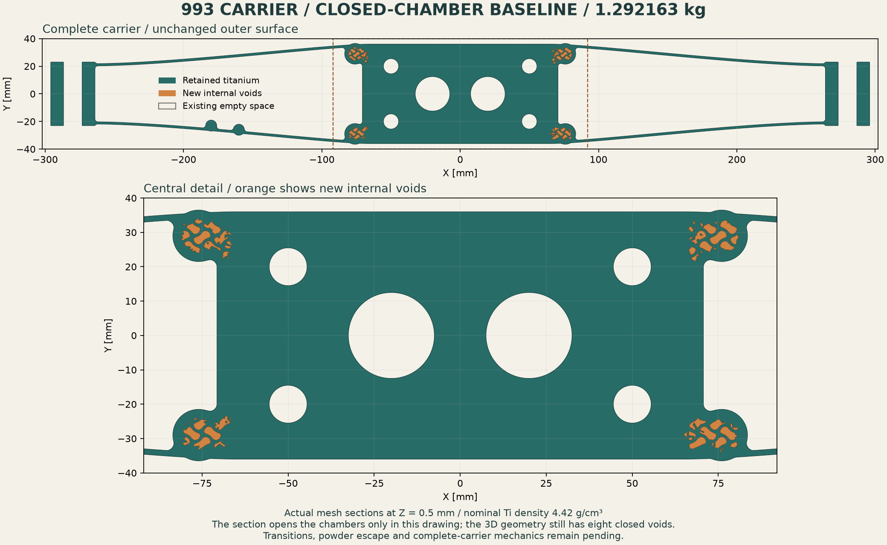

# 993 carrier: closed geometry and reproducible mechanics

The [illustrated report and reproducible workflow](carrier-interface-20261028/README.md)
record explicit solid geometry, periodic T10 meshes, native six-strain controls,
surface-resolution studies, software corrections and retained failures.

The R2 reference remains **1.298199813 kg**, below the **1.30 kg** ceiling.
The first complete closed-chamber variant is **1.292162707 kg** in nominal
geometric calculation, with the original outer surface preserved exactly.
Transition blending, powder escape and changed-geometry mechanics remain active.

