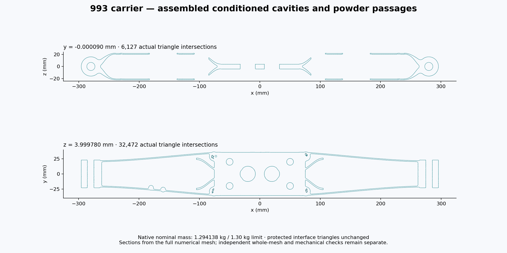
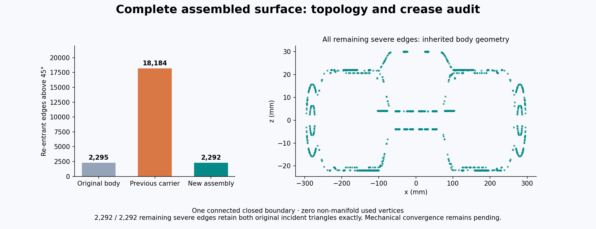
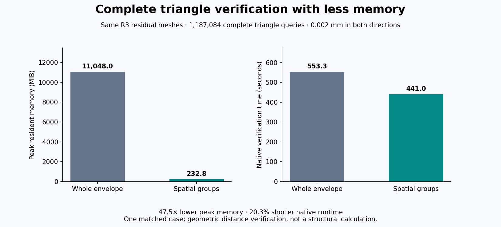
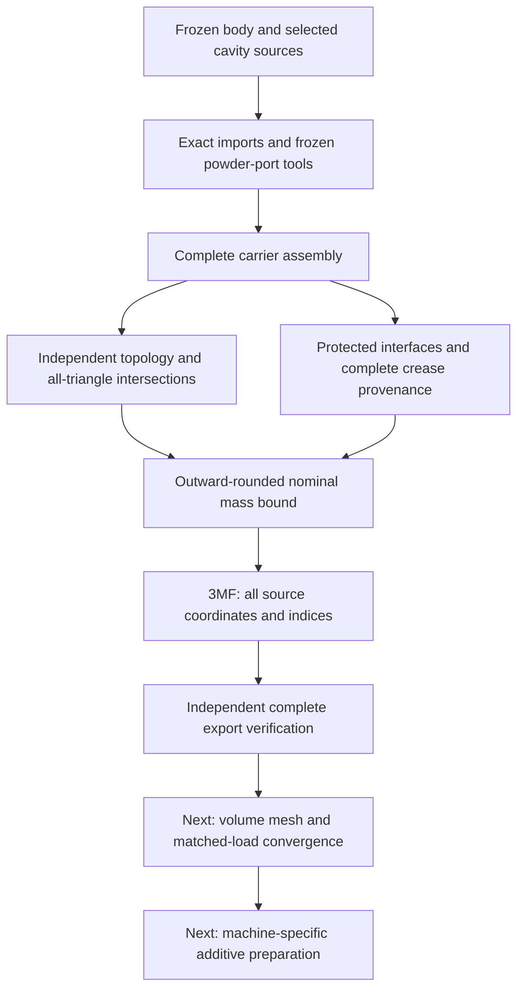

# Complete 993 carrier geometry and verified 3MF

The eight conditioned cavities and existing powder passages are assembled into one complete numerical carrier. Its **nominal mass is bounded below 1.30 kg**, and the full 3MF preserves every source coordinate and triangle. Mechanical convergence and machine-specific build preparation remain open.



## Complete-case results

| Requirement | Evidence |
|---|---|
| Geometry coverage | 21,983,639 vertices and 43,967,366 triangles |
| Surface topology | One connected closed boundary; opposite incident faces at every edge; zero disconnected used-vertex fans |
| Geometric embedding | All triangles queried independently: zero self-intersections or coplanar overlaps |
| Protected nominal interfaces | Original oriented triangles preserved in the central column and both end regions |
| Nominal mass | Between 1.2941381854758 and 1.2941381858383 kg, rounded outward for display |
| Full 3MF transfer | Every coordinate bit and ordered triangle index identical; millimetres and identity placement verified |
| Archive integrity | Every member read completely with CRC checks; one object and one build item |

The [mass certificate](evidence/assembled-carrier-001/mass-certificate.json) retains exact rational endpoints. Density is the declared ratio 442 / 100000000 kg/mm³. The margin is approximately **5.86 g**. This bounds numerical geometry at that density, not material or manufacturing-process variation.

The [assembly receipt](evidence/assembled-carrier-001/assembly.json), [intersection result](evidence/assembled-carrier-001/intersections.json), [topology audit](evidence/assembled-carrier-001/topology.json) and [complete export verification](evidence/assembled-carrier-001/export-verification.json) refer to the same mesh. Native assembly took 72 seconds and about 26.5 GB peak RSS. Independent topology took 8.22 seconds and about 5.39 GB.

## Internal surfaces and inherited features



Re-entrant edges above 45 degrees decrease from 18,184 in the previous carrier to 2,292. Every remaining severe edge has **both incident oriented triangles exactly identical to the original nominal body**. Computed angle differences are below 2.85e-14 degrees. These local configurations were neither created nor geometrically aggravated by the new assembly. This does not establish continuum stress regularity.

The [edge comparison](evidence/assembled-carrier-001/feature-comparison.json) and [incident-face proof](evidence/assembled-carrier-001/incident-face-provenance.json) cover all 2,292 remaining severe edges. The maximum is approximately 77.292 degrees; 783 exceed 60 degrees and none exceeds 90 degrees.

The [selected cavity ledger](evidence/assembled-carrier-001/selected-eight-voids.json) extends [eight-void conditioning](COMPLETE-VOID-CONDITIONING.md) with independently checked R3-positive coarsening from 6,215,640 to 5,606,928 faces. Its added symmetric bound is 0.002 mm; the composed original-rounded-surface bound is below 0.003430796 mm. The historical [R3 acceptance receipt](evidence/assembled-carrier-001/r3-positive-acceptance.json) predates assembly and retains that scope.

## More efficient independent verification



Spatially grouped CGAL EPECK envelopes check complete triangles against subsets of actual target triangles, exhausting both query inventories. On the same R3 residuals and unchanged 0.002 mm tolerance, memory falls from 11,313,104 to 238,360 KiB, and native time from 553.26 to 440.98 seconds: **47.46 times less memory and 20.29% less time** on this case. Controls include an uncovered triangle interior that vertex-only sampling would miss.

The [matched witness](evidence/assembled-carrier-001/complete-envelope-witness.json) retains both results and input hashes. This verifies geometric distance, not structural response.

## Delivery sequence



The [mass checker](evidence/assembled-carrier-001/sources/bound_mass.cpp) uses outward-rounded operations and 1,000-face accumulation blocks. Fourteen controls compare against exact rational determinants, including cancellation and subnormal volumes. Build with C++17, fast math disabled and floating contraction disabled. The [topology checker](evidence/assembled-carrier-001/sources/audit_topology.cpp) checks every vertex fan; a pinched-vertex negative control demonstrates why edge counts alone are insufficient.

The [exporter](evidence/assembled-carrier-001/sources/package.py) and independent [verifier](evidence/assembled-carrier-001/sources/verify.py) stream the mesh. Six mutated packages test units, coordinates, indices, placement and build structure. NumPy is required; verification also uses lxml from the existing 935 repair environment.

After restoring and hash-checking the private binary mesh, replay the export checks:

```sh
python package.py candidate.meshbin carrier-study.3mf
python verify.py candidate.meshbin carrier-study.3mf verification.json
```

The [3MF Core specification](https://github.com/3MFConsortium/spec_core/blob/master/3MF%20Core%20Specification.md) supports the millimetre units, coordinate notation and ZIP64 used here. The source coordinate frame is intentionally preserved. These checks do not establish import capacity in every slicer or machine application.

## Files and remaining work

The verified 3MF contains **712,082,895 bytes**, with SHA-256:

```text
e52c044129e10e781cea998839868f79f42b468ac53aa09fa1d0dfa7ee2b40ee
```

Raw geometry stays private. The [payload register](evidence/assembled-carrier-001/private-payloads.json) identifies the binary mesh, array archive and 3MF. The [manifest](evidence/assembled-carrier-001/manifest.json) binds the public scalar receipts, checker sources and images. A local private package preserves selected inputs and execution files outside the worktree; it is not a remote backup.

The next engineering stage is volume meshing and matched-load refinement on **this geometry**. The earlier 16,239,026-tetrahedron result belongs to the previous carrier. The present surface is dense; any solver-surface reduction needs complete geometry bounds and protected-interface checks. Mechanical response, thermal process studies and final machine preparation remain separate stages.
