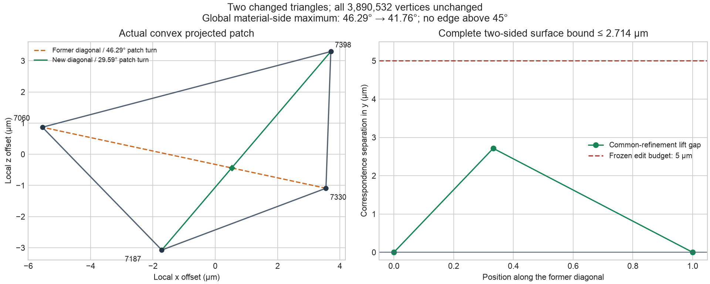
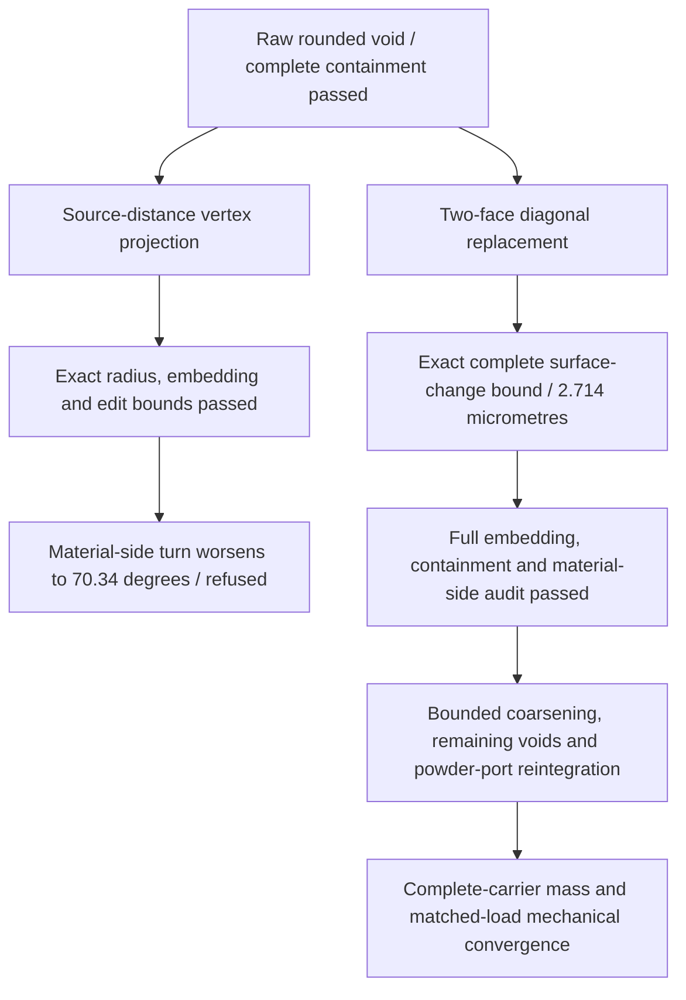

# Bounded edge repair after source-distance rounding

29 October 2026. The remaining material-side edge above 45° has been removed
from the first rounded void by changing **two triangles**, with **all 3,890,532
vertices unchanged**. Complete independent checks cover the resulting
**7,781,064 facets**. Its maximum material-side reentrant turn is now
**41.762878°**, with no edge above 45°, 60° or 90°.

This advances the [source-distance rounding study](SOURCE-DISTANCE-ROUNDING.md).
The full carrier remains the unchanged **1.2933916 kg** reference. Coarsening,
the other voids, port reintegration and mechanical convergence remain pending.



The left panel shows the actual four vertices in local micrometre coordinates.
The right panel shows the lift separation over the exact common refinement.
This correspondence gives a bound on both directed surface distances.

## A distance-correct projection was refused on shape quality

The raw rounded surface had one material-side turn of −46.289837°. Local
distance queries located its offset feature at source vertex 309. Before
attempting a correction, an exact complete check established that the eroded
solid lies strictly inside the raw dilated solid; its runtime was 86.22 seconds.

A fixed-radius projection moved one vertex onto the 0.1 mm source-distance
level. Independent CGAL/EPECK checks confirm the same exact nearest source vertex
before and after, and a final distance within the exact rational interval
`0.1 ± 1e-9 mm`. Four native controls cover the valid spherical-offset case and
refuse a wrong source vertex, wrong radius and face-interior case.

The projected mesh also passes complete embedding, original-domain containment
and an all-triangle bidirectional edit bound of **0.002503 mm**, rounded upward.
Its material-side turn nevertheless worsens to **−70.339971°**. That candidate
is **refused for further mechanical work**. The recorded quality decision
preserves this result as a counterexample to accepting a surface from distance
and containment checks alone. [Projection receipts](evidence/bounded-edge-repair-001/projection-quality-decision.json).

## Accepted two-triangle change

The alternative diagonal improves the local patch turn from **46.289837° to
29.592944°**, without moving any vertex. The input is the original raw rounded
surface, not the refused projection. The frozen edit budget is **0.005 mm**.

| Item | Verified result |
|---|---|
| Changed indexed faces | 13146 and 13147 only |
| Former shared edge | Vertices 7060 and 7330 |
| Replacement shared edge | Vertices 7398 and 7187; absent from the input |
| Coordinates | All vertices identical to the input |
| Global bidirectional surface-change bound | **0.002713795763 mm**, rounded upward |
| Complete embedding and original-void containment | Passed; one closed outward-oriented component, no self-intersection or source-boundary crossing |
| Full material-side audit | All 11,671,596 edges checked; zero reentrant edges above 45° |

The independent edit inspector compares every vertex and face. It then projects
the convex four-vertex patch onto x/z and uses exact rational arithmetic to
construct the intersection of its old and new diagonals. The two parameters are
`534778193/1608384885` and `943289164/1608384885`, both strictly inside their
segments. All four projected triangle orientations agree.

Both triangulations cover the same convex projected domain. Their common
refinement has zero lift difference at the boundary vertices and one interior
gap, exactly **`18307415896247/6746055156695040 mm`**. Affine interpolation
bounds the gap everywhere on each common-refinement triangle. This proves the
complete two-sided surface bound; the unchanged remainder contributes zero.
An exact cosine comparison also confirms improvement of the patch normal turn.
[Independent certificate](evidence/bounded-edge-repair-001/fidelity.json).

The subsequent full-domain check takes **52.61 seconds**. The all-edge
material-side audit takes **9.09 seconds**, with **5.43 GB** observed resident
memory under its 8 GiB / 600-second guard. The global maximum moves to a
different, unchanged edge. These angle diagnostics describe the triangulated
geometry; they do not prove absence of stress singularities or mechanical
convergence.

## Reproduction and next phase

The [source snapshots and scalar receipts](evidence/bounded-edge-repair-001/)
include the exact flip inspector, authoring replay, native offset inspector,
controls, rejected trial and figure generator. With the raw rounded NPZ from
the preceding private payload set, replay the frozen plan into a fresh folder:

```sh
python3 docs/reports/carrier-interface-20261028/evidence/bounded-edge-repair-001/sources/replay_flip.py \
  PRIVATE_RAW_ROUNDED.npz \
  docs/reports/carrier-interface-20261028/evidence/bounded-edge-repair-001/plan.json \
  PRIVATE_NEW_FLIP
```

The replayed native mesh is byte-identical to the inspected result, SHA-256
`9cc330f5ff5a15a14227068b1388c386a57ca69a76fce5028dfa4248c53dd8b4`.
Diagnostic scripts retain the recorded private case layout; reconstruct that
layout before running the inspectors or renderer. For a work-only Docker mount,
use copied files or hardlinks for inputs; absolute host symlinks are inaccessible
inside that mount. Raw meshes remain private under the
[payload manifest](evidence/bounded-edge-repair-001/private-payloads.json).
Offsite recovery of this new payload set has not been executed.



Use the accepted edge-repaired void for the next geometry stage. Do not consume
the refused projected mesh. Full-carrier mass, protected interfaces and powder
outlet connectivity must be rechecked on the reintegrated geometry before the
new mechanical series. No earlier stress result is transferred. All work in
this increment used local CPU compute.
