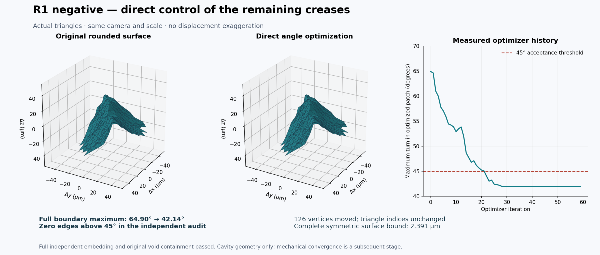
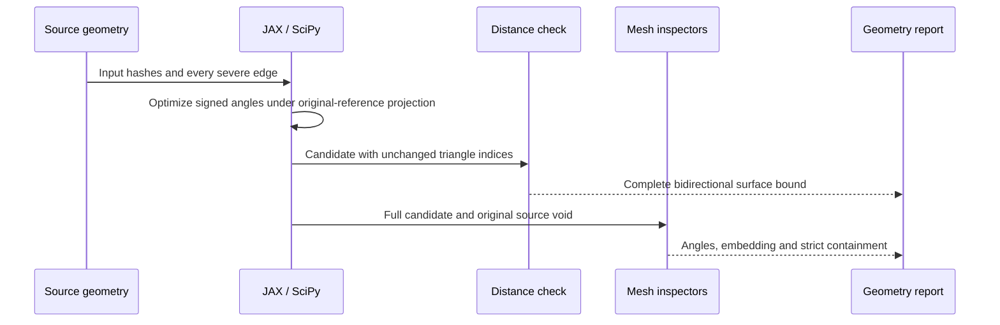

# Eight carrier cavities through geometry conditioning

All eight individual cavity boundaries now pass the 45-degree material-side feature screen, complete independent embedding checks, and strict containment in their original source voids. The three remaining failures were resolved by directly optimizing signed dihedral angles with **JAX and SciPy**, while retaining the original vertices as the displacement reference.

The complete-carrier reference remains **1.293391604 kg**, below the **1.30 kg** limit. This new void set has not yet been assembled into a newly weighed carrier or used for new mechanical-convergence results.



## Verified geometry ledger

Every row has zero material-side edges above 45 degrees, one embedded outward-oriented component and a full original-void containment proof. The [machine-readable ledger](evidence/complete-void-conditioning-001/assessment.json) identifies each private mesh by SHA-256; the [manifest](evidence/complete-void-conditioning-001/manifest.json) binds the published receipts and method sources. Large meshes remain outside Git.

| Void | Retained method | Triangles | Maximum material-side turn |
|---|---|---:|---:|
| R0-NEGATIVE | Exact local edge flip | 7,781,064 | 41.762877° |
| R0-POSITIVE | Exact planar reduction and bounded CGAL coarsening | 3,672,606 | 42.486054° |
| R1-NEGATIVE | JAX direct dihedral optimization | 5,791,180 | 42.137427° |
| R1-POSITIVE | Bounded four-pass local fairing | 5,585,228 | 43.786640° |
| R2-NEGATIVE | Bounded four-pass local fairing | 5,773,520 | 42.352863° |
| R2-POSITIVE | JAX direct dihedral optimization | 5,840,936 | 44.609556° |
| R3-NEGATIVE | Bounded four-pass local fairing | 3,798,540 | 43.541014° |
| R3-POSITIVE | JAX direct dihedral optimization | 6,215,640 | 43.848248° |

R0 negative was rechecked against the canonical eight-void source inventory; its candidate bytes did not change. R0 positive retains the independently bounded coarsening result described in [geometry coarsening](GEOMETRY-COARSENING.md). These are individual cavity surfaces, not the complete assembled carrier boundary.

## Why direct angle optimization worked

Uniform Laplacian smoothing reduces average roughness but does not directly minimize the worst signed crease. Euclidean clipping, local diagonal changes and red/green refinement were tried under the same original-reference tolerance. They reduced some defects and worsened others; none resolved all three remaining cavities. Their failed feature results are retained in the evidence bundle.

The new objective minimizes material-side angle excess above a 42-degree authoring target. A small displacement penalty discourages unnecessary movement; face-area and orientation penalties discourage collapse and reversal. Every evaluation projects displacements into 0.0049 mm balls around the **original** rounded vertices. Outer vertices and triangle indices stay unchanged. Both incident faces of every affected edge are included in the optimization patch.

JAX computes the gradient in float64. Centered directional differences check it on a synthetic folded hinge and on each actual input. The hinge improves from 90 degrees to approximately 42 degrees; a planar control remains unchanged. SciPy L-BFGS-B proposes the coordinates. Independent inspectors decide whether the candidate passes.

| New candidate | Full-boundary maximum | Complete symmetric surface bound | Optimizer termination |
|---|---:|---:|---|
| R1 negative | 42.137427° | 0.002390674114 mm | Converged, 59 iterations |
| R2 positive | 44.609556° | 0.001402344850 mm | 400-iteration cap; independent geometry criteria passed |
| R3 positive | 43.848248° | 0.001430795135 mm | Converged, 37 iterations |

R2 positive is **not** reported as optimizer convergence. Its final geometry independently satisfies the stated geometric criteria. None of these optimizer iterations constitutes mechanical mesh convergence.

For every changed vertex, exact rational arithmetic verifies the squared Euclidean displacement against decimal `(0.005 mm)^2`. Because triangle indices are identical, equal barycentric coordinates pair every point on the two complete surfaces. The vertex bound therefore bounds both complete triangle surfaces, including their interiors; this is not a sampled-distance acceptance test. The earlier R1-positive, R2-negative and R3-negative candidates retain their separately recorded exact L1 certificates.



## Software and reproduction

| Component | Executed contribution |
|---|---|
| JAX / jaxlib 0.12.0.1 | Float64 differentiated signed-dihedral objective, local CPU |
| SciPy 1.18.1 | Bounded L-BFGS-B authoring; termination recorded per case |
| Python Fraction | Exact final displacement certificate, independent of optimizer status |
| NumPy feature inspector | Entire oriented material-side boundary, not only the optimized patch |
| CGAL native inspector | Complete embedding, orientation and original-void containment |
| Matplotlib | Actual surface triangles and recorded iteration history |

The [runtime receipt](evidence/complete-void-conditioning-001/dihedral-optimization-001/runtime.json), [pinned Python packages](evidence/complete-void-conditioning-001/dihedral-optimization-001/requirements.txt), [authoring source](evidence/complete-void-conditioning-001/dihedral-optimization-001/optimize.py), [runner](evidence/complete-void-conditioning-001/dihedral-optimization-001/run.py) and [executed controls](evidence/complete-void-conditioning-001/dihedral-optimization-001/controls.json) are published together. See the official [JAX differentiation](https://docs.jax.dev/en/latest/automatic-differentiation.html) and [installation](https://docs.jax.dev/en/latest/installation.html) documentation.

From a copy of that method directory:

```sh
python -m venv runtime
runtime/bin/python -m pip install -r requirements.txt
runtime/bin/python controls.py
runtime/bin/python run.py INPUT.npz COMPLETE_FEATURE_AUDIT.json FRESH_OUTPUT_DIRECTORY
```

The runner requires the source's adjacent proof receipt and `decoded-001/independent-domain.json`, verifies the serialized NPZ against the checked native binary hash, and refuses incomplete severe-edge inventories. Reproduction of the carrier trials also requires the private input meshes identified by the ledger. Native full-surface inspections remain mandatory after authoring.

This increment implements R-PROVENANCE, R-LOCAL and R-CHANGE through the geometry/verification services of the [engineering architecture](../../architecture/README.md) and [ADR 0012](../../decisions/0012-local-compute-gpu-last.md). No GPU rental was needed. The [wider software assessment](SOFTWARE-FOLLOWUP-20261029.md) retains the separate status of other toolchain stages.

## Next engineering stage

Reduce the dense cavity surfaces with complete distance bounds, preserving their current material-side and embedding criteria. Then reintegrate the cavities and powder routes, verify the complete assembled boundary, recalculate the mass against 1.30 kg, and run matched-load mechanical refinement. The 45-degree screen alone establishes neither continuum stress regularity nor mechanical convergence.
