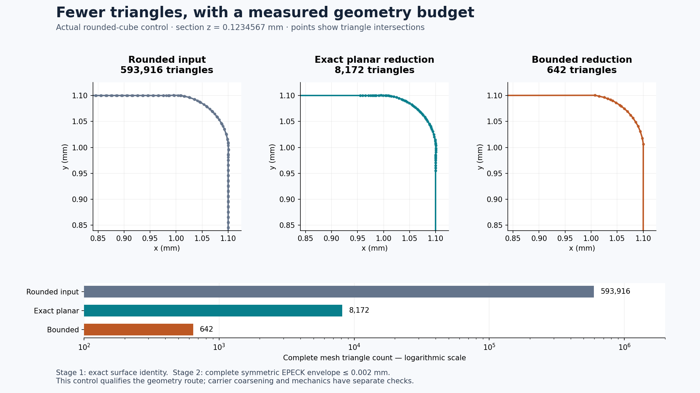
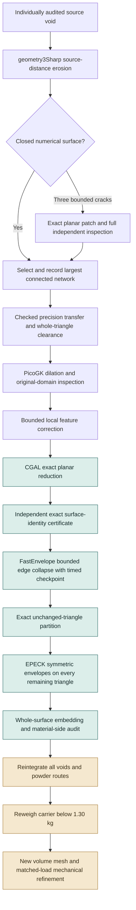

# Carrier void conditioning: exact reduction and complete surface bounds

CGAL and FastEnvelope now reduce the checked **R0 positive** void from
**4,025,460 to 3,672,606 triangles**, with a complete bidirectional surface-distance
bound of **0.002 mm** relative to the corrected rounded input. Independent
checks confirm that the result remains embedded, outward oriented and strictly
inside its original void. No material-side edge exceeds 45°.

This is an intermediate geometry result. The complete-carrier reference remains
**1.293391604 kg**, below the **1.30 kg** requirement. The new voids have not yet
been assembled into a newly weighed carrier or used for new mechanical results.

## What each software stage contributes

| Software or method | Actual contribution | Evidence boundary |
|---|---|---|
| geometry3Sharp | Source-distance erosion; six additional centre networks generated | Source grid 0.025 mm; erosion 0.16 mm |
| Manifold | Explicit connected-component selection | Every discarded component is recorded |
| Exact rational crack repair | Two or four triangles added to three numerical cracks | All vertices and old faces retained; complete patch bound at most 0.000000050001 mm |
| CGAL planar remeshing, EPECK | Removes exactly coplanar triangulation | Exact independent surface-identity certificate |
| CGAL edge collapse + FastEnvelope | Bounded reduction with Lindstrom–Turk placement | Whole-source envelope frozen for the run; independent symmetric check required |
| Independent CGAL EPECK inspectors | Embedding, original-domain containment, complete triangle envelopes | Full meshes or exact partitions; no sampled-only acceptance |
| NumPy and Matplotlib | Exact input accounting and images of actual geometry | Input hashes and image provenance recorded |

The existing [software assessment](SOFTWARE-FOLLOWUP-20261029.md) covers the
wider toolchain. This increment used local CPU compute. No GPU rental was
needed for these native geometry operations.

The green stages have passed for R0 positive. The six other networks are at
an earlier stage; their precision transfer, dilation and later checks remain
separate admissions.

## Exact reduction before approximate reduction

The rounded-cube control demonstrates why preprocessing matters. Direct
bounded simplification of its 593,916 triangles reached the 1,800-second guard
without producing a candidate. Exact planar remeshing first reduces it to
8,172 triangles in 0.493 seconds. Bounded simplification then produces 642
triangles in 108.402 seconds. Complete EPECK symmetric envelopes pass at
0.002 mm, alongside complete embedding checks.

For the actual R0 positive void:

| Stage | Triangles | Native time | Complete result |
|---|---:|---:|---|
| Previously corrected rounded input | 4,025,460 | Earlier checkpoint | Embedded; maximum material-side turn 42.4861° |
| Exact planar reduction | 3,798,036 | 17.025 s | Same complete surface; independent identity certificate |
| Bounded checkpoint | 3,672,606 | 301.292 s | Symmetric distance ≤ 0.002 mm; original-domain containment; no material-side turn above 45° |

The carrier gains less reduction than the analytical control. The checkpoint
removes a further 125,430 triangles, but **does not reach the requested 2%
remaining-edge target**. It is a saved partial result, not completed coarsening.
The native process peaks at about 3.29 GiB resident memory.

The stop mechanism has three controls: a zero-second stop preserves the input
bytes; a one-second stop saves a partial mesh that passes independent checks;
a normal completion reproduces the previously qualified output bytes.
A subsequent run must retain the original source envelope or explicitly
account for composed error. Resetting a fresh 0.002 mm budget against each
checkpoint would accumulate unreported error and is not admitted.

## How the complete distance certificate stays tractable

Exact coordinate matching pairs **3,415,353 unchanged oriented triangles**.
Their geometric change is exactly zero. Every remaining triangle is checked:
382,683 source triangles and 257,253 candidate triangles. The two counts plus
the common count recover the complete inputs without dropping any triangle.

Independent EPECK polyhedral envelopes pass in both directions on those
remaining surfaces, at 0.002 mm, in 94.050 seconds. The unchanged surface union
then gives the same complete bound for the full meshes. This is a conservative
certificate: a failed residual comparison would not by itself prove that the
full-mesh distance exceeds the budget.

The exact planar stage contributes zero additional error. Including the
previous two-face correction gives a composed bound of
**0.002355670789 mm** relative to the raw rounded R0 positive surface.
These are geometry bounds, not new stress results.

## Six additional centre networks

All six selected erosion networks now pass complete independent embedding and
containment inside their respective original voids. These are centre networks
before dilation; their volumes are not final cavity volumes.

| Source | Erosion components | Retained triangles | Retained volume, mm³ |
|---|---:|---:|---:|
| R1 positive | 7 | 816,754 | 82.051774 |
| R1 negative | 32 | 829,288 | 63.454426 |
| R2 positive | 31 | 828,576 | 59.096580 |
| R2 negative | 22 | 846,908 | 76.303109 |
| R3 positive | 67 | 887,956 | 78.699540 |
| R3 negative | 19 | 538,008 | 37.723451 |

R1 positive and R2 positive initially fail closure. Diagnostic exports reveal
one and two four-edge planar cracks. Their exact rational patch bounds are
`28147497/562949953421312`, `7036875/140737488355328`, and
`7036873/140737488355328` mm. Convexity extends the vertex-to-existing-segment
bound over every point of each added triangle; all old triangles remain.
Complete independent inspection follows selection of the retained networks.
Wide, nonplanar and nonquadrilateral holes are refused by the repair controls.

A trial of geometry3Sharp's `MarchingCubesPro` fails the thin-notch control at
0.05 mm. It is retained as a failed software trial and is not used on a carrier
void. Precision transfer is also checked per network: the first R2 positive
and R3 negative float32 transfers fail the closed-edge contract and are not
passed to dilation.

## Evidence and reproduction

[The receipt bundle](evidence/geometry-coarsening-001/) contains source snapshots,
control results, complete checks, input identities, image provenance and a
SHA-256 manifest. Mesh arrays remain private. Native binary mesh files use
little-endian `uint64` vertex/triangle counts, float64 XYZ coordinates and
uint64 triangle indices.

The recorded runtime uses CGAL 5.6, GCC 13.3 and pinned FastEnvelope,
indirect-predicates and SIMDe revisions. Compile with the recorded strict
floating-point flags. Reproduction order is: control checks, exact planar
reduction, independent identity and embedding checks, bounded coarsening,
exact triangle partition, both residual envelopes, then complete material-side
and original-domain checks. The earlier
[source-distance report](SOURCE-DISTANCE-ROUNDING.md) defines erosion, precision
transfer, clearance and PicoGK controls.

The next geometry work is to resolve the refused precision transfer, finish
per-void dilation and bounded coarsening, then reconstruct the complete carrier
with its powder routes. Complete-carrier mass and mechanical convergence are
recomputed on that resulting geometry.
