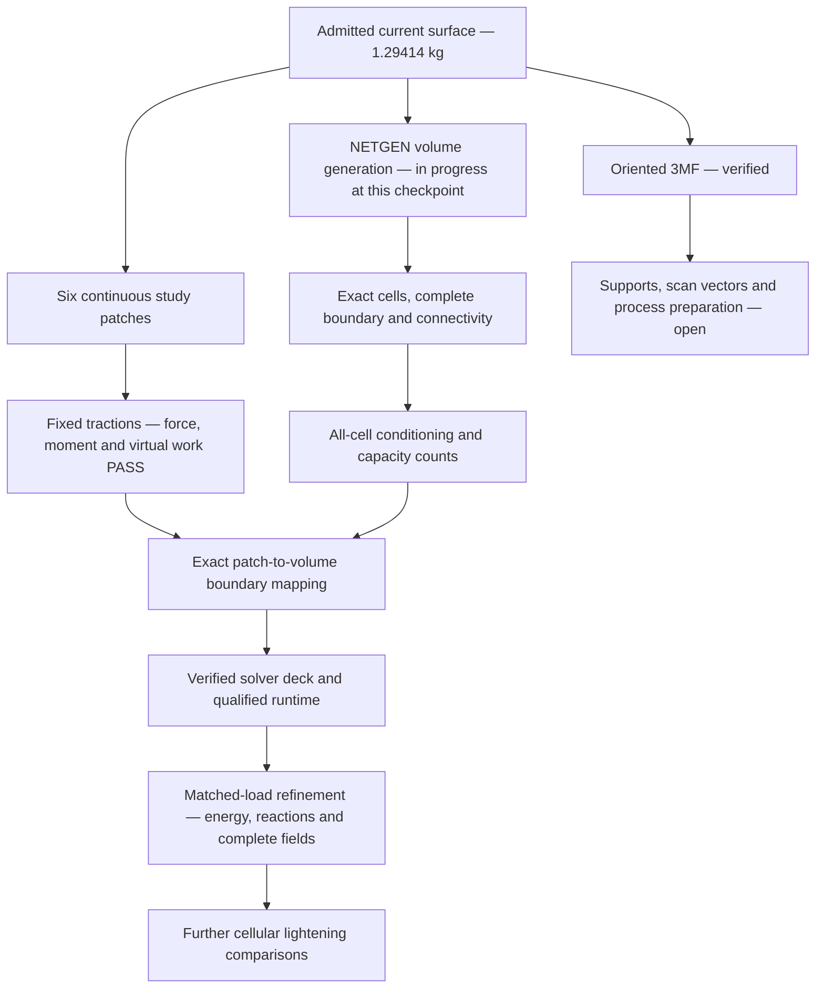
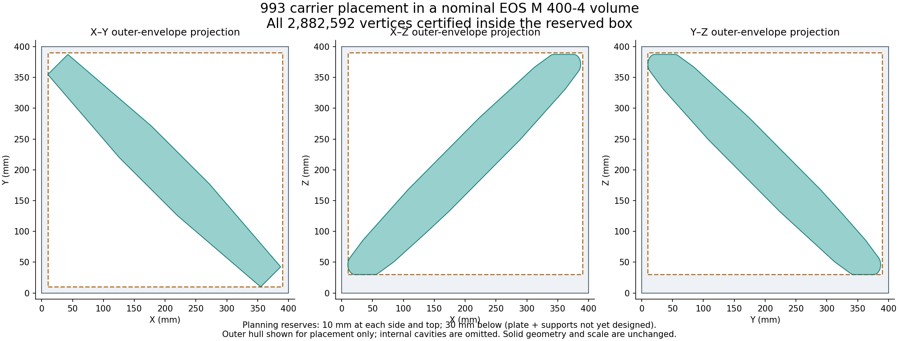
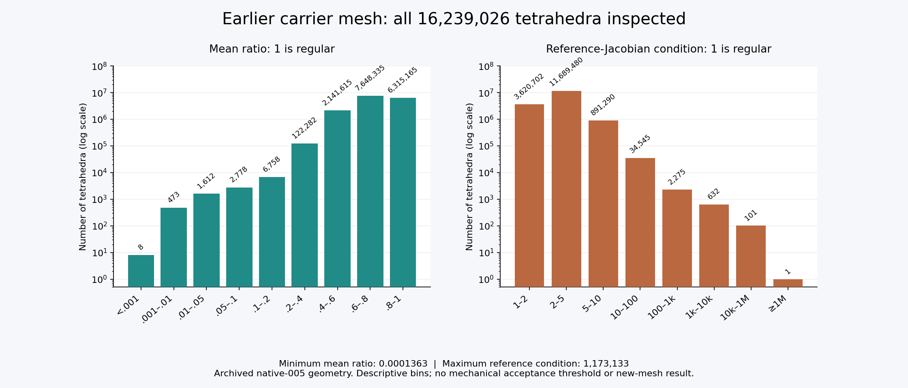
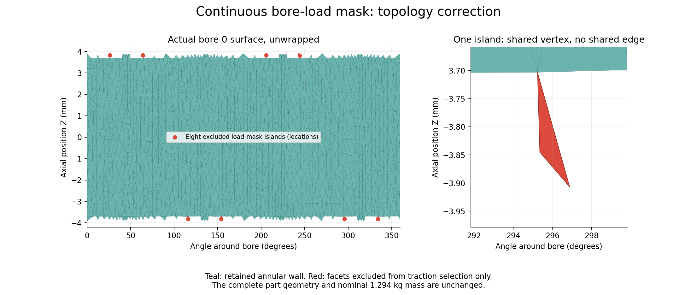

# 993 carrier: oriented export and mechanical preparation

The current carrier remains at **1.2941382075 kg nominal mass**, with
**5,765,272 surface triangles** and unchanged protected interfaces. This update
adds a verified oriented 3MF, complete diagnostics of the earlier volume mesh,
and a corrected continuous load-patch reference for the new surface.
**The new volume calculation and mechanical convergence remain open.**

These results follow the [eight-cavity assembly checkpoint](MESHLIB-ASSEMBLY.md).
The [evidence manifest](evidence/mechanical-preparation-001/manifest.json) binds
all receipts and figures below. Raw geometry and nodal arrays stay private.

## What is ready

| Stage | Result | Scope |
|---|---|---|
| Surface assembly and mass | Previously passed | Same admitted eight-cavity geometry; no new weight reduction |
| Oriented 3MF | Passed | Every coordinate and ordered triangle verified; declared placement checked |
| Earlier tetrahedral mesh diagnostics | Completed | All 16,239,026 archived cells; not the new volume |
| Current load patches | Corrected and checked | Six continuous annular study patches |
| Current force and moment integration | Passed | Gravity and combined scenarios on the corrected masks |
| Solver size preflight | Completed on archived mesh | Structural storage and index-size screen; new counts pending |
| New volume and mechanical solution | Open | No new converged whole-carrier response claimed |

## An oriented export that preserves the mesh

The new study file has SHA-256
`2aaf0a2d11472256a07da6f24ec8d2ad27d7f626fb36d37d479df6fbd77c25a4`.
Its original 2,882,592 vertex-coordinate triples and 5,765,272 ordered triangle
triples were independently read back in full. Units, one build item, relationships,
ZIP members and the declared transform also pass. Seven malformed-export controls
are rejected, including a transposed matrix.

A rational proper rotation fits the nominal **400 × 400 × 400 mm** envelope.
The centered serialized placement encloses X and Y approximately within
11.376–388.624 mm and Z within 31.304–388.696 mm. It retains the study reserves
of 10 mm on the sides and top, and 30 mm below. The binary64-parsed matrix's
positional difference from the ideal rational placement is bounded by
2.232e-14 mm in L1 norm over every source vertex. The serialized matrix is not
claimed to be exactly orthogonal.

*This outer-envelope illustration shows the initial packing translation.
The exported placement is subsequently centered within the reserved box.
Internal cavities and supports are omitted from this projection.*

The EOS M 290 is excluded independently of orientation: two actual mesh vertices
are 593.758132 mm apart, exceeding the 480.234318 mm diagonal of its nominal box.
The M 400-4 envelope includes its build platform. The reserves are planning
assumptions, not an actual support design or machine parameter job.
See [EOS M 290 data](https://www.eos.info/metal-solutions/metal-printers/data-sheets/sds-eos-m-290)
and [EOS M 400-4 data](https://www.eos.info/metal-solutions/metal-printers/eos-m-400-4).
The transform follows [3MF Core section 3.3](https://github.com/3MFConsortium/spec_core/blob/master/3MF%20Core%20Specification.md#33-3d-matrices).

## Positive tetrahedral volumes do not establish good conditioning

The archived native-005 mesh has 16,239,026 tetrahedra. Its complete diagnostic
finds a minimum mean ratio of **0.0001363077** and maximum regular-reference
Jacobian condition of **1,173,133**. A regular tetrahedron scores one in both
metrics. There are 734 cells in the condition bins at or above 1,000.
These are descriptive bins, not adopted mechanical acceptance thresholds.

The worst cell's exact rational volume is positive. An independent 80-digit
calculation reproduces its poor mean ratio. Three vertices share the same Y
coordinate; the fourth differs by only 0.000001430511475 mm. Two faces belong to
the source boundary. Only one of the four exact coordinate triples remains in
the new surface, so the identical archived cell cannot simply be copied forward.
Similar defects still require a complete inspection of the new mesh.

The diagnostic passed eleven analytical/rejection controls and matching C- and
Fortran-order archive controls. It measures element shape, not the condition
number of the assembled elasticity matrix or the stress error. The archived
geometry differs from the new assembly; their comparison is not fixed-geometry
mesh convergence.

## Correcting the load masks before solving

The unchanged legacy bore predicate selected nine edge-connected components
around each central bore: its main wall and eight isolated triangles. Some
islands touch the wall at a vertex. The two end support patches were already
continuous. A force-balance test alone missed this topology defect.

The corrected study mask retains the unique wall component spanning the bore's
axial midplane. All six patches now have one component, consistent orientation,
Euler characteristic zero and two simple boundary cycles. **Thirty-two triangles
were excluded from load selection; none was removed from the part.**

The same requested resultants are reconstructed by minimum surface-L2 constant
tractions on the four corrected bore walls. Independent P1 integration over all
selected triangles gives:

| Scenario | Fz [N] | My [N·mm] | Largest force residual [N] | Largest moment residual [N·mm] |
|---|---:|---:|---:|---:|
| Gravity | −2000 | 0 | 8.186e-12 | 7.420e-11 |
| Combined | −4000 | 850000 | 1.638e-11 | 9.314e-10 |

Both pass the retained 1e-8 scaled wrench tolerance and independent rigid virtual
work checks. Nine traction controls pass. These are declared study loads and
interfaces. The corrected continuous mask is a new load reference; it is not a
measured bearing-pressure distribution.

The [current traction reference](evidence/mechanical-preparation-001/continuous-traction-reference.json)
supersedes the balanced but fragmented-mask reference. Freeze its vectors and
parent facets through subsequent refinements. P2 requires its own face integrals;
P1 equivalent nodal forces must not be reused for P2. No solver deck has yet been
created from these surface-only arrays.

## Size the solver before renting compute

Every edge of the archived volume was counted: 3,343,604 vertices, 21,095,571
edges and 33,990,966 faces. Four small complexes independently check the quadratic
connectivity formula. With three displacement components and full coupling blocks:

| Order | Nodes | Displacement DOFs | Symmetric structural entries | Symmetric CSR storage, 64-bit indices |
|---|---:|---:|---:|---:|
| Linear P1 | 3,343,604 | 10,030,812 | 209,921,763 | 3.44 GB |
| Quadratic P2 | 24,439,175 | 73,317,525 | 2,990,181,333 | 48.43 GB |

These are **pre-constraint structural patterns**, not retained solver nonzeros or
RAM requirements. They exclude geometry, assembly workspaces and factorization.
The quadratic pattern exceeds signed 32-bit indexing. The full assembly-to-solver
integer path needs verification; a 64-bit CPU or a successful smaller reference
solve does not establish that capacity. Intel provides an explicit
[`pardiso_64` interface](https://www.intel.com/content/www/us/en/docs/onemkl/developer-reference-c/2023-0/pardiso-64.html).

The current new mesh requires its own counts. No new rental was made for these
checks. Solver choice must preserve the intended discretization and equations.

## Evidence boundaries and next execution

The published files are scalar receipts and selected numerical figures. Some
receipt source-path keys are shortened to repository-relative paths; those files
explicitly record their original private receipt hash and transformation. The
manifest distinguishes these projections from byte-identical copies. This page
does not provide standalone replay closure for all private meshes and runtimes.

Next: finish the owned volume trial, run independent exact volume checks, inspect
every cell's quality, map the six patches exactly to its boundary, then prepare
and verify the mechanical deck. Complete reaction, energy and field comparisons
remain required. Neither the oriented export nor the corrected load mask closes
mechanical convergence, additional lightening or process preparation.
