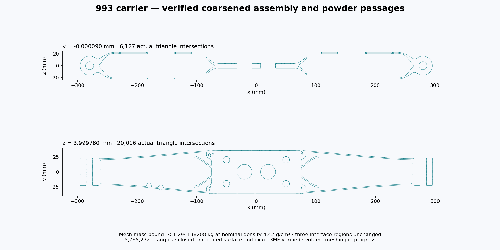
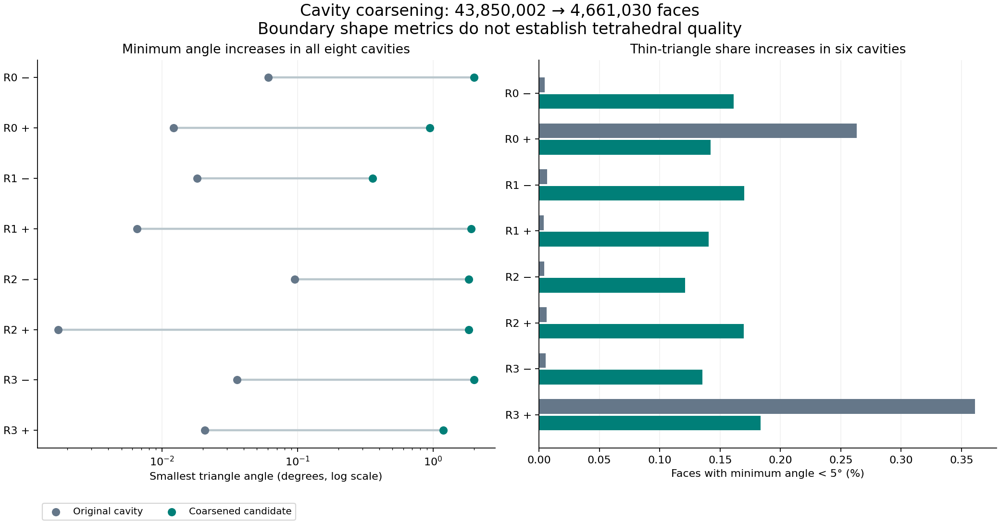
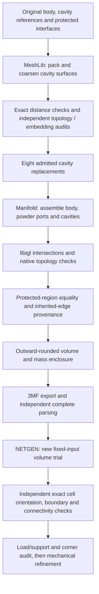

# 993 carrier: eight certified cavities and a verified complete export

The coarsened carrier contains **5,765,272 triangles**, down from 43,967,366 in the previous complete assembly (86.89% fewer). Its nominal mesh mass is enclosed by **[1.2941382074336902, 1.2941382075299805] kg** at the declared density of 4.42 g/cm³. The three protected interface regions retain exactly the same oriented triangles. The complete 3MF has been independently checked against the source mesh.

This checkpoint supersedes the unassembled status of the [earlier MeshLib trial](MESHLIB-COARSENING.md). The [previous complete assembly](ASSEMBLED-CARRIER.md) remains a separate frozen result. Mechanical convergence and machine-specific build preparation are still open.

## Complete geometry checks

| Check | Result |
|---|---|
| Whole surface | 2,882,592 vertices; 5,765,272 triangles |
| Topology | Closed, consistently oriented, vertex-manifold surface; one connected boundary |
| Complete intersection check | Zero intersecting pairs, coplanar pairs or degenerate faces |
| Protected regions | Central column, left end and right end: exact oriented-triangle equality |
| Mass | Strict exact-rational comparison of the outward-rounded upper endpoint with 1.30 kg passes |
| Severe re-entrant configurations | All 2,292 retain both original incident oriented triangles; none unmatched or changed |
| Export | All 2,882,592 coordinate triples and 5,765,272 ordered triangle triples checked; millimetres, identity placement, one build item, all ZIP CRCs verified |

The [assembly](evidence/meshlib-assembly-001/assembly.json), [topology](evidence/meshlib-assembly-001/topology.json), [intersection](evidence/meshlib-assembly-001/intersections.json), [mass certificate](evidence/meshlib-assembly-001/mass-certificate.json), [feature provenance](evidence/meshlib-assembly-001/feature-provenance.json) and [export verification](evidence/meshlib-assembly-001/export-verification.json) all identify the new geometry. No old volume or stress result is transferred to it.

The binary surface SHA-256 is `50b1c1ccb4a868aa1a98e332dcd8221140fa0c282bcf07979b49ed33b2abb420`. The verified study 3MF SHA-256 is `5b04eda2dd17418d770783aa7374d0011cb99d0bb43a6bbac1048faa3f40c7ee`. Raw geometry remains in the private artifact checkpoint; [payload hashes and sizes](evidence/meshlib-assembly-001/private-payloads.json) identify it.

## Eight complete cavity admissions

Each bound is measured from that cavity's original rounded reference, not from the complete carrier or an acquired vehicle scan. Every bound is below the retained 0.005 mm allowance. Values below are rounded outward to nine decimal places; the linked receipts retain exact rationals.

| Cavity | Source faces | Candidate faces | Complete bound (mm) |
|---|---:|---:|---:|
| [r0-negative](evidence/meshlib-assembly-001/r0-negative-admission.json) | 7,781,064 | 780,550 | 0.002713796 |
| [r0-positive](evidence/meshlib-assembly-001/r0-positive-admission.json) | 3,672,606 | 409,672 | 0.003355671 |
| [r1-negative](evidence/meshlib-assembly-001/r1-negative-admission.json) | 5,791,180 | 651,042 | 0.004134792 |
| [r1-positive](evidence/meshlib-assembly-001/r1-positive-admission.json) | 5,585,228 | 558,560 | 0.004900001 |
| [r2-negative](evidence/meshlib-assembly-001/r2-negative-admission.json) | 5,773,520 | 577,352 | 0.004900001 |
| [r2-positive](evidence/meshlib-assembly-001/r2-positive-admission.json) | 5,840,936 | 669,780 | 0.002192359 |
| [r3-negative](evidence/meshlib-assembly-001/r3-negative-admission.json) | 3,798,540 | 379,854 | 0.004492210 |
| [r3-positive](evidence/meshlib-assembly-001/r3-positive-admission.json) | 5,606,928 | 634,220 | 0.004430796 |

Protected-patch cases use the maximum of independently covered disjoint-region bounds. The two composed cases add the verified new bound to their preceding bound. Complete bidirectional distance certificates accompany every admission in the [manifest](evidence/meshlib-assembly-001/manifest.json). MeshLib's own error estimate does not decide acceptance.

## What the triangle reduction improves

All eight minimum triangle angles improve, but the proportion of triangles below 5 degrees increases in six cavities. Five degrees is a descriptive reporting threshold, not an adopted acceptance criterion. These complete boundary inventories do not establish tetrahedral quality or solver conditioning.

This stage reduces geometric representation cost. The new mass differs from the preceding 1.294138186 kg result by only about 0.022 mg. Additional cellular weight reduction still requires a separate design comparison under matched loads; triangle count is not a mass metric.

## Executable chain and tool roles

The local sequence completed `meshlib-carrier-assembly-001`, `meshlib-whole-topology-001`, `meshlib-whole-mass-001`, `meshlib-whole-features-001` and `meshlib-3mf-export-001`. Each stage binds its result to the new input hash and stops on failure. The [native topology source](evidence/meshlib-assembly-001/sources/audit_topology.cpp), [interval source](evidence/meshlib-assembly-001/sources/bound_mass.cpp), [feature source](evidence/meshlib-assembly-001/sources/audit_features.cpp), [3MF writer](evidence/meshlib-assembly-001/sources/export_3mf.py) and [independent reader](evidence/meshlib-assembly-001/sources/verify_3mf.py) are preserved alongside their control receipts. Binary mesh inputs use two little-endian uint64 counts, followed by binary64 vertex triples and uint64 triangle-index triples.

The private retained checkpoint contains the complete surface, NPZ, 3MF, direct receipts and scripts. It uses same-filesystem hardlinks, which are not an independent backup. Upstream cavity geometry and shard payloads remain necessary for a standalone replay of the entire chain; this public report does not claim to supply that closure.

## Current next step

A new local NETGEN trial is running on this exact surface, with `maxh=0.8 mm`, no optional final optimization, and the existing 0.5 mm³ maximum-cell-volume criterion. The larger surface has a 40 GiB resident-memory guard and a 7,250-second supervisor limit. No new Vast lease was needed for this CPU stage.

The upstream verdict admits a geometry-only volume trial. The 2,292 inherited sharp configurations remain present: their provenance does not establish bounded peak stress. A returned volume must pass independent exact orientation, boundary, connectivity and size checks before it can support further analysis. Matched-load mechanical convergence, additional cellular weight savings and a machine-specific build package remain outstanding.

## Catalogue-image provenance

The catalogue's existing thumbnails still depict its unchanged catalogue source geometry; the new numerical study is illustrated by the mesh-derived sections above. `make part-previews` could not use the absent local `3dprinting993-cadsim:dev` image. A native PyVista/VTK fallback returned successfully but produced an incomplete orthographic panel, which failed visual inspection. The prior images and their metadata were retained after verifying their source and image hashes. The catalogue record is an input pinned by the existing free-tools benchmark, so it remains unchanged; these new study results are registered in this separate report and evidence manifest. The native multi-panel rendering issue remains open and does not alter the geometry or export certificates.
