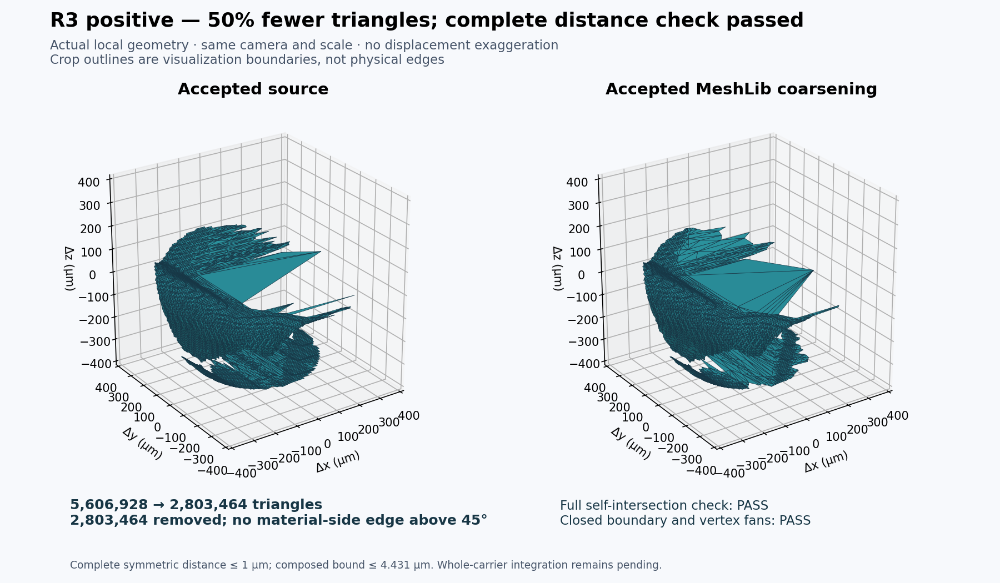
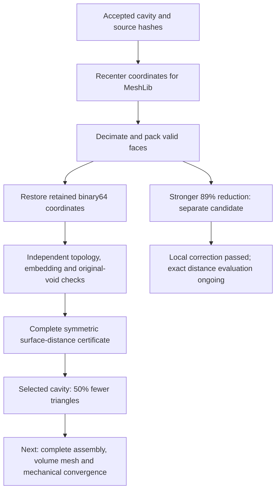
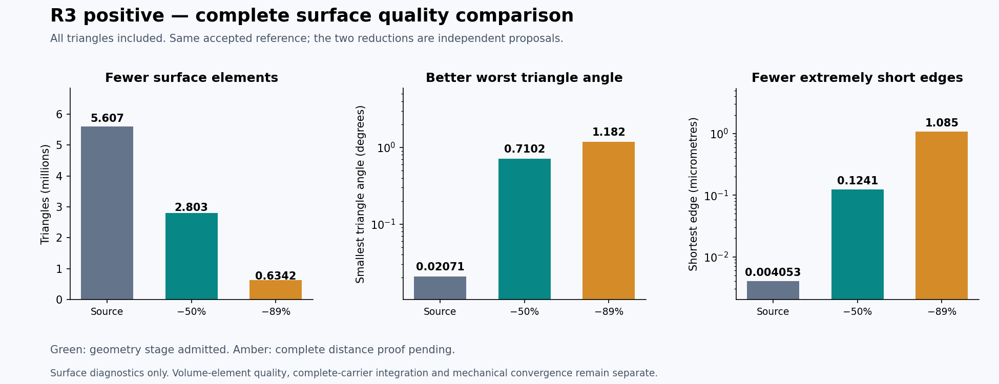

# 993 carrier: certified MeshLib cavity reduction

**The R3 positive cavity now has 50% fewer triangles with a complete additional surface-distance bound of 0.001 mm.** The cumulative bound from its original rounded surface remains below 0.005 mm. This is an accepted cavity geometry stage; the complete carrier and verified 3MF still correspond to the [previous assembly](ASSEMBLED-CARRIER.md), whose nominal mass is about **1.294 kg**.

## What passed

| Check | Complete result |
|---|---|
| Triangle count | 5,606,928 → 2,803,464 |
| Topology | One closed boundary; opposite edge orientations and connected vertex fans |
| Intersections | Zero intersections or coplanar overlaps across all candidate triangles |
| Material-side normal turns | No edge above 45°; maximum 43.84825° |
| Original void containment | Entire candidate remains inside the original cavity |
| New surface-distance bound | At most 0.001 mm, in both directions |
| Cumulative rounded-surface bound | At most 0.004430796 mm, rounded outward |

The [acceptance receipt](evidence/meshlib-coarsening-001/acceptance.json) retains the exact rational cumulative bound and input hashes. The [partition receipt](evidence/meshlib-coarsening-001/partition.json) identifies 1,457,635 identical oriented triangles. The [complete distance check](evidence/meshlib-coarsening-001/distance.json) covers every remaining triangle: 4,149,293 source and 1,345,829 candidate faces. Common plus checked triangles recover both complete inventories.

The native distance check took approximately 1,513 seconds and peaked at about 875 MiB. This is a geometry certificate, not a new stress result.

## Reproducible chain

The [selected cavity ledger](evidence/meshlib-coarsening-001/selected-eight-voids.json) is separate from the assembled-carrier ledger. No mass, stress or export result from the old complete carrier is transferred to an unassembled variant.

## MeshLib adapter defect corrected

With MeshLib 3.1.4.297, exporting an unpacked post-decimation mesh through `getNumpyFaces` returned deleted face slots. The first two exploratory exports were rejected. The corrected adapter packs the mesh, checks the output count against the native deletion count, and rejects repeated vertex indices in a triangle. A [native regression](evidence/meshlib-coarsening-001/export-regression.json) reproduces the issue and verifies the correction.

The adapter restores original binary64 coordinates whenever a retained float32 coordinate identifies one original vertex uniquely. Newly optimized positions still require complete independent distance checks. MeshLib's estimated error is never used as the acceptance certificate.

## Stronger reduction and the distance checker

A separate candidate reaches 634,220 triangles, about 89% fewer than the same accepted input. Two material-side turns above 45° were corrected locally. Full topology, intersection and original-void checks pass, but its complete distance certificate remains pending at this checkpoint.

CGAL's polyhedral envelope is a conservative sufficient test: its prisms use a thickness of epsilon / sqrt(3). A refusal therefore does not establish that Euclidean distance exceeds epsilon. See the [CGAL explanation](https://doc.cgal.org/latest/Polygon_mesh_processing/).

An additional exact certificate checks all three query vertices against **one actual target triangle**. If each distance is bounded by epsilon, convexity proves the same bound for the entire query triangle. Otherwise, exact midpoint subdivision creates four children, all of which must pass. Floating nearest-triangle search only proposes a target; exact squared-distance comparisons decide acceptance. Depth or work-limit exhaustion refuses the query.

The [checker source](evidence/meshlib-coarsening-001/sources/check_exact_distance.cpp) has passed [eight controls](evidence/meshlib-coarsening-001/exact-fallback-controls.json) and [two additional adaptive controls](evidence/meshlib-coarsening-001/exact-fallback-adaptive-controls.json), including an uncovered interior despite covered corners, exact midpoint coverage and equality at the bound. Its full stronger-candidate calculation is separate from the already completed 50% certificate.

These statistics include every triangle. Improved surface angles and edge lengths help prepare volume meshing; they do not establish volume-element quality or mechanical convergence.

## Remaining cavities and deliverables

All seven other accepted cavities pass the [recentered coordinate-transfer and full embedding screen](evidence/meshlib-coarsening-001/remaining-input-admission.json). Their remaining geometric allowances differ. In particular, R1 positive and R2 negative have already used about 0.0049 mm of the 0.005 mm rounded-surface budget; another uniform 0.001 mm allowance would exceed it. Previously corrected patches must be preserved with independent complete inventories, or the result must be compared directly with the original rounded surface.

The [manifest](evidence/meshlib-coarsening-001/manifest.json) binds the public receipts, sources and images. Raw cavity arrays remain private; their hashes and sizes are in the [payload register](evidence/meshlib-coarsening-001/private-payloads.json). Complete-carrier integration, matched-load mechanical convergence and machine-specific additive preparation remain the next engineering stages.
