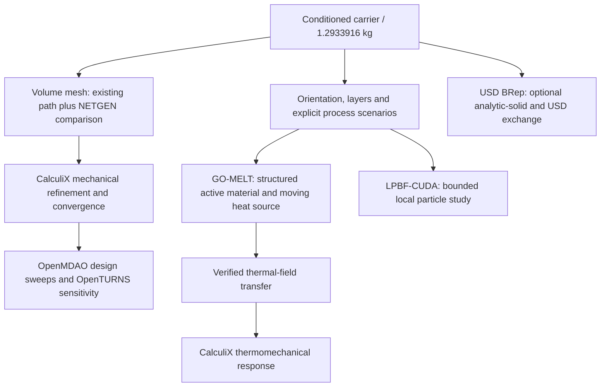

# Recently documented tools: usefulness for the 993 carrier

Reviewed on 29 October 2026 against the current main-branch toolchain, the installed source revisions and upstream repositories. The active carrier remains the [conditioned 1.2933916 kg geometry](SURFACE-CONDITIONING.md).

## Decision

**Use SALOME/NETGEN as the next independent volume-meshing comparison. Prepare GO-MELT for the subsequent LPBF thermal branch.** Keep USD BRep available for solid-CAD and exchange work; evaluate LPBF-CUDA on a small process subdomain before considering a carrier adapter.

| Software | Concrete help for this part | Integration needed | Priority |
|---|---|---|---|
| SALOME/SMESH + NETGEN | Compare a second tetrahedral mesher on the corrected closed surface; preserve input coordinates, faces and named geometric groups | Independent group mapping and a native Linux runtime sized for the complete mesh | **Immediate meshing comparison** |
| GO-MELT | Compute moving-laser temperature histories and heat accumulation, particularly around thin webs and port mouths | Explicit alloy/process data, a structured-grid/material-activation adapter, and mesh/time refinement; transfer temperatures to CalculiX for a subsequent thermomechanical calculation | **Next manufacturing-simulation branch** |
| Simulation-of-LPBF-using-CUDA | Study particle deposition and particle heating for a local powder/process case | Modern CUDA build and CPU/GPU comparison, material review, and a verified particle/wall adapter | Local research case first |
| NVIDIA USD BRep | Exact-solid Boolean operations and BRep/USD exchange for analytic interfaces and review components | Preserve the existing dimensional master and verify any new exchange route | Optional CAD/exchange branch |
| OpenMDAO | Automate a mass/stiffness design sweep once the complete-carrier solver can replay reliably | Accepted solver response, design variables, bounds and reproducible failure handling | After mechanical convergence |
| OpenTURNS | Quantify response sensitivity to declared parameter ranges | Verified solver responses and explicit ranges; probability distributions require their own justification | After mechanical convergence |

The three latest optional additions are documented in the [28 October integration runbook](../../architecture/usd-brep-lpbf.md). The other three come from the [free engineering tools integration](../../architecture/free-tools/README.md).

## Executed check and a concrete GO-MELT integration issue

The installed, pinned GO-MELT thermal kernel was exercised again for this review. Its analytical controls pass: shape-function partition of unity, unit volume, constant-temperature equilibrium, prescribed uniform heating, and source-free diffusion/energy conservation. The heated result is **300.02000000000004**, against **300.02**, on the CPU/x64 profile. [Fresh control receipt](evidence/new-tools-assessment-001/go-melt-control.json).

Source inspection identifies a material-transfer issue that must be resolved in the adapter: `SetupProperties` defaults to a density of **8.0e-6 kg/mm³**, whereas this titanium carrier study uses **4.42e-6 kg/mm³**. The default thermal laws and laser settings therefore cannot be silently reused for this part. The same setup also applies an explicit factor of **1e6** to its convection coefficient before later metre-based boundary calculations; the adapter needs an independently checked unit map.

This review executed the thermal kernel controls, not the complete multilevel laser driver or a carrier thermal simulation. The latter needs its own frozen input package and numerical refinement.

## Native NETGEN adapter started

To test the mesher on the Mac without a large emulated SALOME image, a separate
native environment now installs **netgen-mesher 6.2.2607**, **netgen-occt 7.8.1**
and **NumPy 2.4.6**. Its imported-surface tetrahedron control passes with unchanged
input nodes/faces, positive exact cell orientation and exact volume **1/6**.
A second [through-bore control](evidence/new-tools-assessment-001/netgen-bore-control.json)
also passes: 132 tetrahedra with exact volume equal to the oriented input surface.
[Native NETGEN control receipt](evidence/new-tools-assessment-001/netgen-native-control.json).

This is a new standalone runtime profile, separate from the earlier SALOME 9.16
controls. The first complete-carrier attempt reached its **6 GiB resident-memory
limit** and was stopped cleanly before a volume result was admitted. A 16 GiB
retry then reached its CPU-time limit after 464.6 seconds of wall time, with about
14.9 GiB observed resident memory. [First limit receipt](evidence/new-tools-assessment-001/netgen-initial-resource-limit.json),
[second limit receipt](evidence/new-tools-assessment-001/netgen-second-resource-limit.json).
The unchanged geometry and numerical criteria are now being exercised under a
**24 GiB / 1,850-second** local guard on the verified 64 GiB Mac. No complete
volume result is admitted yet. No support or loading groups are inferred for
this geometry-only comparison; mechanical admission remains separate.

## What each tool does not automatically supply

GO-MELT produces thermal fields. Predicting distortion or residual stress then requires a thermomechanical model and a verified field transfer to CalculiX. Its structured moving meshes are a different geometry contract from the current triangle surface.

The LPBF-CUDA repository models particle deposition and heating after a laser pass. It is not an existing internal-powder evacuation simulation for this carrier. Its current project witness covers CPU builds and thermal controls; the modern CUDA port and arbitrary carrier-wall interaction remain work to perform. The documented floor-conduction and high-temperature capacity branches also need review before using that model in the carrier study.

USD BRep supplies solid-modeling operations and USD exchange. The documented integration does not provide a verified conversion from our complete gyroid triangle mesh into an editable analytic solid, or a replacement for tetrahedral meshing and stress analysis.

## Integration sequence

## Source references

- [GO-MELT](https://github.com/JLnorthwestern/GO-MELT), installed revision `7dafdd8593711cf8ac6ccb18a1f475744610ea3d`.
- [Simulation-of-LPBF-using-CUDA](https://github.com/zhangyaqi1989/Simulation-of-LPBF-using-CUDA), installed revision `b81c9a0d8abae302c9a4eeacf384502d2220d360`.
- [NVIDIA USD BRep](https://github.com/NVIDIA-Omniverse/usd-brep), project profile 1.0.1.
- [Native SALOME worker](../../../benchmarks/free-tools/salome_worker.py): imports the existing surface, invokes NETGEN, verifies unchanged faces/groups, checks tetrahedra and round-trips the CalculiX export.

The selected next actions preserve the current geometry and the 1.30 kg ceiling. No new paid lease was started for this assessment.
