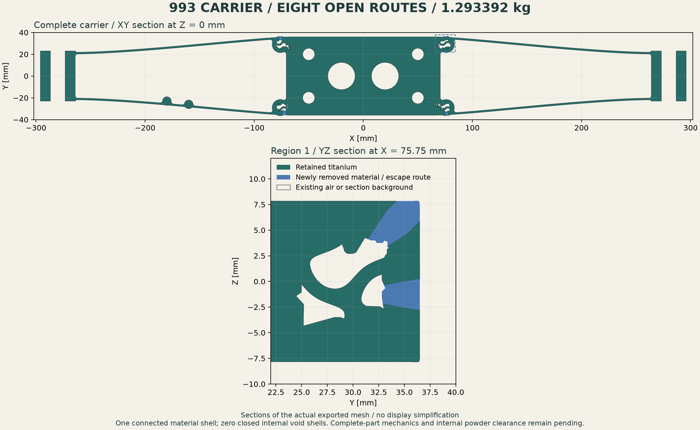
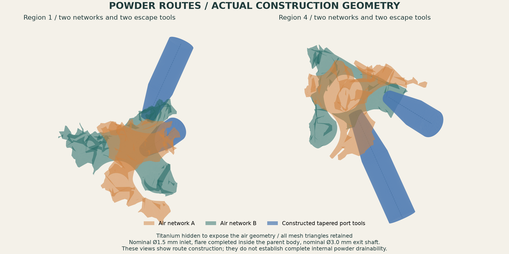
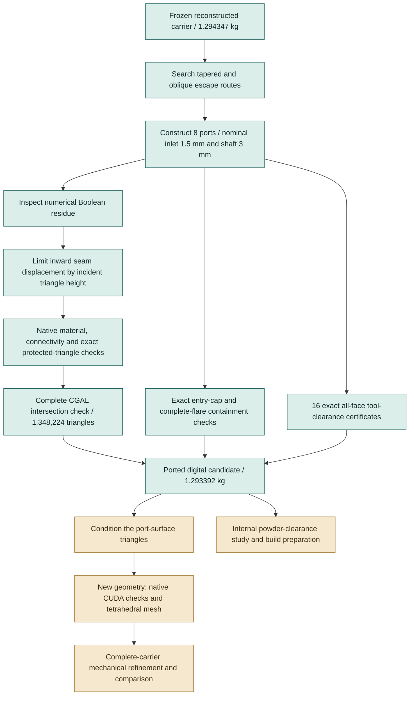

# Eight powder routes and a reproducible geometry check

The new carrier has **eight open escape routes**, one connected titanium shell
and **zero closed internal void shells**. Its nominal mass is **1.293391518 kg**
at the study density of 4.42 g/cm³, below the **1.30 kg** ceiling. The protected
central region and both end regions retain their original oriented triangles.

The complete mesh passes the independent CGAL intersection check. The port
construction also passes **16 exact all-face distance certificates**. Complete
carrier mechanics, the new geometry's GPU query check and clearance throughout
the internal air networks remain active work.



Blue is material actually removed from the preceding closed-chamber carrier.
The lower view cuts through two routes in region 1. These are sections of the
exported mesh, with no display simplification.

## What changed

| Item | Closed reconstructed carrier | Ported candidate |
|---|---:|---:|
| Nominal mass | 1.294346879 kg | **1.293391518 kg** |
| Connected material shells | 1 | **1** |
| Closed internal void shells | 8 | **0** |
| Additional removed volume | — | about **216.145 mm³** |
| Nominal inlet diameter | — | **1.5 mm** |
| Nominal exit-shaft diameter | — | **3.0 mm** |

The ports remove approximately **0.955 g**. They provide access to the existing
cells; a substantial further mass reduction still requires a larger eligible
core or a structural redesign followed by complete-part calculations.

The initial 3 mm opening reference comes from the
[Materialise titanium design guide](https://www.materialise.com/es/academy/industrial/design-am/titanium).
It is a design scenario for this investigation. The guide also discusses larger
or multiple openings for more complex interiors. This study has not yet shown
that every internal constriction can pass the selected powder clearance.

## How the openings are constructed



Each route starts inside its own air network. A polygonal cone expands from the
nominal 1.5 mm inlet to a nominal 3 mm shaft. **The whole flare ends inside the
original carrier body**, so the shaft has reached its full diameter before it
opens through an outside wall. A closed cap at the shaft's far end lies entirely
outside the original body's bounding box.

The search examines outward and oblique directions while retaining the central
protected column, `−65 ≤ X ≤ 65 mm`, and the two end regions, `|X| ≥ 260 mm`.
All three regions are checked against the preceding geometry after construction:
**216,264 + 60,437 + 60,580 original oriented triangles remain exact**.
These are the project's nominal digital interfaces.



## Independent mathematical checks

The [qualification receipt](evidence/powder-ports-001/stages/ported-qualification-001/assessment.json)
binds the candidate, protected-region checks, native roundtrip and independent
receipts. The candidate archive SHA-256 is
`a5a5b20fe3635f36eb6fda8433c2943fb0036071bd0cbce68779b3c5e0582b05`.

- **Complete surface:** CGAL 5.6 / EPECK checks all **1,348,224 triangles** of
  the final candidate and finds no self-intersection.
- **Entry and exit:** exact bounded-side and nearest-distance predicates show
  that each inlet cap lies wholly inside its own network and each complete
  flare lies inside the original carrier. The exit caps lie outside its box.
- **Spacing:** each port is checked against the seven other original air
  networks and against the seven other port tools. All **16** cases certify
  complete-face separation of at least **10001/10000 mm = 1.0001 mm**.
- **Material and interfaces:** the final native difference finds no material
  added to the preceding candidate. The material remains connected, and the
  protected triangle rosters and final export/reimport are exact.

For the spacing certificate, a source triangle is covered by a ball centred at
its exact barycentre. Let `d²` be the exact squared distance from that centre to
the complete target mesh, `r²` the largest squared distance to the triangle's
vertices, and `g = 10001/10000 mm`. The cover is accepted only if
`l = d² − r² − g² ≥ 0` and `l² ≥ 4g²r²`. Otherwise the triangle is subdivided.
This proves the threshold on complete faces with exact rational comparisons.
Analytic separated and insufficient-gap controls run with every certificate.

These certificates describe the **construction tools and original networks**.
They are not an exact global thickness measurement of every final carrier wall.
The seam reconstruction is separately bounded and the final whole mesh is
checked independently. Entry-mouth radii have a declared 0.0001 mm numerical
construction reserve; their measured perimeter diameters round to 3.000 mm.

## Failures retained and corrected

The initial straight/slow-flare search could put its nominal 3 mm section beyond
the outside wall. It was retained as a route-search trial, and the construction
was changed to finish the flare wholly inside the parent body. The next
axis-only search found no admissible route for one network. Including oblique
outward directions found routes for all eight without lowering the spacing gate.

The first raw Boolean cut passed complete-surface intersection checking, but a
native subtraction returned microscopic signed residue rather than an empty
result. A uniform 10 nm inward seam displacement removed that residue but
created **two intersecting triangle pairs**: that version was refused.

The retained reconstruction limits each displacement to **1% of the smallest
incident triangle height**, with a maximum of 10 nm and a floating-point
headroom check. It passes the native empty-difference test and the complete
independent intersection test. Both refused intermediates and their producing
sources are retained in the evidence package.

## Run the current geometry workflow

The [replay runner](../../../parts/993-eng-carrier-0001/source/design-20261016/convergence-20261022/replay_powder_ports.py)
checks the published input hashes, rebuilds the geometry in a fresh staging
directory, compiles the three CGAL workers, runs all independent checks and
renders both figures. It then compares the complete oriented geometry with the
published candidate. The raw intermediate's known refusal is recorded; the
reconstructed candidate must pass.

Use Python 3.11 with this separate pinned runtime:

```sh
python3.11 -m venv work/carrier-ports-runtime
work/carrier-ports-runtime/bin/python -m pip install \
  numpy==2.4.6 scipy==1.17.1 libigl==2.6.3 \
  manifold3d==3.5.4 matplotlib==3.11.2

work/carrier-ports-runtime/bin/python \
  parts/993-eng-carrier-0001/source/design-20261016/convergence-20261022/replay_powder_ports.py \
  --output work/carrier-ports-replay-001
```

The current host's retained **CGAL 5.6 ARM64 image** is a prerequisite:
`sha256:7ed241be10194d98e4ae750cb7f983b0d501742f1ac651580b86c165cba39537`.
This identifies the locally qualified image; it is not a public pull reference.
Each CGAL container runs with one CPU, 6 GiB, no network and a bounded timeout.
The replay preflight checks the image and Python profile before creating output.

Outputs include `replay-assessment.json`, stage logs, the final NPZ model,
independent receipts and PNG images. The
[publication manifest](evidence/powder-ports-001/publication-manifest.json)
records the selected public artifacts and frozen producer sources.

## Recorded verification

The [fresh-directory replay](evidence/powder-ports-001/replay-assessment.json)
completed all 13 stages in **214.43 seconds**. Its complete oriented geometry
matches the published candidate exactly. The known raw intermediate refusal
was retained and its corrected successor passed.

The [macOS repository check](evidence/powder-ports-001/checks/make-check.json)
ran **5,065 tests**, with **290 skips and the same four unrelated failures**
recorded before this change: the two impeller/stator catalogue checks, the
channel CFD proxy comparison and the fillet hydraulic comparison. This is not
a passing local full-suite result.

## Next numerical work

Some port-cut triangles remain extremely thin: the final maximum aspect ratio
is approximately **8.49 × 10⁷**, with a minimum height of **4.82 × 10⁻⁹ mm**.
Float32 transport produces no exactly collapsed triangle, but that alone does
not qualify numerical conditioning. The next operation is a local remesh that
retains the protected regions, followed by the same independent geometry tests.

The native CUDA results on the earlier closed candidate remain attached to that
geometry. The ported candidate needs its own fixed-precision GPU run. Its
complete-carrier mechanical calculations and internal powder-clearance study
also remain pending. `manufacturing_authorized` stays `false`.
