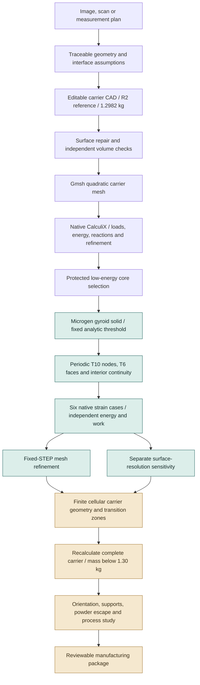

# 993 carrier: explicit cells and reproducible quadratic mechanics

This continuation replaces the voxel-only material experiment with an explicit
gyroid solid, periodic quadratic tetrahedra and six native CalculiX strain cases.
The existing R2 carrier remains **1.298199813 kg**, below the **1.30 kg** ceiling.
Its geometry is unchanged. A lighter cellular carrier has not yet been generated.

The earlier [carrier and GPU results](../carrier-convergence-20261022/README.md)
remain the baseline, including the failed whole-carrier peak-stress convergence
and the failed final voxel-cell refinement. This independent series does not
turn those failures into passes.


The image shows the actual normalized research cell and a cutaway through its
T10 elements. It is generated from the saved mesh, including quadratic boundary
nodes; [image provenance](evidence/geometry-figure-provenance.json) records hashes.
The 1 mm cube is a mathematical reference size, not a chosen printing pitch.

## Workflow and current position



The purpose of the cell work is to establish a defensible material input before
cutting a finite cellular region into the carrier. The complete-carrier analysis,
transition geometry, actual mass and additive preparation remain separate steps.

## Fixed geometry, actual refinement

The analytic solid is
`abs(sin(x) cos(y) + sin(y) cos(z) + sin(z) cos(x)) <= 0.6170021750539874`,
with one period per reference cube. Microgen's sheet offset is twice this
threshold. Neither threshold nor density is retuned between levels.

All three spatial levels import the **same STEP bytes**:
`3e755bf72bc532bbcf2814cd85e6373bce7dfe1ceb7afba405da7f175f963cf6`.
The [compressed editable STEP](evidence/geometry/fixed-r24.step.gz) decompresses
to that identity. Its valid three-solid compound has volume **0.4044733694 mm³**;
all solids are retained on import and become connected through periodic ties.

| Target size | Actual T10 elements | Physical nodes | Maximum corner edge, mm | Six mechanical cases |
|---|---:|---:|---:|---|
| 0.12 | 27,197 | 51,355 | 0.125452 | Passed |
| 0.05 | 67,777 | 116,931 | 0.086294 | Passed |
| 0.03 | 215,798 | 342,185 | 0.057723 | Running in the separate 24 GiB profile |

The 0.08 attempt retained the same maximum edge and added only 2.7% elements.
It is retained privately but is not counted as a meaningful spatial refinement.
The [second contract](evidence/study-contract-002.json) requires element growth
of at least 1.25 and decreasing maximum edges.

Coarse to medium changes the full stiffness tensor by **0.1410616%**, below the
unchanged **2%** threshold. **Two successive comparisons** must pass; the fine
level is still running, so fixed-geometry convergence is not yet admitted.

Surface resolution is a different study. At nominal size 0.05, resolution 32
has **63,542 T10 elements**, volume fraction **0.4026911**, and all six cases pass.
Its tensor changes by **0.5533792%** from resolution 24. Resolution 48 has
**167,435 T10 elements**, volume fraction **0.4014374**, and is running.
These STEP geometries differ; local element sizes also change. Their comparison
cannot be substituted for fixed-STEP mesh convergence.

## Mathematical checks

Dense titanium is modeled as linear isotropic material with **E = 107,000 MPa**
and **ν = 0.31**. Six independent engineering strains of amplitude **0.001**
recover the complete 6 × 6 stiffness tensor. Shear displacement gradients use
half the engineering shear. Internal voids are absent from the domain and have
natural traction-free surfaces; this series has no ersatz stiffness floor.

Every admitted case checks complete physical-node displacements and reactions,
all four stress integration points per T10, periodic displacements, independent
stress-compliance energy and physical-boundary reaction work. Energy and work
relative limits are **10⁻⁴**; periodic displacement is **10⁻⁸ mm**. Reciprocity,
positive stiffness and the solid-volume Voigt upper bound are checked. Small
off-diagonal terms are retained.

Before the gyroid calculation, the same implementation and binary solve a full
solid cube in all six modes. The relative analytic tensor error is
**1.4262 × 10⁻⁷**, below **10⁻⁵**. The 12/24 GiB control has byte-identical decks;
complete field differences remain below the earlier numerical comparison limits.
The [resource-profile comparison](evidence/resource-profile-control-comparison.json)
reports the actual differences, rather than claiming bit-identical tensors.

The current command also enforces facet checks automatically and binds the
cube qualification to every numerical helper's hash. A
[modified helper qualification is refused before a deck is created](evidence/missing-helper-refusal.json).
The [admission-control replay](evidence/preflight-admission-control-comparison.json)
retains byte-identical decks and passing complete fields for the solid cube and
coarse gyroid. Earlier long-running cases retain their original source hashes;
the [archived source versions](evidence/sources/) preserve those implementations.

Mesh admission checks the complete boundary-node bijection, matching opposite
T6 face connectivity, matching all six IDs on shared interior faces, positive
corner determinants and a sufficient whole-simplex quadratic Jacobian
perturbation bound. This is a floating-point bound, not a formal interval proof.

## Software defects reproduced and corrected

| Observed defect | Correction and evidence |
|---|---|
| Microgen 1.3.2 requested order 2 but emitted Gmsh type 4 linear tetrahedra | Set `Mesh.ElementOrder=2` before generation; require actual type 11 T10 elements |
| Its output checker examined only 973 interior-classified nodes in the original 8,376-node probe | Check the complete volume-node roster, including all boundary nodes |
| Its signed-difference comparison accepted a negative 10⁻⁵ mm mismatch | Independent bidirectional, bijective matching checks absolute distances at the unchanged 10⁻⁸ mm limit |
| MSH4 transport could not be read consistently by meshio for this output | Emit explicit ASCII MSH2.2; keep native node and element rosters |
| A native node field exceeded CalculiX's 20-character limit, returning 201 | Serialize at the highest precision that fits, then re-audit the actual serialized coordinates |
| The first fine case exceeded its 12 GiB RSS cap, returning 125 | Preserve the refusal; run a fresh, separately declared 24 GiB profile with the same numerical criteria |

The [negative controls](evidence/software-negative-controls.json) reproduce the
original node-order and periodicity defects. Upstream package files are not
patched: [23 installed Python sources match the pinned source archive](evidence/upstream-installed-source-verification.json).
The adapter targets inspected private APIs and explicitly requires Microgen 1.3.2.

## Runtime and toolchain

| Software | Version / role | Evidence scope |
|---|---|---|
| Microgen | 1.3.2, GPLv3; gyroid solid and periodic meshing orchestration | Actual solids and mesh generation; selected 29 upstream tests pass |
| CadQuery / OpenCascade | 2.5.2 / cadquery-ocp 7.7.2 | Valid compound, STEP import/export and independent solid volume |
| Gmsh / meshio | 4.15.2 / 5.3.5 | Native periodic mesh and explicit T10 transport |
| Python / NumPy / SciPy | 3.11.18 / 2.4.6 / 1.17.1 | Independent geometry and field assessments in an isolated macOS ARM64 runtime |
| CalculiX / corrected SPOOLES | CCX 2.21, eight solver threads | Previously qualified native binary; six solid controls and actual gyroid fields |
| PyVista / VTK / Matplotlib | 0.44.2 / 9.3.1 / 3.11.2 | Actual quadratic-mesh image and numerical charts |
| PR #274 Warp | 1.18.0, unchanged kernel | Existing merged native CPU/CUDA carrier-query evidence; no fresh GPU claim in this CPU study |

The [complete runtime inventory](evidence/runtime-provenance.json) records the
installed versions. Microgen declares SciPy `>=1.13.1,<1.16`; the default 1.15.3
wheel fails this Mac's native PROPACK loader. The retained
[native refusal](evidence/scipy115-native-refusal.json) is followed by a private
1.17.1 compatibility profile. **This override is outside Microgen's declared
dependency range**: [the dependency check correctly reports one incompatibility](evidence/dependency-constraint-check.json).
Selected tests and the actual workflow pass; full upstream compatibility is not
claimed. Global Python packages are unchanged.

The expanded local check also exposes duplicate Objective-C VTK classes when
CadQuery's embedded VTK 9.2 and PyVista's installed VTK 9.3 load together.
[Package ownership metadata](evidence/vtk-package-metadata.json) identifies both
library families. This is a retained packaging limitation; CAD/VTK coexistence
has a documented upstream history in
[CadQuery OCP issue 119](https://github.com/CadQuery/OCP/issues/119).
The selected cell generation and separate image command completed, but a
universal CAD/visualization runtime is not claimed by these results.

The pinned Microgen source archive SHA-256 is
`d64874c852a38225159188b2454bf22b9fb18d1ddd12540b0fa7eb4606a77157`.
The native solver SHA-256 is
`95e9b61985446b686f5f146d1a947101a5ec8ac86fef0cf9e308d25f817c918a`;
its corrected-source and complete-reference qualification are described in the
[earlier native solver audit](../carrier-convergence-20261022/README.md#spooles-race-reproduction-and-corrected-complete-reference).

## Repeat the study

Run from the repository root in a fresh work directory. This is the recorded
macOS ARM64 compatibility profile; a different native binary needs separate
qualification. `CELL_CCX` must point to the qualified binary above.

```sh
CELL_SOURCE=parts/993-eng-carrier-0001/source/design-20261016/convergence-20261022
CELL_WORK=work/interface-replay
uv venv --python 3.11.18 "$CELL_WORK/runtime"
CELL_PY="$CELL_WORK/runtime/bin/python"
uv pip install --python "$CELL_PY" microgen==1.3.2 gmsh==4.15.2 meshio==5.3.5 cadquery==2.5.2 cadquery-ocp==7.7.2 pyvista==0.44.2 vtk==9.3.1
uv pip install --python "$CELL_PY" --no-deps scipy==1.17.1 numpy==2.4.6 matplotlib==3.11.2
"$CELL_PY" -m unittest discover -s tests -p test_carrier_periodic_interface_20261028.py -v
"$CELL_PY" "$CELL_SOURCE/periodic_interface_mesh.py" --kind cube --size .2 --output "$CELL_WORK/cube"
"$CELL_PY" "$CELL_SOURCE/periodic_interface_topology.py" --mesh "$CELL_WORK/cube" --output "$CELL_WORK/cube-topology.json"
```

Use the [24 GiB study contract](evidence/study-contract-003.json), solve the cube
with `periodic_interface_mechanics.py`, then supply its `--qualification` result
to each gyroid run. Decompress the fixed STEP and import it with `--step` for
sizes 0.12, 0.05 and 0.03; run the topology audit on every mesh. Each fresh native
case has a **600 s** wall cap, **24 GiB** RSS cap and a reaped-process receipt.
The host has 64 GiB; the 40 GiB arithmetic remainder is not a measurement of
available memory after other applications.

`assess_interface_series.py` takes three `--level MESH MECHANICS TOPOLOGY`
triples. It checks six successful native terminals and their DAT hashes at each
level before comparing tensors and generating the convergence chart.
`render_periodic_interface.py` renders the actual mesh. All outputs require
fresh paths; failed attempts are retained.

## Consequence for lightweighting


Blue marks the previously selected **7,401 analysis cells / 4,778.814 mm³**.
It locates the material study within the actual carrier analysis; it is not a
picture of a newly generated lattice. The existing
[figure provenance](../../media/carrier-convergence-20261022/P1-refined-core-screen-015/figure-provenance.json)
is retained.

The existing protected-core screen remains a conditional saving of about
**12.6 g**, not an achieved new carrier mass. Smaller pitch at the same solid
fraction does not itself remove more material. The next geometric operation
must create a finite core, retain interfaces and skins, connect its transition
zones, and recalculate the complete modified carrier before reporting a gain.
The manufacturing package also needs computational checks of feature sizes,
powder escape, supports and process response. These remain active work.

### Finite-core topology inspection


The [new topology inspection](evidence/selected-core-topology-001/assessment.json)
finds **375 face-connected components** and **628 boundary edges whose incidence
is not two** in the frozen selected mask. Vertex-only contact is distinguished
from face continuity; vertex manifoldness is not certified. This explains why
the budget mask needs reconstruction into explicit finite regions before it can
serve as a lattice envelope. The selection and its total volume are unchanged.
The [compact selected volume](evidence/selected-core-topology-001/selected-volume.npz)
preserves its actual indexed tetrahedra and parent IDs for independent checks.

`inspect_selected_core.py` accepts the frozen P1 volume, selected-cell archive
and admitted core-energy reference. It verifies their hashes, centroid identity
and volume before emitting the component ledger and image. No smoothing or
clearance enlargement is silently applied.

## Verification checkpoint

The focused interface/core tests pass **9/9**. The selected upstream geometry
tests pass **29/29**. Strict documentation links pass after the new report files
are staged. The expanded macOS `make check` attempt ran **4,943 tests**, with
**4 failures and 275 skips**: the failures compare unrelated fan/stator/coupon
floating-point dictionaries exactly and differ in the last printed digits.
Those files are unchanged by this work. This is not a passing full local check;
the exact published branch still needs its Linux CI result.
