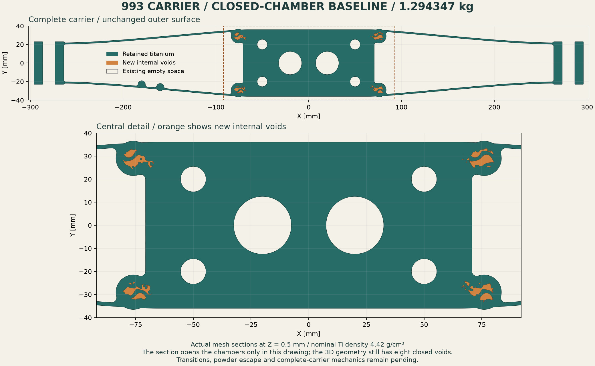
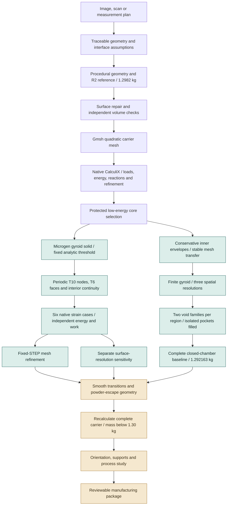
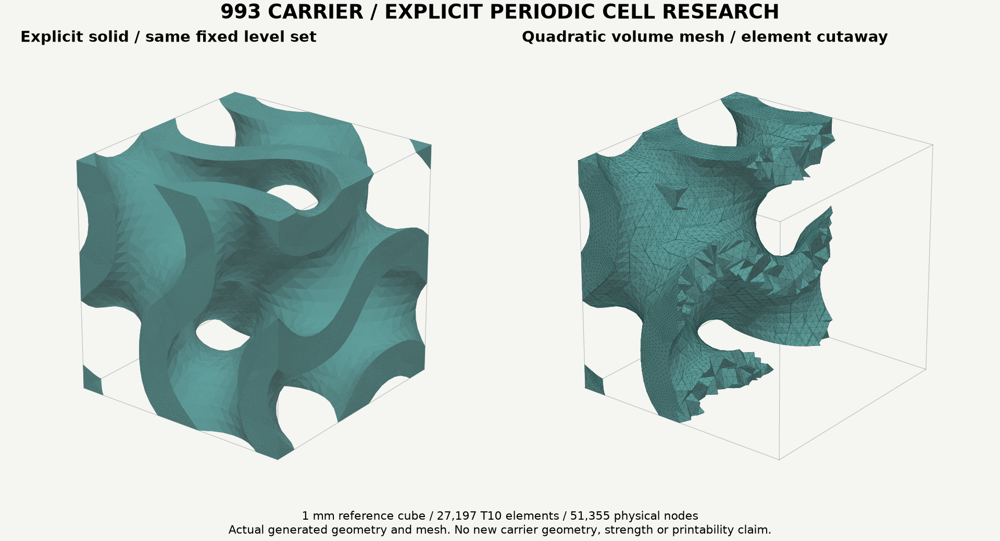
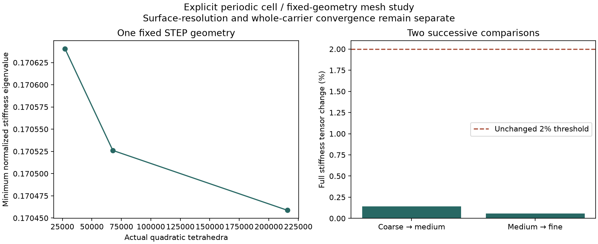
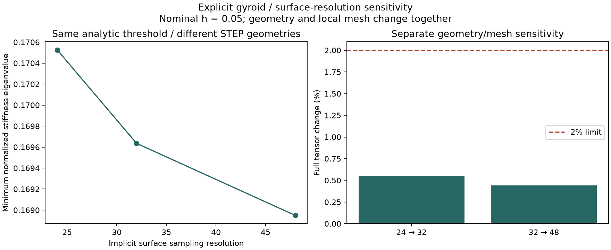
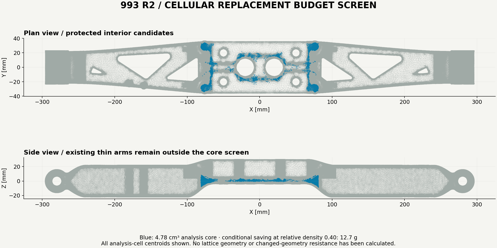
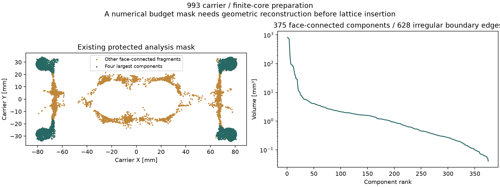
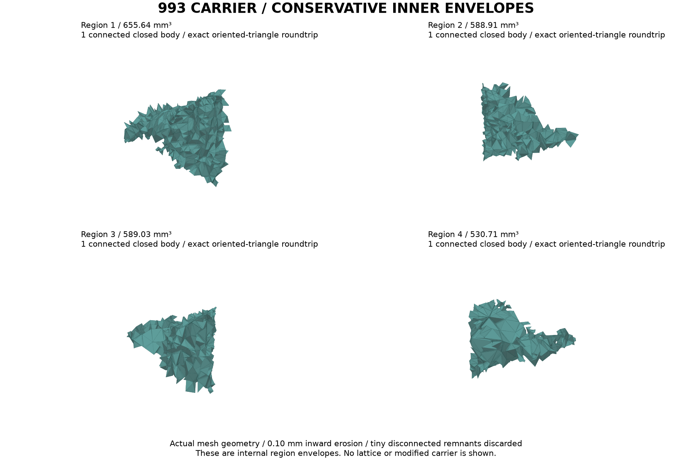
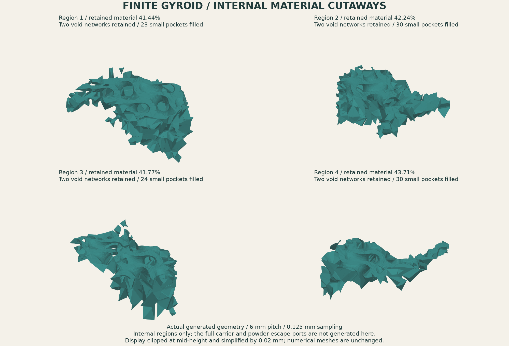

# 993 carrier: closed geometry and reproducible mechanics

This continuation replaces the voxel-only material experiment with an explicit
gyroid solid, periodic quadratic tetrahedra and six native CalculiX strain cases.
The existing R2 carrier remains **1.298199813 kg**, below the **1.30 kg** ceiling.
A first complete closed-chamber variant now has nominal computed mass
**1.292162707 kg**. It preserves the complete R2 outer surface exactly.
Transition blending, powder escape and mechanics on the changed geometry remain
active work.

The [29 October surface/GPU revalidation](SURFACE-REPAIR.md) retains those trials
and adds a **1.294346879 kg reconstructed candidate**. Its complete geometry
passes independent intersection checking, conservative-core containment and the
1 mm cross-network screen. Native CUDA broad and targeted regression workloads
pass the unchanged precision limit; the original carrier control still fails.
The separate 10 µm repair-fidelity profile remains refused.

The earlier [carrier and GPU results](../carrier-convergence-20261022/README.md)
remain the baseline, including the failed whole-carrier peak-stress convergence
and the failed final voxel-cell refinement. This independent series does not
turn those failures into passes.



The sections come from the complete generated mesh. Orange marks the new internal
voids; [figure provenance](evidence/reconstructed-carrier-001/figure-provenance.json)
records the mesh identity and section-plane area checks.

## Workflow and current position



The cell work establishes the reference material behavior. The closed geometry
trial then inserts explicit finite voids. Complete-carrier analysis, transition
geometry and additive preparation remain separate steps.

## Fixed geometry, actual refinement



The image shows the actual normalized research cell and a cutaway through its
T10 elements. It is generated from the saved mesh, including quadratic boundary
nodes; [image provenance](evidence/geometry-figure-provenance.json) records hashes.
The 1 mm cube is a mathematical reference size, not a chosen printing pitch.


The analytic solid is
`abs(sin(x) cos(y) + sin(y) cos(z) + sin(z) cos(x)) <= 0.6170021750539874`,
with one period per reference cube. Microgen's sheet offset is twice this
threshold. Neither threshold nor density is retuned between levels.

All three spatial levels import the **same STEP bytes**:
`3e755bf72bc532bbcf2814cd85e6373bce7dfe1ceb7afba405da7f175f963cf6`.
The [compressed editable STEP](evidence/geometry/fixed-r24.step.gz) decompresses
to that identity. Its valid three-solid compound has volume **0.4044733694 mm³**;
all solids are retained on import and become connected through periodic ties.

| Target size | Actual T10 elements | Physical nodes | Maximum corner edge, mm | Six mechanical cases |
|---|---:|---:|---:|---|
| 0.12 | 27,197 | 51,355 | 0.125452 | Passed |
| 0.05 | 67,777 | 116,931 | 0.086294 | Passed |
| 0.03 | 215,798 | 342,185 | 0.057723 | Passed in the separate 24 GiB profile |

The 0.08 attempt retained the same maximum edge and added only 2.7% elements.
It is retained privately but is not counted as a meaningful spatial refinement.
The [second contract](evidence/study-contract-002.json) requires element growth
of at least 1.25 and decreasing maximum edges.

Coarse to medium changes the full stiffness tensor by **0.1410616%**; medium to
fine changes it by **0.0561359%**. Both successive comparisons pass the unchanged
**2%** threshold. All six strain cases pass at all three levels, so the
[fixed-STEP spatial criterion is satisfied](evidence/fixed-STEP-series-001/assessment.json).
The minimum normalized stiffness ratio changes from **0.1706406** to
**0.1705261** to **0.1704587**. This admits the selected fixed-geometry cell study,
not whole-carrier convergence or isolated implicit-surface convergence.



Surface resolution is a different study. At nominal size 0.05, resolution 32
has **63,542 T10 elements**, volume fraction **0.4026911**, and all six cases pass.
Its tensor changes by **0.5533792%** from resolution 24. Resolution 48 has
**167,435 T10 elements**, volume fraction **0.4014374**, and all six cases pass.
Resolution 32 to 48 changes the tensor by **0.4426642%**. Both observed changes
are below 2%; the [separate sensitivity assessment](evidence/surface-sensitivity-002/assessment.json)
preserves their different interpretation.
These STEP geometries differ; local element sizes also change. Their comparison
cannot be substituted for fixed-STEP mesh convergence.



## Mathematical checks

Dense titanium is modeled as linear isotropic material with **E = 107,000 MPa**
and **ν = 0.31**. Six independent engineering strains of amplitude **0.001**
recover the complete 6 × 6 stiffness tensor. Shear displacement gradients use
half the engineering shear. Internal voids are absent from the domain and have
natural traction-free surfaces; this series has no ersatz stiffness floor.

Every admitted case checks complete physical-node displacements and reactions,
all four stress integration points per T10, periodic displacements, independent
stress-compliance energy and physical-boundary reaction work. Energy and work
relative limits are **10⁻⁴**; periodic displacement is **10⁻⁸ mm**. Reciprocity,
positive stiffness and the solid-volume Voigt upper bound are checked. Small
off-diagonal terms are retained.

Before the gyroid calculation, the same implementation and binary solve a full
solid cube in all six modes. The relative analytic tensor error is
**1.4262 × 10⁻⁷**, below **10⁻⁵**. The 12/24 GiB control has byte-identical decks;
complete field differences remain below the earlier numerical comparison limits.
The [resource-profile comparison](evidence/resource-profile-control-comparison.json)
reports the actual differences, rather than claiming bit-identical tensors.

The current command also enforces facet checks automatically and binds the
cube qualification to every numerical helper's hash. A
[modified helper qualification is refused before a deck is created](evidence/missing-helper-refusal.json).
The [admission-control replay](evidence/preflight-admission-control-comparison.json)
retains byte-identical decks and passing complete fields for the solid cube and
coarse gyroid. Earlier long-running cases retain their original source hashes;
the [archived source versions](evidence/sources/) preserve those implementations.

Mesh admission checks the complete boundary-node bijection, matching opposite
T6 face connectivity, matching all six IDs on shared interior faces, positive
corner determinants and a sufficient whole-simplex quadratic Jacobian
perturbation bound. This is a floating-point bound, not a formal interval proof.

## Software defects reproduced and corrected

| Observed defect | Correction and evidence |
|---|---|
| Microgen 1.3.2 requested order 2 but emitted Gmsh type 4 linear tetrahedra | Set `Mesh.ElementOrder=2` before generation; require actual type 11 T10 elements |
| Its output checker examined only 973 interior-classified nodes in the original 8,376-node probe | Check the complete volume-node roster, including all boundary nodes |
| Its signed-difference comparison accepted a negative 10⁻⁵ mm mismatch | Independent bidirectional, bijective matching checks absolute distances at the unchanged 10⁻⁸ mm limit |
| MSH4 transport could not be read consistently by meshio for this output | Emit explicit ASCII MSH2.2; keep native node and element rosters |
| A native node field exceeded CalculiX's 20-character limit, returning 201 | Serialize at the highest precision that fits, then re-audit the actual serialized coordinates |
| The first fine case exceeded its 12 GiB RSS cap, returning 125 | Preserve the refusal; run a fresh, separately declared 24 GiB profile with the same numerical criteria |

The [negative controls](evidence/software-negative-controls.json) reproduce the
original node-order and periodicity defects. Upstream package files are not
patched: [23 installed Python sources match the pinned source archive](evidence/upstream-installed-source-verification.json).
The adapter targets inspected private APIs and explicitly requires Microgen 1.3.2.

## Runtime and toolchain

| Software | Version / role | Evidence scope |
|---|---|---|
| Microgen | 1.3.2, GPLv3; gyroid solid and periodic meshing orchestration | Actual solids and mesh generation; selected 29 upstream tests pass |
| CadQuery / OpenCascade | 2.5.2 / cadquery-ocp 7.7.2 | Valid compound, STEP import/export and independent solid volume |
| Gmsh / meshio | 4.15.2 / 5.3.5 | Native periodic mesh and explicit T10 transport |
| Python / NumPy / SciPy | 3.11.18 / 2.4.6 / 1.17.1 | Independent geometry and field assessments in an isolated macOS ARM64 runtime |
| CalculiX / corrected SPOOLES | CCX 2.21, eight solver threads | Previously qualified native binary; six solid controls and actual gyroid fields |
| PyVista / VTK / Matplotlib | 0.44.2 / 9.3.1 / 3.11.2 | Actual quadratic-mesh image and numerical charts |
| Manifold / libigl | 3.5.4 / 2.6.3 | Finite envelopes, clipped gyroids, complete carrier subtraction and exact transfer checks |
| PR #274 Warp | 1.18.0, unchanged kernel | Actual CUDA: reconstructed carrier and 36 previous failure locations pass; raw carrier control fails on the same GPU |
| MeshLib / meshlib-core | 3.1.4.297, existing evaluation runtime | Internal reconstruction, degeneracy removal and triangle conditioning; separate 10 µm fidelity profile refused |
| CGAL | 5.6 / 6.2.1, EPECK | Independent embedding checks, calibrated repair trials and exact nearest-distance refusal witness |

The [complete runtime inventory](evidence/runtime-provenance.json) records the
installed versions. Microgen declares SciPy `>=1.13.1,<1.16`; the default 1.15.3
wheel fails this Mac's native PROPACK loader. The retained
[native refusal](evidence/scipy115-native-refusal.json) is followed by a private
1.17.1 compatibility profile. **This override is outside Microgen's declared
dependency range**: [the dependency check correctly reports one incompatibility](evidence/dependency-constraint-check.json).
Selected tests and the actual workflow pass; full upstream compatibility is not
claimed. Global Python packages are unchanged.

The expanded local check also exposes duplicate Objective-C VTK classes when
CadQuery's embedded VTK 9.2 and PyVista's installed VTK 9.3 load together.
[Package ownership metadata](evidence/vtk-package-metadata.json) identifies both
library families. This is a retained packaging limitation; CAD/VTK coexistence
has a documented upstream history in
[CadQuery OCP issue 119](https://github.com/CadQuery/OCP/issues/119).
The selected cell generation and separate image command completed, but a
universal CAD/visualization runtime is not claimed by these results.

Finite-envelope reconstruction uses a separate environment with **no CadQuery or
Microgen imports**. Its [dependency check passes](evidence/geometry-dependency-check.log)
and its [runtime inventory](evidence/runtime-geometry-provenance.json) records the
actual packages. Manifold is Apache-2.0 and libigl's Python package is MPL-2.0;
no upstream implementation is vendored into these scripts.

The complete project stack remains in [TOOLCHAIN.md](../../TOOLCHAIN.md), with
the [USD BRep and LPBF extension](../../architecture/usd-brep-lpbf.md) documenting
the later exact-solid, GO-MELT and LPBF-CUDA branches. Those optional CPU smoke
controls are distinct from a carrier-specific additive process simulation.

The pinned Microgen source archive SHA-256 is
`d64874c852a38225159188b2454bf22b9fb18d1ddd12540b0fa7eb4606a77157`.
The native solver SHA-256 is
`95e9b61985446b686f5f146d1a947101a5ec8ac86fef0cf9e308d25f817c918a`;
its corrected-source and complete-reference qualification are described in the
[earlier native solver audit](../carrier-convergence-20261022/README.md#spooles-race-reproduction-and-corrected-complete-reference).

## Repeat the study

Run from the repository root in a fresh work directory. This is the recorded
macOS ARM64 compatibility profile; a different native binary needs separate
qualification. `CELL_CCX` must point to the qualified binary above.

```sh
CELL_SOURCE=parts/993-eng-carrier-0001/source/design-20261016/convergence-20261022
CELL_WORK=work/interface-replay
uv venv --python 3.11.18 "$CELL_WORK/runtime"
CELL_PY="$CELL_WORK/runtime/bin/python"
uv pip install --python "$CELL_PY" microgen==1.3.2 gmsh==4.15.2 meshio==5.3.5 cadquery==2.5.2 cadquery-ocp==7.7.2 pyvista==0.44.2 vtk==9.3.1
uv pip install --python "$CELL_PY" --no-deps scipy==1.17.1 numpy==2.4.6 matplotlib==3.11.2
"$CELL_PY" -m unittest discover -s tests -p test_carrier_periodic_interface_20261028.py -v
"$CELL_PY" "$CELL_SOURCE/periodic_interface_mesh.py" --kind cube --size .2 --output "$CELL_WORK/cube"
"$CELL_PY" "$CELL_SOURCE/periodic_interface_topology.py" --mesh "$CELL_WORK/cube" --output "$CELL_WORK/cube-topology.json"
```

Use the [24 GiB study contract](evidence/study-contract-003.json), solve the cube
with `periodic_interface_mechanics.py`, then supply its `--qualification` result
to each gyroid run. Decompress the fixed STEP and import it with `--step` for
sizes 0.12, 0.05 and 0.03; run the topology audit on every mesh. Each fresh native
case has a **600 s** wall cap, **24 GiB** RSS cap and a reaped-process receipt.
The host has 64 GiB; the 40 GiB arithmetic remainder is not a measurement of
available memory after other applications.

`assess_interface_series.py` takes three `--level MESH MECHANICS TOPOLOGY`
triples. It checks six successful native terminals and their DAT hashes at each
level before comparing tensors and generating the convergence chart.
`render_periodic_interface.py` renders the actual mesh. All outputs require
fresh paths; failed attempts are retained.

For the finite-envelope stage, no private full-carrier field or solver binary is
needed: the compact selected volume and its reference are included here.

```sh
uv venv --python 3.11.18 "$CELL_WORK/geometry-runtime"
CELL_GEOM_PY="$CELL_WORK/geometry-runtime/bin/python"
uv pip install --python "$CELL_GEOM_PY" numpy==2.4.6 scipy==1.17.1 manifold3d==3.5.4 libigl==2.6.3 pyvista==0.44.2 vtk==9.3.1 matplotlib==3.11.2
"$CELL_GEOM_PY" "$CELL_SOURCE/reconstruct_core_envelopes.py" \
  --selected docs/reports/carrier-interface-20261028/evidence/selected-core-topology-001/selected-volume.npz \
  --reference docs/reports/carrier-interface-20261028/evidence/selected-core-topology-001/assessment.json \
  --output "$CELL_WORK/envelopes"
"$CELL_GEOM_PY" "$CELL_SOURCE/render_core_envelopes.py" \
  --directory "$CELL_WORK/envelopes" --output "$CELL_WORK/envelope-image"
```

## Consequence for lightweighting



Blue marks the previously selected **7,401 analysis cells / 4,778.814 mm³**.
It locates the material study within the actual carrier analysis; it is not a
picture of a newly generated lattice. The existing
[figure provenance](../../media/carrier-convergence-20261022/P1-refined-core-screen-015/figure-provenance.json)
is retained.

The existing protected-core screen remains a conditional saving of about
**12.6 g**, not an achieved new carrier mass. Smaller pitch at the same solid
fraction does not itself remove more material. The next geometric operation
must create a finite core, retain interfaces and skins, connect its transition
zones, and recalculate the complete modified carrier before reporting a gain.
The manufacturing package also needs computational checks of feature sizes,
powder escape, supports and process response. These remain active work.

### Finite-core topology inspection



The [new topology inspection](evidence/selected-core-topology-001/assessment.json)
finds **375 face-connected components** and **628 boundary edges whose incidence
is not two** in the frozen selected mask. Vertex-only contact is distinguished
from face continuity; vertex manifoldness is not certified. This explains why
the budget mask needs reconstruction into explicit finite regions before it can
serve as a lattice envelope. The selection and its total volume are unchanged.
The [compact selected volume](evidence/selected-core-topology-001/selected-volume.npz)
preserves its actual indexed tetrahedra and parent IDs for independent checks.

`inspect_selected_core.py` accepts the frozen P1 volume, selected-cell archive
and admitted core-energy reference. It verifies their hashes, centroid identity
and volume before emitting the component ledger and image. No smoothing or
clearance enlargement is silently applied.

### Four conservative, transfer-checked envelopes



The four largest candidate regions are now reconstructed by native tetrahedral
solid unions, eroded by a centered **0.20 mm cube** and reduced to their dominant
positive connected component. This is an explicit **0.10 mm inward design
operation**, not a relaxed mesh tolerance. Small disconnected remnants are
discarded; the remaining four envelopes total **2,364.280875 mm³**. They are
internal limiting regions for a future finite lattice, not a modified carrier.

Each [checked envelope](evidence/core-envelopes-006/assessment.json) has one
connected closed native body, two-face edge incidence, matching independent
triangle/native volumes, and an **exact oriented-triangle export/reimport
comparison**. Maximum relative export-volume error is approximately **10⁻¹⁵**,
below the **10⁻¹⁰** limit.

An adaptive triangle-ball distance check covers the complete envelope boundary:
**3,614,158 subtriangle centres** are checked for tetrahedral membership and
distance to the original selected boundary. Every accepted subtriangle has a
positive whole-patch clearance bound above the **0.0001 mm** guard. This is a
floating-point coverage check, not a formal interval or full-solid subset proof.
The erosion operator supplies the conservative geometric construction.

VTK's approximate cell locator occasionally returns a nearby tetrahedron rather
than an admissible containing one. Those candidates are replaced by a direct
all-tetrahedron search; the **10⁻¹⁰** barycentric/residual checks remain unchanged.
Manifold's returned read-only index buffers are copied into the writable uint64
format required by its input API.

The [raw-union transfer refusal](evidence/raw-union-roundtrip-refusal.json) is
retained: three original region transfers changed volume despite `NoError`.
No un-eroded envelope is admitted for downstream reuse. The inward construction
and the stronger transfer gate correct this demonstrated problem without
changing the carrier or expanding the protected mask.

The [OBJ meshes and indexed source](evidence/core-envelopes-006/) are available
alongside their input hashes and the [figure provenance](evidence/core-envelopes-006/figure-provenance.json).
The closed baseline below uses these envelopes. Smooth transition zones, updated
whole-carrier mechanics and additive preparation remain active work.

The reduced envelope also changes the weight arithmetic: applying the
resolution-48 periodic solid fraction uniformly to these **2,364.28 mm³** would
save about **6.25 g** at the study density of **4.42 × 10⁻⁶ kg/mm³**. This remains
a conditional calculation before finite-cell clipping, transitions and powder
escape; the actual R2 carrier mass has not changed.

## Finite gyroid regions: stable volume, explicit void networks



The cutaways show actual generated material inside the four checked limiting
regions. Their jagged outer boundaries are internal selection-mask boundaries;
these are not exposed carrier walls or the final transition shape. The complete
closed-carrier assembly follows below. The [figure receipt](evidence/finite-gyroid-001/figure-provenance.json)
records the geometry inputs and display-only clipping/simplification.

The field now has a **6 mm pitch**, the same fixed analytic threshold, and phase
origin `(0, 0, 0)` mm. Native Manifold level sets create the voids; an additional
**0.005 mm inward clip** avoids coincident Boolean faces. This margin is an
internal construction aid, not a proposed printed wall thickness. The geometry
is sampled at **0.25, 0.125 and 0.0625 mm** without changing pitch, threshold,
phase or limiting regions. All **12 native cases pass** containment, oriented
triangle transfer and phase-vertex checks.

| Region | Retained void at finest level, mm³ | Raw void changes, % | Changes after filling small pockets, % |
|---|---:|---:|---:|
| 1 | 384.058132 | 0.118311 → 0.028673 | 0.117784 → 0.028530 |
| 2 | 340.246998 | 0.116128 → 0.027386 | 0.115197 → 0.027171 |
| 3 | 343.093965 | 0.112450 → 0.027675 | 0.112053 → 0.027554 |
| 4 | 298.839092 | 0.105787 → 0.027055 | 0.105501 → 0.026928 |

Every region passes **two successive volume comparisons below 2%**, both before
and after cleanup. The [assessment](evidence/finite-gyroid-001/assessment.json)
keeps volume stabilization separate from topology convergence and complete-carrier
mechanics; those latter claims remain false. Vertex checks also do not establish
whole-face distance convergence.

Cropping the periodic field creates small isolated void pockets. Each connected
component is assigned by the sign of the analytic field at its vertices. Only
the largest component of each sign is retained; all other pockets are filled
with material. The medium-resolution figure therefore has **two void chambers
per region**, after filling **23, 30, 24 and 30** isolated pockets respectively.
The [eight medium-resolution network archives](evidence/finite-gyroid-001/networks/)
are published with their exact oriented-triangle transfer checks. Fine raw meshes
can be regenerated from the published inputs and scripts; their hashes and all
12 native receipts are retained in the [run records](evidence/finite-gyroid-001/runs/).

The finest retained void volume totals **1,366.238188 mm³**, equivalent to
**6.038773 g of titanium** at the study density. This replaces the earlier
uniform-density estimate for these four regions. It is potential subtraction
before transitions and escape routes, not an achieved reduction in carrier mass.
A large additional saving requires broader structural optimization.

### First complete closed-chamber carrier

The [complete computational mesh](evidence/closed-carrier-001/candidate.npz)
contains **1,062,078 vertices and 2,124,436 triangles**. It uses the eight published
medium-resolution void networks and the frozen complete R2 reference.

The [native assembly checks](evidence/closed-carrier-001/assessment.json) establish:

- The void union lies entirely inside the original R2 body.
- Subtracted volume is **1,365.861160 mm³**, giving nominal mass **1.292162707 kg**
  at 4.42 g/cm³, a **6.037106 g** reduction from the R2 reference.
- The result has **one positive material shell and eight negative void shells**.
- Every original exterior triangle and vertex is preserved exactly, including
  its orientation. The inherited mounting geometry is unchanged.
- Export/reimport preserves the complete oriented surface exactly.

The mass differs slightly from the finest-level void arithmetic because this
complete baseline deliberately uses the published 0.125 mm network meshes.
This is a closed-chamber computational variant: its eight voids still have no
powder escape routes, and its changed geometry has no new mechanical solution.
The catalogue's R2 reference and qualification state are unchanged.
The [source and fixed construction contract](evidence/closed-carrier-001/) make
this an auditable intermediate before transition and process work.

### Independent checks that caught real defects

A native `NoError` is insufficient. The coarse analytic sphere misses the fixed
1% volume criterion with an error of **1.278957%**, whereas the two finer controls have errors
**0.375700%** and **0.084697%**. These controls are recomputed on every native run.

Native Boolean output initially lost triangles on export/reimport. The accepted
producer applies one fixed `as_original().simplify(0)` normalization, bounds its
native tolerance by **10⁻⁸ mm** and its volume change by **10⁻¹⁰**, then still
requires an **exact oriented-triangle roundtrip**. No final transfer threshold
was relaxed.

The independent libigl distance query also misclassified two very thin clipping
triangles. One candidate distance was **1.72047 × 10⁻⁷ mm**, while an explicitly
constructed point on the adjacent triangle was only **6.66 × 10⁻¹⁶ mm** away.
The [saved diagnostics](evidence/finite-gyroid-001/distance-diagnostics/)
preserve both counterexamples. The checker now constructs actual triangle-point
witnesses, searching the full clipping mesh when the initial candidate fails.
The cap-distance threshold remains **10⁻⁷ mm**, and the non-cap phase-vertex
residual threshold remains **10⁻⁴**. These are floating-point numerical checks,
not interval-arithmetic certificates.

### Reproduction and the next geometry step

The [finite-region reproduction guide](evidence/finite-gyroid-001/REPRODUCE.md)
provides pinned dependencies, runnable commands, input hashes and the figure
recipe. It uses a separate geometry environment without CadQuery, Microgen or
VTK; it does not change the existing cell-mechanics environment. A
[fresh pinned environment](evidence/finite-gyroid-001/fresh-environment-check.json)
passes dependency checks and reproduces the coarse native case with zero volume
difference.

The medium-resolution material check finds one positive material shell and two
negative void shells in every region, with no separate positive material islands.
The eight retained chambers are still closed. Smooth transitions, explicit
escape paths, minimum-wall/channel checks and complete-carrier mechanics come
next. A 6 mm pitch alone does not establish any of those properties. For process
references, [Xact Metal](https://xactmetal.com/designguidelinesformetal3dprinting/)
recommends powder openings of at least 3 mm, while
[Materialise's titanium guide](https://www.materialise.com/es/academy/industrial/design-am/titanium)
mentions 1 mm hollow-part walls and larger/multiple openings for complex cavities.
These supplier guidelines inform the next software checks; no machine/process
qualification is claimed here.

## Verification checkpoint

The focused interface tests pass **18/18**. The selected upstream geometry
tests pass **29/29**. Strict documentation links pass after the new report files
are staged. The latest macOS `make check` attempt ran **5,065 tests**, with
**4 failures and 290 skips**: the failures compare unrelated fan/stator/coupon
floating-point dictionaries exactly and differ in the last printed digits.
Those files are unchanged by this work. The
[latest full-check receipt](evidence/surface-repair-001/make-check-003.json) and
compressed log retain the failures; this is not a passing full local check.
The initial published checkpoint `b0c1181b` passed
[Linux CI](https://github.com/cluster2600/porscheparts/actions/runs/40784036673);
the completed results and envelope additions are checked on the updated PR head.

The Free Tools pilot retains its original full catalogue input. A
documentation-only `known_limits` addition triggered its frozen-input hash
guard, so that note and its preview-metadata refresh were
[rolled back](evidence/catalogue-note-rollback.json), preserving the original
manifest and its strict checks. The [CI refusal](evidence/ci-catalogue-input-refusal.json)
and historical refresh receipt remain auditable. New numerical results are
indexed in this report without changing the catalogue's concept status.
