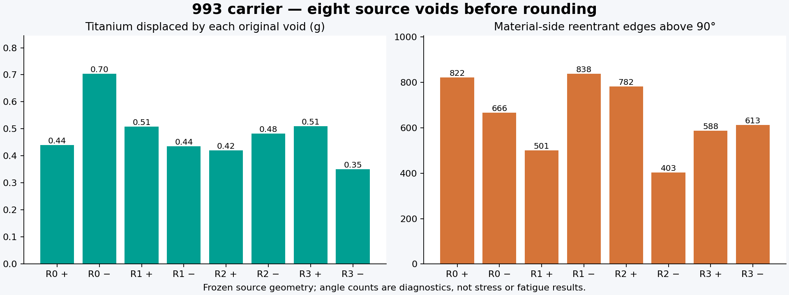
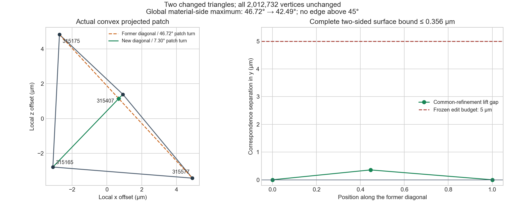

# Second carrier void: rounded and independently checked

The source-distance route now produces a checked second void, **R0 positive**.
Its complete boundary passes independent embedding and original-domain checks.
A bounded two-triangle edit removes the final material-side turn above 45°.
This extends the [first-void result](BOUNDED-EDGE-REPAIR.md); it does not transfer
old mechanical results or change the complete-carrier reference mass of
**1.2933916 kg**, below the **1.30 kg** requirement.

## Eight-source audit

All eight original void archives match their recorded hashes. Recomputed
volumes and vertex/face counts agree with their records. Complete independent
CGAL checks establish closed, outward, connected boundaries without
self-intersections. Synthetic enclosing tetrahedra are used only to exercise
that inspector; they are not carrier containment domains.

These eight original cavities total **871.704626 mm³**, equivalent to
**3.852934 g** at the study titanium density of 4.42 g/cm³. This is their
specific contribution before rounding and port unions, not a general ceiling
on lightweight design. All eight have sharp material-side features requiring
attention; the geometries are distinct and cannot be replaced by copies of
one successful pilot.

## Reused software and actual result

The workflow uses geometry3Sharp for source-distance erosion, Manifold for
explicit connected-component selection, checked float32 conversion, PicoGK
for dilation, and independent CGAL inspection. NumPy and exact rational
arithmetic verify the local edit; Matplotlib renders its actual geometry.
The [software assessment](SOFTWARE-FOLLOWUP-20261029.md) explains the wider
software chain and the [source-distance report](SOURCE-DISTANCE-ROUNDING.md)
records the analytical controls and precision-transfer method.

| Stage | Measured result |
|---|---|
| Original R0 positive void | 15,224 triangles; 99.596846 mm³ |
| Erosion | 0.025 mm grid, 0.16 mm erosion; 8.07 s |
| Component selection | 24 pieces; largest retained at 42.343611 mm³ |
| Retained eroded boundary | 574,188 triangles; complete domain check passes |
| Precision conversion | 146 duplicates merged; 292 zero faces removed with exact image coverage |
| Complete clearance | All 573,896 triangles; lower bound 0.1306711794 mm > 0.125 mm |
| Dilation | Nominal 0.01 mm voxel, 0.10 mm radius; 17.49 s |
| Decoded rounded boundary | 2,012,732 vertices; 4,025,460 triangles |
| Final independent boundary check | Closed, outward, connected, embedded, strictly inside the original void |
| Material-side turns after local repair | Maximum 42.4861°; no edge above 45°, 60° or 90° |

The selection deliberately discards two substantial erosion components of
16.094177 and 2.179557 mm³, plus smaller pieces. This implements the declared
largest-network design rule; it is not a powder-drainage proof. Eroded volume
is not final cavity volume. The float32 cast has a complete vertex L1 bound
of 0.000000581539 mm; subsequent cleanup has zero geometric change. Local STL
coordinates and world translation are checked exactly.

## Exact local correction

The raw dilation has one material-side turn of 46.719962°. Only faces
1,071,926 and 1,071,927 change. All 2,012,732 vertex coordinates and all other
faces remain identical. Replacing their shared diagonal reduces the patch
normal turn to 7.295567°. The next, unchanged feature controls the final
whole-surface maximum of 42.486054°.

An exact projected-quadrilateral common refinement proves a complete
bidirectional surface-distance upper bound of **0.000355670789 mm**, below
the frozen 0.005 mm edit budget. The exact gap is
`27384763058727 / 76994692687855616` mm. A separate full CGAL check confirms
that the edited surface remains embedded and inside its actual original void.
Angle diagnostics do not establish stress or fatigue convergence.

[Scalar receipts, source snapshots and manifest](evidence/second-void-rounding-001/)
record the numerical chain without committing mesh arrays. The accepted NPZ
SHA-256 is `c4b60996433c365c37ef8c310d21cb6d9b3df76d43044b9cb6d1b1dd3bd6b553`.
The binary mesh SHA-256 is
`69c9d8ba7960d226f97b1535d066e45c2d1ae55002457f71bed9e29b01d1043f`.

## Remaining work

Both rounded pilots still require bounded coarsening before full-carrier
reintegration. The remaining six voids need their own checked geometry route.
Port connectivity, whole-carrier mass, new volume meshing and matched-load
mechanical convergence must be evaluated on the resulting assembly. The
current boundary checks qualify these intermediate geometries for subsequent
work; they do not complete that assembly or its mechanics.
