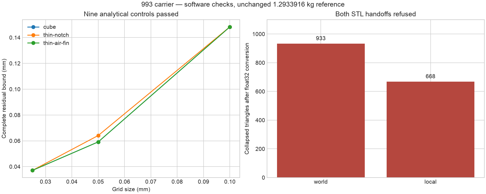
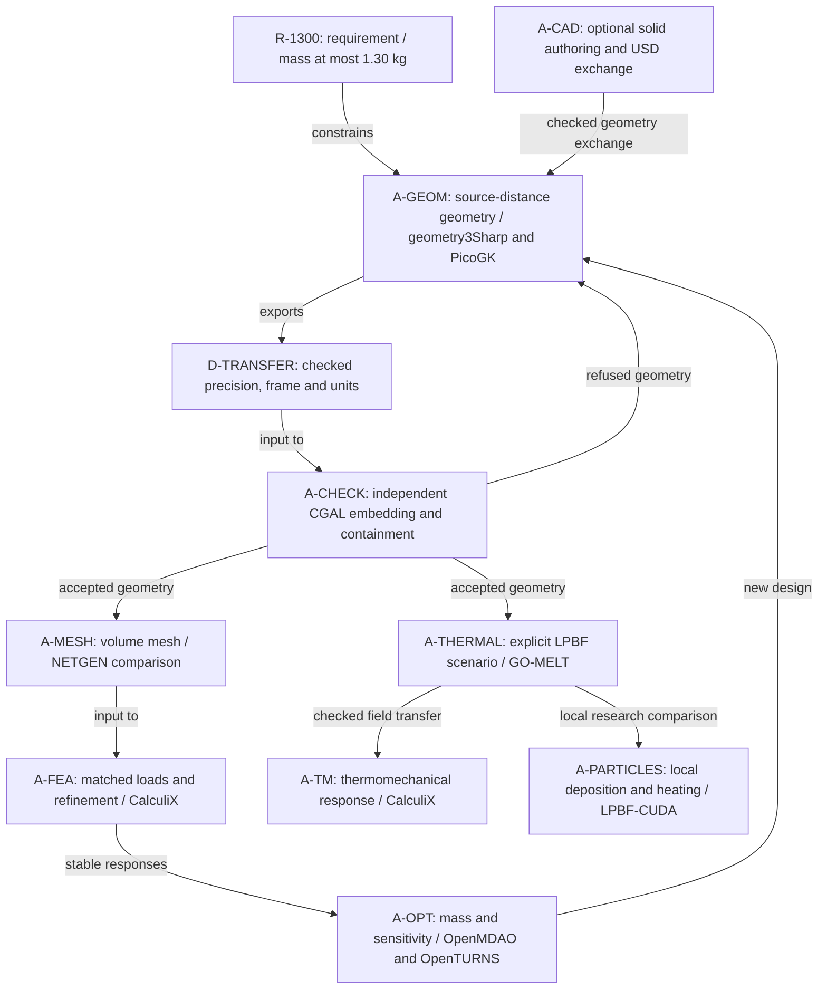

# Software follow-up: what helps the carrier now

Reviewed on 29 October 2026 against the documented integrations and local
execution receipts. Requirement: improve the internal surfaces and reproducible
simulation chain while keeping the carrier below **1.30 kg**. The unchanged
reference is **1.2933916 kg**; no additional mass saving is claimed here.

## Selection and order

| Software | Useful contribution | Decision for this carrier |
|---|---|---|
| geometry3Sharp | Mesh-distance fields and erosion before extracting a new surface | Advance as an isolated geometry experiment; nine analytical controls and the double-precision source-domain check pass. Resolve STL precision loss before consuming its output. |
| PicoGK | Voxel construction, offsets and internal geometry | Keep as the geometry route. The original direct opening trial crossed the source boundary; consume independently checked inputs and check the resulting surface again. |
| CGAL | Exact embedding, containment and complete surface-distance bounds | Keep as the independent geometry inspector; authoring-library success alone is insufficient. |
| SALOME/SMESH and standalone NETGEN | A second volume-meshing route | Already useful: the complete 16,239,026-tetrahedron reference passes the independent volume checks. Mechanical groups and response comparison are subsequent steps. |
| GO-MELT | Moving-source thermal histories and heat accumulation during LPBF | Useful next process branch. Adapt density, material laws and units before a carrier run; current controls exercise its CPU thermal kernel. |
| Simulation-of-LPBF-using-CUDA | Local particle deposition and heating | Start with a bounded local process case and verified CUDA port. Its existing implementation is not a carrier powder-evacuation solver. |
| NVIDIA USD BRep | Analytic solid operations and USD exchange | Optional for interface solids and exchange. The current integration does not turn the gyroid mesh into an editable analytic master. |
| NativeCAD | Editable solid authoring and STEP export | Optional authoring comparison; the documented local witness is a synthetic solid, not this carrier. |
| OpenMDAO and OpenTURNS | Design optimization and sensitivity studies | Use after the mechanical response is stable and reproducible; optimizing an unstable stress peak would select numerical artifacts. |
| CloudCompare | Scan alignment and point-to-surface diagnostics | Useful when a carrier scan is available; retain complete surface checks alongside sampled diagnostics. |
| DVC, SQLite FTS5 and Qwen | Private artifact recovery, referenced document retrieval and assisted drafting | Supporting infrastructure. Preserve hashes and reviewed inputs; these tools do not establish geometric dimensions or mechanical results. |

The [existing assessment](NEW-TOOLS-ASSESSMENT.md) records the GO-MELT unit and
density findings. Installation and control commands remain in the
[free-tools runbook](../../architecture/free-tools/README.md) and
[USD BRep / LPBF runbook](../../architecture/usd-brep-lpbf.md).

## New geometry experiment and the handoff problem

The isolated geometry3Sharp source revision is
`ece336493111ffe372a4bfc7fee5026d4127dade`, under **BSL-1.0**. Its source was
compiled in a separate .NET 9 profile without modifying the upstream checkout.
This is a tested local profile, not a claim of upstream .NET 9 qualification.

The test matrix uses a cube, a thin notch and a thin air fin, each at grid sizes
0.1, 0.05 and 0.025 mm. All nine fixed controls pass. The notch is only
0.0002 mm thick: computing source-mesh distances before erosion retains its
effect despite its being smaller than the grid. The complete triangle residual
bounds decrease with refinement. Volume error is not strictly monotone, so this
is not a mechanical convergence claim. For the air-fin case, the volume
comparison uses the limiting cube reference.

On one original carrier void, erosion by 0.16 mm at a 0.025 mm grid takes
**9.10 seconds**, with about **2.05 GB** observed resident memory. The erosion
splits into 14 positive-volume components. The design experiment retains the
largest connected erosion-centre network and records all 13 discarded
components; this is an explicit selection, not a repair certificate.

The retained network has **1,139,700 triangles** and volume **115.081141 mm³**.
An independent exact CGAL check confirms closed, outward-oriented, embedded
source and candidate boundaries, no boundary crossings, and whole bounded-solid
containment. This result applies to the **double-precision eroded intermediate**,
before a planned dilation; it does not apply to the final carrier or STL export.

Checking the actual float32 handoff finds **933 collapsed triangles** in world
coordinates. Recentering at `[74, 29, 0]` mm reduces this to **668**, but does not
resolve it. The complete vertex L1 displacement bounds are respectively
0.000005244671 mm and 0.000000575207 mm. Small displacement alone therefore does
not establish valid topology. Neither export is admitted as a PicoGK input.

The next geometry task is a bounded, topology-checked precision conversion,
followed by complete clearance verification, dilation, and another independent
embedding/containment check. The clearance checker passes an interior control
and correctly refuses a near-boundary control; it has **not yet certified the
actual float32 input**. No parameter sweep is justified until that handoff passes.

The image plots actual recorded values, including the refused handoffs.
[Scalar receipts and rendering source](evidence/software-followup-20261029/)
exclude raw meshes and solver arrays.

## Reproducible integration sequence

No GPU rental was needed for these CPU checks. A GPU is useful when an admitted
CUDA/process case is ready to execute; renting one does not repair the current
precision-conversion failure.

## Primary sources

- [geometry3Sharp](https://github.com/gradientspace/geometry3Sharp): mesh-distance and mesh-processing APIs, Boost licence.
- [GO-MELT](https://github.com/JLnorthwestern/GO-MELT): multilevel LPBF thermal solver.
- [USD BRep](https://github.com/NVIDIA-Omniverse/usd-brep): NURBS-based solid operations and USD exchange.
- [Simulation-of-LPBF-using-CUDA](https://github.com/zhangyaqi1989/Simulation-of-LPBF-using-CUDA): particle dynamic and thermal research implementation.
