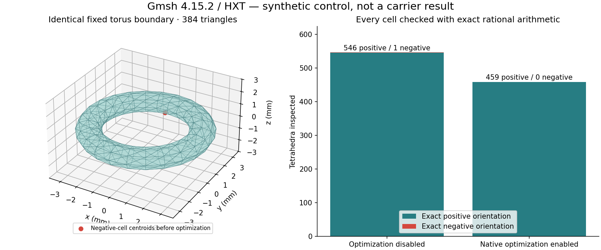
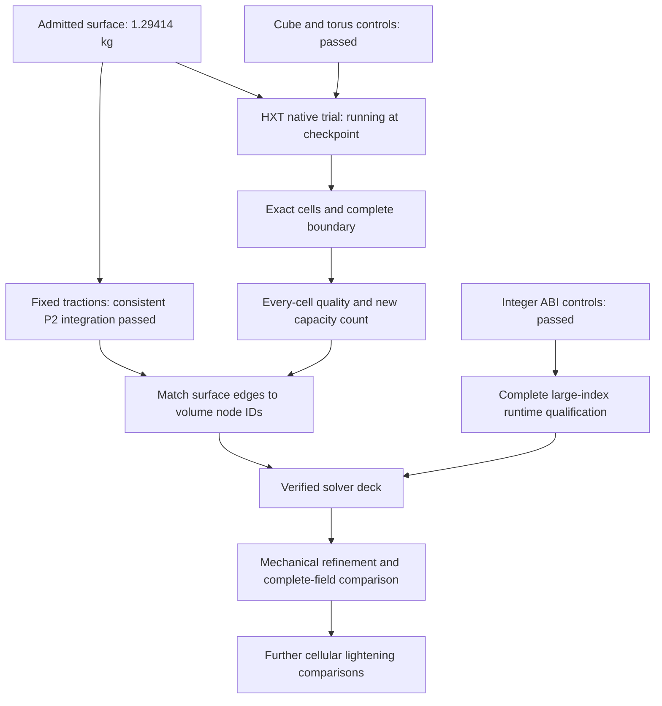

# 993 carrier: volume-mesher controls and quadratic solver preparation

The admitted surface remains at **1.2941382075 kg nominal mass**. This update
adds tested HXT controls, consistent quadratic surface loads and direct evidence
about the archived solver's integer storage. The full HXT carrier trial is still
running at this checkpoint; no new mechanical response or convergence is claimed.

This follows [mechanical preparation](MECHANICAL-PREPARATION.md). The
[evidence manifest](evidence/solver-readiness-001/manifest.json) binds the numerical
receipts and illustration. Raw meshes, nodal arrays and binaries remain private.

## Use HXT with an independently checked configuration

The bounded NETGEN worker reached its CPU limit without returning a usable volume:
return code −24, elapsed 6,682.96 seconds, peak observed RSS 29.34 GB. Its exact
checker did not run. The failed trial is retained rather than presented as a mesh.

The installed Gmsh 4.15.2 HXT algorithm was then exercised on fixed cube and torus
surfaces. The same torus input, with 384 triangles, gives:

| Configuration | Tetrahedra | Exact positive | Exact negative |
|---|---:|---:|---:|
| Native optimization disabled | 547 | 546 | 1 |
| Native optimization enabled | 459 | 459 | 0 |

The negative determinant is approximately −5.04e-19 mm³, six times signed volume.
Its small magnitude does not waive the orientation requirement. The optimized
control preserves every original coordinate bit and the complete oriented surface,
pairs interior faces with opposite orientations, forms one cell component and
uses every vertex. The separate cube control passes with 12 cells.

These controls justify trying that configuration on the admitted carrier; they
do not certify its result. The actual trial uses two threads, 0.8 mm maximum
size, native optimization enabled, a 30-minute worker limit and a 40 GiB RSS cap.
It started only after the NETGEN worker terminated. Its independent complete
volume check and subsequent conditioning analysis are queued, not yet passed.

The implementation is described in the [Gmsh manual](https://www.gmsh.info/doc/texinfo/gmsh.html)
and [Quality tetrahedral mesh generation with HXT](https://arxiv.org/abs/2008.08508).

## Preserve the load field when changing element order

The continuous-patch reference fixes constant tractions on the four study bore
walls. For a straight six-node triangular face of area A under constant traction
t, consistent P2 forces are zero at the three corners and At/3 at each edge
midpoint. The P1 corner allocation must not be reused on P2 faces.

Exact rational controls verify all ten barycentric monomials through degree two
and reject the incorrect corner-only quadratic rule. On the actual retained
patches, independent three-point triangle quadrature agrees with the assembled
forces for ten Cartesian virtual-displacement modes. Both load cases use
**12,362 unique surface edge nodes**. Force residuals are below 7e-12 N and
moment residuals below 7e-10 N mm; the largest scaled quadratic-work discrepancy
is below 6e-11. Rigid translation and rotation work also agree.

The retained edge keys still need to be matched to the quadratic volume mesh.
No solver node IDs, deck or curved-face integration are asserted here.

## Verify integer storage before choosing a large machine

The actual archived PARDISO binary, SHA-256
`93181a8340dac42f2e76fb9159edcdcebc536c5f29cc25dfa4689413e83582ac`,
was inspected read-only with a pinned Linux ELF reader. Its `iparm` and `iparmcp`
objects each occupy 256 bytes for 64 integer parameters. It imports `pardiso_`;
no explicit `pardiso_64` symbol was observed. Saved C flags omit `INTSIZE64`.
Eight-byte pointer objects do not establish eight-byte sparse indices.

Four isolated C/Fortran controls using the unmodified original 2.21 integer
header establish the following local ABI behavior:

| C integer | Fortran integer | Observed result |
|---|---|---|
| 32 bit | 32 bit | 17 → 18 |
| 64 bit | 64 bit | 2,147,483,664 → 2,147,483,665 |
| 64 bit | 32 bit | Rejected before payload exchange |
| 32 bit | 64 bit | Rejected before payload exchange |

This is not a full solver build or library-dispatch qualification. A larger-index
runtime must align C, Fortran, assembly arrays, sparse pointers and numerical
libraries, then repeat analytical and full reference solves. The new mesh also
needs its own capacity count. The archived pre-constraint P2 pattern exceeding
2³¹−1 entries cannot be treated as the actual constrained new-system size.

No new Vast lease, mechanical acceptance or extra weight saving is attributed
to these preparatory results.
