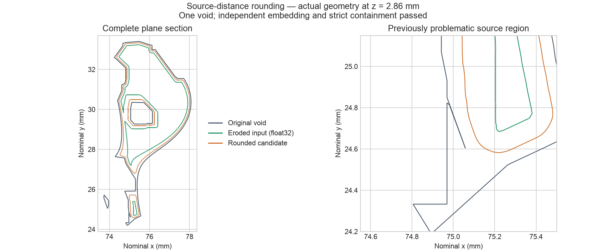
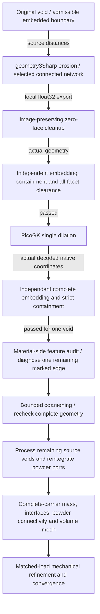

# Source-distance rounding: precision transfer and complete containment

29 October 2026. **One rounded source void now passes independent full-surface
embedding and strict containment checks.** This corrects the numerical
overshoot demonstrated by the earlier direct PicoGK opening. The complete
carrier remains the unchanged **1.2933916 kg** reference: the new void has not
been reintegrated into its powder ports, and mechanical convergence is pending.

**Subsequent result:** [bounded edge repair](BOUNDED-EDGE-REPAIR.md) removes the
remaining material-side edge above 45° through an independently bounded
two-triangle edit. The earlier distance-projection proposal is refused on shape
quality; the receipts below describe the preceding raw rounded surface.



These are actual mesh sections at nominal z = 2.86 mm. The right panel shows the
previously problematic source region. The image is an engineering section of
one negative design volume, not a rendering of a newly completed carrier.

## What changed

The previous voxel-first opening crossed the original source boundary, even
after adding an inset. This route instead computes distance to the original
triangle mesh **before** extracting an eroded surface with geometry3Sharp.
The retained erosion-centre network is then transferred to PicoGK for a single
dilation. The upstream [software assessment](SOFTWARE-FOLLOWUP-20261029.md)
records the nine geometry3Sharp analytical controls and selection of the largest
connected erosion-centre network.

The erosion uses a 0.025 mm distance grid and 0.16 mm retreat; the subsequent
PicoGK dilation uses radius 0.1 mm and voxel size 0.01 mm. This is an explicitly
changed void design. It does not inherit the old carrier's 0.01 mm remeshing
fidelity certificate or its mechanical results.

| Stage | Triangles | Surface-integral volume, mm³ |
|---|---:|---:|
| Original source void | 18,672 | 159.163170 |
| Transferred eroded input | 1,139,034 | 115.081141 |
| Rounded candidate | 7,781,064 | 140.273145 |

Volumes use the complete oriented surface integral in float64, with a local
reference and compensated accumulation of block totals. They are separate from
PicoGK's voxel-volume estimates. At the declared density 4.42e-6 kg/mm³, the
void-volume reduction corresponds to **0.083494 g** of restored titanium before
port reintegration; it is not a measured change to the full carrier mass.

## Precision conversion is now checked

Direct float32 conversion collapsed 668 triangles even after recentering.
The converter now operates in the local frame with origin `[74, 29, 0]` mm:

1. Merge 333 vertices with exactly identical decoded float32 coordinates.
2. Remove 666 repeated-index faces only after proving their complete point or
   line images are covered by retained vertices or edges.
3. Replace two exactly collinear face pairs by partitions of the unchanged
   neighbouring triangles. Exact rational middle-point ratios are `26215/52429`
   and `1/2`; orientations and the absence of an existing replacement edge are
   checked before each operation.
4. Check closed, oppositely paired edges and exact preservation of the cleaned
   local coordinates in the actual STL bytes.
5. Check exact local-to-world addition. The public converter uses TwoSum to
   detect lost translations; a subtraction round trip alone can miss them.

Cleanup changes the already-quantized surface by **zero**. The preceding
complete vertex L1 quantization displacement bound is
**0.000000575208 mm**, rounded upward. This small displacement is not used as a
substitute for embedding checks.

The public converter replays to byte-identical native inspection and STL
inputs. Nine focused regression tests cover a quantized short edge, exact
collinear partition, uncovered zero-image refusal, open and nonmanifold surface
refusal, nonfinite input/origin, lost translation and preservation of existing
outputs. Four positive analytical fixtures also pass the independent native
embedding/domain inspector. [Transfer and replay receipts](evidence/source-distance-rounding-001/).

## Complete independent input and output checks

Before dilation, CGAL/EPECK checks the actual transferred geometry: one closed,
outward-oriented, embedded boundary; no source/candidate boundary crossings;
and whole bounded-solid containment in the original void.

The complete clearance check visits **all 1,139,034 input facets**. For every
triangle, exact source distance at its exact centroid, minus an outward-rounded
radius covering the whole triangle, bounds its minimum distance to the source.
Distance is 1-Lipschitz. The minimum lower bound is **0.130002640784 mm**, above
the frozen **0.125 mm** gate. Both an interior control and a deliberately
near-boundary refusal control pass. Runtime is 216.31 seconds.

The single-offset PicoGK operator also passes a 2 mm cube control: surface
volume **10.588409 mm³**, analytical rounded-cube volume **10.592684 mm³**,
relative error **0.04036%**, and complete directed signed-distance residual
bound **0.012369 mm**, rounded upward. The residual is an analytical-control
result, not an error certificate for the carrier void.

The actual dilation completes in **31.43 seconds**, with **2.34 GB** observed
resident memory under a 6 GiB / 300-second guard. Its 7,781,064 triangles have
no repeated-index zero faces. Decoding preserves the actual native STL
coordinates and exact local/world translation.

The final independent check covers the **entire rounded boundary**: closed,
one connected component, outward-oriented, no self-intersections and no
crossings with the original source. It proves strict containment of the whole
bounded solid. The proof uses disjoint, connected, embedded closed boundaries:
the side is constant over the candidate boundary, so an exact inside test on a
used face vertex establishes its side; this is not a sampled-distance claim.
Runtime is **49.79 seconds**. [Final full-domain receipt](evidence/source-distance-rounding-001/rounded-domain.json).

## Upstream feature audit before the next mechanical study

The feature auditor visits **all 11,671,596 edges** of the rounded output.
Orientation matters: the boundary of a negative volume must be reversed to
represent the surrounding material. An outward-void normal turn has the opposite
sign from its material-side counterpart. A new wrapper makes this explicit; an
analytical tetrahedral-cavity regression checks the reversal without mutating
the source triangles.

The **material-side** comparison now finds:

| Diagnostic | Original void, material side | Rounded void, material side |
|---|---:|---:|
| Most reentrant normal turn | −179.990700° | **−46.289837°** |
| Reentrant edges above 45° | 1,474 | **1** |
| Reentrant edges above 60° | 1,266 | **0** |
| Reentrant edges above 90° | 666 | **0** |

The remaining marked material-side edge is near
`[67.260295, 28.160081, -0.156890]` mm, with length 0.012410 mm. Diagnose this
feature before mechanical admission. The rounded audit takes 8.09 seconds and
5.42 GB observed resident memory under an 8 GiB / 600-second guard.

The earlier outward-void audit reported 14 negative turns above 45°, with a
minimum of −63.3388°; these correspond to **convex material-side** turns. Its
initial mechanical interpretation is superseded by this orientation-corrected
comparison. The original receipts remain unchanged.
[Orientation reconciliation and corrected receipts](evidence/source-distance-rounding-001/material-orientation-reconciliation.json).

Edge counts depend on triangulation and are geometry diagnostics, not stress or
fatigue results. The auditor explicitly does not prove a stress singularity or
its absence. Containment alone does not establish a smooth stress-bearing
surface.

A local five-point libigl diagnostic at the remaining marked edge finds only
**1.7656°** between the source-distance gradients at its two incident face
centroids, compared with **46.2898°** between their actual mesh normals. The
largest local distance residual from the declared 0.1 mm offset is
**0.002503 mm**, rounded upward. The nearest source feature at the affected
endpoint is **vertex 309**, not the interior of a source triangle. A proposed
pure-face-normal correction therefore refused its precondition before changing
geometry. Next, assess a vertex-distance correction with a bounded edit and
fresh complete checks. These five queries are a local diagnostic, not a
whole-surface distance certificate.
[Diagnostic and precondition refusal](evidence/source-distance-rounding-001/remaining-crease-diagnostic-manifest.json).

## Reproduction and next integration steps

The reusable [precision converter](../../../parts/993-eng-carrier-0001/source/design-20261016/convergence-20261022/transfer_void_to_float32.py)
requires NumPy and refuses an existing output directory:

```sh
python3 parts/993-eng-carrier-0001/source/design-20261016/convergence-20261022/transfer_void_to_float32.py \
  PRIVATE_ERODED.npz PRIVATE_NEW_TRANSFER --origin 74 29 0
python3 -m unittest discover -s tests -p test_993_carrier_float32_transfer.py -v
```

The [source snapshots](evidence/source-distance-rounding-001/sources/) include
the native independent domain/clearance inspectors, PicoGK 2.3.0 / .NET 9
single-offset worker and actual-STL decoder. The domain inspector takes
`SOURCE.mesh64 CANDIDATE.meshbin REPORT.json`; the clearance inspector uses the
same arguments. Compile the C++ inspectors in a CGAL/GMP/MPFR Linux environment
with `-std=c++17 -O2 -frounding-math -ffp-contract=off -fno-fast-math` and link
`-lgmp -lmpfr`. The PicoGK worker takes `PLAN.json NEW_OUTPUT_DIR` and verifies
the input STL hash and the input domain/clearance reports before a carrier run.
The recorded plan's relative private paths must be resolved in a reconstructed
private workspace; the public receipts alone do not contain the geometry.

Raw meshes remain in the local private payload set; the
[payload manifest](evidence/source-distance-rounding-001/private-payloads.json)
records sizes and hashes. Offsite recovery of this new set has not been run.
The [figure generator](../../../parts/993-eng-carrier-0001/source/design-20261016/convergence-20261022/render_qualified_void.py)
takes original, transferred and rounded NPZ files followed by a fresh PNG path.



The next work is diagnosing the remaining marked edges, coarsening without
reintroducing intersections, applying the checked route to the remaining voids,
then checking port overlap and reachability
after reintegration. A connected negative volume alone does not prove its
connection to an external powder outlet. Recompute full-carrier mass and rerun
the mechanical series on that exact geometry. No earlier stress result is
transferred to this candidate. These CPU geometry steps require no new GPU lease.
