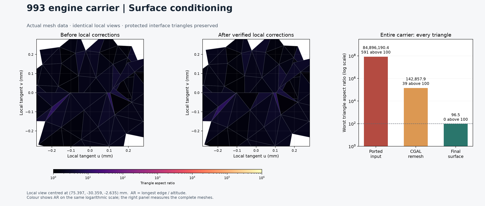
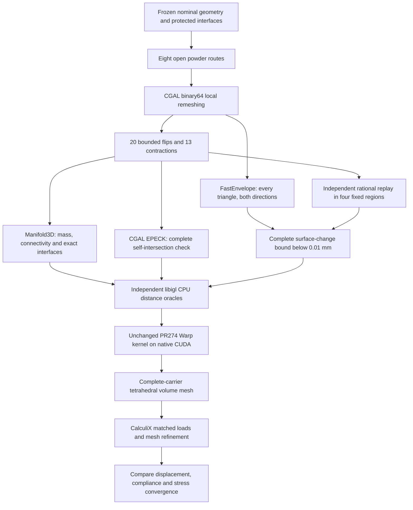

# 993 carrier — conditioned surface and native CUDA checks

The nominal carrier now weighs **1.2933916 kg**, below the **1.30 kg** limit. The complete surface has **no triangle with an aspect ratio above 100**, no detected self-intersection, one connected material shell, and the same protected interface triangles. Native CUDA distance checks pass on the corrected complete carrier.

This checkpoint supplies a surface-conditioning baseline. The subsequent [upstream feature audit](SURFACE-FEATURES.md) identifies inherited nearly closed reentrant creases that require examination before mechanical stress refinement.



The local views use the same coordinates and colour scale. Changes are deliberately small; the chart measures every triangle, including facets too thin to see at this scale.

## What changed

| Complete mesh | Vertices | Triangles | Worst aspect ratio | Triangles above 100 |
|---|---:|---:|---:|---:|
| Eight-port input | 674,058 | 1,348,224 | 84,896,190.4 | 591 |
| CGAL remesh, 1° feature threshold | 1,147,826 | 2,295,760 | 142,857.9 | 39 |
| Final conditioned surface | 1,147,813 | 2,295,734 | **96.49** | **0** |

Aspect ratio means longest edge divided by the corresponding altitude. The threshold is a conditioning diagnostic, not a strength criterion.

After local isotropic remeshing, **20 edge flips and 13 short-edge contractions** remove the remaining needles and caps. Every edit has a recorded displacement bound. The three original protected oriented-triangle rosters remain exact: **216,264** in the central column, **60,437** at the left end, and **60,580** at the right end.

The final native geometry contains one positive material shell and no negative closed void shell. The [eight powder escape routes](POWDER-PORTS.md) are retained. Full internal clearance and full-carrier mechanical convergence remain open digital gates.

## The workflow



The catalogue and the previously frozen print-geometry records have not been replaced by this calculation checkpoint.

## Complete-surface fidelity

The acceptance limit stays **0.01 mm**. No tolerance was increased to admit a failed candidate.

FastEnvelope checks complete triangle interiors, not just vertices. Four checked patches cover every changed face; the remaining oriented faces are identical. A separate saddle control has identical vertices but different triangle interiors, and must be rejected. This prevents vertex-only comparisons from masquerading as surface checks.

Two complementary checks pass:

1. The CGAL remesh lies within a conservative **0.003 mm** envelope of the eight-port input, in both directions.
2. The final corrected surface passes the complete **0.01 mm** envelope check directly, in both directions.

The independent edit replay gives a tighter composed bound. Each edit stays wholly within one fixed open XY quadrant, including every incident face affected by a contraction. The unchanged outside patch remains identical. Consequently, independent regional bounds combine by their maximum.

| Fixed region | Accumulated exact edit bound, mm |
|---|---:|
| −X, −Y | 0.000467114624 |
| −X, +Y | 0.003953338093 |
| +X, −Y | **0.004291641498** |
| +X, +Y | 0.002393157200 |

The resulting complete-surface bound is **0.003 + 0.004291641498 = 0.007291641498 mm**, below 0.01 mm. The verifier uses rational arithmetic on the exact dyadic values represented by the stored coordinates, then rounds displayed upper bounds outward.

For a convex projected flip, the largest height difference occurs at the intersection of the two diagonals. For a general cap flip, flattening the opposite vertex to a point on the shared segment makes both triangulations identical; two such vertex homotopies bound the change by twice that displacement. A contraction moves incident triangles by at most the L1 distance between its endpoints. The verifier also checks that every deleted triangle image remains covered by a surviving edge.

The complete geometries after all four stages are bound by portable little-endian coordinate and index signatures. Changed outputs, understated bounds, protected-face edits, and edits crossing a regional boundary are rejected by tests.

## Software actually exercised

| Tool | Work performed here | Evidence |
|---|---|---|
| CGAL 5.6, EPICK | Binary64 local isotropic remeshing, fixed protected boundary | [Native producer source](evidence/surface-conditioning-001/producers/cgal-remesh/check_self.cpp) |
| CGAL 5.6, EPECK | Independent exact-predicate screen of all **2,295,734** final triangles | [Complete surface report](evidence/surface-conditioning-001/native-complete-self-intersection.json) |
| FastEnvelope | Conservative complete-triangle containment, both directions | [Pinned software and compiler profile](evidence/surface-conditioning-001/native-software.json) |
| Independent rational replay | Reconstruct all edits and verify complete regional bounds | [Executable verifier](../../../parts/993-eng-carrier-0001/source/design-20261016/convergence-20261022/replay_surface_conditioning_bounds.py) |
| Manifold3D 3.5.4 | Connected material, volume/mass, native round trip and protected rosters | [Native geometry checks](evidence/surface-conditioning-001/native-protected-and-connectivity.json) |
| libigl 2.6.3 | Double-precision CPU distance oracles on the exact transported arrays | [Broad oracle record](evidence/surface-conditioning-001/cuda/ported-broad-cpu-oracle.json) |
| Warp 1.18.0 / NumPy 2.2.6 | Unchanged PR274 query kernel on native CUDA | [CUDA summary](evidence/surface-conditioning-001/cuda/summary.json) |
| Matplotlib | Actual mesh views and complete-mesh statistics | [Image producer](../../../parts/993-eng-carrier-0001/source/design-20261016/convergence-20261022/render_surface_conditioning.py) |

[FastEnvelope](https://github.com/wangbolun300/fast-envelope/tree/f50eb6c1572c5865bfab3cac1acae0e27c8b4a82) is pinned to a specific upstream revision, with pinned Indirect Predicates and SIMDe dependencies. The qualified local profile uses GCC, binary64 coordinates, directed rounding, disabled fast math and contraction, and active assertions. Its standalone predicate backend is initialized explicitly. Clang is not admitted by this profile.

Simpler remeshing attempts were refused when they self-intersected or changed the shape too much. In particular, a 30° feature-threshold candidate had a rationally checked **0.0150587 mm** vertex counterexample and was rejected against the unchanged 0.01 mm limit.

## Native GPU results

All three cases pass on an **NVIDIA GeForce RTX 4070 Ti SUPER**. Each case runs **six fresh mesh/BVH constructions and CUDA dispatches**, with the same fixed absolute error limit of **0.0001 mm**.

| Case | Queries per dispatch | Maximum absolute error, mm | Result |
|---|---:|---:|---|
| Previously qualified closed CF2 control, same GPU | 65,536 | 0.0000360800 | Pass |
| Complete conditioned eight-port carrier | 65,536 | 0.0000305771 | Pass |
| Hard triangle sweeps and previous failures | 4,644 | 0.00000787272 | Pass |

The hard corpus covers the 128 worst native/transported triangles, four barycentric locations and nine normal offsets, plus all 36 previous failure positions retargeted to the corrected geometry. The CPU oracle uses double precision on exactly the float32-promoted arrays sent to CUDA. No CPU fallback, relaxed precision limit, or speedup claim is used.

The first connection attempt exposed a direct/proxy metadata parsing mismatch. That lease was destroyed before testing. The corrected parser and the short-lived lease cleanup path now have regression tests. The successful test lease was also **destroyed and independently verified absent**, including three further guard observations. [Sanitized lifecycle evidence](evidence/surface-conditioning-001/cuda/lease-summary.json) retains the image pin, limits and timing without SSH transport details.

These results qualify the tested geometry-query workload. They do not supply the complete-carrier stiffness or stress calculation.

## Replay the geometry and its bounds

The fast replay needs NumPy, the public ledgers and the frozen remesh seed from the private evidence release. It reconstructs the final mesh from that remesh seed and four small ledgers, checks every complete stage signature, and writes a fresh candidate archive.

Restore the two mesh payloads to the paths and SHA-256 identities in the [private payload manifest](evidence/surface-conditioning-001/private-payloads.json). Large mesh bytes stay in the private evidence release under the repository storage policy. From the repository root, in a Python environment with NumPy installed:

```bash
python parts/993-eng-carrier-0001/source/design-20261016/convergence-20261022/replay_surface_conditioning_bounds.py \
  --reference work/carrier-conditioning-payloads-20261029/remesh-seed.npz \
  --recipe docs/reports/carrier-interface-20261028/evidence/surface-conditioning-001/replay-recipe.json \
  --maximum-change-mm 0.007 \
  --output work/carrier-conditioning-replay
```

Use a fresh output directory. The 0.007 mm argument bounds the additional edits after the independently checked 0.003 mm seed envelope. [Published checksums](evidence/surface-conditioning-001/publication-sha256.json), [final archive identity](evidence/surface-conditioning-001/private-payloads.json), [portable recipe](evidence/surface-conditioning-001/replay-recipe.json), and [qualification record](evidence/surface-conditioning-001/assessment.json) bind the result.

The native producer snapshots retain the actual remeshing and envelope-check code. Their execution profile is the qualified local Linux ARM64/GCC container; the portable rational replay does not require that container or a GPU.

## Next calculation

Generate the complete tetrahedral volume mesh from this corrected surface, retain the frozen geometric interfaces, and run matched load cases on successively refined meshes. Compare displacement, compliance, regional stress and the global peak separately. Recheck final web and mouth clearances for the process package. The earlier R2 full-carrier stress results are not transferred to the changed geometry.
