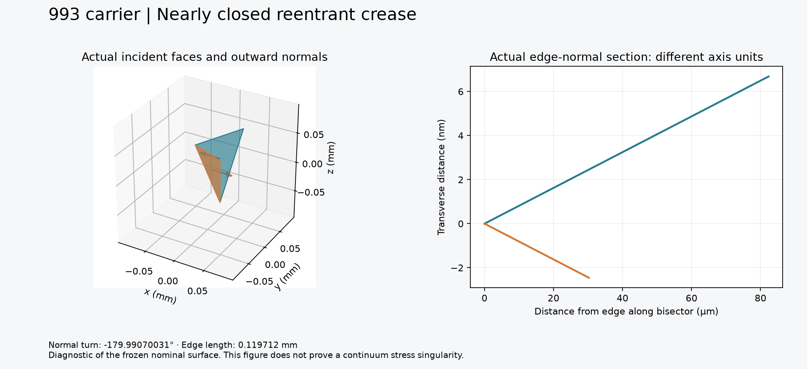
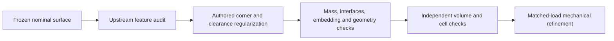

# Upstream surface-feature audit before mechanical refinement

## Decision

**Inspect and regularize inherited nearly closed reentrant creases before another complete-carrier stress-refinement campaign.** Existing embedding, fidelity and triangle-quality checks remain valid; they do not establish a bounded continuum peak stress. This diagnostic alone does not prove a stress singularity.

The frozen nominal candidate remains **1.293391604 kg**. This audit changes no geometry and infers no measured interfaces or loads.

## Executed audit

The [audit source](../../../parts/993-eng-carrier-0001/source/design-20261016/convergence-20261022/audit_surface_features.py) checks finite indexed triangles, two incident faces per edge and opposite edge orientation. It measures lengths and signed adjacent-normal turns. Four analytical/refusal tests pass: a convex cube has twelve convex right-angle edges; an extruded L has exactly one unit-length reentrant right-angle edge; missing faces and reversed individual faces are refused.

| Frozen surface | Edges below 1 µm | Reentrant normal turns above 45° | Most negative turn |
|---|---:|---:|---:|
| Ported input | 22 | 12,556 | −179.99070031° |
| CGAL remesh | 14 | 18,184 | −179.99070031° |
| Final conditioned | 3 | 18,184 | −179.99070031° |

Counts depend on subdivision and are not counts of independent defects. The extreme crease is inherited from the input: its 0.239424 mm edge near `(72.2192, 25.1283, 1.54994)` mm was split during remeshing. Both incident triangles also match the **rank-0 negative-branch void before insertion**, with exact coordinates and reversed material/void normals ([lineage receipt](evidence/surface-features-001/crease-void-lineage.json)). The displayed final edge is 0.119712 mm long; its face planes form an approximately **0.00930° opening**. The figure slices the actual triangles normal to that edge. Horizontal units are micrometres; vertical units are nanometres. Both finite segments stop at their triangle boundaries.

The final minimum edge is **0.000460948 mm**; 133 of 3,443,601 unique edges are below 0.01 mm. Correcting aspect ratios did not remove every small edge or nearly folded surface feature.

Frozen numerical receipts: [input](evidence/surface-features-001/original-assessment.json), [remesh](evidence/surface-features-001/remesh-assessment.json), [final](evidence/surface-features-001/assessment.json). Each records input and audit source hashes. Raw geometry stays private.

## Mass benefit and regularization budget

The [nominal solid parent](evidence/reconstructed-carrier-001/assessment.json) weighs **1.298199813 kg**. The eight closed cavity networks remove **871.704626 mm³**, or **3.852934 g** at the declared density. Ports and conditioning bring the total parent-to-candidate saving to **4.808210 g (0.3704%)**. These small gains must be weighed against the additional geometric complexity. The current mass margin is **6.608396 g**; filling and rounding portions of these cavities can therefore be evaluated without immediately exceeding 1.30 kg. No cavity is removed or parent geometry substituted by this comparison. [Mass balance](evidence/surface-features-001/mass-balance.json).

## NETGEN execution and export interruption

The bounded NETGEN004 run **returned from volume generation and reached archive export**, but SIGALRM interrupted it at 1,802.19 seconds. Peak observed RSS was 21,817,475,072 bytes, below the 24 GiB guard. Its partial archive has a closed `vertices.npy` member and an unfinished `tetrahedra.npy` member, with no valid ZIP directory. No volume is admitted from this archive. [Terminal receipt](evidence/surface-features-001/netgen-fourth-terminal.json), [independent ZIP-member/CRC diagnosis](evidence/surface-features-001/netgen-fourth-export-diagnosis.json).

A live one-second stack sample earlier showed `MeshOptimize3d::CombineImprove` inside `MeshVolume`, despite disabling the optional final optimization pass. The installed binary reports `v6.2.2607-0-g9642315f`. The [matching upstream source](https://github.com/NGSolve/netgen/blob/v6.2.2607/libsrc/meshing/meshfunc.cpp) also performs internal open-front recovery and legality operations. The sample identifies active work; it does not establish a geometric root cause.

The justified follow-up retains the same geometry, mesher arguments, 0.5 mm³ maximum-cell-volume gate, 24 GiB RSS and 1,850-second supervisor limit. It writes **uncompressed** arrays and records intermediate mesher-return/export checkpoints, so compression cannot consume the meshing deadline again. This is a geometry-only comparison, not another stress-refinement sweep. Frozen sources: [worker](evidence/surface-features-001/sources/netgen_carrier_worker_005.py) and [owned-process supervisor](evidence/surface-features-001/sources/run_netgen_carrier_005.py).

## Next geometry decision

Isolate these creases in the authored void/port construction. Determine which are intended finite-radius features and which are numerical remnants. Any regularization needs an explicit radius/clearance contract, protected-interface preservation, mass below 1.30 kg, independent embedding, connectivity and port checks. Keep the existing 0.01 mm conditioning criterion unchanged; an intentional design change requires a separately identified candidate and comparison.

**Trial verdict:** geometry diagnostics may proceed. Peak-stress convergence remains unadmitted until corner interpretation and the load/support contract are established.
