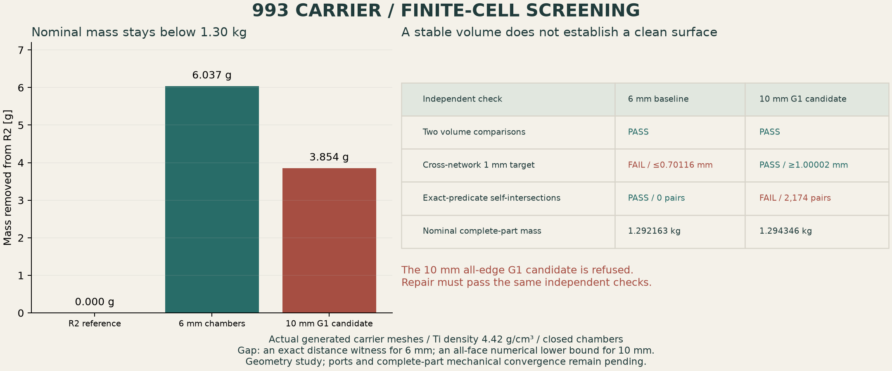
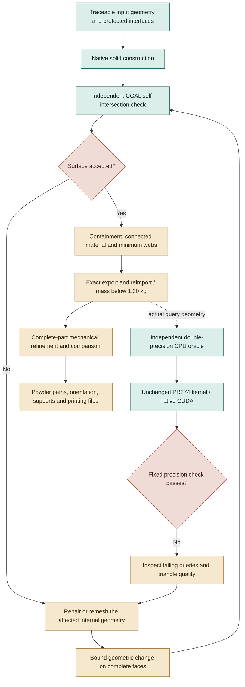
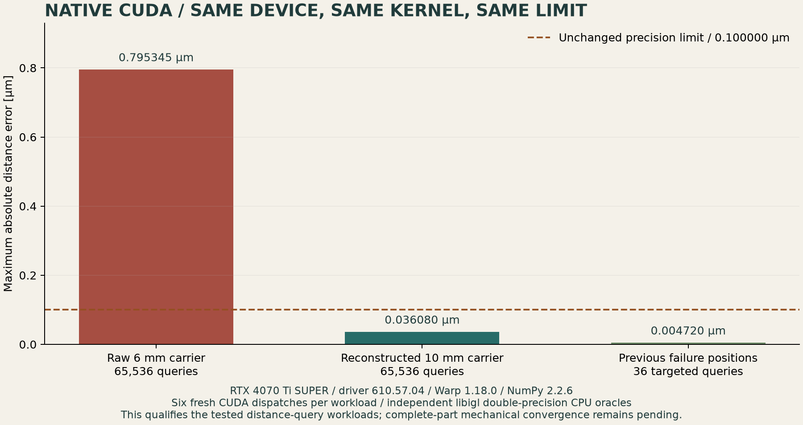

# Surface repair and actual CUDA qualification

The new checks expose two separate problems: a smooth-looking mesh can intersect
itself, and a valid closed mesh can still contain triangles that make a GPU
distance calculation inaccurate. This page records the failures and the repair
work without promoting an unfinished variant.

## What the cells actually save

| Numerical variant | Nominal complete-part mass | Additional findings |
|---|---:|---|
| R2 reference | 1.298199813 kg | Existing carrier geometry |
| 6 mm closed chambers | 1.292162707 kg | Exact exterior preserved; no self-intersections; fails the initial 1 mm cross-network target |
| 10 mm all-edge G1 candidate | 1.294345998 kg | Volume stabilizes and the cross-network bound passes; **2,174 intersecting triangle pairs: refused** |

The four accepted internal envelopes contain **2,364.281 mm³**. Even removing
their entire volume would save only **10.450 g** at the declared density of
4.42 g/cm³. A cellular structure retains some material, so its saving is smaller.
Larger gains require expanding the eligible core or changing the carrier's
structure, followed by new complete-part mechanical calculations.

The **1 mm** target is an initial design screen informed by the
[Materialise titanium guide](https://www.materialise.com/es/academy/industrial/design-am/titanium),
not a universal LPBF lattice limit. Exact rational point/triangle witnesses place
the 6 mm variant's minimum cross-network distance at **at most 0.70116 mm**.
The 10 mm G1 candidate has an all-face numerical lower bound above **1.00002 mm**
in every region. The latter uses a global phase-gradient bound and adaptive
triangle bounds; it is not an interval-arithmetic certificate or a computed exact
global minimum. Neither measurement covers every wall of the complete carrier.

## The reusable workflow

Each arrow needs its own receipt. A passing native volume/export test does not
replace the independent surface test. A passing GPU query test would qualify
that query workload, rather than establish strength or printing readiness.

## Surface investigation

CGAL uses **EPECK**, interpreting every stored binary64 coordinate as an exact
dyadic number. Its checks process the complete triangle roster. Calibration
includes a closed tetrahedron, separated closed components and intersecting
closed components. The [complete-carrier result](evidence/surface-repair-001/cgal-full-self-check-002/output/assessment.json)
finds no intersections in the 6 mm baseline and rejects the all-edge G1 variant.

| Operation tested | Actual result |
|---|---|
| 10 mm sharp seed | 209 intersecting triangle pairs |
| Unrestricted G1 interpolation | 2,174 pairs |
| Feature-preserving G1 interpolation | 1,323 pairs |
| Native 1 µm seed simplification before interpolation | 1,863 pairs |
| CGAL 5.6 autorepair | Analytic union-volume control passes; actual carrier hits an assertion |
| CGAL 6.2.1 autorepair | Same control passes; actual carrier also hits an assertion |
| PyMeshFix 0.18.1 | First tested network changes volume by 1.436%; exceeds the fixed 1% repair allowance and is refused |
| Existing MeshLib 3.1.4.297 evaluation runtime | Eight medium-resolution networks pass independent CGAL intersection checking; the separate 10 µm fidelity profile is refused |

The sharp seed's first diagnosed intersections lie almost in a common plane:
the recorded plane residuals are around **10⁻¹⁵–10⁻¹⁴ mm**. Interpolation can
amplify these defects. Exporting and reimporting exactly preserves them; it does
not repair them. CGAL's
[intersection and repair facilities](https://doc.cgal.org/5.6/Polygon_mesh_processing/index.html)
are therefore used independently of Manifold's native status.

The first MeshLib repair reduces the eight networks from **333,480 to 126,374
triangles**. Maximum relative volume change is below **0.041% per network**;
the largest edge-to-altitude ratio is below **39**. The corresponding twelve
native repair runs also pass two successive 2% volume comparisons. These facts
do **not** establish geometric fidelity. An
[exact CGAL nearest-distance witness](evidence/surface-repair-001/cgal-fidelity-vertex-proof-001/output/assessment.json)
proves a local change of **0.0396724835 mm**, exceeding the unchanged **0.01 mm**
repair target. This repair profile is refused. The first CutAndFill/relaxation
step introduces the largest observed change; disabling relaxation produces the
same distance diagnostics and does not resolve that failure.

The [paired exact-geometry bridge](evidence/surface-repair-001/meshlib-repaired-series-001/medium-geometry-bridge.json)
binds the medium-resolution intersection result to the twelve-run repair series.
The refusal prevents admission under the 10 µm repair profile. The distinct
reconstructed model below has separate containment and carrier-reinsertion
receipts. The frozen
[artifact manifest](evidence/surface-repair-001/artifact-manifest.json) retains
parameters, code snapshots, refusals and numerical observations.

The complete-distance estimate exceeded its bounded runtime. A separate CGAL
6.2.1 early-threshold experiment hits an assertion during its analytic controls;
it is not used as an acceptance check. The exact nearest-distance witness above
provides the refusal without relying on either incomplete calculation.

## Actual GPU run

Vast instance **58191314** supplied an **RTX 3090 / 24 GiB**, driver
**595.99.02**. The unchanged PR274 Warp kernel ran on the complete 6 mm carrier:
**2,124,436 triangles**, **65,536 queries**, and **six fresh CUDA dispatches**.
The oracle uses libigl double-precision distances on the exact float32-promoted
transport geometry. Warp **1.18.0** and NumPy **2.2.6** are enforced.

The run **fails** the fixed **0.000100 mm** error limit. Maximum error is
**0.000795345 mm**; the retained run has **36 failing queries**. The worst
diagnosed query lies near a triangle with edge-to-altitude ratio around **669**.
Triangle conditioning is being investigated; no kernel correction or successful
retest is claimed here.

The [native report](evidence/surface-repair-001/cuda/report.json),
[failure coordinates](evidence/surface-repair-001/parameters-and-diagnostics/cuda-distance-failure-diagnostic-001.json)
and [sanitized lease receipt](evidence/surface-repair-001/cuda/lease-receipt.json)
retain the evidence. The instance was destroyed and independently verified
absent. A one-hour deadline guard and USD 2 envelope were armed before launch.

## Reconstructed carrier and successful CUDA comparison

The repaired networks also define a **separate experimental internal design**:
the complete carrier weighs **1.294346879 kg**, with **1,344,722 triangles**.
Its exterior remains exactly the R2 exterior. Eight additional containment
checks require each new void to stay inside its original conservative envelope,
preserve its oriented triangles on native import and retain one positive
connected component. The complete solid retains one material shell and eight
closed chambers, with an exact final export/reimport.

The [complete CGAL check](evidence/reconstructed-carrier-001/cgal-reconstructed-full-check-001/output/assessment.json)
finds **no self-intersections**. The
[whole-face numerical phase screen](evidence/reconstructed-carrier-001/meshlib-reconstructed-gap-001/assessment.json)
supports a cross-network separation of at least **1.00022 mm** in every region.
The [model and native receipts](evidence/reconstructed-carrier-001/assessment.json)
remain explicitly computational. This different internal geometry does **not**
turn the failed 10 µm repair-fidelity profile into a pass.

A second bounded Vast run compares all workloads on the **same RTX 4070 Ti
SUPER**, driver **610.57.04**, with the same kernel and runtime versions:

| Workload | Queries | Maximum absolute error | Fixed 0.000100 mm check |
|---|---:|---:|---|
| Original 6 mm carrier control | 65,536 | 0.000795345 mm | **FAIL** |
| Reconstructed carrier | 65,536 | 0.000036080 mm | **PASS** |
| All previous failure locations on the reconstructed carrier | 36 | 0.000004720 mm | **PASS** |

Each workload runs six fresh mesh/BVH/array/dispatch/readback repetitions.
The 36 locations are held fixed, while their expected distances are recomputed
independently on the reconstructed geometry. The original control still fails
on this same device; no precision limit or kernel implementation was changed.
These results support triangle conditioning as the relevant change, rather than
merely a successful CUDA launch.

The [broad workload](evidence/reconstructed-carrier-001/cuda/gpu-output/report.json),
[targeted regression](evidence/reconstructed-carrier-001/cuda/regression-output/report.json)
and [raw control](evidence/reconstructed-carrier-001/cuda/raw-reference-output/report.json)
retain their native results. Instance **58200009** was destroyed and
[independently verified absent](evidence/reconstructed-carrier-001/cuda/lease-receipt.json).
Complete-part mechanics and powder-escape geometry remain active work.

## Software and reproducibility

| Software | Role and boundary |
|---|---|
| Manifold 3.5.4 | Native solids, controlled interpolation, booleans and exact transfer checks; its status is not an independent embedding check |
| CGAL 5.6 / 6.2.1, EPECK | Independent surface checks, calibrated repair trials and complete-face distance bounds |
| libigl 2.6.3 | CPU distance oracle and diagnostics; candidate triangles are independently checked when necessary |
| MeshLib / meshlib-core 3.1.4.297 | Existing pinned evaluation runtime; repair, degeneracy removal and decimation; backend error settings still require independent bounds |
| PyMeshFix 0.18.1 | Evaluated and refused on the recorded first network |
| Warp 1.18.0 | Actual CUDA: original carrier control fails; reconstructed broad and targeted workloads pass the unchanged limit |
| Matplotlib | Figures generated from numerical meshes and receipts |

MeshLib remains an evaluation dependency under its
[non-commercial/evaluation licence](https://github.com/MeshInspector/MeshLib/blob/master/LICENSE).
CGAL and PyMeshFix provenance and licence records are linked from their upstream
[release](https://github.com/CGAL/cgal/releases/tag/v6.2.1) and
[repository](https://github.com/pyvista/pymeshfix). No commercial activation was
performed.

Use the [existing finite-geometry reproduction recipe](evidence/finite-gyroid-001/REPRODUCE.md)
for the reference environment and envelope inputs. The frozen 10 mm parameter
files and source snapshots are in this page's evidence directory. Fresh output
directories are mandatory; historical runs are never overwritten. The local
CGAL worker uses the retained ARM64 image identified in its plan, so reproducing
those receipts also requires that image/toolchain rather than just a Python
installation.

When replaying a frozen script outside the live source directory, set
`PYTHONPATH` to
`parts/993-eng-carrier-0001/source/design-20261016/convergence-20261022`
from the repository root so its shared geometry helper can be imported. Keep
the geometry, MeshLib and CUDA environments separate: their NumPy versions
differ and their exact versions are enforced by the recorded checks.

The 10 µm repair profile remains refused. The separate reconstructed design
passes its embedding, conservative-core containment, cross-network and actual
GPU-query checks. Printing paths and mechanical convergence on the changed
carrier remain active work.
