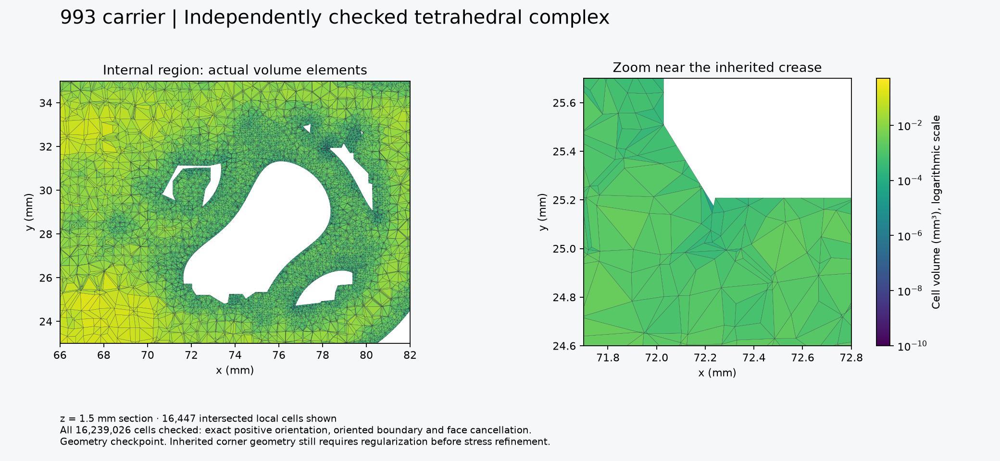
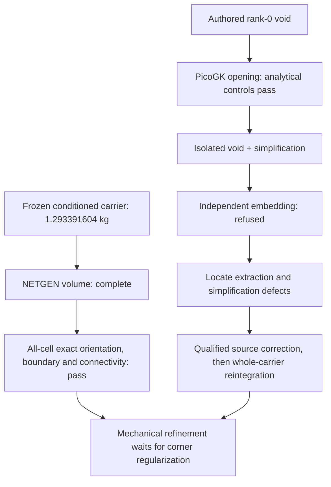

# Complete volume checkpoint and first void-rounding trial

## Current result

The unchanged **1.293391604 kg nominal carrier** now has a complete NETGEN volume with **16,239,026 tetrahedra**. Independent CGAL checks cover every cell and indexed face. This is a geometry checkpoint; the inherited sharp-corner audit still prevents admitting a mechanical peak-stress refinement campaign on this surface.



| Independent check | Result |
|---|---:|
| Exact positive cell orientations | 16,239,026 / 16,239,026 |
| Frozen indexed boundary facets, with matching orientation | 3,025,828 |
| Interior facets occurring twice with opposite orientation | 30,965,138 |
| Face-connected cell components | 1 |
| Unused vertices | 0 |
| Certified upper bound on the largest cell volume | 0.49448775902636 mm³ |
| Unchanged maximum-volume criterion | 0.5 mm³ |

The checker uses CGAL exact orientation predicates and directed-rounding interval arithmetic for the volume limit. It checks the complete indexed boundary against the frozen FEM source, rather than accepting the mesher's own boundary claim. Seven native controls pass: conforming two-cell complexes in C and Fortran storage, an exact-positive case whose naive floating determinant is zero, and refusals for negative orientation, reversed boundary winding, oversized cells and disconnected cells. The exact determinant of the floating-zero control is `2^-54`.

NETGEN005 took **1,789.5 seconds**, under the original 1,800-second worker alarm, with observed peak RSS **21,147,500,544 bytes**. Uncompressed export fixes the diagnosed compression-deadline failure. The separate all-cell CGAL checker completed in **11.46 seconds** on the native Linux ARM64 container profile. Its results do not transfer any earlier R2 stress result.

Frozen receipts: [mesher](evidence/volume-validation-001/netgen-assessment.json), [mesher terminal](evidence/volume-validation-001/netgen-actual-terminal.json), [independent result](evidence/volume-validation-001/independent-assessment.json), [independent execution](evidence/volume-validation-001/independent-plan.json), [controls](evidence/volume-validation-001/independent-controls.json), [extended controls](evidence/volume-validation-001/independent-extra-controls.json).

## Reproduce the independent check

Raw arrays remain private. Restore the two files described in the [payload manifest](evidence/volume-validation-001/private-payloads.json). Their hashes bind the archive and original FEM boundary. The [stored-archive adapter](../../../parts/993-eng-carrier-0001/source/design-20261016/convergence-20261022/describe_stored_tet_archive.py) verifies the complete archive checksum, CRCs, NPY dimensions, byte layout and compression mode. Five adapter tests cover C/Fortran order and malformed inputs.

The volume archive stores tetrahedra in **Fortran order**. Ignoring that flag would read different cells. The [C++ checker](../../../parts/993-eng-carrier-0001/source/design-20261016/convergence-20261022/check_oriented_tet_complex.cpp) explicitly supports both layouts; the full-case offsets and counts are in the [verified descriptor](evidence/volume-validation-001/independent-portable-archive-layout.json).

Compile with `-std=c++17 -O2 -frounding-math -ffp-contract=off -fno-fast-math`, linking GMP and MPFR, in image `sha256:7ed241be10194d98e4ae750cb7f983b0d501742f1ac651580b86c165cba39537` (**Linux ARM64**). Invoke its positional interface:

```text
CHECK ARCHIVE V_OFFSET NV T_OFFSET NT T_FORTRAN SOURCE_MESH64 REPORT
```

For this frozen archive the numeric arguments are `190 3343604 80246878 16239026 1`. The trial used a 6 GiB container limit and 900-second timeout. Do not reuse these offsets for another archive: regenerate and verify its descriptor.

## Source-void regularization: controls pass, first candidate refused

The [upstream audit](SURFACE-FEATURES.md) traced the extreme crease to the rank-0 negative-branch authored void. A PicoGK 2.3.0 headless Mac ARM64 pilot now evaluates opening by erosion/dilation. It first passes **12 analytical controls**: a sphere and cube at three fixed voxel sizes, with and without an additional retreat. Volume approaches the analytic result and the complete mesh-to-analytic signed-distance bounds decrease at each refinement. These are directed bounds, not a claim of symmetric carrier fidelity. [Opening controls](evidence/void-opening-001/opening-assessment.json), [retreat controls](evidence/void-opening-001/retreat-assessment.json), [runtime profile](evidence/void-opening-001/runtime-profile.json).

The isolated void trial uses 0.01 mm voxels, 0.10 mm opening radius and 0.02 mm retreat. Input STL conversion changes no vertex coordinates. The native operation completes in 59.7 seconds under a 4 GiB guard. Its raw output has 8,301,408 faces; Manifold simplification requested at 0.002 mm reduces this to 160,628 faces. A remaining exactly collinear triangle is repaired by partitioning its adjacent triangle at an existing strict middle vertex, with **zero geometric change**.

**This candidate is refused.** Independent CGAL/EPECK screening finds self-intersection in the candidate; the original void passes. A native Boolean pre-screen also reports a nonempty outside remnant, approximately `1.65e-6 mm³`, so strict containment is not claimed. The raw voxel output contains four repeated-index zero-area faces. Removing them changes no geometric image: each removed edge is covered by a retained face edge. Independent EPECK screening then checks all **8,301,404 retained raw faces** and finds no self-intersection. However, **five of 4,150,700 vertices lie outside the original void**, and the boundaries intersect, so raw strict containment also fails. Simplification introduces the separate self-intersection defect. Next actions are localized containment repair and a coarsener that preserves embedding, not an unexamined parameter sweep. [Complete raw diagnosis](evidence/void-opening-001/raw-independent-assessment.json), [zero-change cleanup](evidence/void-opening-001/raw-independent-preparation.json). No part of this failed candidate replaces the current carrier.

[Native trial](evidence/void-opening-001/runtime.json), [simplification](evidence/void-opening-001/simplification.json), [exact collinear repair](evidence/void-opening-001/collinear-repair.json), [independent refusal](evidence/void-opening-001/independent-refusal.json), [raw degeneracies](evidence/void-opening-001/raw-degeneracy.json), [exact repeated-vertex confirmation](evidence/void-opening-001/raw-degeneracy-exact.json). The [PicoGK pilot source](../../../parts/993-eng-carrier-0001/source/design-20261016/convergence-20261022/void-opening-pilot/Program.cs) is experimental and preserves the refused trial settings. PicoGK upstream: [LEAP71/PicoGK](https://github.com/leap71/PicoGK).



The remaining chain includes independently qualified source regularization, complete-carrier reintegration and clearance/port checks, a new volume checkpoint for the changed geometry, matched-load mechanical convergence, and process-specific additive preparation. The present volume result is a reusable baseline for those comparisons.
