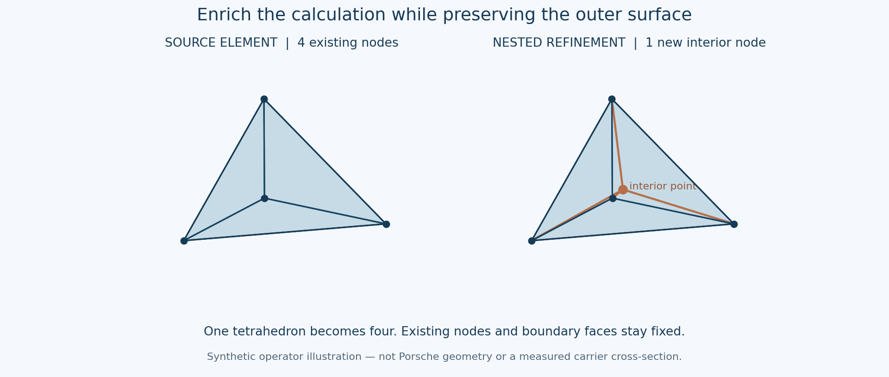
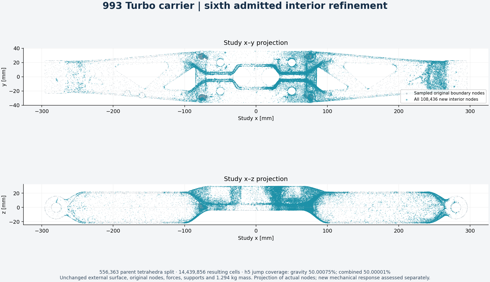
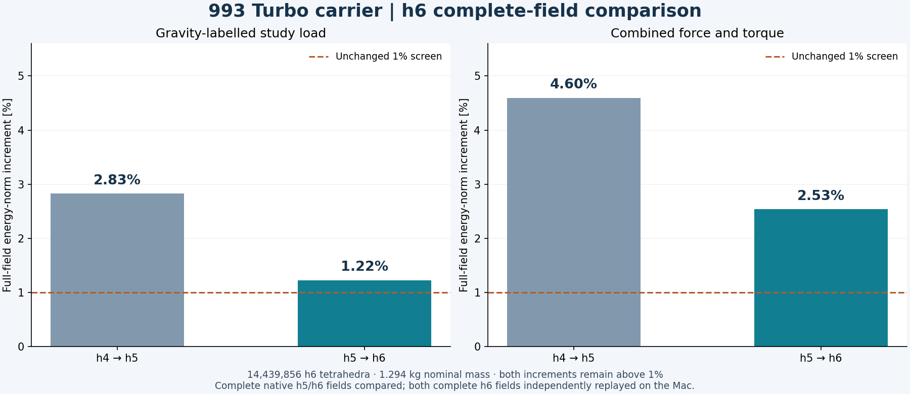
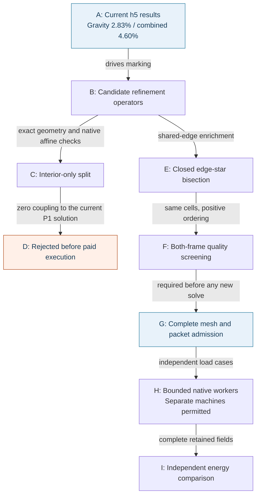

# Carrier refinement: numerical usefulness before machine size

The complete h6 native responses and full h5-to-h6 field comparisons are now
available. Energy-norm increments are **1.2243% for gravity** and **2.5340%
for combined loading**, down from 2.8261% and 4.5965%. Both exceed the unchanged
1% stabilization screen. Nominal mass remains **1.2941382 kg**, below 1.30 kg.
This note distinguishes useful refinement, admitted geometry, actual complete
responses and the byte-identical source recovery preceding a subsequent h7.

## Why an interior-only split was rejected

A tetrahedron can be split into four by adding one strictly interior point.
Exact partition checks passed in both coordinate frames, preserving its volume,
boundary and original nodes. A native CalculiX fixture also passed: six
independent affine strain modes, each exercised with all twelve positive
vertex orderings, gave 72 checked blocks. Maximum displacement, reaction and
stress component errors were 1.39e-17 mm, 2.56e-6 N and 2.47e-5 MPa. The largest
relative energy residual was 2.86e-7, below the retained 1e-4 limit.

Those successes establish geometry and affine consistency. They do **not**
establish useful mechanical enrichment. For the current homogeneous linear
elastic study, stress is constant inside each source P1 tetrahedron. An added
interior displacement basis function vanishes on that tetrahedron's boundary.
Its integrated gradient is zero, so its stiffness coupling with every original
affine displacement field is zero. The retained nodal-load functional also
vanishes on this added basis function. Eliminating these interior degrees of
freedom therefore recovers the original parent response.

An independent exact-rational check obtained the integrated gradient
`(0, 0, 0)` for centroid, off-centre and translated/rounded-point fixtures.
The complete mixed-refinement preparation was cancelled before geometry
admission or any paid execution. Its partial logs are retained. Counting these
interior splits toward traction-jump marking would add cells without the
intended error reduction. This conclusion concerns the current material,
linear formulation and nodal loads; it does not cover distributed body forces,
heterogeneous materials or nonlinear formulations.

## The retained route changes shared-edge approximation

A closed interior edge-star split adds a degree of freedom across neighbouring
source tetrahedra. It can enrich their shared traces while preserving the
carrier's outer surface. This is the existing qualified refinement route.
The first h6 selection reached its 1,800-second local limit before both 50%
indicator-marking targets. Its final recorded coverage was approximately
48.22% for gravity and 47.82% for combined loading; it produced no admitted
proposal.

A bounded audit inspected 799 high-indicator source cells and all 2,537 incident
source edges. Checking positive vertex permutations of the same child cells
reduced the inspected individually unmarkable indicator mass from 14.02% to
6.14% for gravity and from 15.73% to 9.87% for combined loading. These are
operator-feasibility observations on the inspected cells, not global error
bounds or proof that the marking target will be reached.

The new complete selection retains exact midpoint and cavity checks, the
original child node sets and source boundary, separate 50% targets, the
1e6 conditioning caps and all 135 protected source cells. The selected positive
ordering must meet the raw condition cap in **both** original and serialized
coordinate frames. The fresh preparation completed in **940.61 seconds** under its
3,600-second per-phase limit. Both complete coordinate frames passed exact
positive-volume and boundary checks, one connected component and no unused
vertices. Independent full solver-text readback and the h5-to-h6 nesting map
also passed. No paid lease was extended.

## Admitted h6 geometry and completed native responses

| Item | Admitted h6 value |
|---|---:|
| Nodes | 3,933,632 |
| Tetrahedra | 14,439,856 |
| Added free, unloaded nodes on closed interior edge stars | 108,436 |
| Source parent cells split | 556,363 |
| Gravity indicator coverage | 50.000745% |
| Combined indicator coverage | 50.000014% |
| New cells with normalized condition at least 1e6 | 0 |
| Inherited protected high-condition cells | 135 |
| Maximum new normalized condition in either frame | 999,066.12 |
| Minimum new mean-ratio quality in either frame | 1.3610e-5 |
| Nominal mass | 1.2941382 kg, unchanged |

The complete volume SHA-256 is
`1ecb8528fd3e3b20d2d31c78ff2fec714f5d96b383d7326dbaaaa0d49192ec60`;
the solver mesh SHA-256 is
`7f85e5a4929537073198ddc3327f0755871f4105afe7ffd7d621da9b1be8435c`.
The independently checked nesting map is bound to both actual admitted h5
load-case geometries. All original nodes, support and load functionals,
outer surface and nominal mass are retained. The pinned-image witness and
native host controls subsequently passed before the complete responses below.

| Full-field result | Gravity | Combined loading |
|---|---:|---:|
| Energy-norm increment | 1.2242989801% | 2.5340209264% |
| External work, N mm | 1,468.73540783 | 19,111.10391487 |
| Maximum displacement, mm | 0.8150653495 | 2.3592695302 |
| Volume-weighted stress p95, MPa | 45.43666264 | 171.55793639 |
| Unresolved global stress peak, MPa | 21,388.80684 | 174,923.44556 |
| Relative Galerkin identity defect | 6.3048e-8 | 7.8958e-9 |

Two separate bounded Vast workers used the retained CalculiX/PARDISO runtime
with eight threads each. Each passed three analytic cases and two complete
reference repetitions, then its complete h6 response and independent native
energy assessment. The first copied runtime refused execution with code 126
at the first control; executable-mode correction used separate job roots and
preserved the refused attempt. It did not relax any mathematical limit.

Each host then ran a fresh complete h5 source response with its own controls
and assessment. Both raw source DAT hashes exactly matched the previously
admitted h5 responses. The unchanged public comparator checked all 14,439,856
fine cells, complete displacement fields, exact nesting and unchanged study
inputs. Both actual comparator terminals returned zero and were reaped.

The retained comparison JSON hashes are:

- Gravity: `64038419c10b028a6b0052e79f7703d590387fc9d8f48c055244a008f906b5b7`.
- Combined: `17255ce111ea26ca53d62d73731d6142c9c1c9d9af2de37f55496c4fc6355a7e`.
- Unchanged comparator source: `d788b3be607270f4908622eefa49af3da28265d566d305dff90b290115ac82cd`.

The screen remains two successive energy-norm increments below 1%, together
with the existing 0.5% scalar checks. These h6 increments do not pass it.
The stress peaks remain unresolved and are not strength allowables.
Both full h6 raw DATs are locally retained with verified hashes. Both complete
Mac replays subsequently passed using the separately qualified
[bounded RAM storage profile](../architecture/calculix-memory-replay.md),
retaining all original numerical checks. The original bulk storage gate remains
failed; this new profile changes field storage, not equations or thresholds. The fresh
combined h5 repeat is fully retained losslessly; the extra fresh gravity h5
archive is short by 1,386,600 bytes after its endpoint refused the final
transfer. Its native comparison and metadata were already retained.

Complete h6 traction-jump fields and their controls were retained for both
loads, then normalized by the respective complete external work for joint
marking. Local source recovery using the original NumPy 2.2.6 runtime decoded
every mesh coordinate and connectivity entry independently and reproduced
**both admitted h6 archive hashes exactly**. The earlier repack attempts failed
the hash check and remain recorded. No h7 geometry or solve is admitted yet.
Both owned Vast instances were destroyed with provider absence verified.
The subsequent local h7 preparation stopped at its resource guard after
2,287 seconds: free disk space fell below the unchanged 8 GiB reserve. The
child was reaped; its last logged coverage was 46.0336% for gravity and
45.8089% for combined loading. Neither separate 50% target was attained. No
proposal was admitted, and assembly, new solves and paid workers did not start.
The diagram below records how the h5 evidence drove h6; its intermediate
checks are historical completed stages, rather than a claim that h7 is ready.

[Rendered workflow diagram](../media/carrier-refinement-admissibility-20261105.png).

## Reproduction pointers

Private raw geometry and numerical fields remain outside Git. These local
receipts identify the executable checks and retained inputs:

| Check | Local receipt |
|---|---|
| Exact four-child partition and positive ordering | `work/carrier-h6-cell-feasibility-001/interior-controls.json` |
| Actual 72-block native affine fixture | `work/carrier-interior-native-patch-001/assessment.json` |
| Independent zero-coupling rejection | `work/carrier-interior-enrichment-audit-001/audit.json` |
| Cancelled mixed preparation | `work/carrier-adaptive-h6-mixed-001/refusal.json` |
| Same complete h5 comparisons reproduced exactly by the optional generalized comparator | `work/carrier-mixed-p1-001/actual-qualification.json` |
| Source edge feasibility without ordering search | `work/carrier-h6-cell-feasibility-001/audit.json` |
| Source edge feasibility with positive ordering search | `work/carrier-h6-edge-order-feasibility-002/audit.json` |
| New edge-only preparation and frozen sources | `work/carrier-adaptive-h6-edge-order-001/source-binding.json` |
| External h6 geometry receipt locations | `work/carrier-adaptive-h6-edge-order-001/runtime-paths.json` |
| Complete geometry nesting to both actual h5 cases | `work/carrier-nested-comparison-h6-001/map-provenance.json` |
| Actual h6 node projection and input hashes | `work/carrier-h6-refinement-figure-001/figure.json` |
| Full gravity h5-to-h6 comparison | `work/carrier-h5-offline-source-033-001/h5-to-h6-comparison.json` |
| Full combined h5-to-h6 comparison | `work/carrier-h5-offline-source-032-001/h5-to-h6-comparison.json` |
| Native h6 gravity raw-data retention | `work/carrier-h6-modefix-033-002/scientific-complete.json` |
| Native h6 combined raw-data retention | `work/carrier-h6-modefix-032-002/scientific-complete.json` |
| Complete h6 traction-jump indicators | `work/carrier-h6-native-jumps-001/033/complete.json`; `032/complete.json` |
| Plotted results and source hashes | `work/carrier-h6-comparison-figure-001/figure.json` |
| Byte-identical local h6 source archive recovery | `work/carrier-h6-local-source-recovery-002/result.json` |
| Complete joint h6 marking vector | `work/carrier-h6-joint-marking-001/ranking.json` |
| Recovered original h6 admission, population and boundaries | `work/carrier-h6-source-admission-recovery-001/complete.json` |
| Bounded local h7 proposal source admission | `work/carrier-adaptive-h7-edge-order-001/source-admission.json` |
| Actual stopped h7 preparation | `work/carrier-adaptive-h7-edge-order-001/terminal.json` |
| Both complete h6 Mac replays and native comparison | `work/carrier-h6-memory-replay-001/complete.json` |
| Actual h6 unaveraged field image | `work/carrier-h6-field-figure-001/figure.json` |

The generalized comparator reproduced every actual numerical value of both
previous complete h4-to-h5 comparisons exactly. This is compatibility evidence;
it does not reverse the rejection of the interior-only mechanical refinement.

The user permits multiple simultaneous Vast rentals. Independent accepted load
cases may run on separate bounded workers after packet qualification. Two separately guarded
workers completed the h6 study load cases described above. Additional RAM or GPUs do
not resolve the zero-coupling issue above.

[Complete mechanical results and software chain](carrier-current-mechanics-20261104.md).
