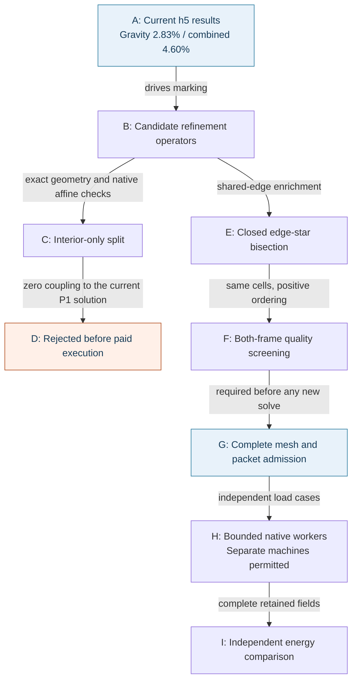

# Carrier refinement: numerical usefulness before machine size

The complete h5 results remain the current mechanical reference: gravity and
combined-load energy-norm increments are 2.83% and 4.60%, respectively. Both
exceed the unchanged 1% stabilization screen. Nominal mass remains
**1.2941382 kg**, below the 1.30 kg limit. This note records the next
refinement-method checks; it contains no new complete-carrier response.

## Why an interior-only split was rejected

A tetrahedron can be split into four by adding one strictly interior point.
Exact partition checks passed in both coordinate frames, preserving its volume,
boundary and original nodes. A native CalculiX fixture also passed: six
independent affine strain modes, each exercised with all twelve positive
vertex orderings, gave 72 checked blocks. Maximum displacement, reaction and
stress component errors were 1.39e-17 mm, 2.56e-6 N and 2.47e-5 MPa. The largest
relative energy residual was 2.86e-7, below the retained 1e-4 limit.

Those successes establish geometry and affine consistency. They do **not**
establish useful mechanical enrichment. For the current homogeneous linear
elastic study, stress is constant inside each source P1 tetrahedron. An added
interior displacement basis function vanishes on that tetrahedron's boundary.
Its integrated gradient is zero, so its stiffness coupling with every original
affine displacement field is zero. The retained nodal-load functional also
vanishes on this added basis function. Eliminating these interior degrees of
freedom therefore recovers the original parent response.

An independent exact-rational check obtained the integrated gradient
`(0, 0, 0)` for centroid, off-centre and translated/rounded-point fixtures.
The complete mixed-refinement preparation was cancelled before geometry
admission or any paid execution. Its partial logs are retained. Counting these
interior splits toward traction-jump marking would add cells without the
intended error reduction. This conclusion concerns the current material,
linear formulation and nodal loads; it does not cover distributed body forces,
heterogeneous materials or nonlinear formulations.

## The retained route changes shared-edge approximation

A closed interior edge-star split adds a degree of freedom across neighbouring
source tetrahedra. It can enrich their shared traces while preserving the
carrier's outer surface. This is the existing qualified refinement route.
The first h6 selection reached its 1,800-second local limit before both 50%
indicator-marking targets. Its final recorded coverage was approximately
48.22% for gravity and 47.82% for combined loading; it produced no admitted
proposal.

A bounded audit inspected 799 high-indicator source cells and all 2,537 incident
source edges. Checking positive vertex permutations of the same child cells
reduced the inspected individually unmarkable indicator mass from 14.02% to
6.14% for gravity and from 15.73% to 9.87% for combined loading. These are
operator-feasibility observations on the inspected cells, not global error
bounds or proof that the marking target will be reached.

The new complete selection retains exact midpoint and cavity checks, the
original child node sets and source boundary, separate 50% targets, the
1e6 conditioning caps and all 135 protected source cells. The selected positive
ordering must meet the raw condition cap in **both** original and serialized
coordinate frames. The fresh preparation completed in **940.61 seconds** under its
3,600-second per-phase limit. Both complete coordinate frames passed exact
positive-volume and boundary checks, one connected component and no unused
vertices. Independent full solver-text readback and the h5-to-h6 nesting map
also passed. No paid lease was extended.

## Complete h6 geometry; new mechanical responses pending

| Item | Admitted h6 value |
|---|---:|
| Nodes | 3,933,632 |
| Tetrahedra | 14,439,856 |
| Added free, unloaded nodes on closed interior edge stars | 108,436 |
| Source parent cells split | 556,363 |
| Gravity indicator coverage | 50.000745% |
| Combined indicator coverage | 50.000014% |
| New cells with normalized condition at least 1e6 | 0 |
| Inherited protected high-condition cells | 135 |
| Maximum new normalized condition in either frame | 999,066.12 |
| Minimum new mean-ratio quality in either frame | 1.3610e-5 |
| Nominal mass | 1.2941382 kg, unchanged |

The complete volume SHA-256 is
`1ecb8528fd3e3b20d2d31c78ff2fec714f5d96b383d7326dbaaaa0d49192ec60`;
the solver mesh SHA-256 is
`7f85e5a4929537073198ddc3327f0755871f4105afe7ffd7d621da9b1be8435c`.
The independently checked nesting map is bound to both actual admitted h5
load-case geometries. All original nodes, support and load functionals,
outer surface and nominal mass are retained. These checks admit the geometry
for the next calculation; the h6 displacement, stress and energy increments
remain unmeasured. The new packet must pass its complete pinned-image witness
before a native worker starts.

[Rendered workflow diagram](../media/carrier-refinement-admissibility-20261105.png).

## Reproduction pointers

Private raw geometry and numerical fields remain outside Git. These local
receipts identify the executable checks and retained inputs:

| Check | Local receipt |
|---|---|
| Exact four-child partition and positive ordering | `work/carrier-h6-cell-feasibility-001/interior-controls.json` |
| Actual 72-block native affine fixture | `work/carrier-interior-native-patch-001/assessment.json` |
| Independent zero-coupling rejection | `work/carrier-interior-enrichment-audit-001/audit.json` |
| Cancelled mixed preparation | `work/carrier-adaptive-h6-mixed-001/refusal.json` |
| Same complete h5 comparisons reproduced exactly by the optional generalized comparator | `work/carrier-mixed-p1-001/actual-qualification.json` |
| Source edge feasibility without ordering search | `work/carrier-h6-cell-feasibility-001/audit.json` |
| Source edge feasibility with positive ordering search | `work/carrier-h6-edge-order-feasibility-002/audit.json` |
| New edge-only preparation and frozen sources | `work/carrier-adaptive-h6-edge-order-001/source-binding.json` |
| External h6 geometry receipt locations | `work/carrier-adaptive-h6-edge-order-001/runtime-paths.json` |
| Complete geometry nesting to both actual h5 cases | `work/carrier-nested-comparison-h6-001/map-provenance.json` |
| Actual h6 node projection and input hashes | `work/carrier-h6-refinement-figure-001/figure.json` |

The generalized comparator reproduced every actual numerical value of both
previous complete h4-to-h5 comparisons exactly. This is compatibility evidence;
it does not reverse the rejection of the interior-only mechanical refinement.

The user permits multiple simultaneous Vast rentals. Independent accepted load
cases may run on separate bounded workers after packet qualification. No new
machine was rented for the checks described here. Additional RAM or GPUs do
not resolve the zero-coupling issue above.

[Complete mechanical results and software chain](carrier-current-mechanics-20261104.md).
