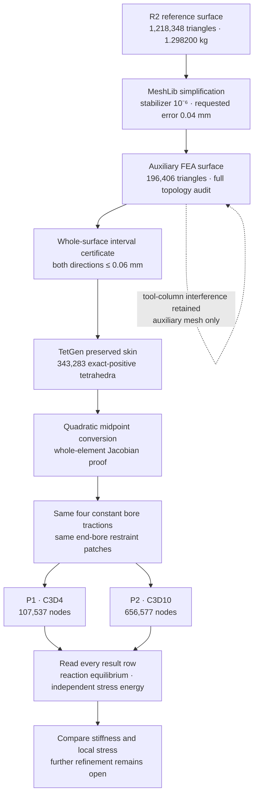
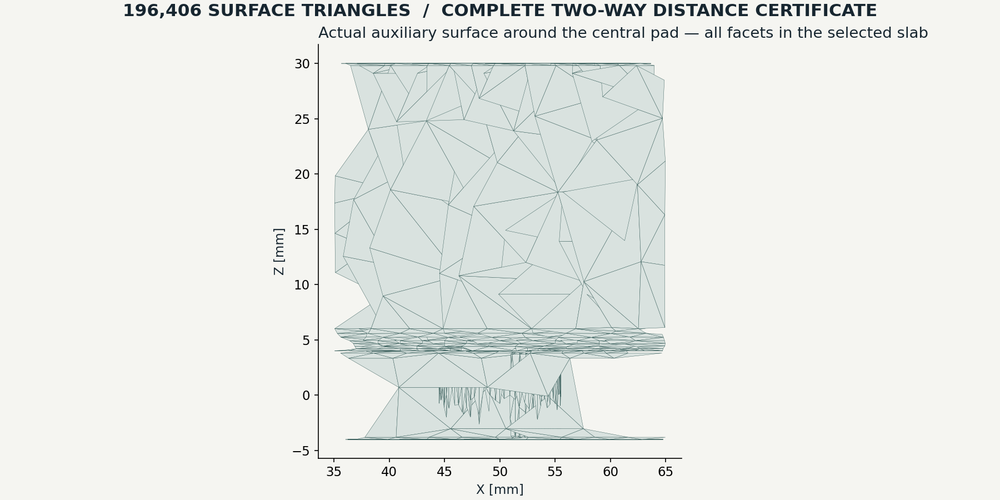

# 993 carrier — controlled mechanical comparison

The retained R2 carrier is **1.298199813 kg** at the stated reference density of
4,420 kg/m³. This continuation builds a smaller analysis mesh with a complete
surface-distance bound, verifies quadratic elements, and compares element
orders under the same continuous bore tractions. R2 remains the geometry
reference; the auxiliary analysis surface is a separate numerical approximation.

[Main project page](README.md) · [Runnable source](../../../parts/993-eng-carrier-0001/source/design-20261016/resume-20261020/README.md)

## Complete surface fidelity

Changing MeshLib's planar regularizer from 0.001 to **0.000001**, while keeping
its requested error at 0.04 mm, reduces the R2 surface to **98,169 vertices and
196,406 triangles**. The full libigl topology and self-intersection audit passes.
Six nominal shank gauges pass, but the exact tool-column exclusion refuses
small intrusions. This surface therefore belongs only to the FEA approximation;
it does not replace the separately audited R2 manufacturing-reference surface.
A global distance bound does not imply that an individual clearance is preserved.

The complete symmetric distance is certified at **less than 0.06 mm**:

| Direction | Complete covering leaves | Certified upper bound |
| :--- | ---: | ---: |
| R2 reference → auxiliary | 9,015,375 | 0.0599999818485282 mm |
| Auxiliary → R2 reference | 19,573,542 | 0.059999994899749935 mm |

The predicate covers triangle interiors. A libigl query selects a possible
target triangle; it supplies no acceptance decision. For each source leaf,
nonnegative integer barycentric witnesses lie in that target triangle.
Outward-rounded interval arithmetic encloses distances for all three source
vertices. Convexity then bounds the entire source leaf. Exact address partitions
check that the leaves cover every original source face without gaps or overlap.
The reverse pass records binary split edges and checks their shared-prefix
consistency. Independent tests use exact rational arithmetic and adversarial
missing, duplicated and inconsistent partitions.

The first quadtree budget was insufficient. The second certified the forward
pass but exhausted the reverse budget. Reusing the unchanged forward proof and
switching the reverse subdivision to longest-edge bisection completed both
passes. Two earlier CGAL bounded-Hausdorff attempts timed out; neither counts
as a distance certificate. Vertex and centroid probes are retained as diagnostics.

The successful [interval report](evidence/meshlib-R2-binary-reverse-cover-001/output/result/assessment.json)
and [actual execution receipt](evidence/meshlib-R2-binary-reverse-cover-001/actual-terminal.json)
record source identities, limits and completion. The complete proof arrays
remain local because their compressed sizes are approximately 193 MB and
597 MB. Their SHA-256 values are recorded in the reports; they are regenerable
from the published surfaces and source. The public report is a receipt, while
full witness replay requires those generated arrays.

## Element geometry and analytical controls

TetGen preserves the auxiliary skin and produces **343,283 exact-positive,
face-connected tetrahedra**. Linear and quadratic meshes have identical parent
corners and faces. The quadratic converter adds one shared midpoint per edge
using the existing bounded CalculiX numeric codec.

A rational affine-perturbation calculation covers the **whole quadratic
reference simplex**, including the homotopy from its corner-affine map. Its
maximum relative Jacobian perturbation bound is **3.38536 × 10⁻¹⁰ < 1**;
all element orientations therefore stay positive. The composed complete
surface-distance bound, including coordinate encoding and midpoint deviations,
is **0.059999994899797904 mm**, within the unchanged 0.06 mm limit.
See the [whole-element audit](evidence/meshlib-R2-quadratic-mapping-audit-001/assessment.json).

The actual pinned CalculiX binary also solves a six-tetrahedron quadratic unit
cube with **27 nodes and one unconstrained interior node**. The manufactured
solution is `u = (10⁻⁶ x², 0, 0)`, with its corresponding body force. Every
nodal displacement and all 24 integration-point stress rows are checked.
The displacement error is **1.895 × 10⁻²² mm**, stress error
**3.712 × 10⁻⁸ MPa**, and independent energy residual **2.652 × 10⁻⁷**.
The unchanged limits are 10⁻¹¹ mm, 10⁻⁶ MPa and 10⁻⁴ respectively.
Removing the required body force makes the control fail, as intended.

A second unit cube tests the actual constant-traction distribution for both
orders against uniaxial elasticity. Both pass: maximum displacement error
**3.926 × 10⁻¹³ mm** and stress error below **3.693 × 10⁻¹⁵ MPa**.
The published small input decks, DAT files and assessments permit independent
inspection of these controls. The first manufactured-solution deck had invalid
boundary syntax; that failed run is retained alongside the corrected input.

## Matched load model

The four central bore surface patches receive one constant vector traction
each. Their values minimize the surface integral of squared traction subject
to the requested resultant force and moment. Both element orders use the same
parent triangles, areas and traction vectors. Exact straight-triangle shape
integrals place `area/3` on each P1 corner, and `area/3` on each P2 edge midpoint
with zero corner force. Actual serialized nodal loads are checked against all
six resultant components.

Both end-bore patches are fixed. The assumed combined case is **−4,000 N in Z
and +850,000 N·mm about Y**, with **E = 107,000 MPa, ν = 0.31**. This fixture
uses neither contact nor bolt preload. It is a new continuous-traction model;
the earlier minimum-norm nodal load studies remain separate comparisons.

| Matched combined case | P1 · C3D4 | P2 · C3D10 |
| :--- | ---: | ---: |
| Parent tetrahedra | 343,283 | 343,283 |
| Nodes | 107,537 | 656,577 |
| Maximum nodal displacement | 1.469255 mm | 2.491741 mm |
| Maximum printed integration-point von Mises stress | 2,242.595 MPa | 1,152.404 MPa |
| Independent stress-energy residual | 6.619 × 10⁻⁹ | 5.293 × 10⁻⁹ |
| Actual solver time | 13.34 s | 150.00 s |

Both solves completed using the pinned direct binary with a 12 GiB container
limit. Every displacement, integration-point stress and support-reaction row
was read. The quadratic case includes **1,373,132 stress rows**; the peak lies
near the end restraint at **(276.422, 22.829, −5.761) mm**. It is the maximum
among printed integration points, with no nodal stress averaging.

The displacement difference is approximately **69.6% relative to P1**. These
two orders do not establish mesh convergence; they expose significant
sensitivity to the approximation. Peak stresses near an ideal fixed support
also need their own spatial-convergence and fixture-sensitivity study. The
lower P2 peak is not evidence of a stronger design.

The views retain the undeformed geometry and use the mean of the three parent
corner displacement magnitudes for each projected surface triangle. The colour
scale is shared; reported maxima use all solved nodes, including P2 midsides.

[Complete P1 assessment](evidence/meshlib-R2-matched-P1-assessment-001/assessment.json) ·
[Complete P2 assessment](evidence/meshlib-R2-matched-P2-assessment-001/assessment.json)

The independent energy check integrates the printed stress field through the
isotropic compliance law and compares it with half the external nodal work.
It is independent of simply defining strain energy as half the external work.
The retained relative acceptance limit is **10⁻⁴**. Original R1 and R2 dense
C3D4 cases also pass this check, with residuals **1.423 × 10⁻⁹** and
**3.365 × 10⁻⁹**, respectively.

## Solver experiments retained

A source-built CalculiX experiment used the official Debian 2.21 source
archives, checked against the SHA-256 values in its source description. The
PGP signature was not verified. Its first proposed change, the argument
`eps` in `preiter.c`, did not change PCG's hard-coded stopping condition: the
original affine control still failed. The corrected experiment changed the
actual `c1` stopping constant in `pcgsolver.c` from 0.005 to 10⁻¹². It passed
the original affine tolerances, but the full R2 solve reached its **600-second
limit without a completed result**. Both failed experiments are preserved.
The canonical direct CalculiX image and binary remain unchanged.

All compute in this checkpoint ran locally with bounded owned processes or
containers. No Vast instance was rented. No model strength, fatigue or print
qualification is inferred from solver completion or these numerical controls.
