# 993 carrier — geometry, simulation and reproducible software chain

**20 October 2026 · Engineering resumed — mechanical screening flags a root hotspot**

[Project overview](../../manufacturing/993_CARRIER_PROJECT_EN.md) · [Runnable recipe](../../../parts/993-eng-carrier-0001/source/design-20261016/resume-20261020/README.md) · [Machine-readable checkpoint](checkpoint.json)

Three routes have now been executed from the retained **24af0584 carrier**:
small NURBS reinforcement, native cavity redesign, and PicoGK volumetric
rounding followed by MeshLib surface simplification. Their nominal masses
remain below the requested **1.30 kg** ceiling. The two restored volumetric surfaces are **1.281680 kg (R1)** and
**1.298200 kg (R2)**. Their own complete audits and new mechanical cases
are recorded below.

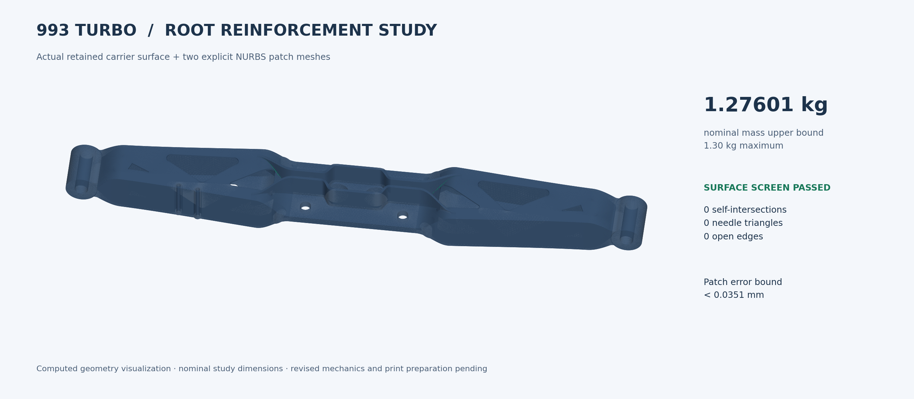

The new mechanical cases identified severe local hotspots in the first two
routes. The PicoGK route passes the complete surface screen and six nominal
shank gauges. Pad restoration now has a separate exact open-tool-column
exclusion certificate; its closed-set test still reports planar contact. No
variant is adopted as the final design. The catalogue selection remains
24af0584; the results below identify their actual geometry and scope.

## New: controlled element-order comparison

The [convergence study](CONVERGENCE.md) now certifies the complete auxiliary
surface within 0.06 mm of R2, verifies all quadratic-element mappings, and
solves matched linear and quadratic cases with identical continuous bore
tractions. Both pass reaction and independent stress-energy checks. The large
displacement difference, **1.469 → 2.492 mm**, leaves convergence open.

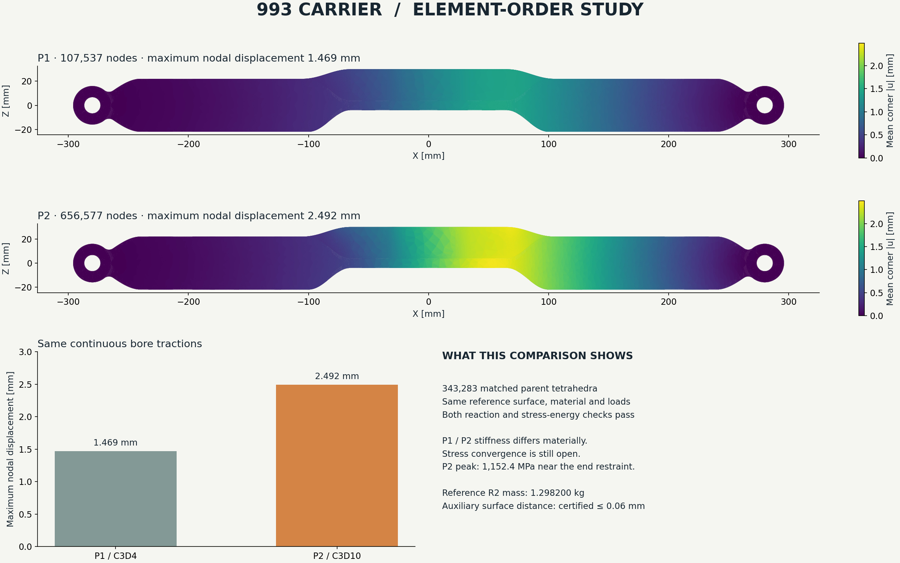

## What changed

The native radius-law trials and Boolean unions did not satisfy their original
acceptance conditions. Instead of relabelling these results, we retained them
and constructed the reinforcement surfaces explicitly from complete control
nets. A structured tessellator bounds every source-surface cell. Twelve short
edge contractions per patch then remove endpoint needles while accumulating
an exact rational bound on the added surface displacement.

The saved native BREP patches were reopened: all four B-spline faces per patch
have **exactly matching degrees, knots, multiplicities, poles and weights**.
The mathematical tessellation certificate is tied to these control nets. Its
endcap construction belongs to the parametric definition; the native readback
checks the four tensor surfaces and counts the two remaining cap faces.

| Check on the new prototype | Actual result |
| :--- | ---: |
| Parent mesh retained byte for byte in 3MF | 598,372 triangles |
| Each cleaned reinforcement | 761 vertices · 1,518 triangles |
| All component triangles | **601,408** |
| Open / nonmanifold / inconsistently oriented edges | **0 / 0 / 0** |
| Degenerate / needle triangles | **0 / 0** |
| Intracomponent self-intersection pairs, full libigl audit | **0** |
| Connected surface components per mesh resource | **1 each** |
| Minimum reinforcement triangle ratio | **0.00106169**, criterion ≥ 0.001 |
| Complete source-to-patch-mesh L1 bound | **≤ 0.035084723 mm**, criterion ≤ 0.06 mm |
| Strict lib3mf read warnings | **0** |
| Build items / positive source components | **1 / 3** |
| Positive overlap with parent, two patch checks | **1.496425 / 1.490772 mm³** |
| Nominal dense titanium mass upper bound, ρ = 4,420 kg/m³ | **1.276005162 kg** |
| Remaining mass allowance | **23.9948 g** |

Mass is the sum of component volumes times the stated density, so overlap is
counted twice and the result is an upper bound for the intended union. It is
not a support, powder, machining-stock or build-consumption estimate.

## The reproducible route

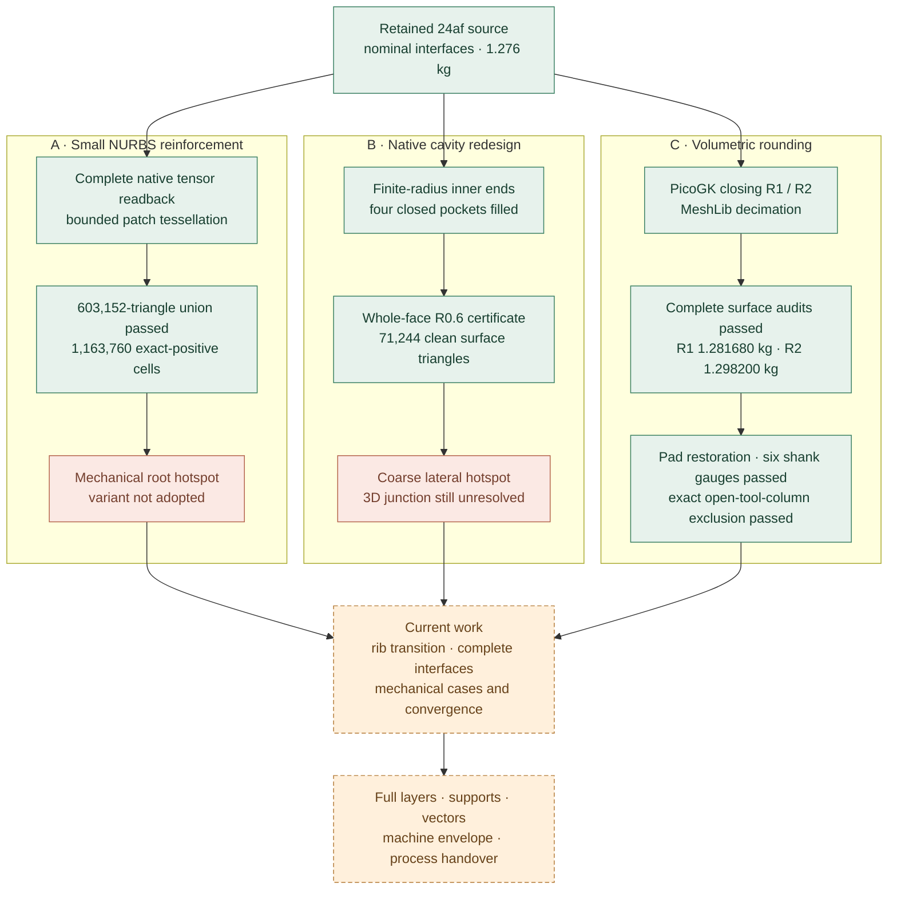

The 3MF contains overlapping positive solids. The
[3MF Core specification](https://github.com/3MFConsortium/spec_core/blob/997b385e06f3181cf9aae0c578e0b45ccd48ccb2/3MF%20Core%20Specification.md)
requires consumers to unite overlapping components. We verified the archive,
coordinate graph and each complete component surface. We have **not yet
verified a slicer's actual union and every resulting layer**. A valid component
archive alone does not close that stage.

## Why the endpoint cleanup is bounded

The original surface error has four terms: U curve-to-chord deviation,
rational V curve-to-chord deviation, bilinear-cell triangulation and float32
coordinate rounding. Exact rational convex-hull bounds cover every cell;
these are continuous bounds rather than sampled point distances. Their maximum
is approximately **0.030717 mm** for these two patches.

For a contraction that sends vertex B to existing vertex A, every affected
triangle point moves by at most `||A − B||₁`: barycentric coefficients are
nonnegative and sum to one. The images of collapsed triangles must be covered
by surviving triangles. Every accepted operation also preserves closed,
consistently oriented local topology. Summing all twelve displacement bounds
adds **18319 / 4194304 mm ≈ 0.00436759 mm** per patch. Combining this with the
source tessellation bound gives the reported **0.035085 mm** upper bound.
The independent all-facet audit then checks self-intersections and the original
triangle-quality criterion.

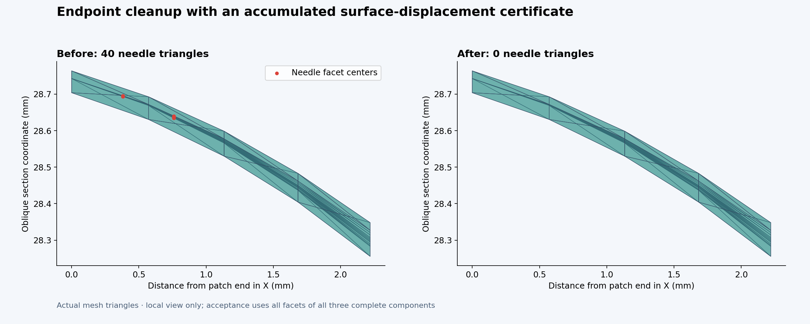

The bound covers the two complete parametric patch surfaces, including their
constructed planar endcaps. It does not replace the retained parent's older
sampled CAD-distance evidence, prove native Boolean containment, or establish
mechanical improvement. The original carrier mesh stays exactly unchanged.

## Software actually used

| Software / component | Version or identity | Executed role |
| :--- | :--- | :--- |
| [build123d](https://github.com/gumyr/build123d) | 0.11.1 | Import carrier, create and reopen explicit patch solids |
| [OCCT](https://github.com/Open-Cascade-SAS/OCCT) via cadquery-ocp-novtk | 7.9.3.1.1 | Radius-law trials, native BREP, Boolean diagnostics, tensor readback |
| Python `Fraction` | Standard library | Exact serialized-coefficient polynomial and surface-error certificates |
| [NumPy](https://github.com/numpy/numpy) | 2.0.2 in the 3MF runtime | Complete coordinate/index processing, deterministic binary STL |
| [Manifold](https://github.com/elalish/manifold) | 3.5.2 | Positive source-solid and overlap screens; separate refused Boolean union trial |
| [lib3mf](https://github.com/3MFConsortium/lib3mf) | 2.5.0 | Mesh resources, component graph, writer and strict reader |
| [CGAL](https://github.com/CGAL/cgal) | 5.6, EPECK; pinned local image `sha256:7ed241be10194d98e4ae750cb7f983b0d501742f1ac651580b86c165cba39537` | Exact full-mesh unions and strict complete-parent difference |
| [libigl](https://github.com/libigl/libigl) | 2.6.3 | Independent full-surface topology and exact-predicate intersection audit |
| Docker audit runtime | `sha256:3ccaf5701c7c9add59eda6e8db918106fc8d51f4c2ef5b148d8079262861c7e1` | Isolated Linux ARM64 audit, network disabled, 1 CPU / 4 GiB |
| Matplotlib / NumPy / SciPy | 3.10.8 / 2.2.6 / 1.14.1 figure environment | Actual geometry and saved-data figures |
| [WildMeshing / fTetWild bindings](https://github.com/wildmeshing/wildmeshing-python) | 0.4.1, NumPy 1.26.4, svgwrite 1.4.3; verified macOS ARM64 wheel | Positive tetrahedron installation control; complete carrier volume-meshing trial |
| [TetGen via libigl](https://www.wias-berlin.de/software/tetgen/1.5/doc/manual/manual005.html) | Existing pinned libigl 2.6.3 Docker image; bundled TetGen version not independently established | Actual `pYMQ` carrier run; analytic control; exact boundary bijection; separate quality-refinement experiment |
| [PicoGK](https://github.com/leap71/PicoGK) / OpenVDB | PicoGK 2.3.0.0 / native ABI 26.2; .NET SDK 9.0.319 | Actual full-carrier morphological closing, with an owned process, lock, resource receipts and positive control |
| [MeshLib](https://github.com/MeshInspector/MeshLib) | meshlib / meshlib-core 3.1.4.297, NumPy 2.2.6 | Actual full-mesh decimation after PicoGK; pinned macOS ARM64 wheels; numerical evaluation |
| [CalculiX](https://www.calculix.de/) | 2.21, Debian 2.21-1; pinned binary and Docker image | Direct SPOOLES affine control and actual carrier gravity/combined cases |
| Git / GitHub | Repository-native source and evidence | Reviewable source, manifests, reports and images |

The wider chain already includes **Gmsh, CalculiX and PySLM**, described in the
[project overview](../../manufacturing/993_CARRIER_PROJECT_EN.md#the-software-chain).
Gmsh 4.15.2 was also executed on the three native inputs: the [fragment preflight](evidence/gmsh-fragment-001/assessment.json) refused its source-volume balances, with native Boolean warnings retained. No mechanical mesh was admitted from that Gmsh preflight. The later TetGen study below supplies new provisional mechanical results; complete slicing is still pending. MeshLib was subsequently installed and executed for the PicoGK branch below. No Vast machine was rented for this resume.

## Trials that remain refused

| Retained trial | What the actual run showed |
| :--- | :--- |
| Three-point native radius law | Standalone law proof passed; native construction refused at two vertices; consumed law's endpoint slopes were nonzero |
| Zero-radius terminal source edges | Native construction refused at four vertices |
| Native sequential / simultaneous unions | Saved Boolean candidates failed strict full-parent retention comparisons; separate self-controls passed |
| Manifold Boolean union | Parent-minus-union was nonempty: 460 facets, signed volume about −4.97 × 10⁻¹⁵ mm³; criterion remained empty |
| Initial OCP patch tessellation | 30 / 26 needles and 141 / 136 self-intersection pairs after exact redundant-facet cleanup |
| First bounded structured tessellation | Zero self-intersections; 40 needles in each patch |
| Gmsh 4.15.2 fragment preflight | Source-to-fragment volume balance refused; no mechanical mesh admitted |
| Certified endpoint contractions | **All complete component surface screens passed** |

The component representation preserves the parent directly as an unchanged
resource. This is a separate representation and acceptance argument; none of
the refused Boolean outputs has been reclassified as a pass.

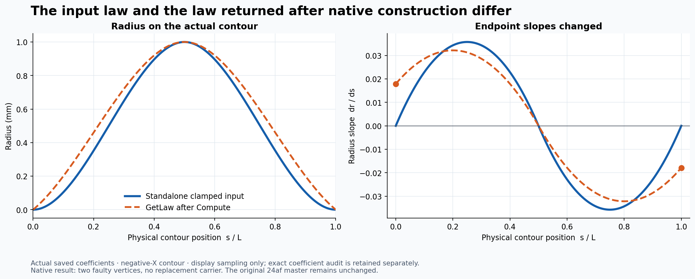

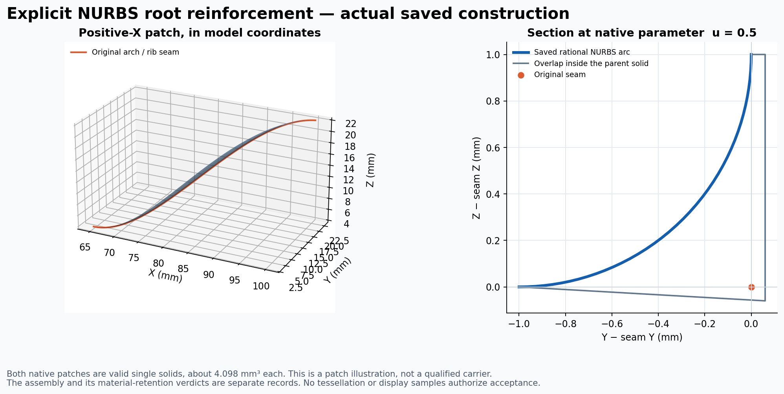

## Files and evidence

- [Runnable source recipe and exact inputs](../../../parts/993-eng-carrier-0001/source/design-20261016/resume-20261020/README.md)
- [New 3MF component assembly study](../../../parts/993-eng-carrier-0001/source/design-20261016/resume-20261020/carrier-additive-assembly-study.3mf), SHA-256 `95558c07bf62a51630c799c6a8cf64feaff2a3d9bde06a4594c6b788ef049363`
- [Complete independent surface audit](evidence/component-libigl-certified-001/assessment.json) and [actual Docker terminal receipt](evidence/component-libigl-certified-001/actual-terminal.json)
- [Exact cell-by-cell surface bounds](evidence/bounded-tessellation-001/assessment.json) and [every accepted contraction](evidence/certified-collapse-001/assessment.json)
- [3MF strict readback, byte identity, overlaps and mass](evidence/certified-component-replay-001/assessment.json)
- [Complete reopened native tensor coefficients](evidence/native-tensor-readback-001/assessment.json)
- [Exact evidence-copy manifest](evidence-copy-manifest.json); large launch plans and terminal receipts are losslessly gzip-compressed with both stored and uncompressed hashes
- [18 October checkpoint](../carrier-pause-20261018/README.md), retained unchanged as history

## Exact polyhedral union: parent retention now passes

A subsequent CGAL **5.6 EPECK** trial completed both full-mesh unions and then
computed the difference between the complete original parent and the exact
union. The difference operation succeeded with **zero output faces**. This
passes strict parent retention for this exact polyhedral representation; the
older native and Manifold trial refusals remain unchanged.

The [native operation record](evidence/exact-union-001/union.json),
[actual terminal receipt](evidence/exact-union-001/actual-terminal.json) and
[complete exact-coordinate master](../../../parts/993-eng-carrier-0001/source/design-20261016/resume-20261020/exact-polyhedral-union.mesh64.gz)
retain this result. Its master has **603,258 triangles**. Conversion to float64
has a full surface L1 bound of **1.908 × 10⁻¹⁴ mm**. The
[independent rounded-union audit](evidence/exact-union-surface-audit-001/assessment.json)
found zero open/nonmanifold/orientation edges, zero degeneracies and zero
self-intersections, but **86 needle triangles**, so that surface was refused.

This is a separate route towards a conformal mechanical mesh. A bounded local
contraction trial stopped with 38 needles when no further admissible contraction
fit the unchanged 0.06 mm budget. Bounded diagonal flips remove slivers by
changing the triangulation of convex projected quadrilaterals. These mesh
preparation trials do not inherit the exact master's zero-difference result.
A complete audit after quality-driven diagonal flips found **62 remaining needles** and zero self-intersections. A subsequent economical contraction trial stopped with **23 needles** and remained incomplete. WildMeshing/fTetWild 0.4.1 has been installed in a separate runtime, with the exact wheel hash and bundled MPL-2.0/dependency licences retained. Its [closed-tetrahedron installation control](evidence/wildmeshing-control-001/assessment.json) returned 216 nodes, 658 positive tetrahedra and total volume 0.16666666666666669 mm³. The complete carrier trial requests a 0.06 mm envelope and 9 mm ideal edge length; its boundary and envelope require independent checks. The three-component 3MF remains available as the unchanged-parent source representation; the later bounded single-surface checkpoint is described below.

The [CGAL manual](https://doc.cgal.org/5.5.1/Polygon_mesh_processing/index.html)
documents exact constructions as a way to avoid intersection-coordinate
rounding during corefinement. The implemented adapter retains rational output
coordinates and performs one separately audited conversion. CGAL's polygon
mesh processing package has GPL licensing requirements; the trial used the
existing pinned local image and did not install a new commercial package.

## Exported volume-mesh checkpoint

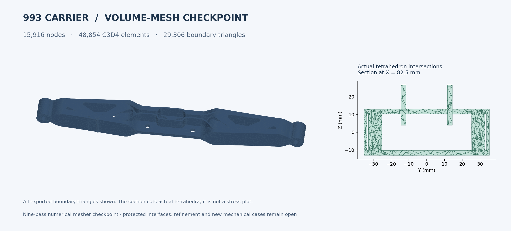

WildMeshing returned **15,916 nodes and 48,854 C3D4 tetrahedra** after nine
optimization passes. The complete exported boundary has **29,306 triangles**.
The [independent complete boundary audit](evidence/wildmeshing-boundary-audit-001/assessment.json)
passes the original criteria: zero open, nonmanifold or orientation edges,
zero degenerate or needle triangles, one connected component and zero
self-intersections.

The [independent volume audit](evidence/wildmeshing-volume-audit-001/assessment.json)
checks all **48,854 determinants with exact rational arithmetic** on the stored
binary64 coordinates. Every determinant is strictly positive. The tetrahedra
form one face-connected component, with no repeated-node cells or nonmanifold
faces, and the exported skin matches the complete volume boundary exactly.
The exact total volume is approximately **288,676.110399 mm³**.

This first mesh remains **unadmitted**. A complete symmetric Hausdorff maximum
calculation reached its 230-second execution limit. A separate complete CGAL
predicate finished and [rejected the conservative 0.059 mm guard](evidence/wildmeshing-boundary-envelope-predicate-001/assessment.json),
which reserves 0.001 mm for its public additive-error contract within the
unchanged 0.06 mm limit. The exact maximum deviation remains unknown. Both
analytic predicate controls passed: a 1/64 mm translation was inside the guard,
and a 1/8 mm translation was outside.

The completed **0.03 mm mesher-envelope trial** returned 25,244 nodes and 77,196 tetrahedra. Its complete skin and exact positive-orientation checks passed, but the same global predicate refused its boundary again. Deterministic diagnostics over every vertex and face centroid observed a **0.577792 mm** source-to-output distance at a window tip near X = −65 mm. These diagnostic samples locate a defect; they are not a continuous upper-bound certificate. Neither volume mesh is admitted, and neither failed guard has been reclassified. The native optimization log also
reports a peak energy near 20.03 against its requested stopping target of 10;
that stopping target is separate from the exact orientation and boundary
checks reported above.

The first unrestricted carrier trial stopped at its CPU limit before export.
Its [actual terminal receipt](evidence/wildmeshing-carrier-001/actual-terminal.json)
records the signal, clean process reaping and unchanged inputs. The successful
nine-pass export took **273.98 seconds** of host wall time and peaked at
approximately **1.13 GB sampled RSS**. Native library timing fields include an
inconsistent winding-number duration; the host supervisor's elapsed time is
used for execution reporting.

[Mesh arrays](../../../parts/993-eng-carrier-0001/source/design-20261016/resume-20261020/volume-checkpoint.npz),
[complete boundary](../../../parts/993-eng-carrier-0001/source/design-20261016/resume-20261020/volume-checkpoint-boundary.mesh64.gz)
and [source union transport](../../../parts/993-eng-carrier-0001/source/design-20261016/resume-20261020/union-float64.mesh64.gz)
are included for reproducibility. They are numerical study inputs, with the
reported fidelity and downstream checks still open.

## Single union surface: all original quality criteria now pass

The complete exact union initially had 86 needle triangles. Quality-driven
bounded diagonal flips reduced that count to 62. A composed original-vertex
map then allowed independent short contractions to share one maximum
coordinate-displacement bound rather than summing unrelated local motions.
All 53 accepted contractions were replayed, including every degenerate-image
coverage and local-boundary check. Four needles remained. Four small vertex
moves removed those final needles, with unchanged face indices and exact
positive old/new normal dot products in each affected triangle star.

The total two-way surface L1 bound relative to the **exact polyhedral union**
is **0.023852782 mm**, below the unchanged **0.06 mm** criterion. This combines
exact-coordinate conversion, bounded flips, the composed vertex map and the
last vertex motions. It does not establish a new complete native-CAD distance
bound or exact parent containment after those motions.

The [full independent audit](evidence/union-bounded-quality-surface-audit-001/assessment.json)
checks all **603,152 triangles**: zero open/nonmanifold/orientation edges,
zero degenerate or needle triangles, one closed connected component, positive
volume and **zero self-intersection pairs**. The needle threshold remains
**0.001**, with final minimum ratio 0.0010000000000001882.
The [complete final motion certificate](evidence/union-bounded-vertex-quality-001/assessment.json)
and [compressed surface](../../../parts/993-eng-carrier-0001/source/design-20261016/resume-20261020/carrier-union-bounded.mesh64.gz)
are published with hashes. A regression test reverses the saved motions and
reconstructs the exact prior mesh hash.

## TetGen volume with exact boundary preservation

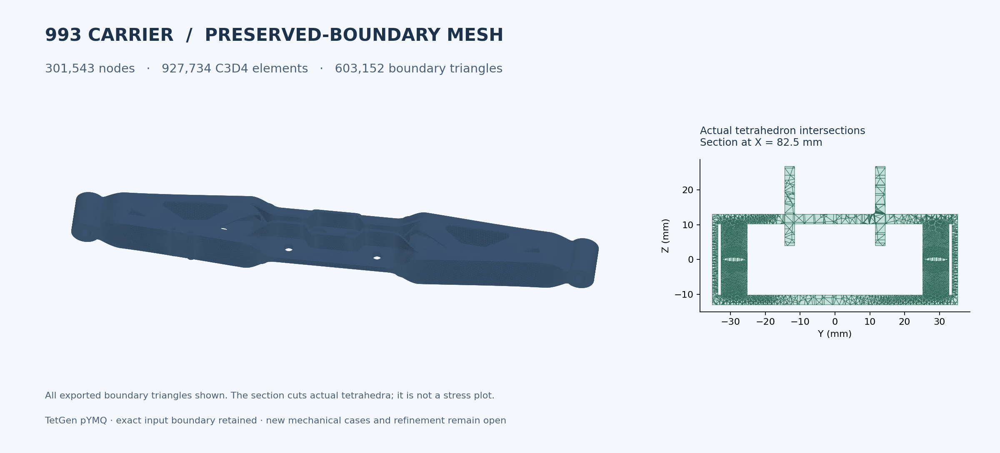

TetGen, already present in the pinned libigl image, completed the full carrier
with `pYMQ` in **10.79 seconds of supervised host wall time**. The same worker
first passed an analytic tetrahedron control. The carrier has **301,543 nodes,
927,734 C3D4 cells and 603,152 boundary triangles**. An exact coordinate and
triangle bijection confirms that the complete input surface is preserved.
The [official TetGen manual](https://www.wias-berlin.de/software/tetgen/1.5/doc/manual/manual005.html)
describes `Y` as preserving the input boundary and `M` as disabling coplanar-facet
or close-vertex merging; the exported boundary was checked independently.

The raw backend skin used inward winding. Its independent surface audit
therefore refused negative signed surface volume. A separate
[winding-only normalization](evidence/tetgen-outward-boundary-001/assessment.json)
requires an exact triangle bijection before using the audited input's outward
order. **Every volume coordinate and tetrahedron array remains byte-identical**.
The final skin file is byte-identical to the previously audited input surface.
The raw mesher output and refusal remain recorded.

The [exact full-cell audit](evidence/tetgen-exact-volume-audit-001/assessment.json)
checks **all 927,734 determinants as rational numbers**: none zero or negative.
It also confirms one face-connected volume, no repeated-node tetrahedra,
no nonmanifold faces and exact agreement between skin and volume boundary.
The signed total volume is **288,685.963061 mm³**, nominally **1.27600396 kg**
at the stated study density. The source component sum remains the conservative
mass figure in the opening table.

Positive determinants alone do not establish useful finite-element accuracy.
The [all-cell diagnostic](evidence/tetgen-cell-quality-001/assessment.json)
found mean-ratio quality from **0.00001324 to 0.999765** and a worst local
Jacobian condition number near **458,323**. A regular tetrahedron has mean
ratio 1. These values motivated a separate `q2` interior-refinement experiment; no mechanical acceptance threshold has been invented or weakened.

[Published outward volume arrays](../../../parts/993-eng-carrier-0001/source/design-20261016/resume-20261020/tetgen-volume-outward.npz)
retain this completed checkpoint. It is not yet admitted for new mechanical
results. The runnable recipe explains all transformations and their checks.

### Completed interior refinement

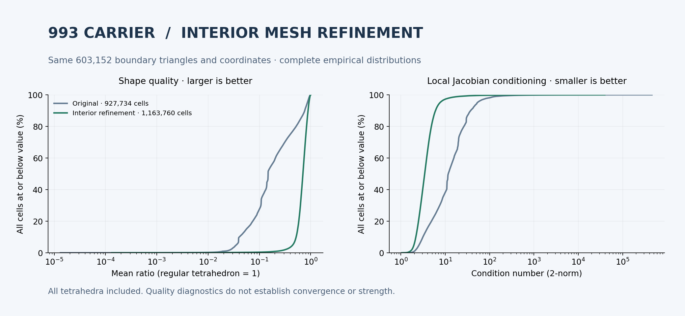

The `pYMQq2` run completed in **21.13 supervised seconds** with **351,600 nodes
and 1,163,760 tetrahedra**. The complete boundary is again identical to the
same audited 603,152-triangle input. All **1,163,760 exact determinants are
strictly positive**, with one connected volume and an exact skin match.
Median mean ratio improves from **0.148029 to 0.706263**; the minimum improves
from **0.00001324 to 0.00013250**. Worst local Jacobian conditioning decreases
from **458,323 to 39,566**. Small and poorly shaped cells remain, so the requested
`q2` setting is not presented as a proof that every element meets a quality
bound or that stresses have converged.

The [refined run](evidence/tetgen-boundary-quality-001/assessment.json),
[exact cell audit](evidence/tetgen-refined-exact-volume-audit-001/assessment.json),
[complete quality diagnostics](evidence/tetgen-refined-cell-quality-001/assessment.json)
and [winding-only proof](evidence/tetgen-refined-outward-boundary-001/assessment.json)
are retained. The [refined outward volume](../../../parts/993-eng-carrier-0001/source/design-20261016/resume-20261020/tetgen-volume-refined-outward.npz)
is a separate reproducible checkpoint; neither earlier mesh has been overwritten.

## Mechanical screening: the small reinforcements are not a final design

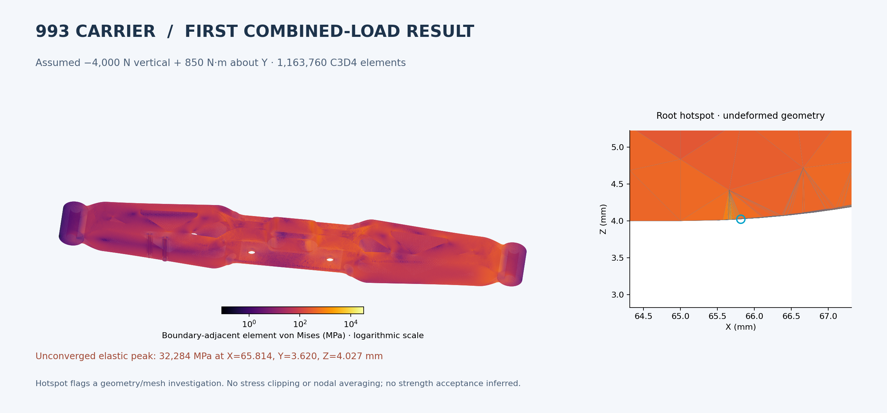

The new mesh was actually solved with **CalculiX 2.21 / SPOOLES**, in a pinned,
network-isolated owned container. An affine six-tetrahedron cube control first
met the fixed analytic tolerances: displacement error ≤ 10⁻¹¹ mm and stress
error ≤ 10⁻⁶ MPa. The default iterative backend had missed both limits and
remains recorded as refused. The direct solver passed without relaxing them.
A rejected first carrier deck also exposed a 20-character numeric-field issue;
the corrected exporter bounds and records the complete coordinate-transport
change (**6.94 × 10⁻¹⁸ mm L1**) and retains the failed deck receipt.

The complete output rosters and reaction equilibrium were checked for every
node and element. These are **unconverged linear-elastic demand values** with
the original nominal bore fixture, assumed loads, E = 107,000 MPa and ν = 0.31.
They are not predictions that titanium sustains the reported peak stresses.

| Actual new run | Maximum displacement | Unconverged integration-point von Mises peak | Host solver time |
| :--- | ---: | ---: | ---: |
| Added-patch study · 2,000 N vertical | 0.748392 mm | 5,195 MPa | 72.88 s |
| Added-patch study · 4,000 N vertical + 850 N·m about Y | 2.095885 mm | **32,284 MPa** | 65.48 s |
| Retained 24af baseline · same combined load, same TetGen q2 recipe | 2.085746 mm | **5,178 MPa** | 65.13 s |

The new combined-load peak lies near **(65.814, 3.620, 4.027) mm**, at the
reinforcement/root transition. The baseline comparison instead peaks near
**(66.780, 34.362, 0) mm**, at the closing hollow-cavity tip. Both are numerical
red flags. The added-patch variant is **not adopted as a final mechanical
design**; surface quality and exact-positive tetrahedra did not establish
improved resistance. The figure uses actual adjacent-cell stresses on the
complete skin, with no nodal averaging or stress clipping. Its local view is
explicitly a zoom; the full result assessment includes every element.

[Gravity assessment](evidence/tetgen-gravity-assessment-001/assessment.json) ·
[combined assessment](evidence/tetgen-combined-assessment-001/assessment.json) ·
[baseline comparison](evidence/tetgen-baseline-combined-assessment-001/assessment.json) ·
[actual direct-control data](evidence/ccx-affine-direct-control-001/execution/case/job.dat).
The retained CAD hollow cutter closes to zero thickness at its inner tip. A
separate native iteration now trims that inner cutter at |X| = 70 mm and
rounds its two end-cap corners at **R = 0.6 mm**, while retaining the end-eye-side
cutter. This is an intentional cavity-design change, followed by new geometry,
mass, surface, interface and mechanical checks. It does not reclassify the
failed small-reinforcement study.

## Native cavity-end iteration

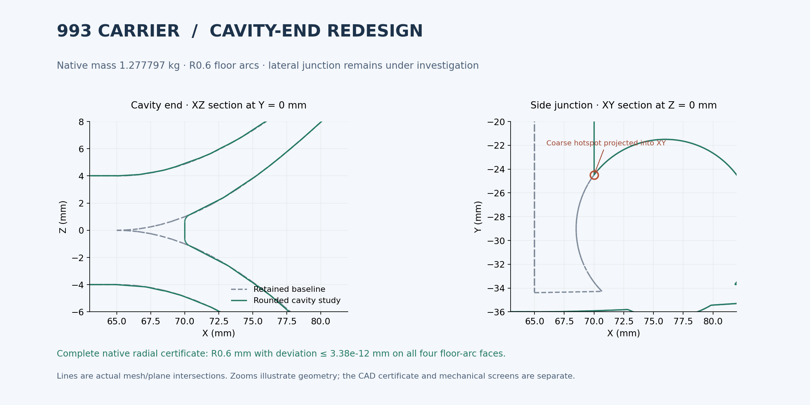

The saved native redesign has one valid solid and, after filling four explicitly
identified small closed pockets, one shell. Its nominal mass is **1.277797 kg**.
The strict full-parent difference is empty. The four floor-arc surfaces are
stored as rational quadratic B-splines rather than native `Cylinder` objects.
An initial cylinder-only observer therefore refused its radius check; that
record remains unchanged. The replacement observer reads every native pole,
weight and knot, proves the exact radial tensor factorisation, and bounds the
complete squared-radius residual in Bernstein form. Its maximum radial
geometric deviation from **R0.6 mm** is **3.378 × 10⁻¹² mm**, within the fixed
10⁻⁸ mm readback limit. An independent power-basis regression replays every
published residual coefficient.

The [complete radial certificate](evidence/rounded-native-radius-certificate-002/assessment.json)
and [combined native audit](evidence/rounded-filled-certified-native-audit-001/assessment.json)
are tied to the published [editable native/STEP study](../../../parts/993-eng-carrier-0001/source/design-20261016/resume-20261020/rounded-native-study/).
Its cleaned surface has **71,244 triangles**, zero original quality failures
and zero self-intersections. The complete mesh-edit L1 bound is **0.044644 mm
relative to the exported STL**. This is not a complete native-CAD distance
certificate; the requested native deflection of 0.015 mm is an exporter setting.
TetGen retained that boundary in **213,854 exact-positive cells**.

The first coarse C3D4 combined-load study flags another severe hotspot near
**(70.004, −24.494, 0.197) mm**, at the lateral end-cap/gusset junction. Its
unconverged elastic peak is approximately **80,638 MPa**. This coarser mesh is
not a like-for-like converged comparison with the earlier million-cell studies.
It demonstrates that rounding the XZ floor profile alone does not close the
three-dimensional junction. Constant R0.6 and R0.3 side fillets were refused
by OCCT. A separate certified reconstruction of the four analytic cylindrical
supports produced a valid body, but the R0.3 side-filleting retry still failed.
No failed fillet or high-stress result has been promoted into acceptance.

A finer native export was also run at 0.00375 mm deflection / 0.04 rad: 355,296
triangles, no intersections, but 3,634 needles. Its bounded flip trial stopped
at its wall budget. That finer surface remains unadmitted.

## PicoGK and MeshLib: volumetric rounding branch

PicoGK's `voxFillet` performs a positive then negative offset. The isolated
SDK 9.0.319 project uses the already installed PicoGK 2.3.0/native 26.2 runtime;
no viewer or unrelated workbench was changed. A finite-probe L-shaped control
passed before the carrier run. The first full run reached its aggregate CPU
limit and was reaped; a separately recorded larger CPU budget completed the
same unchanged geometry operation in **50.83 seconds**, peaking near **5.11 GB
sampled RSS**. The catalogue lock was released and all inputs stayed unchanged.

The completed full-carrier study uses **0.2 mm voxels and R1 mm closing**.
Its raw export has **10,764,852 triangles**. MeshLib then loaded every triangle
and simplified the complete surface with a requested estimated error of
0.02 mm. The output has **2,293,220 triangles** and nominal mesh mass
**1.281674 kg**. Its [independent complete audit](evidence/meshlib-picogk-surface-audit-001/assessment.json)
passes all original topology, needle and self-intersection criteria. The
backend's error estimate has not been presented as an independent Hausdorff
certificate. A separate 0.04 mm backend request produced 1,234,122 triangles;
its independent full-surface audit also passes. Its downstream interface and mechanical checks remain separate.

[Whole-carrier PicoGK receipt](evidence/picogk-closing-carrier-002/actual-terminal.json) ·
[complete MeshLib decimation](evidence/meshlib-picogk-decimation-001/assessment.json) ·
[nominal gauge results](evidence/picogk-nominal-gauges-001/assessment.json).

Full-solid nominal clearance tests use actual polygonal prisms whose side
planes are checked with exact Fractions to enclose the corresponding smooth
circular gauges. Both nonempty annulus controls and all **six shank gauges**
pass. Four tool-column tests remain refused: their small nonempty intersections
reach approximately **0.00343 mm above the Z = 4 mm pad plane**. The original
zero-intersection criterion remains in place; explicit datum restoration and
fresh checks are the next step. Unchanged interfaces and improved strength
are not yet established for this volumetric branch.

MeshLib is evaluated under its [published licence](https://github.com/MeshInspector/MeshLib/blob/master/LICENSE).
Commercial deployment of that software requires the appropriate licence; no
commercial binary or licence was purchased or redistributed here. The large
raw voxel mesh remains a local run artifact; the trusted C# source, pinned
runtime inputs and recorded hashes make the computation reproducible.

## Nominal pad restoration and exact tool-column exclusion

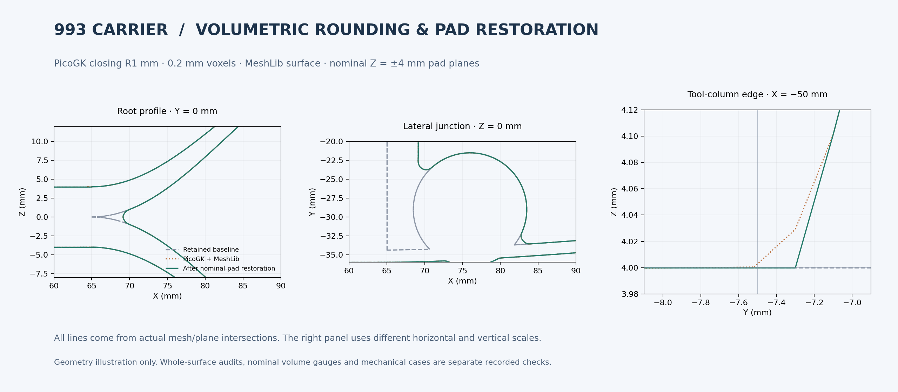

A declared vertex map restores the central pad neighbourhood to **Z = ±4 mm**.
It retains every face index and introduces no coincident vertices or collapsed
triangles. Every changed vertex is recorded; the largest exact L1 displacement
is **23555560217999 / 562949953421312 mm ≈ 0.0418431 mm**. A piecewise-affine
map with the same triangle roster bounds the complete two-way surface edit by
that maximum. This bound covers this edit only, not preceding voxelization.

The resulting **1,234,122-triangle surface** passes the independent complete
surface audit. Its nominal dense mesh mass is **1.281680 kg**. All six shank
volume checks still pass. The original strict closed-set tool test remains
refused: its returned intersection vertices are all **exactly Z = 4 mm**.
The small signed volume sums of those flat outputs are not used as tolerances
or relabelled as an empty intersection.

A separate whole-facet certificate addresses the connected **open volumes**
`radius < 12.5 mm, 4 < Z < 40 mm` at the four nominal tool axes. Every source
triangle is considered. Every triangle above Z=4 is separated from each tool
column by an exact coordinate interval; no triangle needs the subsequent
rational polygon-distance fallback. The global source Z maximum is below 40,
providing an exterior witness in each open column. With the closed audited
surface, this proves the absence of material in those open interiors while
allowing their intended planar boundary contact. An independent regression
replays all triangles and reconstructs both before/after mesh hashes from the
published edit ledger.

[Published complete indexed surface and edit ledger](../../../parts/993-eng-carrier-0001/source/design-20261016/resume-20261020/picogk-restored-study/) ·
[complete surface audit](evidence/picogk-pad-datum-surface-audit-002/assessment.json) ·
[exact open-column certificate](evidence/picogk-open-tool-certificate-001/assessment.json) ·
[unchanged closed-set refusal](evidence/picogk-restored-nominal-gauges-002/assessment.json).

The initial narrower pad-restoration band is retained as a separate failed
trial: it still left a small true intrusion near the tool-column edge. The
wider declared band fixes that geometry without moving the acceptance plane.
TetGen has subsequently generated **745,347 nodes and 2,661,257 C3D4 cells**
with exact input-boundary identity. The full exact audit confirms all
**2,661,257 cells are strictly positive**, one face-connected volume and no
missing boundary face. Full-cell quality diagnostics give minimum mean-ratio
0.005272 and maximum Jacobian condition about 3,232. The first combined-load C3D4 attempt exited with code 137 in the 6 GiB
container without a completed solution. The same inputs and direct solver then
completed in **242.03 seconds** under a **12 GiB** ceiling. The recorded terminal
state is `ExitCode=0`, `OOMKilled=false`; the owned container was removed and
inputs stayed unchanged. The updated supervisor also passed a fresh affine
control at the original fixed tolerances.

### Actual first PicoGK combined-load result

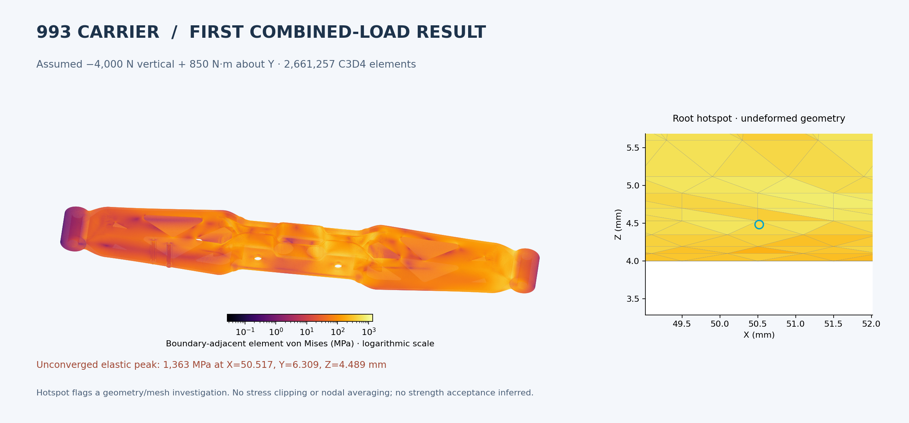

The complete result reader covers all **745,347 displacements**, **2,661,257
stress rows** and **14,120 reactions**. Under the same assumed resultant
−4,000 N / 850 N·m, the displacement maximum is **2.344956 mm** and elastic
von Mises maximum is **1,362.854 MPa**, near **(50.517, 6.309, 4.489) mm**.
Force and moment equilibrium checks pass. This new hotspot is at the central
pad/rib transition. The declared bore classifier uses a 0.06 mm radial band,
inward radial face alignment ≥ 0.9, and explicit axial bounds; those are
numerical classification rules rather than dimensional acceptance.

[Complete result summary](evidence/picogk-restored-combined-assessment-001/assessment.json) ·
[actual completed solver receipt](evidence/picogk-restored-combined-direct-002/actual-terminal.json) ·
[declared bore groups](evidence/picogk-restored-ccx-preparation-001/assessment.json).

These linear-tetrahedron results have not demonstrated stress convergence or
strength acceptance. The native and voxel studies have different surface and
bore discretizations; their peaks are not presented as a converged improvement
ratio. The separate R2 closing trial below repeats its own mass, interface, surface,
volume and mechanical checks.

### Flat-build envelope on this exact surface

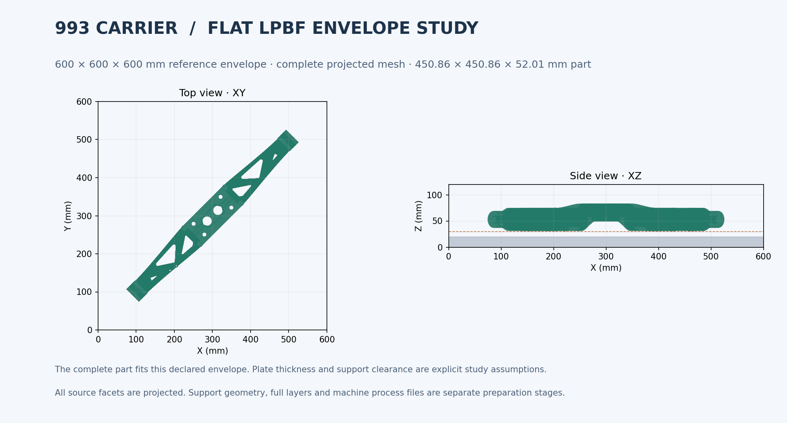

A fresh full-vertex check uses the manufacturer's documented
[600 × 600 × 600 mm NXG XII 600 envelope](https://nikon-slm-solutions.com/newsroom/peak-productivity-slm-solutions-launches-12-laser-machine/),
checked on 20 October. At the recorded 45-degree stored pose, the current part
occupies **450.8614 × 450.8617 × 52.0074 mm**. It passes the complete guarded
part-envelope check with 10 mm XY margins, an assumed 20 mm plate and a minimum
10 mm support clearance. Its lowest placed Z is 31 mm, adding a declared 1 mm
placement margin. Exact rational roundoff bounds cover the stored affine map;
triangle containment follows from vertex containment.

The first placement at exactly Z=30 failed its guarded lower-bound check and
is retained. The second placement changes translation only. This is an
inference about this part inside the stated box, not a selected supplier,
support envelope, thermal simulation or machine job. Full layers and support
checks remain separate. [Actual full-envelope result](evidence/picogk-flat-build-envelope-002/assessment.json).

## R2 closing and local clearance design edit

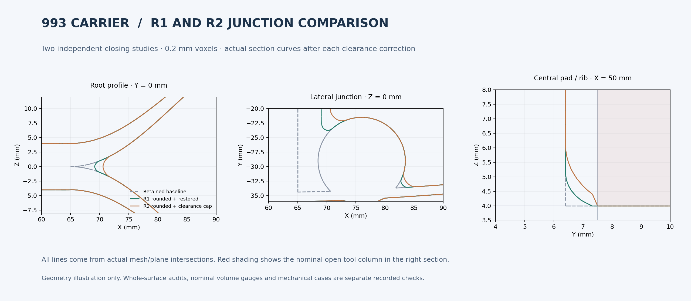

A separate R2 mm closing run completed in **89.10 seconds**, peaking near
**4.88 GB sampled RSS**. Its own finite-probe control passed first. MeshLib
retained every input triangle on load, then produced 1,218,348 surface triangles
with the same 0.04 mm backend setting. This setting is still not an independent
CAD-distance certificate.

The first exact tool-column certificate refused genuine interference. The
subsequent clearance design edit identifies all **231 intruding facets** and
caps their above-plane vertices to **Z=4 mm**. It moves **125 vertices**; the
complete two-way edit bound is **298643 / 1048576 mm ≈ 0.2848082 mm**. This is
a deliberate shape correction rather than an enlarged tessellation tolerance.
XY and every triangle index remain unchanged. The full affected facets now
have Z≤4; all other surface points move only downwards. Fresh complete
self-intersection, topology and original triangle-quality checks pass.

Six shank gauges pass. The separate exact open-column certificate also passes:
**155 / 149 / 149 / 153 facets** require rational polygon checks after coordinate
interval exclusion. An independent regression reconstructs each clipped
polygon and checks a feasible exact separating half-plane for its entire
convex hull. This dual proof does not trust the worker's reported minimum
distance. Original polygonal closed-set gauge refusals remain unchanged.

The complete signed volume has been calculated twice: once by **integer
surface determinants**, once by **per-cell rational determinants** over all
**2,645,661 tetrahedra**. The two exact Fractions are identical. At the stated
4,420 kg/m³ reference density, exact nominal dense mass is **1.29819981344 kg**,
leaving **1.80019 g** below 1.30 kg. No supports or machining stock are included
in that part-mass calculation.

[Complete surface and both edit ledgers](../../../parts/993-eng-carrier-0001/source/design-20261016/resume-20261020/picogk-R2-study/) ·
[whole surface audit](evidence/picogk-R2-capped-surface-audit-001/assessment.json) ·
[exact open-column proof](evidence/picogk-R2-capped-open-tool-certificate-001/assessment.json) ·
[exact surface mass](evidence/picogk-R2-exact-mass-001/assessment.json) ·
[independent exact volume](evidence/picogk-R2-exact-volume-audit-001/assessment.json).

The new volume has one face-connected component and the exact source skin.
Full-cell diagnostics give minimum mean-ratio **0.016133** and maximum Jacobian
condition about **707**. The minimum cell altitude is much smaller than in R1;
cell size and shape are retained separately in the diagnostic record. Its own combined direct calculation completed in **244.58 seconds** under the
same 12 GiB ceiling. All **739,620 displacement rows**, **2,645,661 stress rows**
and **14,064 reaction rows** are read. Force and moment equilibrium pass.
Displacement maximum is **2.246491 mm** and elastic von Mises maximum is
**1,008.611 MPa**, near **(88.771, 13.091, 17.530) mm**. The maximum has moved
from the central pad to another arm/rib junction. These remain unconverged
linear-tetrahedron results; no strength acceptance or converged improvement
ratio is inferred.

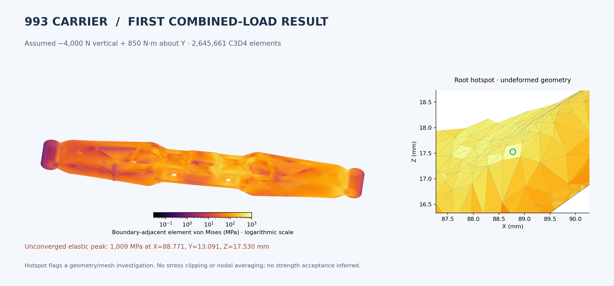

[Completed R2 solver receipt](evidence/picogk-R2-combined-direct-001/actual-terminal.json) ·
[complete R2 result summary](evidence/picogk-R2-combined-assessment-001/assessment.json).

## Protected source regions

The [source preservation certificate](evidence/source-preservation-certificate-001/assessment.json)
reconstructs and hashes all eight original 3,264-point rosters: **26,112 point
memberships remain unchanged** for the unchanged-parent source assembly.
Exact bounding intervals also separate the added solids from complete nominal
central bore/tool regions and end-bore/seat regions. The frozen bracket pose
has a positive separating Z interval. This is a scoped source argument;
it does not replace every protected predicate on the altered single surface. A separate [exact triangle-roster comparison](evidence/interface-surface-identity-001/assessment.json) now confirms complete boundary identity in four conservative X slabs covering the nominal central bores/tool columns and end bores/seats: **25,483 / 25,410 / 53,412 / 53,332 triangles** respectively, with no missing or added triangle. Because TetGen retains the entire surface exactly, those same triangle rosters are retained on both volume skins. The central-pad boundary and other predicates remain outside this particular certificate.

## Reading this with a mechanic

Start with the workflow and the actual geometry sections. The green source
assembly image shows the first reinforcement trial; the cavity sections explain
why its replacement needs a rounded three-dimensional junction. The mechanical
image locates the calculated hotspot. The volumetric route is the current
surface-development branch. Its remaining work is datum correction, complete
interface checks, new mechanical cases and convergence, then full print
preparation on that same revision.

## Verification of this checkpoint

The **67 focused tests pass**. They replay every saved contraction against the
actual input and output triangles, verify each rational displacement cost and
error budget, and hash-check the published evidence and archive. The strict
documentation check reports **zero broken links**.

The local `make check` was executed and did not pass in the host Python 3.10
environment: failures=4, errors=27, skipped=411. Recorded issues include the unavailable
`hashlib.file_digest`, a host SciPy import failure and exact floating-point
comparison differences. The [check record](checks.json) and
[complete compressed local log](make-check-local.log.gz) retain the result.
The canonical [GitHub integration run](https://github.com/cluster2600/porscheparts/actions/runs/39447532730) **passed** for commit `312a4f21`. The subsequent [native/mechanical/PicoGK checkpoint run](https://github.com/cluster2600/porscheparts/actions/runs/39461106451) also passed for `f4b0c0e6`. The [restored-pad checkpoint run](https://github.com/cluster2600/porscheparts/actions/runs/39462948199) also passed for `ab5de898`. Later mechanics, envelope and R2 additions receive a separate run. No tests were weakened.
