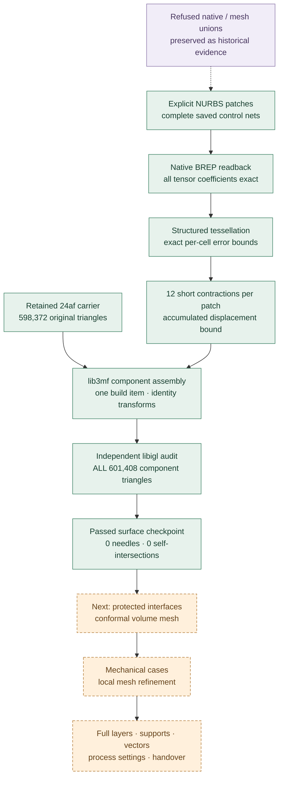

# 993 carrier — bounded reinforcement surfaces

**20 October 2026 · Engineering resumed at the user's request**

[Project overview](../../manufacturing/993_CARRIER_PROJECT_EN.md) · [Runnable recipe](../../../parts/993-eng-carrier-0001/source/design-20261016/resume-20261020/README.md) · [Machine-readable checkpoint](checkpoint.json)

The new prototype retains every triangle of the **24af0584 carrier** and adds
two explicit NURBS root reinforcements. Its complete component surfaces now pass
the independent topology and self-intersection screen. The nominal mass upper
bound is **1.276005 kg**, below the requested **1.30 kg** ceiling.

This is a new additive **component assembly study**. Its mechanical response,
conformal volume mesh and full print preparation still need calculation. The
catalogue's selected design remains 24af0584. Its twenty coarse and two refined
mechanical results have not been transferred to this changed geometry.

## What changed

The native radius-law trials and Boolean unions did not satisfy their original
acceptance conditions. Instead of relabelling these results, we retained them
and constructed the reinforcement surfaces explicitly from complete control
nets. A structured tessellator bounds every source-surface cell. Twelve short
edge contractions per patch then remove endpoint needles while accumulating
an exact rational bound on the added surface displacement.

The saved native BREP patches were reopened: all four B-spline faces per patch
have **exactly matching degrees, knots, multiplicities, poles and weights**.
The mathematical tessellation certificate is tied to these control nets. Its
endcap construction belongs to the parametric definition; the native readback
checks the four tensor surfaces and counts the two remaining cap faces.

| Check on the new prototype | Actual result |
| :--- | ---: |
| Parent mesh retained byte for byte in 3MF | 598,372 triangles |
| Each cleaned reinforcement | 761 vertices · 1,518 triangles |
| All component triangles | **601,408** |
| Open / nonmanifold / inconsistently oriented edges | **0 / 0 / 0** |
| Degenerate / needle triangles | **0 / 0** |
| Intracomponent self-intersection pairs, full libigl audit | **0** |
| Connected surface components per mesh resource | **1 each** |
| Minimum reinforcement triangle ratio | **0.00106169**, criterion ≥ 0.001 |
| Complete source-to-patch-mesh L1 bound | **≤ 0.035084723 mm**, criterion ≤ 0.06 mm |
| Strict lib3mf read warnings | **0** |
| Build items / positive source components | **1 / 3** |
| Positive overlap with parent, two patch checks | **1.496425 / 1.490772 mm³** |
| Nominal dense titanium mass upper bound, ρ = 4,420 kg/m³ | **1.276005162 kg** |
| Remaining mass allowance | **23.9948 g** |

Mass is the sum of component volumes times the stated density, so overlap is
counted twice and the result is an upper bound for the intended union. It is
not a support, powder, machining-stock or build-consumption estimate.

## The reproducible route

The 3MF contains overlapping positive solids. The
[3MF Core specification](https://github.com/3MFConsortium/spec_core/blob/997b385e06f3181cf9aae0c578e0b45ccd48ccb2/3MF%20Core%20Specification.md)
requires consumers to unite overlapping components. We verified the archive,
coordinate graph and each complete component surface. We have **not yet
verified a slicer's actual union and every resulting layer**. A valid component
archive alone does not close that stage.

## Why the endpoint cleanup is bounded

The original surface error has four terms: U curve-to-chord deviation,
rational V curve-to-chord deviation, bilinear-cell triangulation and float32
coordinate rounding. Exact rational convex-hull bounds cover every cell;
these are continuous bounds rather than sampled point distances. Their maximum
is approximately **0.030717 mm** for these two patches.

For a contraction that sends vertex B to existing vertex A, every affected
triangle point moves by at most `||A − B||₁`: barycentric coefficients are
nonnegative and sum to one. The images of collapsed triangles must be covered
by surviving triangles. Every accepted operation also preserves closed,
consistently oriented local topology. Summing all twelve displacement bounds
adds **18319 / 4194304 mm ≈ 0.00436759 mm** per patch. Combining this with the
source tessellation bound gives the reported **0.035085 mm** upper bound.
The independent all-facet audit then checks self-intersections and the original
triangle-quality criterion.

The bound covers the two complete parametric patch surfaces, including their
constructed planar endcaps. It does not replace the retained parent's older
sampled CAD-distance evidence, prove native Boolean containment, or establish
mechanical improvement. The original carrier mesh stays exactly unchanged.

## Software actually used

| Software / component | Version or identity | Executed role |
| :--- | :--- | :--- |
| build123d | 0.11.1 | Import carrier, create and reopen explicit patch solids |
| OCCT via cadquery-ocp-novtk | 7.9.3.1.1 | Radius-law trials, native BREP, Boolean diagnostics, tensor readback |
| Python `Fraction` | Standard library | Exact serialized-coefficient polynomial and surface-error certificates |
| NumPy | 2.0.2 in the 3MF runtime | Complete coordinate/index processing, deterministic binary STL |
| Manifold | 3.5.2 | Positive source-solid and overlap screens; separate refused Boolean union trial |
| lib3mf | 2.5.0 | Mesh resources, component graph, writer and strict reader |
| CGAL | 5.6, EPECK; pinned local image `sha256:7ed241be10194d98e4ae750cb7f983b0d501742f1ac651580b86c165cba39537` | Exact full-mesh unions and strict complete-parent difference |
| libigl | 2.6.3 | Independent full-surface topology and exact-predicate intersection audit |
| Docker audit runtime | `sha256:3ccaf5701c7c9add59eda6e8db918106fc8d51f4c2ef5b148d8079262861c7e1` | Isolated Linux ARM64 audit, network disabled, 1 CPU / 4 GiB |
| Matplotlib / NumPy / SciPy | 3.10.8 / 2.2.6 / 1.14.1 figure environment | Actual geometry and saved-data figures |
| Git / GitHub | Repository-native source and evidence | Reviewable source, manifests, reports and images |

The wider chain already includes **Gmsh, CalculiX and PySLM**, described in the
[project overview](../../manufacturing/993_CARRIER_PROJECT_EN.md#the-software-chain).
Gmsh 4.15.2 was also executed on the three native inputs: the [fragment preflight](evidence/gmsh-fragment-001/assessment.json) refused its source-volume balances, with native Boolean warnings retained. No mechanical mesh was admitted. The wider tools have existing carrier results, but no completed new-geometry mechanical
or complete slicing result is claimed here. MeshLib was evaluated and not
installed; no Vast machine was rented for this resume.

## Trials that remain refused

| Retained trial | What the actual run showed |
| :--- | :--- |
| Three-point native radius law | Standalone law proof passed; native construction refused at two vertices; consumed law's endpoint slopes were nonzero |
| Zero-radius terminal source edges | Native construction refused at four vertices |
| Native sequential / simultaneous unions | Saved Boolean candidates failed strict full-parent retention comparisons; separate self-controls passed |
| Manifold Boolean union | Parent-minus-union was nonempty: 460 facets, signed volume about −4.97 × 10⁻¹⁵ mm³; criterion remained empty |
| Initial OCP patch tessellation | 30 / 26 needles and 141 / 136 self-intersection pairs after exact redundant-facet cleanup |
| First bounded structured tessellation | Zero self-intersections; 40 needles in each patch |
| Gmsh 4.15.2 fragment preflight | Source-to-fragment volume balance refused; no mechanical mesh admitted |
| Certified endpoint contractions | **All complete component surface screens passed** |

The component representation preserves the parent directly as an unchanged
resource. This is a separate representation and acceptance argument; none of
the refused Boolean outputs has been reclassified as a pass.

## Files and evidence

- [Runnable source recipe and exact inputs](../../../parts/993-eng-carrier-0001/source/design-20261016/resume-20261020/README.md)
- [New 3MF component assembly study](../../../parts/993-eng-carrier-0001/source/design-20261016/resume-20261020/carrier-additive-assembly-study.3mf), SHA-256 `95558c07bf62a51630c799c6a8cf64feaff2a3d9bde06a4594c6b788ef049363`
- [Complete independent surface audit](evidence/component-libigl-certified-001/assessment.json) and [actual Docker terminal receipt](evidence/component-libigl-certified-001/actual-terminal.json)
- [Exact cell-by-cell surface bounds](evidence/bounded-tessellation-001/assessment.json) and [every accepted contraction](evidence/certified-collapse-001/assessment.json)
- [3MF strict readback, byte identity, overlaps and mass](evidence/certified-component-replay-001/assessment.json)
- [Complete reopened native tensor coefficients](evidence/native-tensor-readback-001/assessment.json)
- [Exact evidence-copy manifest](evidence-copy-manifest.json); large launch plans and terminal receipts are losslessly gzip-compressed with both stored and uncompressed hashes
- [18 October checkpoint](../carrier-pause-20261018/README.md), retained unchanged as history

## Exact polyhedral union: parent retention now passes

A subsequent CGAL **5.6 EPECK** trial completed both full-mesh unions and then
computed the difference between the complete original parent and the exact
union. The difference operation succeeded with **zero output faces**. This
passes strict parent retention for this exact polyhedral representation; the
older native and Manifold trial refusals remain unchanged.

The [native operation record](evidence/exact-union-001/union.json),
[actual terminal receipt](evidence/exact-union-001/actual-terminal.json) and
[complete exact-coordinate master](../../../parts/993-eng-carrier-0001/source/design-20261016/resume-20261020/exact-polyhedral-union.mesh64.gz)
retain this result. Its master has **603,258 triangles**. Conversion to float64
has a full surface L1 bound of **1.908 × 10⁻¹⁴ mm**. The
[independent rounded-union audit](evidence/exact-union-surface-audit-001/assessment.json)
found zero open/nonmanifold/orientation edges, zero degeneracies and zero
self-intersections, but **86 needle triangles**, so that surface was refused.

This is a separate route towards a conformal mechanical mesh. A bounded local
contraction trial stopped with 38 needles when no further admissible contraction
fit the unchanged 0.06 mm budget. Bounded diagonal flips remove slivers by
changing the triangulation of convex projected quadrilaterals. These mesh
preparation trials do not inherit the exact master's zero-difference result.
A complete audit after quality-driven diagonal flips found **62 remaining needles** and zero self-intersections. A subsequent economical contraction trial stopped with **23 needles** and remained incomplete. WildMeshing/fTetWild is the next volume-meshing route under evaluation. The passing three-component 3MF remains the published surface checkpoint.

The [CGAL manual](https://doc.cgal.org/5.5.1/Polygon_mesh_processing/index.html)
documents exact constructions as a way to avoid intersection-coordinate
rounding during corefinement. The implemented adapter retains rational output
coordinates and performs one separately audited conversion. CGAL's polygon
mesh processing package has GPL licensing requirements; the trial used the
existing pinned local image and did not install a new commercial package.

## Reading this with a mechanic

Start with the overall geometry image and the mass table. The original nominal
mounting geometry is retained in the parent component; the green regions show
the two proposed local reinforcements. The comparison image explains what was
changed in the surface triangulation. The next engineering work is to verify
all protected regions, obtain a conformal volume mesh and calculate the new
junction response. Full print preparation then follows on that same revision.

## Verification of this checkpoint

The **35 focused tests pass**. They replay every saved contraction against the
actual input and output triangles, verify each rational displacement cost and
error budget, and hash-check the published evidence and archive. The strict
documentation check reports **zero broken links**.

The local `make check` was executed and did not pass in the host Python 3.10
environment: failures=4, errors=27, skipped=411. Recorded issues include the unavailable
`hashlib.file_digest`, a host SciPy import failure and exact floating-point
comparison differences. The [check record](checks.json) and
[complete compressed local log](make-check-local.log.gz) retain the result.
Canonical GitHub integration is tracked separately. No tests were weakened.
