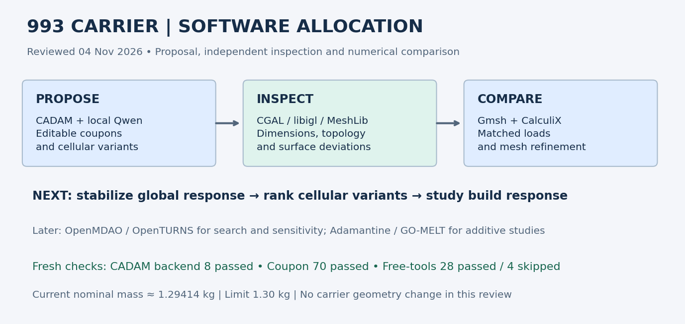
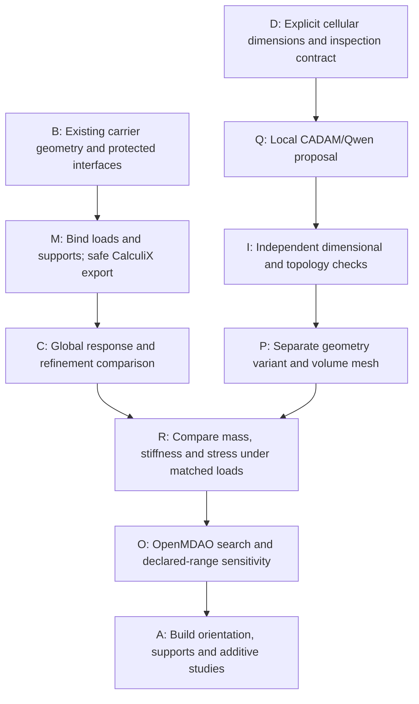

# 993 carrier: newly documented software review

Reviewed on 2026-11-04 against main `b657cce8`, carrier branch `b82719da`,
and CADAM documentation commit `60b56c31`. This is a tool-selection review;
no carrier geometry or loads were changed. CADAM documentation is present on
another branch and was not found in the reviewed main revision.

Follow-up: fetched main and inspected `fcfdf5d19` on the same date. Changes
since `b657cce8` add 935/964 inspection documentation, not a new carrier
software integration. The CADAM backend, TypeScript, archived coupon and
free-tools checks below were rerun with the same results. The fresh coupon
report is `/tmp/carrier-cadam-review-followup-20261104.json`.

## Decision

Use the local CADAM/Qwen installation for bounded parametric proposals and
cellular test coupons. Preserve the existing carrier geometry and its protected
interfaces. Use the new scan-repair runbook's independent inspection pattern
for future edits. Continue the global mechanical calculation before ranking
lightening candidates by strength or stiffness.



| Tool or documented route | Practical carrier use | Decision and next acceptance check |
|---|---|---|
| CADAM + local Qwen + OpenSCAD | Editable coupon and simple cellular proposals from explicit dimensions | Use for separate proposals. Existing verifier measures one fixed coupon, not arbitrary carrier geometry; a cellular contract must precede generation. No automatic carrier/STEP/PicoGK bridge is implemented. |
| MeshLib, CGAL and libigl scan-repair route | Scoped retriangulation, independent intersection/topology checks and bidirectional deviation measurements | Reuse inspection methods. Current carrier is already closed and checked; whole-part voxel rebuilding would create a different geometry requiring a new distance and interface audit. |
| SALOME/SMESH NETGEN | Independent volume-mesher comparison | Keep as fallback, preserving actual interface/load face groups. A cube/bore witness does not qualify the carrier mesh. |
| NativeCAD and USD BRep | Solid authoring/exchange and Boolean controls | Separate trial route; no demonstrated conversion of the current 10.45-million-tetrahedron carrier into an equivalent editable solid. |
| OpenMDAO | Parameter search over cellular pitch, wall thickness and retained solid regions | Useful after a repeatable accepted global response exists. Feed real solver outputs, not the existing admission-only replay. |
| OpenTURNS | Sensitivity to explicitly supplied material/load/geometric ranges | Useful after the deterministic calculation stabilizes. No distributions are inferred in this review. |
| Adamantine | Later thermal/thermomechanical additive study | Candidate for build-response studies with a declared process/material model; not a replacement for structural CalculiX convergence. No new Adamantine run here. |
| GO-MELT and LPBF-CUDA | Multilevel thermal or particle-scale research | Keep separate from the immediate structural bottleneck; existing CPU witnesses do not provide a carrier build simulation. |
| DVC and CloudCompare | Private artifact recovery and sampled deviation diagnostics | Retain in the process. Sampled distances complement whole-model checks. |

## Fresh execution in this review

The installed CADAM checkout matches upstream revision
`e339e3ad85601bb1e23a5ff9c7f33b51ddf602f5`.

| Check rerun | Result | Scope |
|---|---|---|
| CADAM backend unit suite | 8 passed | Prompt/code handling and fixed endpoint boundaries; no new generation |
| CADAM local TypeScript check | Exit 0 | Static integration check |
| Independent STL coupon verifier | 70 passed, no failures | Archived synthetic coupon, 60 × 40 × 15 mm; volume 10513.840195690242 mm³ |
| Repository `free-tools-check` | 28 passed, 4 skipped | Native CloudCompare, DVC and sensitivity/optimization dependencies unavailable in the selected check environment |

The fresh coupon receipt is private at
`work/carrier-software-review-20261104/cadam-coupon-recheck.json`. No new model
inference, GPU execution, Vast lease or carrier solve was performed in this review.
The full repository suite was not rerun; no merge is proposed by this review.

Reproduce the CADAM checks from `~/Developer/CADAM`:

```sh
node --experimental-strip-types --test local-calibration/qwen/backend.test.ts
./node_modules/.bin/tsc -p local-calibration/tsconfig.json --noEmit
local-calibration/.venv/bin/python local-calibration/verify_coupon.py \
  "$HOME/Developer/PorschePartsArtifacts/cadam-qwen-calibration-20261104/parts/935-cadam-dimensional-coupon-study/exports/coupon.stl" \
  --contract local-calibration/contract.json \
  --report /tmp/carrier-cadam-coupon-recheck.json
```

Use a fresh report path and retain failures. Run `make free-tools-check` with
an explicitly selected Python interpreter; record skipped native dependencies.

## Carrier sequence

For the first cellular comparison, define an independent synthetic contract
before asking CADAM to generate code. Specify outer dimensions, skin and wall
thickness, cell pitch, open powder-removal paths, protected solid zones and a
mass/volume limit. Verify the exported geometry against those requirements;
the current fixed 70-check coupon verifier does not inspect arbitrary cells.
Keep the accepted carrier unchanged until a separate variant passes interface,
surface and volume-mesh checks. Compare each admitted variant under identical
loads and supports, reporting mass, displacement, strain energy and resolved
stress measures. Do not rank a lighter variant using mesh quality alone.



The current private geometry checkpoint has nominal mass interval
`[1.294138207488142, 1.294138207584442] kg`, below 1.30 kg. Its current
P1 graph has 9,389,514 unconstrained degrees of freedom and a scalar structural
entry upper bound of 324,524,556. Raw CSR32 storage is bounded near 3.93 GB;
factorization memory is not established by that count. A GPU rental does not
directly accelerate the existing native SPOOLES factorization path. Select a
concrete backend and memory plan before renting compute.

Cellular lightening can reduce mass, but smaller cells alone do not establish
better specific stiffness. Compare shell thickness, load-path continuity,
stress concentrations and powder-access geometry in explicitly named variants.
The current carrier calculation remains the reference to stabilize first.

## Source trail

- [Local CADAM integration documentation at its reviewed commit](https://github.com/cluster2600/porscheparts/blob/60b56c31/docs/architecture/cadam-local-qwen.md)
- [Scan-repair runbook at reviewed main](https://github.com/cluster2600/porscheparts/blob/b657cce8/docs/architecture/scan-repair-workflow.md)
- [Existing free-tools integration](../architecture/free-tools/README.md)
- [USD BRep and LPBF research routes](../architecture/usd-brep-lpbf.md)
- [CADAM upstream](https://github.com/Adam-CAD/CADAM)
- [MeshLib upstream](https://github.com/MeshInspector/MeshLib)
- [Adamantine upstream](https://github.com/adamantine-sim/adamantine)

Carrier checkpoint references are private:
`work/carrier-surface-kernel-assembly-003/README.md`,
`work/carrier-p1-capacity-current-001/report.json`, and
`work/carrier-ccx-parity-003/verification.json`. They remain local evidence;
the coupon tests do not advance the global mechanical convergence claim.
