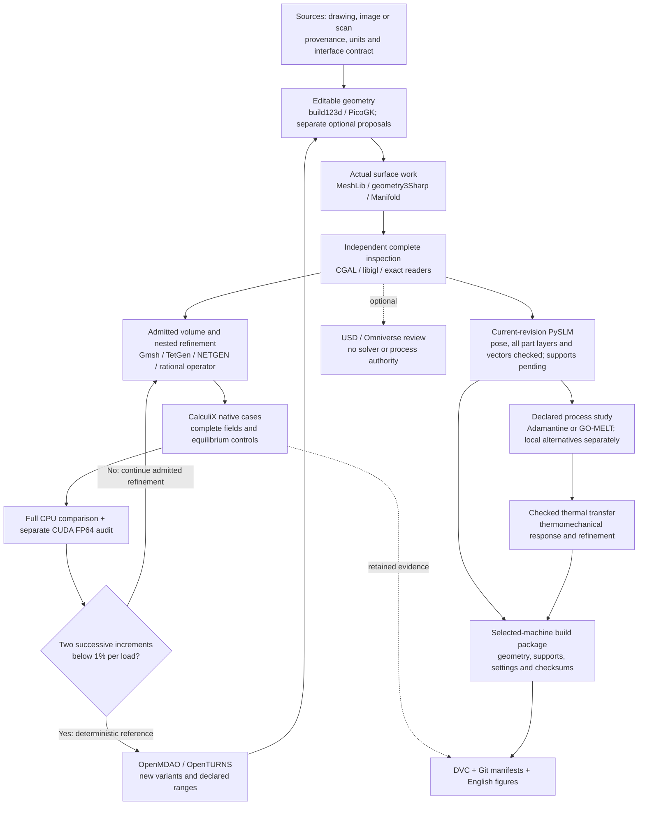

# 993 carrier: software coverage and remaining integrations

**Audit date: 6 November 2026.** The software chain is being used, but it has
not all been exercised successfully on this carrier. Geometry construction,
independent inspection, native mechanics, complete-field comparisons, actual
CUDA energy checks and private recovery have carrier evidence. Several other
tools have only synthetic controls, retained failed carrier trials or a
documented role. The [complete current part-layer calendar](carrier-current-am-full-20261107.md)
passed on 7 November; current-revision supports and a metal-machine job remain
unfinished.

The owner has removed the 1.30 kg design ceiling. Historical reports retain
their original limits and results. H8 keeps the same external geometry and
study material as H7 so that the refinement comparison remains meaningful;
removing the weight constraint does not require changing that reference.

## Scope and counting

The inventory was read from GitHub at main commit
[`d56d05cd51a99473b1adb984fafd2a7d41c0156b`](https://github.com/cluster2600/porscheparts/commit/d56d05cd51a99473b1adb984fafd2a7d41c0156b),
without merging it into the active calculation checkout. Sources are the
[toolchain][T], [engineering overview][O], [architecture][A],
[carrier manufacturing workflow][W], [free-tools integration][F],
[USD BRep/LPBF extension][L] and [CADAM runbook][C], supplemented by the
carrier execution reports linked below. Current local H7/H8 and GO-MELT
continuations are identified separately from that main snapshot.

Rechecked on 7 November against main
[`5efface17959068eee9de2bd80e5a876b4bc8c26`](https://github.com/cluster2600/porscheparts/commit/5efface17959068eee9de2bd80e5a876b4bc8c26):
the toolchain, container index, architecture, free-tools and container trees
have identical Git object identities. The engineering overview only changed
two labels in the unrelated archived 964 study. No new carrier tool requirement
was found in those definitions; the active calculation checkout was unchanged.
The [refresh receipt](carrier-toolchain-coverage-20261106/main-refresh-20261107.json)
records both revisions and the compared identities.

A second live check against main
[`429deaef606277ba81f5e895ff26aebc088cb4a6`](https://github.com/cluster2600/porscheparts/commit/429deaef606277ba81f5e895ff26aebc088cb4a6)
also finds all eight inspected toolchain definitions unchanged, including the
carrier workflow and original Warp pilot. The [second refresh receipt](carrier-toolchain-coverage-20261106/main-refresh-20261107-002.json)
records their exact Git identities. The active calculation checkout was not
updated.

**Denominator: 54 numbered capability rows**, covering those named services
and the later carrier-specific additions. Closely coupled components share a
row; Warp has three rows because its three contracts have different results.
This is a capability ledger, not a count of installed packages. Transitive
libraries, unrelated 917/935/962 engine recipes and every alternative CAD
product are outside the denominator. No tool is omitted merely because its
carrier execution is missing.

[PR #274](https://github.com/cluster2600/porscheparts/pull/274), merged at
`ad3070a1af108e8f0d8678d0cf3f121a5ae1a280`, introduced the optional Warp
geometry pilot and documented its place beside Qwen/PicoGK, PorscheFanatics
and optional ComPilot. It did not introduce or validate the entire manufacturing
suite. The later carrier and CUDA evidence is credited separately below.

Status codes describe the evidence, not permission to print:

- **E — executed in a carrier study:** includes assumed historical concepts and partial
  stages; the row states the accepted extent.
- **S — synthetic/software control only:** no completed carrier application.
- **R — actual carrier attempt refused:** retain the failure and use the
  accepted alternative.
- **A — optional/alternative:** documented, but no carrier execution is credited.
- **N — not applicable to this calculation:** retain for another input/process.
- **P — pending deliverable:** needed for the eventual selected metal route.

The distribution is **24 E, 11 S, 3 R, 10 A, 5 N and 1 P**. In particular,
24 E rows do not mean 24 completed current-revision stages: historical and
partial scopes are stated explicitly.

The [current main container index][I] lists **41 recipes**, **9 named by a
container lock** and **19 built by a workflow**. These are different counts from
54 capabilities. An unlocked recipe or image tag is not an immutable execution
identity; source/wheel pins and actual binary/image receipts must be checked for
each run. Some carrier runtimes are native environments, not those images.

## Acquisition, CAD and surface inspection — 20 rows

| ID | Tool / recorded profile | Status and actual evidence | Next use or acceptance condition |
|---|---|---|---|
| 01 | PorscheFanatics metadata + SQLite FTS5 | **E.** Actual carrier record/report and allowlisted catalogue identity imported; 30 retrieval/boundary controls. [Free-tools results][FR] | Keep referenced input provenance; retrieval is not a dimensional measurement. |
| 02 | `capture_caliper.py` / pyserial; `capture_photoset.py` / gphoto2 | **N.** Capture interfaces documented in [T]; not inputs to the present H8 calculation. | Use when an instrument/photoset is supplied; retain timestamp, units and manual-entry state. |
| 03 | COLMAP / GLOMAP / Meshroom | **N.** Photo-reconstruction alternatives in [T]; no carrier reconstruction run credited. | For a future licensed, scaled multiview photoset; camera/dense reconstruction checks precede CAD. |
| 04 | CloudCompare 2.13.2 | **S.** Native analytical point-to-surface controls pass; no registered carrier scan/transform. [FR], [FK] | Add a source-bound scan and rigid-transform contract before a carrier deviation run. |
| 05 | Open3D | **A.** Point-cloud route in [T]; no carrier result credited. | Optional point processing with explicit units and unchanged-source comparison. |
| 06 | Blender | **A.** Organic/reference-surface route in [T]; no carrier authoring result credited. | Use only for a concrete inspection/authoring need with independently checked export. |
| 07 | PyMeshLab | **A.** Later [scan-repair workflow][SR] documents scoped trials on a different scan. | Reuse its masking controls if needed; those trials do not establish carrier repair. |
| 08 | qwen-picogk / Qwen / MLX | **E, historical concept.** Qwen2.5-Coder-1.5B `coding-003/checkpoint-600` generated eight accepted `AddBeam` statements from human-supplied hypothetical coordinates. [F1 source/inference](../../parts/993-eng-carrier-0001/source/qwen-concept-f1/README.md), [native/export checks](../../parts/993-eng-carrier-0001/derived/qwen-concept-f1/checks.json). The concept omits the central attachment and is independently blocked. The separate free-tools documentary draft was rejected [FR]. | Credit actual generation, not functional acceptance. New proposals require explicit interfaces and independent checks; neither accepted graph syntax nor rejected correction training supplies missing dimensions. |
| 09 | CADAM + OpenSCAD WASM + local Qwen | **S.** CADAM `e339e3ad…`; two 60 × 40 × 15 mm coupon generations pass 70 independent checks. [C], [software review](carrier-software-review-20261104.md) | Only a separate, dimensioned proposal trial. No verified arbitrary-cell inspector or CADAM-to-carrier/STEP/PicoGK bridge exists. |
| 10 | build123d 0.11.1 / OCCT 7.9.3.1.1 | **E.** Actual BREP/STEP authoring, patch solids, native differences and readback. [Historical project][H], [resume][R20] | Retain each native master and exact interface predicates when changing geometry. |
| 11 | CadQuery 2.5.2 / OCCT 7.7.2 / Microgen 1.3.2 | **E.** Explicit gyroid solids, STEP and periodic cell meshes. [Interface study][IS] | Separate cellular comparison, not H8 geometry. The retained SciPy 1.17.1 profile is outside Microgen's declared range; do not silently generalize compatibility. |
| 12 | FreeCAD / Assembly | **A.** Inspection and assembly alternatives in [T]. | Use for an identified editable-solid/assembly review; no carrier FEM acceptance follows from opening a model. |
| 13 | PicoGK 2.3.0 / native ABI 26.2 / OpenVDB; ShapeKernel `554bce47…` / LatticeLibrary `81c3c7b2…` | **E.** Whole-carrier closing and subsequent checked void construction [R20]. Earlier [native V5 trial](../../parts/993-eng-carrier-0001/source/bionic-20261011/native-leap71/README.md) executed ShapeKernel masks and LatticeLibrary BCC bracing; seven VDB fields round-tripped, including 37,792 stress and 72,231 displacement bins from unchanged V5. [Exact result](../../parts/993-eng-carrier-0001/source/bionic-20261011/native-leap71/results.json) records rejected extraction geometry and the then-applicable 1.2 kg mass gate; the changed BCC trial had no solve. | Keep study identities distinct. Removing the current mass ceiling does not erase the historical refusal, extraction defects or missing changed-geometry response. |
| 14 | geometry3Sharp `ece336493111ffe372a4bfc7fee5026d4127dade` | **E.** Nine analytical controls and actual source-distance void erosion; initial float32 handoffs refused, later checked route separate. [Follow-up][SF] | Preserve precision/clearance checks before consuming a new void surface. |
| 15 | MeshLib / meshlib-core 3.1.4.297 | **E.** Actual decimation, cavity conditioning and eight-cavity assembly. [Assembly](carrier-interface-20261028/MESHLIB-ASSEMBLY.md) | Reapply complete source-distance, topology and interface checks after every proposed change. |
| 16 | CGAL EPECK 5.6 / 6.1.3 / 6.2.1; separate 6.3-dev `b4e8c188…` envelope witness; libigl 2.6.3 | **E.** Independent complete intersections, embedding, containment, exact-distance and conversion checks, each in its recorded profile. [H], [R20], [IS]. Current CGAL 6.2.1 exact unions cover all 4,676 support-region projections and 905,248 source occurrences with complete readback. The separate 6.3-dev witness and independent reader check two current 3D envelopes: component 148 with all 73,294 retained parent references, and component 534 with all 72,811. Both unchanged float64 representations pass their bounded conversion checks. [Current support audit](carrier-current-support-projection-20261107.md) | Preserve individual runtime hashes; these versions are distinct witnesses, not interchangeable installations. Exact mask and triangulation checks are recorded separately; complete current support/contact and layer-exposure checks remain. Finite solids are required only by downstream consumers needing volumes. |
| 17 | PyMesh 0.3 | **E.** Historical carrier regional Boolean/prism operations and reproduction. [W] | Reuse only when a current regional support operation requires it; historical region admission is not inherited. |
| 18 | Manifold 3.5.2 / 3.5.4 | **E.** Source-solid screens, finite envelopes and gyroid subtraction; a historical strict union trial was refused. [R20], [IS] | Continue independent exact checks; successful Boolean return is not sufficient. |
| 19 | NativeCAD 0.26.0 historical witness | **S.** Synthetic solid, restart persistence and STEP-volume readback documented in [L]. | Optional authoring trial only; no equivalent editable carrier conversion established. Recheck runtime/licence for a new trial. |
| 20 | NVIDIA USD BRep 1.0.1 / embedded OpenUSD 25.11 | **S.** Analytic Boolean and volume-preserving USD round-trip; pinned wheels, isolated Python 3.12. [L] | Optional analytic interface/exchange branch; no automatic gyroid mesh-to-BRep conversion. |

## Meshing, mechanics, GPU checks and optimization — 16 rows

| ID | Tool / recorded profile | Status and actual evidence | Next use or acceptance condition |
|---|---|---|---|
| 21 | Gmsh 4.15.2 / meshio 5.3.5 | **E.** Actual historical T10 meshes and periodic cell transport; separate fragment preflight refused. [H], [IS], [R20] | Require native element type and exact node/cell/group readback; H8 uses the admitted nested mesh. |
| 22 | TetGen through pinned libigl image | **E.** Complete carrier volume and exact surface preservation. Bundled TetGen version was not independently established. [R20] | Refer to the recorded image, commands and mesh proofs, not an invented package version. |
| 23 | WildMeshing / fTetWild bindings 0.4.1 | **R.** Positive tetrahedron control, but complete-carrier trial did not supply an admitted replacement. [R20] | Retain as mesher alternative; first resolve the documented full-boundary/envelope/resource failure. |
| 24 | SALOME 9.16 / SMESH / NETGEN | **S.** Native cube/bore controls; pilot carrier face-group mapping missing. Kali container acceptance remained incomplete. [FR], [FK] | Separate group-preserving mesher trial only if needed. Do not confuse this runtime with row 25. |
| 25 | Standalone netgen-mesher 6.2.2607 / netgen-occt 7.8.1 | **E.** Complete 16,239,026-cell reference passed independent volume checks. [Volume validation](carrier-interface-20261028/VOLUME-VALIDATION.md) | Fallback geometry route; mechanical groups and response belong to their own subsequent admission. |
| 26 | CalculiX 2.21 / historical SPOOLES / current PARDISO | **E.** Complete H7, H8, H9 and H10 gravity/combined fields, native controls and independent force/moment/energy checks. [H7](carrier-h7-native-results-20261105.md), [H8](carrier-h8-native-results-20261106.md), [H9](carrier-h9-native-results-20261107.md) | Continue source-admitted refinement with the same native path and limits; [H10](carrier-h10-native-results-20261107.md) has not closed stabilization. |
| 27 | scikit-fem 11.0.0 / SciPy 1.17.1 / PyAMG 5.3.0 alternative | **R.** Analytical controls passed; complete retained quadratic-reference attempts failed the iteration or true-residual gate. Actual current-cell mapping checks passed, but no replacement carrier response was admitted. [Current mechanics](carrier-current-mechanics-20261104.md#optional-local-amg-route-independent-controls-passed) | Keep native PARDISO as the comparison authority; another solver needs its own complete parity result. |
| 28 | Repository exact-rational refinement, NumPy/SciPy field readers and comparator | **E.** Exact parent-child maps, full DAT replay and rational-fraction controls. Complete seven-digit H8→H9 comparisons are 2.672628% gravity / 3.325553% combined across the admitted 19,199,981-cell H9 mesh. [H8 results](carrier-h8-native-results-20261106.md), [H9 geometry and map](carrier-h9-global-geometry-20261107.md), [H9 results](carrier-h9-native-results-20261107.md). Both full 17-digit audits check all 149,087,999 numeric components per case. Fresh two-case marking and H10 intake pass. Expanded H10 selection now reaches both targets; the complete 20,083,501-cell geometry and exact H9→H10 nesting pass independent readback. Exact selected-node sums and the original Linux geometry object exclude reader/local force-kernel rounding as the explanation for that gravity node's imbalance. | Both complete H10 native fields and independent comparisons now pass: **1.700053% / 2.008986%** energy-norm increments. [H10 results](carrier-h10-native-results-20261107.md). Complete H10 joint indicators and their independent full-vector readback now pass; the H11 source intake retains 135 protected cells and starts from empty selection state. Continue the exact nested refinement and its independent recount. The remaining native cause is unidentified; it introduces no zero-residual veto. Retain the two-successive-below-1% criterion. |
| 29 | PR #274 Warp 1.18.0 original geometry pilot | **S.** Original analytic box cases and CPU/native controls. [Warp pilot][WP] | This is the baseline software contract; do not describe the original PR as a complete CUDA/carrier/manufacturing validation. |
| 30 | Warp 1.18.0 actual CUDA distance queries | **R.** Earlier reconstructed-carrier probes passed [IS]; latest full 10,452,018-probe witness failed all six repetitions: 422 exceed 0.0001 mm, maximum error 0.002814613 mm. [Current refusal](carrier-current-mechanics-20261104.md#complete-pr-274-cuda-accuracy-witness-refused) | Retain double CPU/libigl distances as clearance reference. Isolate and correct query errors before another acceptance claim. |
| 31 | Warp 1.18.0 CUDA FP64 energy audit | **E.** Every H7, H8, H9 and H10 cell checked under both loads against distinct CPU algebra at abs 1e-14 N mm + rel 1e-12. H10 covers 20,083,501 cells on RTX 4000 Ada and RTX 5070; [actual H10 checks](carrier-h10-native-results-20261107.md). [H7](carrier-h7-native-results-20261105.md), [H8](carrier-h8-native-results-20261106.md), [H9](carrier-h9-native-results-20261107.md) | Energy agreement does not validate row 30 or provide a GPU mechanical solve. Rebind and rerun for each new complete field. |
| 32 | cluster_compilot / ComPilot `362a080d…` | **A.** Optional C/OpenMP loop optimization after profiling; separate Python ≥3.14/ISL environment. [WP] | Identify a costly compatible loop and preserve dependence/numerical tests before a trial. No C#/PicoGK/Warp backend or carrier speedup credited. |
| 33 | OpenMDAO, isolated [requirements lock][FL] | **S.** Analytical beam optimum and carrier admission replay; no native carrier optimization. [FR], [FK] | Connect real accepted solver outputs, bounded variables and failure handling after stable deterministic response. |
| 34 | OpenTURNS, isolated [requirements lock][FL] | **S.** Fixed-seed analytical sensitivity control, not carrier response sensitivity. [FR], [FK] | Define reviewed parameter ranges and use complete solver outputs; do not invent probability distributions. |
| 35 | OpenFOAM / foamlib | **N.** Documented fluid route [T]; no need for a fluid calculation in current static H8 convergence. | Reconsider for a defined flow/thermal question, separate from the structural solver. |
| 36 | NVIDIA PhysicsNeMo | **A.** Documented surrogate route [T], [O]. | Requires a suitable reference dataset and held-out evaluation; current mesh refinement is not surrogate training data qualification. |

## Additive preparation and process simulation — 8 rows

The [public current-source replay](../../parts/993-eng-carrier-0001/source/process-float64-20261107/README.md)
now runs through the existing v3 workflow with explicit private inputs. Its actual
layer-517 arrays and NPZ match the admitted reference byte for byte, with native
and independent domain checks. This closes the public-source entrypoint for one
layer in the recorded Mac profile. The separate [full-calendar execution](carrier-current-am-full-20261107.md)
now passes all 1,034 layers and the global volume bound. The new
[public full-calendar recipe](../../parts/993-eng-carrier-0001/source/process-float64-full-20261107-v4/README.md)
passed bounded source, numerical and cleanup controls, then reproduced all 1,034
layers. All 3,102 NPZ files and 13,442 arrays match the original run byte for byte.
A subsequent same-Mac package-tree relocation now passes the existing bounded
controls and layer-517 byte parity. Fresh installation and a complete relocated
calendar remain unfinished; see the [actual relocation scope](carrier-current-am-full-20261107.md).

The [current support-region audit](carrier-current-support-projection-20261107.md)
preserves all 905,248 selected triangles through native extraction and splitting
into 4,676 components. The first floating-point projection failed nine
independently exact coverage checks. CGAL exact unions now cover every component,
with complete source-occurrence and serialized-ring readback. The complete mask
pass retains seven current candidates, excludes 32 polygons below 5 mm² and
accounts for 4,642 empty masks. Every produced polygon passes exact containment
and area checks. All seven retained masks now have checked triangulations: 50,498
positive triangles, exact union/area equality and original coordinate bits. Their
369,273 original roof occurrences remain bound. Component 148 now has a checked
exact envelope: 45,852 faces in two closed components, with all 73,294 listed
parent references independently verified. Its unchanged float64 representation
also passes, with a continuous surface-distance bound of approximately
4.01628e-14 mm. A subsequent full-face proof accounts for all 45,852 exact faces:
9,308 upper witnesses, 28,616 lower/plate witnesses and 7,928 exactly vertical
faces, with no unclassified tilted face. This proves existence of positive-area
upper/lower witnesses, not exhaustive partial-parent identities or membership of
rounded coordinates. Component 534 also has a checked exact envelope and
unchanged float64 representation: 22,735 vertices, 45,462 faces, two closed
components and 72,811 independently checked parent references. Its continuous
conversion-distance bound is approximately 4.00067e-14 mm. Its complete exact
whole-face proof now accounts for 9,203 upper, 28,516 lower/plate and 7,743
vertical faces, with independent readback and no unclassified tilted face.
The same existential witness scope applies. Component 534 subsequently completed
both support charts and all 14,898 vertices / 13,012 triangles; independent
readback checked 3,053 exact-union receipts and 28 numerical connection witnesses.
All fourteen grid units and both skin units also pass, including thirty exact
material-band subset checks and a separate retained-file readback. Generated
support attachment and exposure remain pending. The other five
envelopes and final support structures remain unfinished.

| ID | Tool / recorded profile | Status and actual evidence | Next use or acceptance condition |
|---|---|---|---|
| 37 | PySLM `8fa03f1…` + recorded patches; Shapely 2.2.0 / pyclipr 0.1.8 | **E, current part layers complete.** The [full 1,034-layer calendar](carrier-current-am-full-20261107.md) passed native and independent checks of 36,914,986 contour/hatch segments, complete file readback and a derived global volume bound. Includes the near-vertex plane and exact layer-517 reference parity. All current projections and mask-policy candidates pass exact coverage/area checks, retaining seven masks [support audit](carrier-current-support-projection-20261107.md). Historical supports and interrupted 440-layer cache remain separate [W], [pause receipt](carrier-pause-20261018/README.md#interrupted-layer-cache). | The actual public full-calendar replay now passes complete NPZ/array equality. Complete current support/contact and layer-exposure checks through the native shell-to-laser route, then prepare the machine job. Finite solids are needed only for downstream volume-based consumers. Part-layer completion does not admit historical supports or select machine parameters. |
| 38 | PrusaSlicer / OrcaSlicer | **N.** Polymer prototype tools in [T]; not a Ti64 LPBF machine job. | Optional polymer geometry trial with its own material/printer profile. |
| 39 | UVtools | **N.** Optional resin-job inspection in [T]. | No resin process selected for this carrier. |
| 40 | Adamantine | **S.** Retained thermal/exporter/coupon software controls, including a Q1 conduction control; no carrier build-distortion prediction. [Historical controls](carrier-adamantine-historical-links-20261018/README.md), [W] | Define the build material, activation/heat history and verified field exchange before a bounded thermomechanical study. |
| 41 | ORNL AdditiveFOAM 2.0.0 / OpenFOAM 14 | **A.** Documented local melt-pool route [T]; no carrier process result credited. | Use only for an explicit local exposure/material case; not required to rerun static H8. |
| 42 | GO-MELT `7dafdd8593711cf8ac6ccb18a1f475744610ea3d`; JAX 0.4.16 CPU/x64 | **S.** Actual property/convection/radiation controls and a moving-source solid coupon with variable TIMET reference properties. A fresh 4,224-step audit corrects earlier sampled maxima; the finest energy defect is 0.011477%. [Unit report](carrier-go-melt-units-20261106.md), [all-step refinement](carrier-go-melt-allsteps-20261107.md), [L] | Preserve the bounded solid-reference range; supply the complete thermal card, activation/toolpath and checked temperature transfer before a carrier study. Coupon space/time checks do not validate multilevel transfer, a carrier scan or CUDA execution. |
| 43 | LPBF-CUDA `b81c9a0d8abae302c9a4eeacf384502d2220d360` | **S.** CPU rebuild and small thermal/deposition-program controls. [L] | Modern CUDA build, CPU/GPU agreement and reviewed local particle/wall/material case first; not a carrier powder-evacuation solver. |
| 44 | Supplier LPBF preparation / machine software (EPHatch reference) | **P.** Published build-envelope comparison only; no complete current support envelope or machine job. [Process references](../manufacturing/CARRIER_LPBF_REFERENCES_20261018_EN.md) | Select the actual production profile and hand over the checked geometry/support/process package; retain the returned job identity. |

## Exchange, images, reproducibility and runtime — 10 rows

| ID | Tool / recorded profile | Status and actual evidence | Next use or acceptance condition |
|---|---|---|---|
| 45 | lib3mf 2.5.0 and independent streaming 3MF reader | **E.** Full component/coordinate/triangle readback; restored current 3MF matches 2,882,300 vertices and 5,764,688 triangles. [R20], [current recovery](carrier-current-mechanics-20261104.md#private-recovery-with-dvc) | Keep millimetres, transforms, CRCs and hashes explicit for every delivered derivative. |
| 46 | ccx2paraview | **A.** Result-conversion route in [T]; no current H7/H8 execution credited. | Optional view conversion only; complete qualified DAT reader remains numerical authority. |
| 47 | PyVista 0.44.2 / VTK 9.3.1 | **E.** Actual quadratic-cell geometry and field figures in [IS]. | Preserve source-array hashes and keep its runtime separate from conflicting CadQuery VTK libraries. |
| 48 | ParaView | **A.** Interactive post-processing alternative in [T]. | Use if it answers a concrete field-inspection question; no numerical acceptance inferred from display. |
| 49 | Matplotlib / Pillow / Poppler / ReportLab | **E.** Actual geometry, stress/energy plots and report export/inspection. Versions are bound per figure, not one global environment. [H], [H7](carrier-h7-native-results-20261105.md), [H8](carrier-h8-native-results-20261106.md), [H9](carrier-h9-native-results-20261107.md) | H9 figures bind both actual comparisons and exact shared H8 scalars; retain source-array hashes and missing/corrupt-result refusals. |
| 50 | OpenUSD; documented usd-convert-cad 0.2.0 / nvidia_usd_validate 1.21.0 alternatives | **E, historical concept.** F1 [checks](../../parts/993-eng-carrier-0001/derived/qwen-concept-f1/checks.json) record Pixar USD 0.25.5 reopen, exact mesh-array agreement, Z-up and 0.001 metres/unit. SimReady validation was false. The converter and NVIDIA validator are documented [T], with no carrier execution credited here. | A current review bundle needs its own exchange/relocation checks; historical USD readback neither clears F1's missing attachment nor supplies current carrier manufacturing evidence. |
| 51 | ovstage 0.1.1.355824 / ovphysx 0.5.11 / OVRTX | **A.** Documented scene, rigid-body and RTX review alternatives [T]. | Only for a concrete assembly/contact/visual question; rendering and rigid motion do not replace FEA or build simulation. |
| 52 | DVC 3.67.1 | **E.** Real carrier input recovery; later 24-file and 69-file fresh-cache restores with all SHA-256 checks. [Current recovery](carrier-current-mechanics-20261104.md#private-recovery-with-dvc); earlier separate Kali recovery [FK] | Archive the new complete retained scientific outputs in a new checkpoint; same-Mac restoration alone is not off-device backup. |
| 53 | Git / GitHub / Make / Python / GitHub Actions | **E.** Versioned scripts, public scalar evidence, locks, catalogue and CI. [H], [T] | New docs/results remain reviewable; a merge or CI pass is separate from numerical convergence. |
| 54 | Docker / bounded host runners / approved OpenBao–Vast wrapper | **E.** Isolated recorded runtimes, bounded native H7/H8/H9 execution, complete lossless recovery and verified teardown. Both complete H10 instances were also destroyed and their absence verified; [H10 receipts](carrier-h10-native-results-20261107.md). Both seven-digit H9 instances were destroyed. Both separate 17-digit lanes now completed native/GPU checks, full recovery, verified instance deletion and their complete local algebraic audits. [H7](carrier-h7-native-results-20261105.md), [H8](carrier-h8-native-results-20261106.md), [H9](carrier-h9-native-results-20261107.md) | Preserve each lease's ownership, finite budget/deadline and full recovery. Fresh refinement requires its own complete preparation and execution evidence. |

## Newer software generation: separate candidate evidence

A further 7 November review includes the open, stacked [PR #640](https://github.com/cluster2600/porscheparts/pull/640)
at [`c06fbe29`](https://github.com/cluster2600/porscheparts/tree/c06fbe2943174739bfd18f445b3c7fae1976ef0a/containers/stack-20261105),
which is separate from the main snapshots above. Its **38 replacement recipes**
have native Linux build and offline CPU-check receipts. Its separate 44-row
inventory still contains 34 built entries, eight pending entries, one blocked
wrapper migration and one English-generation reference. The PR-head container
index lists 79 recipes. These are different inventories; none replaces the
54 numbered capability rows or proves current-carrier execution.

The [generation review receipt](carrier-toolchain-coverage-20261106/stack-generation-review-20261107.json)
records immutable source revisions and content hashes. The current carrier's
geometry, solver, CUDA and process-runtime pins remain unchanged. JAX-FEM and
the CAD-Recode companion are two additional optional trials outside the
historical 54-row snapshot; neither receives carrier execution credit.

| Candidate profile | Recorded check | Concrete carrier use and remaining check |
|---|---|---|
| Warp 1.19 / NumPy 2.5.4 / Python 3.15 | CPU box witness | Reuse the failed complete distance-query case with the original oracle and tolerance. CUDA execution and full-carrier accuracy are untested in this profile; the Warp 1.18 energy result is not inherited. |
| build123d 0.13 / OCP 8; separate CadQuery 2.8 / OCP 7; CGAL 6.2.1; Gmsh 4.15.2; SALOME | Isolated native CPU checks and dependency closure | Possible geometry/meshing replacement, conditional on complete source, interface and group-preservation checks. No replacement carrier mesh is admitted. |
| CalculiX 2.23 | Synthetic bar and heat checks | Possible separate solver comparison. The current 2.21 / 17-digit / PARDISO qualification and complete-field checks must be reproduced before changing the reference. |
| JAX-FEM 0.0.12 / JAX 0.12.0.1 / PETSc-petsc4py 3.26.1 / Basix 0.11 | Nine-node Laplace and automatic-differentiation CPU witness | Optional thermal or sensitivity experiment after its material, load and activation inputs are defined. No carrier solve, CUDA result or upgrade of the historical GO-MELT runtime is established. |
| CAD-Recode CAD companion | Synthetic STEP dimensions and independent CalculiX bar/heat checks | Optional editable-CAD trial from admissible inputs. No model weights, generated code or carrier reconstruction were exercised. |
| COLMAP 4.2.1 / GLOMAP 1.2 / Blender 5.2.3 | CPU command-line/import checks | Potential new licensed, scaled image reconstruction; reconstruction quality and GPU execution remain unchecked. |
| PrusaSlicer 2.9.7 | Synthetic cube produced 109,853 bytes of G-code | Optional polymer prototype route. This is not an LPBF support or metal-machine job. |
| PhysicsNeMo 2.2.2; standalone OV runtimes; Content Agents 0.6.2; Kit 110.4.1 packaging | Separate CPU/runtime checks with their own dependency locks | Optional surrogate or visualization routes. Current-carrier training, RTX/streaming and new CUDA execution remain unverified; Content Agents retains its distinct older OV locks. |

NativeCAD has two distinct records. The generation's installation receipt reports
0.29 while its then-active connection still reported 0.26. The later
[PR #635 synthetic readback](https://github.com/cluster2600/porscheparts/blob/f70401f7a1482bb627afaf4d7a7546d1f05a3336/docs/research/nativecad-029-synthetic-readback-20261107.md)
observes a live 0.29 connection and separate STEP/Picopie witnesses. Its bridge
volume is 35,909.6015625 mm³ versus 36,000.0004580915 mm³ for exported STL;
general conversion equivalence and a current-carrier bridge are not established.
[Issue #407](https://github.com/cluster2600/porscheparts/issues/407) remains open.
This bounded review found no fVDB, cuDSS or AmgX execution evidence in those
generation sources; none is credited here.

## What happens next

The complete **H9→H10 comparison is 1.70005264% for gravity and 2.00898588%
for combined loading**, using all retained seventeen-digit native fields.
The [H10 dossier](carrier-h10-native-results-20261107.md) includes the actual
figures, independent readbacks and verified destruction of both paid instances.
The criterion remains **two successive complete-field energy increments strictly
below 1% for each load case**. Stabilization remains open; unresolved pointwise
peaks remain separate. Historical seven-digit H8→H9 increments were
2.67262758% / 3.32555327%; those exports are labelled separately.

Concrete integration gaps, in order:

1. **Derive fresh H10 indicators and admit the next nested refinement.** Both
   native cases, complete lossless recovery, CUDA FP64 energy checks and full
   H9→H10 comparisons are complete. The admitted H10 geometry contains
   **5,039,930 vertices and 20,083,501 cells**; all 135 protected cells remain
   unchanged. Fresh face pairing requires **1,285,344,064 bytes**, and three
   indicator arrays require **482,004,024 payload bytes**. Retain the unchanged
   two-case marking target and separately admit the next complete field/output
   capacities. Selection coverage is not mechanical convergence. Keep two
   successive full-field increments below 1% per load; the unresolved
   gravity-node diagnostic introduces no new residual veto. See the
   [complete H10 results](carrier-h10-native-results-20261107.md).
2. **Close the current geometry's additive preparation.** PySLM's current-source
   import, pose, all 1,034 part layers and every scan segment passed independent
   checks, including the near-vertex case and complete volume assessment.
   All 4,676 exact support-region projections and the complete mask-policy pass
   now pass, retaining seven current candidates with checked triangulations.
   The public full-calendar replay also passes complete byte-for-byte array
   comparison. The [portable exact 3D and export chain](carrier-current-support-projection-20261107.md)
   passes its reference case. The first current exact envelope, component 148,
   also passes independent topology, volume and listed-parent checks, with an
   actual three-view figure. Component 534 now also passes exact and unchanged
   float64 checks, its own figure and all 45,462 exact-face contact witnesses.
   Its first material generation stopped at the finite time bound with retained
   exact receipts; full material admission remains pending.
   Exact GMP acceleration reproduces chart 0 through
   309 nested unions. The latest [sheet recovery](carrier-current-support-projection-20261107/component148-sheets-recovery.json)
   verifies **2,482 complete exact receipt occurrences**, both returned charts
   and all 15,111 vertices / 13,155 triangles of the saved open sheets. The
   native driver refused a duplicated 429 MB chart export at its unchanged
   256 MiB per-file cap; the saved geometry is intact. A subsequent unchanged
   connectivity calculation and independent witness readback now admit its
   two numerical sheet components using the recorded skin-witness subset.
   All 14 nonempty grid planes and both skin units now pass their complete
   planar predicates and independent readback: 5,119 grid triangles and 8,036
   skin triangles, with original arrays and mapping bounds preserved.
   The complete 1,034-layer component 148 exposure calendar is now checked:
   13 chronological unanchored events in each representation remain across
   four layers of skin0. The original contact callback confirms all 515 affected
   rational cuts lack positive-length band overlap. Exposure admission is rejected;
   full support admission remains unfinished. PySLM's native
   [shell-to-laser route](carrier-current-support-projection-20261107.md#native-shell-to-laser-route)
   uses sliced scan segments; it does not require an invented normal wall
   thickness. Finite support solids remain a separate requirement if the chosen
   simulation or export needs them. Finish the remaining envelopes, supports, contacts, access
   and the complete build envelope, then package the matching machine job.
   The historical 440-layer cache is not reused by this result.
3. **Turn thermal controls into a bounded process calculation.** GO-MELT's
   convection/material unit questions now have executed controls. Supply the
   remaining alloy and exposure inputs, then test activation, energy balance,
   space/time refinement and temperature transfer. Adamantine is the separate
   global build-response alternative; AdditiveFOAM and LPBF-CUDA address local
   process questions, not duplicate static solves.
4. **Integrate optimization only with repeatable responses.** Replace the
   OpenMDAO admission-only component with actual accepted responses; use
   OpenTURNS on declared ranges. Any cellular redesign is a separately inspected
   variant. CADAM and NativeCAD remain optional proposal tools until a real
   carrier-specific exchange and independent check are demonstrated.
5. **Keep the failed CUDA distance witness visible.** Its acceptance problem
   is independent of successful Warp energy audits. Correct and recheck it only
   when it is needed; do not weaken the 0.0001 mm criterion or displace the
   complete double CPU reference.

This audit reads documentation and retained results. It reruns no numerical
test, modifies no frozen recipe/evidence, starts no rental and changes no
current geometry. It records neither an all-tools pass nor a complete LPBF job.

[T]: https://github.com/cluster2600/porscheparts/blob/d56d05cd51a99473b1adb984fafd2a7d41c0156b/docs/TOOLCHAIN.md
[O]: https://github.com/cluster2600/porscheparts/blob/d56d05cd51a99473b1adb984fafd2a7d41c0156b/docs/ENGINEERING_OVERVIEW.md
[A]: https://github.com/cluster2600/porscheparts/blob/d56d05cd51a99473b1adb984fafd2a7d41c0156b/docs/architecture/README.md
[W]: https://github.com/cluster2600/porscheparts/blob/d56d05cd51a99473b1adb984fafd2a7d41c0156b/docs/manufacturing/PART_WORKFLOW_EN.md
[H]: https://github.com/cluster2600/porscheparts/blob/d56d05cd51a99473b1adb984fafd2a7d41c0156b/docs/manufacturing/993_CARRIER_PROJECT_EN.md
[F]: https://github.com/cluster2600/porscheparts/blob/d56d05cd51a99473b1adb984fafd2a7d41c0156b/docs/architecture/free-tools/README.md
[FR]: https://github.com/cluster2600/porscheparts/blob/d56d05cd51a99473b1adb984fafd2a7d41c0156b/docs/architecture/free-tools/RESULTS.md
[FK]: https://github.com/cluster2600/porscheparts/blob/d56d05cd51a99473b1adb984fafd2a7d41c0156b/docs/architecture/free-tools/KALI_NATIVE_20261028.md
[FL]: ../../benchmarks/free-tools/requirements.lock.txt
[L]: https://github.com/cluster2600/porscheparts/blob/d56d05cd51a99473b1adb984fafd2a7d41c0156b/docs/architecture/usd-brep-lpbf.md
[C]: https://github.com/cluster2600/porscheparts/blob/d56d05cd51a99473b1adb984fafd2a7d41c0156b/docs/architecture/cadam-local-qwen.md
[I]: https://github.com/cluster2600/porscheparts/blob/d56d05cd51a99473b1adb984fafd2a7d41c0156b/docs/CONTAINER_INDEX.md
[WP]: https://github.com/cluster2600/porscheparts/blob/d56d05cd51a99473b1adb984fafd2a7d41c0156b/docs/WARP_GEOMETRY_VAST_PILOT.md
[SR]: https://github.com/cluster2600/porscheparts/blob/d56d05cd51a99473b1adb984fafd2a7d41c0156b/docs/architecture/scan-repair-workflow.md
[R20]: carrier-resume-20261020/README.md
[IS]: carrier-interface-20261028/README.md
[SF]: carrier-interface-20261028/SOFTWARE-FOLLOWUP-20261029.md
